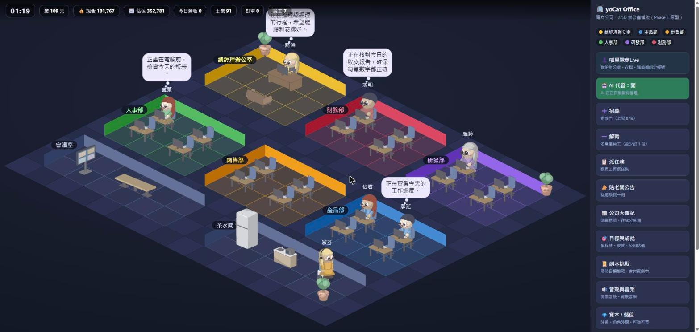
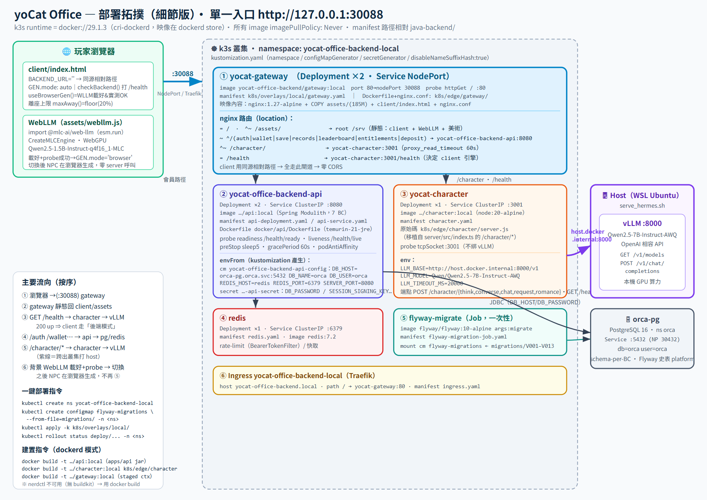

# yoCat Office 喵星電商

一款 2.5D 等角視角的辦公室經營模擬遊戲。你是老闆，公司裡每一個員工都是**由本地 LLM 即時驅動的 AI**——他們有自己的個性、記憶、心情，會發呆講心聲、會跟鄰座同事聊天八卦、會跟你要加薪、會談辦公室戀愛，也會因為太累或不爽而離職。沒有兩個員工是一樣的。

> 這專案的核心賭注很單純：**用「本地跑得動的 LLM」把一堆 NPC 變活**，而不是寫死的對話腳本。所以它同時長在遊戲前端（單檔 HTML5）和一套 k8s 後端上，算力留在本地。



---

## 它長什麼樣子

- **2.5D 等角辦公室**：總經理室、產品 / 銷售 / 人事 / 研發 / 財務五個部門，員工各自在工位上班。
- **活的員工**：每個 NPC 的發呆心聲、鄰座對話、向老闆提案 / 請假 / 抱怨 / 告白，全部是 LLM 當場生成的繁體中文，不是罐頭台詞。
- **你只有四個權力**：招募、解職、派任務、貼公告——其餘的公司自己長出來。
- **經營壓力**：營收、薪資、士氣、估值、破產線。虧錢是漸進的，不是猝死。
- **會員與存檔**：帳號 / 錢包 / 經營記錄存在後端，可跨裝置同步（也能先用訪客試玩）。

---

## 技術架構

整套系統只有**一個對外入口**（`:30088` 的 nginx gateway），底下反向代理到 Java 後端、NPC 大腦服務與本地 LLM。



> 完整可縮放版本：[部署拓撲](docs/diagrams/arch-deployment.svg)、[請求循序](docs/diagrams/arch-sequence.svg)、[建置對照](docs/diagrams/arch-build-deploy.svg)

重點設計：

| 元件 | 做什麼 | 技術 |
|---|---|---|
| **gateway** | 單一入口：靜態 client + 反向代理 | nginx（k8s NodePort 30088） |
| **client** | 遊戲本體 | 單檔 HTML5 + Canvas，零建置 |
| **api** | 會員系統：帳號 / 錢包 / 存檔 / 記錄 | Java 21 · Spring Boot · **Modulith**（7 個 BC、Clean Architecture、schema-per-BC） |
| **character** | NPC 大腦（LLM 代理） | Node（零依賴），轉譯對話請求到 LLM |
| **LLM（雙引擎）** | 生成 NPC 對話 | 後端 **vLLM**（Qwen2.5-7B，品質好）／ 瀏覽器 **WebLLM**（WebGPU，省伺服器算力） |
| 資料庫 / 快取 | 帳號、錢包、rate-limit | PostgreSQL · Redis |

### 雙引擎與「品質閘」

開場先用後端 vLLM（7B，穩）。瀏覽器端的 WebLLM 在背景下載，**載好後不是無腦切換**——會先實測它能不能生出通順的繁體中文（`llmOutputOK()` 品質閘：檢查中文佔比、無亂碼 / 重複 / 特殊 token 洩漏）。過得了才切到瀏覽器引擎（省伺服器算力），過不了就老老實實留在後端。走不走，由 LLM 的實際輸出決定。

---

## 快速開始

### 需要先有

- **Rancher Desktop**（或任何 k3s / k8s，dockerd runtime）
- **一個 OpenAI 相容的 LLM 端點**（本專案用 [vLLM](https://github.com/vllm-project/vllm) 跑 `Qwen/Qwen2.5-7B-Instruct-AWQ`，監聽 `:8000`）
- `kubectl`、`docker`

### 跑起來

```bash
# 1. 建置三個映像（build context = 專案根目錄）
docker build -t yocat-office-backend/gateway:local   -f java-backend/k8s/edge/gateway/Dockerfile   .
docker build -t yocat-office-backend/api:local       -f java-backend/docker/api/Dockerfile          .
docker build -t yocat-office-backend/character:local -f java-backend/k8s/edge/character/Dockerfile  .

# 2. 建 namespace + DB 遷移設定
kubectl create namespace yocat-office-backend-local
kubectl create configmap flyway-migrations --from-file=java-backend/migrations/ -n yocat-office-backend-local

# 3. 部署
kubectl apply -k java-backend/k8s/overlays/local/

# 4. 等就緒後開瀏覽器
#    http://127.0.0.1:30088
```

> 本機 LLM 的啟動方式請見 [`docs/LOCAL_DEPLOY.md`](docs/LOCAL_DEPLOY.md)。
> client 端的 vLLM / WebLLM 切換、品質閘細節在 [`client/index.html`](client/index.html)（搜 `llmOutputOK`、`GEN.mode`）。

---

## 專案結構

```
yocatoffice/
├─ client/           遊戲本體（單檔 HTML5 + Canvas）
├─ assets/           美術 sprites / 動畫 + WebLLM 載入器
├─ java-backend/     會員後端（Spring Modulith）+ k8s 清單
│  ├─ apps/api/            Java 後端原始碼
│  ├─ k8s/edge/gateway/    nginx 單一入口
│  ├─ k8s/edge/character/  NPC 大腦（Node）
│  ├─ k8s/overlays/local/  Kustomize 部署
│  └─ migrations/          Flyway DB 遷移
├─ server/          早期 TypeScript 版 NPC 服務（參考用）
├─ features/        BDD 情境（Gherkin）
└─ docs/            設計文件、架構圖、API、本地部署指南
```

---

## 設計文件

這遊戲的來龍去脈、玩法規格、資料模型、以及（假設性的）商業化思考都在 `docs/`：

- [`企画.md`](企画.md) — 總企畫書（接手這專案的 30 秒摘要就在開頭）
- [`docs/PRD.md`](docs/PRD.md) · [`docs/ARCH.md`](docs/ARCH.md) · [`docs/EDD.md`](docs/EDD.md) · [`docs/API.md`](docs/API.md) · [`docs/SCHEMA.md`](docs/SCHEMA.md)
- [`docs/LOCAL_DEPLOY.md`](docs/LOCAL_DEPLOY.md) — 本地部署逐步指南

> 文件裡的商業化 / 獲利章節是**設計階段的假設性推演**，不代表實際營運方式，留著是為了讓看的人理解整個開發的思考脈絡。

---

## 已知限制

- **付費流程是假的**：目前儲值 / 注資是 demo（點了直接入帳，未接真實金流），用來驗證經濟系統。
- **WebLLM 不是每台機器都能用**：部分 GPU（實測 RTX 5090 / Blackwell 的 WebGPU q4f16）會產生數值異常的亂碼輸出——品質閘會擋下來、維持後端 vLLM，所以不會影響體驗，但那些機器就享受不到「瀏覽器省算力」。
- **小模型品質有上限**：NPC 對話品質直接取決於你接的 LLM；7B 以上繁中體驗明顯較好。

---

## 授權

目前未指定授權條款（All rights reserved）。如需使用請先聯絡。
