# ARCH — 架構設計文件（Architecture Design）

> 全文 zh-TW。本文件回答「系統如何被部署、擴展、保持高可用與安全」；技術選型、模組邊界與 HA 規格以上游 **EDD** 為唯一真實來源（SSoT），如有差異以 EDD 為準並標記 `[UPSTREAM_CONFLICT]`。本文件無任何裸 placeholder，所有圖表均為 Mermaid（嚴禁 ASCII art）。

---

## Document Control

| 欄位 | 內容 |
|------|------|
| **DOC-ID** | ARCH-YOCAT-OFFICE-BACKEND-20261030 |
| **專案名稱** | yoCat Office 後端信任層（yocat-office-backend） |
| **文件版本** | v1.0 |
| **狀態** | IN_REVIEW |
| **作者（Tech Lead / Architect）** | 資深 System Architect（gendoc gen ARCH） |
| **日期** | 2026-10-30 |
| **上游 EDD** | [EDD.md](EDD.md) |
| **上游 PDD** | 本專案 client_type=api-only，無 PDD（靜默跳過） |
| **上游 PRD** | [PRD.md](PRD.md) |
| **上游 CONSTANTS** | [CONSTANTS.md](CONSTANTS.md)、[constants.json](constants.json) |
| **審閱者** | 資深 Solutions Architect、資深 Backend Engineer、資深 DevOps/SRE Expert |
| **核准者** | Tech Lead + Architect |

---

## Change Log

| 版本 | 日期 | 作者 | 變更摘要 |
|------|------|------|---------|
| v1.0 | 2026-10-30 | gendoc gen ARCH | 初稿：依 EDD §2–§13 生成完整架構設計；Spring Modulith 模組化單體（7 BC）、Clean Architecture 4 層、Day1 HA（≥2 replicas / HPA 2–8 / PDB / Patroni / Redis Sentinel）、單體 HA ↔ 獨立微服務雙拓撲、local-first（Rancher Desktop k8s namespace `yocat-office-backend-local`） |

---

## 目錄

1. 架構目標（1.1 品質屬性需求 / 1.2 ADR 索引）
2. 架構模式選擇
3. 系統元件圖（3.1 C4 L1 / 3.2 C4 L2 / 3.3 C4 L3 / 3.4 Data Flow）
4. 服務邊界（4.0 API-BC-Schema 映射表）
5. 通訊模式（5.1 同步/非同步矩陣 / 5.2 API Gateway / 5.3 Event-Driven）
6. 資料分層
7. 高可用設計（7.1 Shared State Isolation）
8. 災難恢復（DR）
9. 安全架構（9.1 縱深防禦 / 9.2 Zero-Trust / 9.3 Secret 輪換 / 9.4 Network / 9.5 Compliance）
10. 擴展策略（10.2 Scalability Ceiling Analysis）
11. 技術棧全覽
12. Observability 架構
13. 外部依賴地圖
14. Architecture Decision Records（完整）
15. 架構審查檢查清單
16. Cost Optimization & FinOps Architecture
17. API Gateway & Service Mesh Architecture
18. Admin Portal 架構（條件章節）

---

## 1. 架構目標

### 1.1 品質屬性需求（Quality Attribute Requirements）

> 數值繼承 EDD §3.6.3 / §10.5 與 PRD §7；以 500 PCU 啟動期量級為基準，成長期 3,000 PCU。

| 屬性 | 目標值 | 測量方式 | 優先級 |
|------|--------|---------|--------|
| 可用性（Availability） | ≥ 99.9%（月停機 ≤ 43.8 分鐘） | SLO Dashboard（成功/總請求，30 天滾動） | P0 |
| 延遲（Latency） | P99 ≤ 1000ms @ 500 PCU（成長期 ≤ 1500ms @ 3000 PCU） | `http_server_requests` histogram（Prometheus） | P0 |
| 吞吐量（Throughput） | 寫入 ≥ 200 txn/s；峰值 ~35 req/s（啟動期） | k6 壓測（§13.6 CI 閘門） | P0 |
| 可擴展性（Scalability） | 水平擴展至 8 副本（HPA min=2 max=8，CPU 70%） | HPA 觸發測試（§10） | P1 |
| 可維護性（Maintainability） | 7 BC 模組邊界以 ModularityTests 建置期驗證 | ArchUnit + Spring Modulith `verify()` | P1 |
| 安全性（Security） | Server-Authoritative、BOLA 防護、TLS 1.3、scrypt | SAST（OWASP Dependency-Check）、滲透測試 | P0 |
| 可觀測性（Observability） | Trace 採樣 Prod 10%（錯誤 100%）、對帳不一致恆 0 | Tempo 採樣率、`wallet_ledger_mismatch_total` | P1 |
| 一致性（錢包） | 併發扣款 0 筆不一致、RPO=0（同步複本 WAL） | `SELECT FOR UPDATE` + 對帳稽核（§7） | P0 |

**約束條件（Constraints）：**

- 預算上限：啟動期 Prod 相對成本 4x 基準（EDD §11.2），具體月費見 §16；算力留本地（遊戲模擬在玩家端），後端僅承載信任層低頻請求。
- 法規遵循：個人資料保護法（台灣）、GDPR（若有 EU 用戶）；PII 限 email、display_name（PRD §11.5）；無支付卡資料（Phase A 假付費，無 PCI 範圍）。
- 既有系統整合：既有 Node/TS 原型（`accounts.ts` + PostgreSQL 8 表）重構為 Spring Boot 3.3；現有 `docs/req/postgres.yaml`（namespace `yocat`，單節點，NodePort 30432）為本機原型，正式重構為 schema-per-BC + HA。
- 團隊技術棧偏好：Java 21 + Spring Boot 3.3 + Spring Modulith 1.3（lang_stack 已鎖定）；客戶端引擎 N/A。

---

### 1.2 Architecture Decision Record（ADR）索引

以下為本專案重大架構決策追蹤索引，詳細內容見 §14。索引與 EDD §3.2 ADR 對齊。

| ADR-ID | 決策標題 | 狀態 | 決策日期 | 影響範圍 |
|--------|---------|------|---------|---------|
| ADR-001 | 模組化單體（Spring Modulith）vs Day1 微服務 | Accepted | 2026-10-30 | 全系統、部署拓撲 |
| ADR-002 | 錢包一致性：PostgreSQL 交易 + `SELECT FOR UPDATE` vs 樂觀鎖 | Accepted | 2026-10-30 | wallet BC、資料層 |
| ADR-003 | 認證：Opaque Session Token（Redis+DB）vs JWT | Accepted | 2026-10-30 | member BC、網路入口 |
| ADR-004 | 事件匯流排：Spring Modulith Event Registry（JDBC Outbox）vs Kafka | Accepted | 2026-10-30 | 非同步通訊、模組解耦 |
| ADR-005 | 容器編排：Kubernetes（Local=Rancher Desktop）+ ArgoCD GitOps | Accepted | 2026-10-30 | 部署層、CD |

> 新決策須先建立 ADR 草稿、完成 RFC 討論，再更新此索引並於 §14 補完整條目。

---

## 2. 架構模式選擇

**選用架構：** 模組化單體（Modular Monolith，Spring Modulith）+ Clean Architecture（Hexagonal 四層）+ Event-Driven（模組間，Transactional Outbox）。

**選擇理由（與 EDD §3.1 一致）：**

- 啟動期 5,000 DAU / 500 PCU 量級，信任層請求頻率低（登入/儲值/存檔/上榜，非每幀），單一可部署單元足以承載，微服務的分散式交易與運維成本不划算。
- 7 個有界上下文邊界清晰，以 Spring Modulith `@ApplicationModule` 強制邊界（HC-1~HC-5），建置期機械化驗證，保留「隨時零改模型拆分為獨立微服務」的選項（Day1 可分可合）。
- 錢包強一致需求（併發扣款 0 筆不一致）在單一 PostgreSQL 交易 + 行鎖內最簡單可靠；事件驅動以 Outbox 同交易保證「至少一次」可靠投遞，模組間解耦。

**未選擇的替代方案：**

| 方案 | 排除理由 |
|------|---------|
| 純單體（無模組邊界） | 無法機械化驗證 BC 隔離，日後拆分成本高、易架構腐化 |
| Day1 微服務 | 分散式錢包一致性複雜、運維重、啟動期量級不需要；跨服務交易需 Saga 補償，風險高 |
| Serverless（FaaS） | 需長連線行鎖交易與 Outbox 排程，冷啟動與交易邊界不適合；與 local-first（Rancher Desktop）目標衝突 |

**Clean Architecture 四層對應部署/模組邊界：**

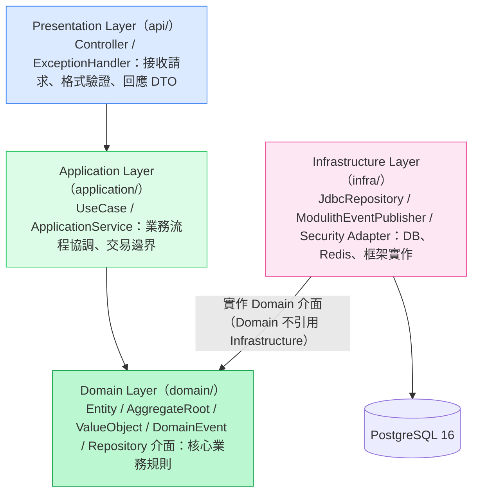

- **部署對應**：四層同處一個可部署單元 `yocat-office-backend-api`（Spring Boot 3.3，Port 8080）；每個 BC 目錄 = 一個 `@ApplicationModule`，內部再分四層。拆分為微服務時，Domain/Application 零改，只替換 Infrastructure 的傳輸層（本地事件 → 外部 broker）。
- **禁止（硬約束，ArchUnit + Modulith 於 CI 驗證）**：Domain 層不得 `import` 任何 JDBC / HTTP / Spring / 外部 SDK；Application 不得 `new` Infrastructure 具體類別（一律建構子注入 Interface）；跨 BC 僅透過 `*/api` 的 `@NamedInterface` 或 Domain Event。

### §2.1 介面定義規範（Interface 定義規範，lang_stack=Java 21）

每個 Service 與 Repository 必須先定義介面（置於 Domain 或 Application 層），由 Infrastructure 實作、Spring DI 注入（DIP）。對齊 EDD §3.1b DIP 宣告與 §4.1/§4.2 介面。

**Service 介面範例（對應 EDD §4.1 wallet）：**

```java
// 置於 wallet.domain / wallet.api（Public NamedInterface）
public interface WalletService {
    WalletView topUp(AccountId accountId, Currency currency, long amount, String reason, Map<String,Object> meta);
    WalletView debit(AccountId accountId, Currency currency, long amount, String reason, Map<String,Object> meta); // 餘額不足擲 InsufficientBalanceException → 402
    WalletView findWallet(AccountId accountId);
}
```

**Repository 介面範例（Domain 層，對應 EDD §4.5.2）：**

```java
// 置於 wallet.domain；由 wallet.infra.JdbcWalletRepository 實作（SELECT FOR UPDATE）
public interface WalletRepository {
    long selectBalanceForUpdate(AccountId id, Currency currency); // 悲觀行鎖
    void updateBalance(AccountId id, Currency currency, long newBalance);
    void appendLedger(LedgerEntry entry);                          // append-only 審計
    Wallet findByAccount(AccountId id);
}
```

> EDD §3.1b DIP 宣告的具體介面名稱（`WalletRepository`、`DomainEventPublisher`、`MemberRepository`）均於本文件 §3 元件清單有對應元件；讀寫分離（ISP）：`WalletReadRepository` / `WalletWriteRepository`、`LedgerAppender` 見 EDD §3.1b。

### §2.2 元件命名規則

| 類型 | 命名約定 | 範例 |
|------|---------|------|
| Base package | `com.sayyogames.yocat`（SSoT，EDD §3.3.x） | `com.sayyogames.yocat.wallet` |
| BC 模組 | `com.sayyogames.yocat.<bc>`（小寫，7 BC） | `member` / `wallet` / `deposit` / `entitlement` / `record` / `leaderboard` / `gamesave` |
| Controller | `<Domain>Controller`（Presentation） | `AuthController` / `WalletController` |
| UseCase | `<Verb><Domain>UseCase`（Application） | `SpendWalletUseCase` / `RegisterMemberUseCase` |
| Service 介面 | `<Domain>Service` | `WalletService` / `MemberService` |
| Repository 介面 | `<Domain>Repository`（Domain） | `WalletRepository` / `MemberRepository` |
| Repository 實作 | `Jdbc<Domain>Repository`（Infrastructure） | `JdbcWalletRepository` |
| Domain Event | `<PastTenseEvent>`（Publisher BC 的 `domain.event`） | `MemberRegistered` / `WalletBalanceChanged` |
| DB schema | BC 短名（schema-per-BC，HC-1） | `member` / `wallet` / `game_save` |

---

## 3. 系統元件圖

### 3.1 C4 Model — System Context（L1）

> Actor 名稱來自 PRD §3.2；對齊 EDD §2.1。所有圖表為 Mermaid（TD 方向），真實服務名稱。

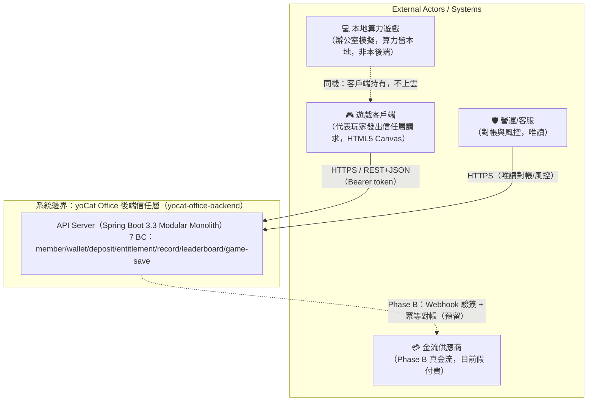

- 本地算力遊戲為客戶端本地模擬，**不屬本後端**；信任層僅透過 `wallet_ledger.reason`（如 `rescue`）感知其結果。
- 外部系統 Phase A 僅「金流供應商（假付費）」為虛線預留；無第三方 Auth/Email/Storage/CDN（api-only、無靜態資源）。

---

### 3.2 C4 Model — Container（L2）

> **BC Topology 對照（強制）**：本系統為模組化單體，7 BC 是單一可部署單元 `yocat-office-backend-api` 內的 7 個 Spring Modulith 模組，而非 7 個獨立 Container（對齊 EDD §2.2 IC-01）。§7 要求 ≥2 replicas 的部署單元即此單一 API 應用。Port 與 EDD §3.5 服務 Port 對照表一致（API 8080 / PG 5432 / Redis 6379）。未來任一 BC 可零改模型拆為獨立 Container（見 §3.2.1）。

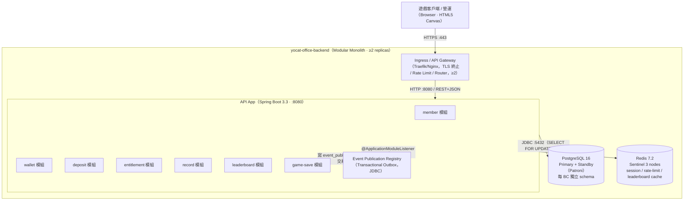

- 每個容器節點標注技術棧 + 埠號；技術棧與 §11 / EDD §3.3 一致。
- Outbox 與業務寫入同一 PostgreSQL 交易，保證事件「至少一次」可靠投遞；啟動期不引入外部 broker。

#### §3.2.1 「可分可合」兩種部署拓撲（Spring Modulith，切換不需改碼）

> gendoc 原則落實：同一套 Domain/Application 程式碼，透過組態切換 **單體 HA（最小成本）↔ 獨立微服務（最大擴展）**。in-process event（`@ApplicationModuleListener`）與 message broker 之間切換只換 Infrastructure 傳輸層與打包方式，Domain 模型零改（EDD §3.2 ADR-001 後果）。

**拓撲 A — 單體 HA（啟動期採用，最小運維成本）：**

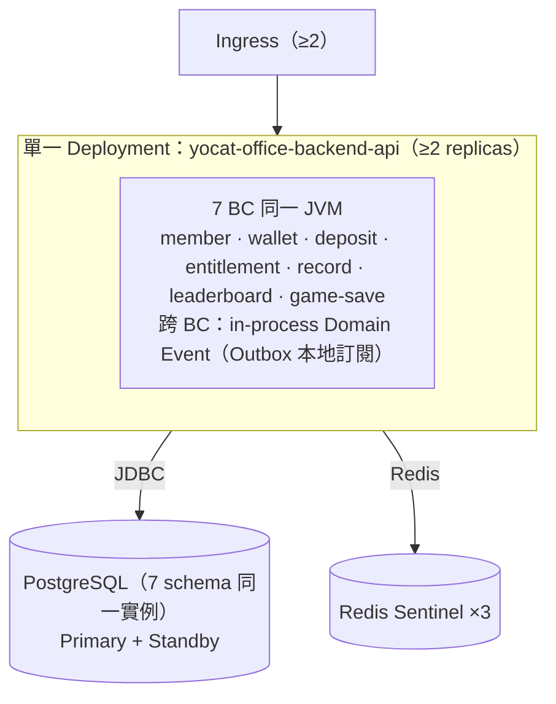

**拓撲 B — 獨立微服務（成長期可選，最大擴展）：**

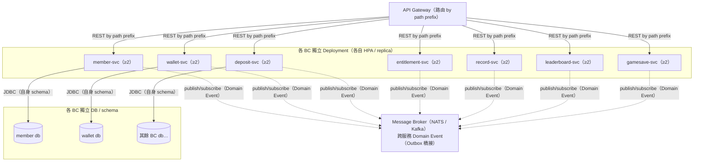

**切換不需改碼的機制：**

| 面向 | 拓撲 A（單體 HA） | 拓撲 B（微服務） | 是否改 Domain 碼 |
|------|------------------|------------------|-----------------|
| 跨 BC 呼叫 | `@NamedInterface` 同 JVM 直呼 | REST / gRPC（Gateway 路由） | 否（介面不變） |
| 跨 BC 事件 | in-process `@ApplicationModuleListener` | Outbox 橋接至 NATS/Kafka | 否（Event class 不變） |
| 交易邊界 | 單 DB 交易原子（entitlement→wallet debit） | Saga / 最終一致性 | 僅 entitlement 購買流程需改編排層 |
| 部署單元 | 1 個 Deployment | 7 個 Deployment | 否（打包組態） |
| 成本 | 最小（1 套 DB/Redis/Pod 群） | 最大（各 BC 獨立資源） | — |

> 唯一需注意：entitlement 購買於拓撲 A 以「同交易呼叫 `WalletService.debit()`」保證原子；拆為微服務後此跨服務扣款須改為 Saga（預授權→扣款→授予，失敗補償），屬 Application 編排層變更，Domain 不變（EDD §3.4）。

---

### 3.3 C4 Model — Component（L3）

以核心 **wallet 模組** 為例，展示 Clean Architecture 四層內部元件分解（對齊 EDD §4.1 / §4.5.2）。依賴方向 Controller → UseCase → Domain，Infrastructure 實作 Domain 介面。

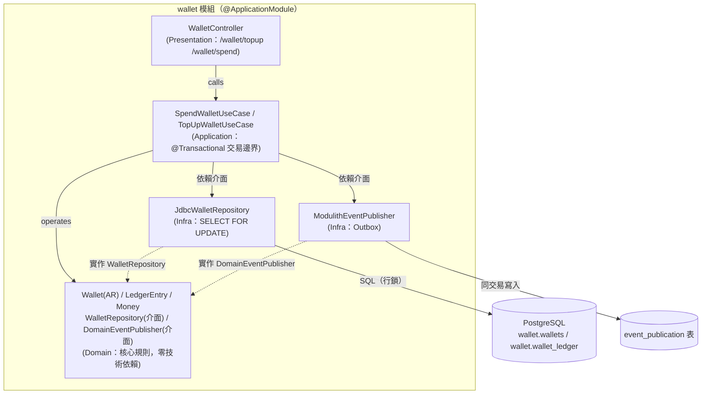

**元件清單（Module / Package / Service）：**

| 元件 | 層次 | 職責 | 對應 PRD 功能 |
|------|------|------|-------------|
| `member.api.AuthController` | Controller | 註冊/登入/登出/我的資料，格式驗證 | US-MEM-001（P0） |
| `member.application.MemberService` | Service | scrypt 驗證、session 簽發/撤銷 | US-MEM-001 |
| `member.infra.JdbcMemberRepository` / `SessionStore` | Infrastructure | accounts/sessions 存取、Redis session 快取 | — |
| `wallet.api.WalletController` | Controller | topup / spend 入口 | US-WAL-001（P0） |
| `wallet.application.SpendWalletUseCase` | Service | 行鎖扣款、append ledger、發事件 | US-WAL-001 AC-2/5 |
| `wallet.infra.JdbcWalletRepository` | Infrastructure | `SELECT FOR UPDATE` 行鎖、ledger 寫入 | — |
| `deposit.application.DepositService` | Service | pack 解析、假付費入帳、Phase B 金流預留 | US-WAL-001 AC-1 |
| `entitlement.application.BuyEntitlementUseCase` | Service | 原子扣款+授予、防重複 | US-ENT-001（P0） |
| `record.application.RecordService` | Service | 經營史（破產/成就/傳承）寫入與查詢 | US（record） |
| `leaderboard.application.LeaderboardService` | Service | 上榜 upsert（by run_id）、Top N 查詢 | US（leaderboard） |
| `gamesave.application.SaveService` | Service | 跨裝置存檔 upsert / 還原（by slot） | US-SAVE-001（P0） |
| `platform.SecurityConfig` / `RateLimitFilter` | Infrastructure（底座） | Bearer token filter、RBAC、Redis 滑動視窗限流 | US-MEM-001 AC-6 |
| `platform.OutboxConfig` | Infrastructure（底座） | Event Publication Registry（JDBC Outbox）排程投遞 | US-PLAT-001 AC-4 |

**Domain 模型（純業務語意，不含 ORM annotation；對齊 EDD §4.5.2 / SCHEMA 表名）：**

```markdown
#### Account（member BC，AggregateRoot）
- id: AccountId（VO，long）
- email: Email（VO，全域唯一，不可變）
- displayName: DisplayName（VO，1–24 字）
- passwordHash: String（scrypt salt$hash）

#### Wallet（wallet BC，AggregateRoot）
- accountId: AccountId
- cash: Money（CHECK ≥ 0）
- gems: Money（CHECK ≥ 0）

#### LedgerEntry（wallet BC，Entity，append-only）
- currency: Currency（CASH / GEMS）
- delta: long（±異動量）
- reason: LedgerReason（INIT / TOPUP / BUY_COSMETIC / BUY_DREAM / BUY_SCENARIO / RESCUE）
- balance: long（異動後餘額）

#### Entitlement（entitlement BC，AR）／ BusinessRecord（record BC，AR）
#### RunScore（leaderboard BC，AR，by run_id）／ OfficeSave（game-save BC，AR，by slot）
#### Session（member BC，Entity：token / accountId / expiresAt）
```

> **跨文件命名一致性**：以上 Entity/AR 名稱與 EDD §4.5.2 Class Diagram 及 SCHEMA 的 table 名稱一一對應（`Account`↔`member.accounts`、`Wallet`↔`wallet.wallets`、`LedgerEntry`↔`wallet.wallet_ledger`、`OfficeSave`↔`game_save.saves`、`RunScore`↔`leaderboard.leaderboard`）。

**分層依賴方向（含禁止規則，對齊 EDD §3.1b）：**

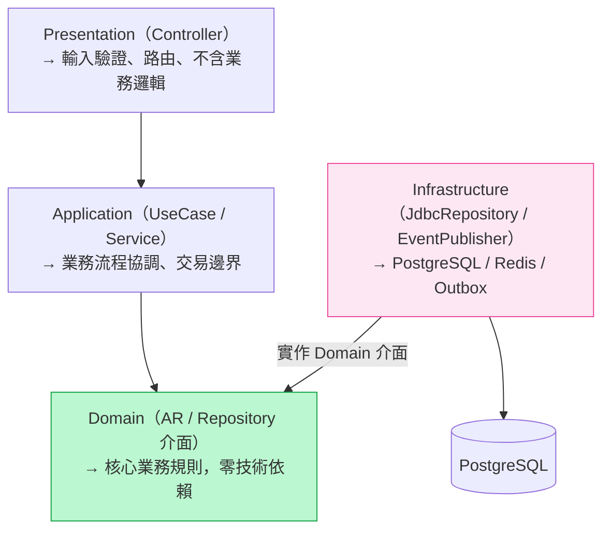

禁止：Domain 引用 Infrastructure（ArchUnit 驗證）；禁止：Controller 直接存取 DB；禁止：跨 BC 直接呼叫他 BC Repository。

---

### 3.4 Data Flow Diagram（資料流向圖）

#### 請求資料流（Write Path）— 購買權益（原子扣款 + 授予，對齊 EDD §4.5.4 / §7.1）

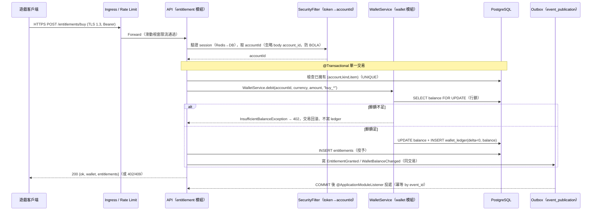

#### 敏感資料流動圖（Sensitive Data Map / PII，對齊 EDD §9.4 / PRD §11.5）

| PII 資料類型 | 流經元件 | 儲存位置 | Masking 規則 |
|------------|---------|---------|------------|
| email（登入識別） | 客戶端 → API（member） → DB | `member.accounts.email`（PostgreSQL，TLS 1.3 in-transit、磁碟加密 at-rest） | Log 遮罩為 `a***@e***`；不記入 trace tag |
| display_name | 客戶端 → API（member/leaderboard） → DB | `member.accounts.display_name`（排行榜公開顯示） | 排行榜公開顯示（業務同意）；Log 不額外遮罩 |
| password（明文） | 客戶端 → API（member） | 不儲存（scrypt 單向雜湊後丟棄明文） | 絕不記錄 password / pass_hash / token 明文 |
| session token | 客戶端 → SecurityFilter → Redis/DB | `member.sessions.token` + Redis `member:session:{token}` | Log 遮罩前 4 + 後 2 字元；可即時撤銷 |

> PII 欄位於寫入 Log 前自動 Mask（Logback JSON encoder + PII masker）；稽核日誌記錄 OPS 查詢 PII 事件（EDD §10.6）。

---

## 4. 服務邊界

> Context Map 對齊 EDD §3.4；每個 BC 獨佔 schema（HC-1），跨 BC 僅透過 Public API 或 Domain Event。

| 服務 / 模組 | 職責 | 邊界說明 | 擁有資料（Schema: Tables） | 對外 API |
|------------|------|---------|--------------------------|---------|
| Ingress / API Gateway | 請求路由、TLS 終止、Rate Limit、健康檢查路由 | 不含業務邏輯（stateless） | 無 | — |
| member | 註冊/登入/登出/我的資料、scrypt + opaque session，身分權威 | 只處理身分與會話，不含錢包邏輯 | `member`: `accounts`, `sessions` | REST `/auth/*`；`MemberService.verifySession()`；Event `MemberRegistered`/`MemberDeleted` |
| wallet | 伺服器權威錢包加值/扣款、append-only 審計帳本 | 只處理 cash/gems 與 ledger，不授予權益 | `wallet`: `wallets`, `wallet_ledger` | REST `/wallet/*`；`WalletService.debit()/credit()`；Event `WalletBalanceChanged` |
| deposit | 儲值包目錄解析、假付費入帳、Phase B 金流預留 | 只解析 pack 並觸發入帳，不持錢包餘額 | `deposit`: `deposit_pack`（`deposit_order` Phase B） | REST `/wallet/topup`（pack 解析）；Event `DepositConfirmed` |
| entitlement | 購買權益（原子扣款+授予）、列出權益 | 只管權益擁有關係，扣款委派 wallet | `entitlement`: `entitlements` | REST `/entitlements/*`；Event `EntitlementGranted` |
| record | 經營史（破產/成就/傳承）記錄與查詢 | 只存經營事件，不影響錢包/權益 | `record`: `records` | REST `/records/*`；Event `BusinessRecordAdded` |
| leaderboard | 上榜 upsert（by run_id）、公開 Top N | 只管榜單，顯示名取自 member（Conformist） | `leaderboard`: `leaderboard` | REST `/leaderboard`（公開 Top N + 上榜）；Event `RunScoreSubmitted` |
| game-save | 跨裝置存檔 upsert（by slot）/ 還原 | 只存辦公室存檔 blob，不解讀內容 | `game_save`: `saves` | REST `/save`（GET/PUT） |

**跨 BC 依賴圖（DAG 驗證，HC-5，對齊 EDD §4.3）：**

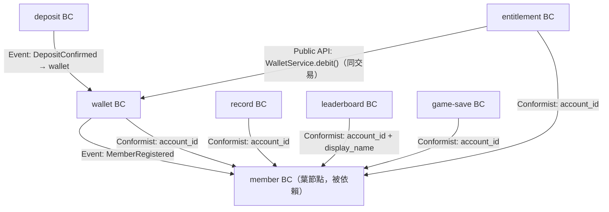

| DAG 驗證項目 | 結果 | 說明 |
|-------------|------|------|
| 是否存在循環依賴 | NO | 無任何 A→…→A 路徑 |
| 依賴圖為 DAG | CONFIRMED | member 為葉節點，無反向邊；由 `ApplicationModules.verify()` 於 CI 阻斷循環 |
| 最長依賴鏈 | 3 層 | entitlement → wallet → member |

**邊界原則（Spring Modulith HC-1 / HC-2）：**

- 每個 BC 擁有且只擁有自己的 DB schema；**無兩個 BC 宣告擁有同一張 table**。
- **禁止跨 BC 直接存取他 BC 的 DB table / JOIN**；所有跨 BC 資料存取必須透過 Public `@NamedInterface` 或 Domain Event（HC-1/HC-2）。
- **移除原型跨 BC DB-level FK**：原 `schema.sql` 中各表 FK 參照 `accounts(id)`，重構後各 BC 以 `account_id BIGINT`（application-layer ID，無跨 schema FK）參照；帳號刪除以 `MemberDeleted` 事件驅動各 BC 匿名化/級聯清理（EDD §3.4 / §6.3）。
- Anti-Corruption Layer：Phase B 金流供應商整合時，deposit BC 以 ACL（Webhook 驗簽 + 冪等對帳）翻譯外部支付模型為內部 `DepositConfirmed` 事件，隔離外部契約變動。

### §4.0 API-BC-Schema 映射表（API Endpoint → Bounded Context → Owned Tables）

> 每列對應一個 Endpoint（EDD §5.2，共 16 個，含 2 健康檢查），可追溯至 Owning BC 及該 BC 擁有的 DB Tables。`Owning Bounded Context` 名稱與 §4 服務邊界表「服務/模組」欄一致。

| API Endpoint（Method + Path） | Owning Bounded Context | Owned DB Tables |
|-------------------------------|------------------------|-----------------|
| `GET /health/live` | 平台底座 | 無直接對外 API（基礎設施健康檢查） |
| `GET /health/ready` | 平台底座 | 無（檢查 `member`/`wallet` 所用 DB + Redis 連線） |
| `POST /auth/register` | member | `member`: `accounts`, `sessions`（並觸發 `MemberRegistered` → wallet） |
| `POST /auth/login` | member | `member`: `accounts`, `sessions` |
| `POST /auth/logout` | member | `member`: `sessions` |
| `GET /auth/me` | member | `member`: `accounts`（彙整 wallet+entitlements 經 Public API） |
| `POST /wallet/topup` | deposit → wallet | `deposit`: `deposit_pack`；`wallet`: `wallets`, `wallet_ledger` |
| `POST /wallet/spend` | wallet | `wallet`: `wallets`, `wallet_ledger` |
| `GET /entitlements` | entitlement | `entitlement`: `entitlements` |
| `POST /entitlements/buy` | entitlement → wallet | `entitlement`: `entitlements`；`wallet`: `wallets`, `wallet_ledger`（同交易 debit） |
| `GET /save` | game-save | `game_save`: `saves` |
| `PUT /save` | game-save | `game_save`: `saves` |
| `POST /records` | record | `record`: `records` |
| `GET /records` | record | `record`: `records` |
| `GET /leaderboard` | leaderboard | `leaderboard`: `leaderboard` |
| `POST /leaderboard` | leaderboard | `leaderboard`: `leaderboard` |

> 驗證：每個 Endpoint 對應一列（無孤立端點）；7 個 BC 均 ≥1 列；跨 BC 寫入（topup/buy）以「→」標示委派方向，實際落庫 table 明列。

---

## 5. 通訊模式

### 5.1 同步 / 非同步通訊矩陣

| 通訊方（From → To） | 方式 | 協定 | 逾時 | 重試策略 | 備注 |
|--------------------|------|------|------|---------|------|
| 客戶端 → Ingress | 同步 | HTTPS REST+JSON | 30s | 客戶端 3 次指數退避 | Bearer token；非冪等寫入不自動重試 |
| Ingress → API | 同步 | HTTP/1.1 :8080 | 10s | 無（同叢集） | 通過滑動視窗限流 |
| entitlement → wallet（同 BC 群，拓撲 A） | 同步 | `@NamedInterface` in-process | 同交易 | 無（交易原子） | 購買原子扣款（EDD §3.4） |
| member → wallet（建錢包） | 非同步 | Domain Event（Outbox） | N/A | at-least-once + 冪等 | `MemberRegistered` |
| deposit → wallet（入帳） | 非同步 | Domain Event（Outbox） | N/A | at-least-once（orderId dedup） | `DepositConfirmed` |
| API → PostgreSQL | 同步 | JDBC :5432 | 60s（查詢）；交易視業務 | 連線池重取；寫入不盲重試 | `SELECT FOR UPDATE` 行鎖 |
| API → Redis | 同步 | Redis Protocol :6379 | 1s | miss 回源 DB（降級，非 500） | session/limit/leaderboard cache |

**資料一致性策略（對齊 EDD §8 / §6）：**

| 場景 | 一致性模型 | 實作方式 |
|------|-----------|---------|
| 錢包扣款/加值、購買權益 | 強一致（Strong，ACID） | 單 DB 交易 + `SELECT FOR UPDATE` 行鎖 + 同交易寫 ledger |
| 跨 BC 事件（建錢包、入帳） | 最終一致（Eventual） | Transactional Outbox（同交易寫 event_publication）+ 冪等消費（event_id dedup） |
| 排行榜 Top N、session | 最終一致（快取） | Redis cache（TTL 30s / 1800s）+ miss 回源 DB |
| 拆微服務後跨服務扣款 | 最終一致 + 補償 | Saga（預授權→扣款→授予，失敗補償；見 §3.2.1） |

---

### 5.2 Service Mesh / API Gateway

**選用方案：** Ingress Controller（Local=Traefik/Nginx，Prod=Cloud LB + Ingress）作為 API Gateway；啟動期不引入 Service Mesh（單體內模組直呼，mTLS 於拆微服務時再導入 Linkerd/Istio）。

**請求路由規則（by path prefix，對齊 EDD §5.2）：**

```yaml
# Ingress 路由（示意，Traefik/Nginx 風格）
routes:
  - path: /auth/        # member BC（register/login 公開，其餘需 token）
    upstream: yocat-office-backend-api:8080
    plugins: [rate-limit, request-id]
  - path: /wallet/      # wallet/deposit BC（需 token）
    upstream: yocat-office-backend-api:8080
    plugins: [bearer-auth, rate-limit, request-id, audit-log]
  - path: /entitlements/
    upstream: yocat-office-backend-api:8080
    plugins: [bearer-auth, rate-limit, request-id]
  - path: /leaderboard  # GET 公開 / POST 需 token
    upstream: yocat-office-backend-api:8080
    plugins: [rate-limit, request-id]
```

**責任邊界（認證 / 限流 / 路由 / TLS 各在哪層）：**

| 職責 | 處理位置 | 說明 |
|------|---------|------|
| TLS termination | Ingress（:443 → :8080） | 憑證 cert-manager 自動輪換 |
| Rate Limiting | API 內 `RateLimitFilter`（Redis 滑動視窗 Lua，原子） | 細粒度 by IP/account（EDD §11.3C），非 Gateway 粗限流 |
| 認證（Bearer→accountId） | API 內 `SecurityConfig` filter chain | token→account_id，不信任 body（BOLA 防護） |
| 授權（RBAC USER/OPS） | API 內 middleware | 每端點明確授權（EDD §9.1） |
| 路由 | Ingress（by path prefix） | 單體內由 Spring MVC 分派至各 BC Controller |

**Rate Limit 配置（Redis 滑動視窗，EDD §11.3C）：**

| 端點 | 鍵模板 | window | limit | 超限 |
|------|-------|--------|-------|------|
| POST /auth/login | `rate:login:{ip}` | 60s | 10 | 429 + Retry-After |
| POST /auth/register | `rate:register:{ip}` | 60s | 5 | 429 |
| POST /wallet/topup,spend | `rate:wallet:{account}` | 60s | 60 | 429 |
| POST /entitlements/buy | `rate:buy:{account}` | 60s | 30 | 429 |
| GET /leaderboard | `rate:lb:{ip}` | 60s | 120 | 429 |

**Circuit Breaker 狀態機（Resilience4j，對齊 EDD §3.6.2 / §8.3）：**

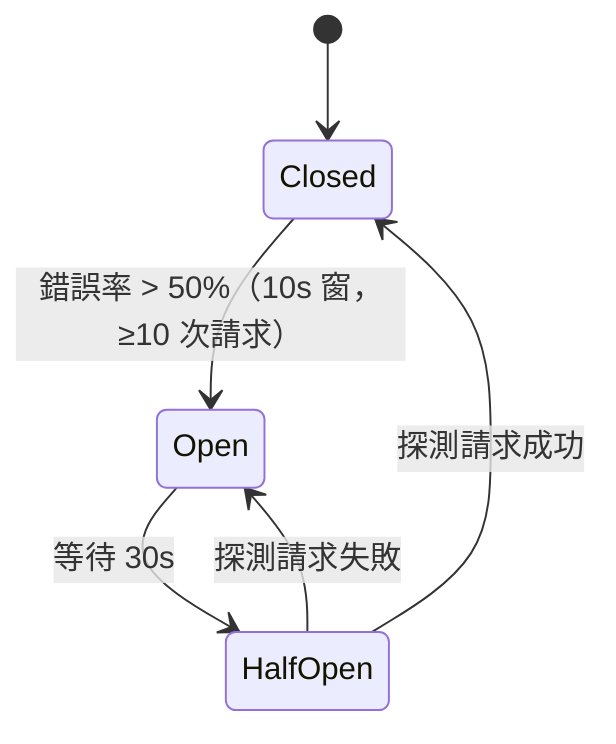

- 錯誤閾值：50%（10 秒窗，最少 10 次請求）；Open 持續 30 秒；Half-Open 探測 5 次。
- **DB 關鍵路徑（錢包交易）不熔斷**（寧可失敗回滾，不丟一致性）；Redis / 非關鍵依賴熔斷降級（cache miss 回源，非 500）。

---

### 5.3 Event-Driven Communication

**選用 Event Bus：** Spring Modulith Event Publication Registry（JDBC Outbox，`spring.modulith.events.jdbc.enabled=true`）；拓撲 A 走 in-process `@ApplicationModuleListener`，拆微服務時 Outbox 橋接至 NATS/Kafka（程式碼不變）。

**事件定義表（§5.3 Event-Driven，HC-3，對齊 EDD §4.6.1）：**

| 事件名稱 | Schema 版本 | Publisher BC | Consumer BC(s) | Payload 主要欄位 | topic_name | 冪等 |
|---------|------------|-------------|---------------|-----------------|-----------|------|
| `MemberRegistered` | v1 | member | wallet | `{accountId, email, occurredAt}` | `member.account.registered` | event_id dedup |
| `MemberDeleted` | v1 | member | wallet, entitlement, record, leaderboard, game-save | `{accountId, deletedAt}` | `member.account.deleted` | event_id dedup |
| `WalletBalanceChanged` | v1 | wallet | record（BC-internal 稽核） | `{accountId, currency, delta, balance, reason, occurredAt}` | `wallet.balance.changed` | event_id dedup |
| `DepositConfirmed` | v1 | deposit | wallet | `{accountId, orderId, currency, amount, occurredAt}` | `deposit.order.confirmed` | orderId dedup |
| `EntitlementGranted` | v1 | entitlement | （BC-internal，不跨 BC 消費） | `{accountId, kind, itemId, occurredAt}` | `entitlement.item.granted` | event_id dedup |
| `BusinessRecordAdded` | v1 | record | （BC-internal） | `{accountId, type, occurredAt}` | `record.history.added` | event_id dedup |
| `RunScoreSubmitted` | v1 | leaderboard | （BC-internal，觸發 cache 失效） | `{runId, accountId, mode, score, occurredAt}` | `leaderboard.run.submitted` | runId dedup |

**事件結構（Event Envelope）：**

```json
{
  "event_id": "uuid",
  "event_type": "wallet.balance.changed",
  "event_schema_version": "v1",
  "produced_at": "ISO8601 UTC",
  "producer": "wallet",
  "correlation_id": "W3C traceparent",
  "payload": { "accountId": 1001, "currency": "cash", "delta": -1250, "balance": 18750, "reason": "buy_cosmetic" }
}
```

**可靠投遞（Transactional Outbox）：**

- 事件與業務寫入**同一 PostgreSQL 交易**寫入 `event_publication` 表 → COMMIT 後由 `@Scheduled` 投遞（`SELECT FOR UPDATE SKIP LOCKED` 防多副本重複消費）→ 完成標記。
- 消費端冪等：by `event_id`（或業務鍵 orderId/runId）去重，重複投遞不產生副作用。
- 監控：Outbox pending count > 100（5 分鐘）→ P2 告警（EDD §10.4）。

---

## 6. 資料分層

> 所有圖表為 Mermaid（取代 template 示意 ASCII）。本系統 schema-per-BC，同一 PostgreSQL 實例內 7 個 schema。

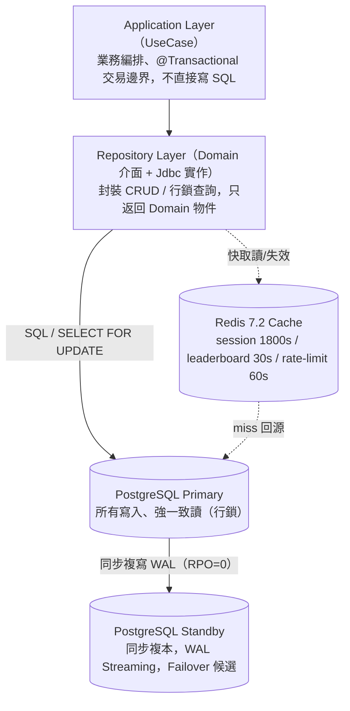

> 啟動期不設讀寫分離（量級小、強一致優先）；成長期可加 Read Replica 分流榜單/查詢（§10.2 Phase 2）。搜尋索引（Elasticsearch 等）非本系統範圍（無全文搜尋需求）。

**分層錯誤轉換策略（對齊 EDD §8.1）：**

1. Repository 層 → 回傳 Domain Error（`NotFoundError`、`DatabaseError`）。
2. Application 層 → 轉為 Business Error（`InsufficientBalanceException`、`EmailExistsException`、`AlreadyOwnedException`）。
3. Presentation 層（`@RestControllerAdvice`）→ 轉為 HTTP 狀態碼，統一 `{ "error": "<zh-TW 訊息>" }`。

**錯誤碼規範（對齊 EDD §5.4）：**

| HTTP 碼 | 場景 |
|---------|------|
| 400 | 輸入驗證失敗（email 格式、名稱越界、密碼過短、金額不正確、kind/type 非法、缺 data/runId） |
| 401 | 未認證（無/過期/無效 token；登入帳密錯） |
| 402 | 餘額不足（spend/buy，交易回滾、不寫 ledger，附 `wallet`） |
| 404 | 命中前綴但無路由 |
| 409 | 業務衝突（email 已註冊；已擁有 (kind,item)） |
| 429 | Rate limit（附 Retry-After） |
| 500 | 系統錯誤（交易回滾，不揭露內部訊息） |

---

## 7. 高可用設計

> **Iron Constraint — Min Replicas ≥ 2**：所有核心元件副本數不得低於 2（含 Local）。本系統從 Day1 採 HA-First（EDD §3.6）。HA 策略：**API 層 Active-Active（≥2 replicas 無狀態、任意分流）；PostgreSQL Active-Standby（Patroni 自動 failover）；Redis Sentinel 選主**。

**最小健康 Pod 數 / 副本配置（對齊 EDD §3.6.1 / §3.7）：**

| 元件 | Min Replicas | Max | Pod Disruption Budget | 說明 |
|------|-------------|-----|----------------------|------|
| API Server（Modular Monolith） | 2 | 8（HPA，CPU 70%） | minAvailable: 1 | 消除應用層 SPOF；無狀態，session 外置 Redis/DB |
| 事件處理（Outbox，內嵌 API Pod） | 2 | 隨 API | 隨 API | `SELECT FOR UPDATE SKIP LOCKED` + 冪等，多副本只生效一次 |
| PostgreSQL | Primary + 1 Standby | — | — | Patroni / Multi-AZ 同步複本，Failover ≤ 30s |
| Redis | Sentinel 3 nodes | — | — | Quorum 要求 ≥3，選主避免腦裂 |
| Ingress / API Gateway | 2 | — | minAvailable: 1 | Cloud LB 多 AZ；本機 Traefik ≥2 |

**健康檢查策略（對齊 EDD §10.7 / postgres.yaml probe）：**

```yaml
livenessProbe:
  httpGet: { path: /health/live, port: 8080 }
  initialDelaySeconds: 20
  periodSeconds: 10
  failureThreshold: 3
readinessProbe:
  httpGet: { path: /health/ready, port: 8080 }   # 含 DB/Redis 連線檢查
  initialDelaySeconds: 10
  periodSeconds: 5
  failureThreshold: 2
```

**失效轉移設計（對齊 EDD §3.6.4 BCP）：**

- API Pod 崩潰：Liveness 連 3 次失敗 → K8s 自動重建，Readiness 通過後接流量，RTO ≤ 30s。
- DB Primary 故障：Patroni 偵測 > 30s → Standby 提升為新 Primary，連線 VIP 不變、應用 pool 重連，RTO ≤ 30s、RPO=0。
- Redis 主節點故障：Sentinel 選新 Master，session 回源 DB、cache miss 降級（非 500），RTO ≤ 30s。
- 跨 AZ：Pod 以 `topologySpreadConstraints` 分散至 ≥2 AZ；AZ 故障時多 AZ LB 切換，RTO ≤ 60s。

**Graceful Shutdown（零停機部署，對齊 EDD §3.6.5）：**

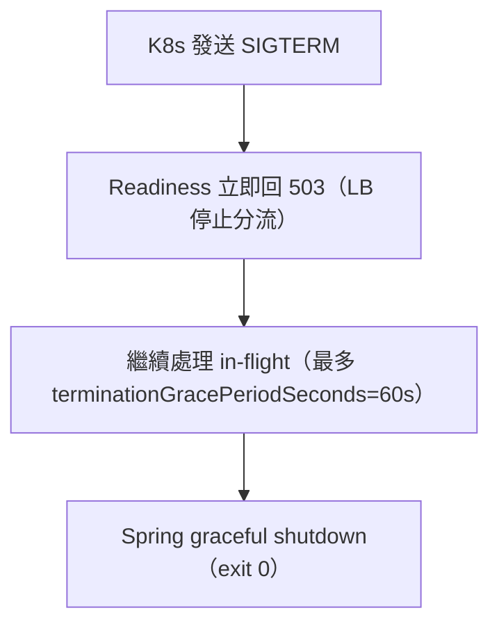

`server.shutdown=graceful`、`spring.lifecycle.timeout-per-shutdown-phase=30s`、K8s `terminationGracePeriodSeconds: 60`、`preStop: sleep 5`；PDB `minAvailable: 1`（2 副本時）保證滾動更新不全下線，部署期 5XX ≤ 0.1%（PRD §5.5 AC-2）。

### §7.1 Shared State Isolation（HC-4）

> 各 BC 的 Redis Key 必須有獨立 namespace 前綴，禁止跨 BC 直接讀寫他 BC 的 Key。對齊 EDD §21.3。

**Redis Key Namespace 格式**：`{bc_name}:{entity_type}:{id}`（全小寫，前綴不重疊）。

| Bounded Context | Key Pattern | 範例 Key | 可寫入的 Keys | 禁止存取 |
|-----------------|------------|---------|-------------|---------|
| member | `member:*` | `member:session:a1b2c3…`（token）、空值快取 `member:session:unknown` | 本 BC 所有 `member:*` | 其他 BC 的任何 Key |
| leaderboard | `leaderboard:*` | `leaderboard:top:sandbox:20`、`leaderboard:top::100`（全模式 Top 100） | 本 BC 所有 `leaderboard:*` | 其他 BC 的任何 Key |
| 平台底座（rate limit，橫切） | `rate:*` | `rate:login:203.0.113.5`、`rate:wallet:1001` | 限流橫切元件 `rate:*` | 其他 BC 業務 Key |

> wallet / deposit / entitlement / record / game-save 走強一致（DB），**無獨立 Redis Key**，故不列（EDD §21.3）。各 Key Pattern 前綴不重疊；BC 名稱與 §4 服務邊界表一致。

**隔離強制策略：** 所有 Redis 操作透過各 BC 的 CacheService（BC 內部類別，其他 BC 不得 import）；production 禁用全域 `FLUSH`/`KEYS` 掃描；Redis Cluster 模式以 `{bc_name}` 作 Hash Tag 確保同 BC Keys 落同一 Slot。

---

## 8. 災難恢復（DR）

> 對齊 EDD §3.6.3 / §13.5。區分「Pod/節點級（秒級，§7）」與「Region 級（分鐘級，本節）」。

| 指標 | 目標值 | 說明 |
|------|--------|------|
| RPO（同 Region） | 0（同步複本 WAL） | 已確認寫入不遺失（錢包交易 0 丟失，PRD §9.1） |
| RPO（Region 級） | ≤ 5 分鐘 | 跨 Region 非同步複本；備份/複本驗證 |
| RTO（API Pod） | ≤ 30s | Pod 重啟到接流量 |
| RTO（DB Failover，Patroni） | ≤ 30s | Standby 提升 |
| RTO（Region 級 DR） | ≤ 30 分鐘 | DR Region 提升（手動觸發 Runbook） |
| MTTR | ≤ 2 小時 | Incident 分析 |

**備份策略（對齊 EDD §13.5）：**

| 資料類型 | 備份頻率 | 保留期 | 儲存位置 | 驗證頻率 |
|---------|---------|--------|---------|---------|
| PostgreSQL 全量 | 每日 | 30 天 | 異地物件儲存 | 每季 DR 演練還原 |
| PostgreSQL 增量 / WAL | 每小時（持續串流） | 30 天 | 異地物件儲存 | — |
| Audit Log | 持續串流 | 7 年 | WORM / S3 Object Lock | — |
| 設定 / Secrets | 每次變更 | Git 全歷史 | Git + Sealed Secrets | — |

**Failover 計畫：**

```
1. DB Primary 故障
   Patroni 偵測 > 30s → Standby 提升新 Primary → VIP 不變 → 應用 pool 重連　預計 RTO ≤ 30s（RPO=0）
2. API Pod 全滅
   K8s 重新調度 → 拉 Image → Readiness 通過 → 接流量　預計 RTO ≤ 30s
3. 整個 AZ 故障
   多 AZ LB 移除不健康節點 → 流量切存活 AZ → HPA scale-out　預計 RTO ≤ 60s
4. 主 Region 完全故障
   手動觸發 DR → DR Region DB 提升（≤5min 複本）→ DNS/GeoDNS 切換　預計 RTO ≤ 30 分鐘
```

**DR 演練計畫：** 頻率每季一次（於 Staging）；範圍含單 AZ 模擬故障、DB Patroni 切換、Redis Sentinel 選主、Outbox 卡住恢復；對應 Runbook：`runbook-db-failover`、`runbook-redis-sentinel`、`runbook-outbox-stuck`、`runbook-wallet-mismatch`（EDD §13.7）。

---

## 9. 安全架構

### 9.1 縱深防禦層次圖（Defense in Depth）

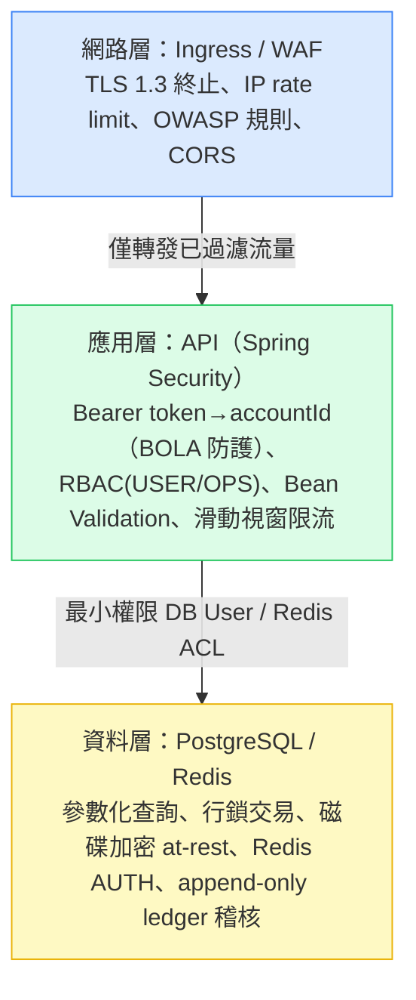

**認證與授權（對齊 EDD §9.1）：** 外部用戶 Opaque Session Token（Bearer，32B hex，TTL 30 天，可即時撤銷）；無 JWT（ADR-003）；管理/OPS 唯讀 + 稽核；密碼 scrypt（salt 16B / keylen 64B）+ `timingSafeEqual`。

### 9.2 Zero-Trust Network Policy

**原則：** 永不信任，始終驗證。資源歸屬一律以 token 的 account_id 判定（忽略 body，防 BOLA / 水平越權）。

```yaml
# Kubernetes NetworkPolicy — API 僅接受 Ingress，metrics 僅 monitoring
apiVersion: networking.k8s.io/v1
kind: NetworkPolicy
metadata:
  name: yocat-office-backend-api-ingress
  namespace: yocat-prod
spec:
  podSelector: { matchLabels: { app: yocat-office-backend-api } }
  policyTypes: [Ingress]
  ingress:
    - from: [{ podSelector: { matchLabels: { app: ingress } } }]
      ports: [{ protocol: TCP, port: 8080 }]
    - from: [{ namespaceSelector: { matchLabels: { name: monitoring } } }]
      ports: [{ protocol: TCP, port: 8080 }]   # /actuator/prometheus
```

**服務間 / 資料存取驗證矩陣：**

| 發起方 | 目標方 | 驗證方式 | 允許操作 |
|--------|--------|---------|---------|
| Ingress | API | 網路策略（僅 Ingress label） | HTTP :8080 |
| API | PostgreSQL | DB User（最小權限，per-schema grant） | SELECT/INSERT/UPDATE（限自身 BC schema） |
| API | Redis | Redis AUTH + ACL | GET/SET/DEL/ZADD（限 namespace 前綴） |
| 外部 | DB / Redis | 禁止直連（Data Subnet 隔離） | — |

> 拆微服務後服務間導入 mTLS（Linkerd/Istio）；單體內模組直呼無網路邊界，以 ArchUnit/Modulith 邊界取代。

### 9.3 Secret 輪換策略（對齊 EDD §9.3）

| Secret 類型 | 存放位置 | 輪替頻率 | 輪替方式 | 告警 |
|------------|---------|---------|---------|------|
| DB 密碼 | K8s Sealed Secrets（Prod 可升 Vault），`secret:yocat-office-backend/db-password` | 每 90 天 | 自動輪替（無停機） | 到期前 14 天 |
| Redis AUTH | 同上 `.../redis-password` | 每 90 天 | 自動輪替 | 到期前 14 天 |
| Phase B 金流 HMAC key | 同上 `.../payment-hmac` | 每 180 天 | 手動 + 審計 | 到期前 30 天 |
| mTLS 憑證（拆微服務後 / Ingress TLS） | cert-manager | 自動（到期前續） | 自動更新 | 到期前 14 天 |

> 啟動時 fail-fast 驗證所有必填 secret 存在；Log 遮罩前 4 + 後 2 字元；文件中無任何明文 secret。緊急輪換（疑洩漏）：SLA 內完成輪替 + 審查存取 Log + Incident Report。

### 9.4 Network Architecture（網路架構）

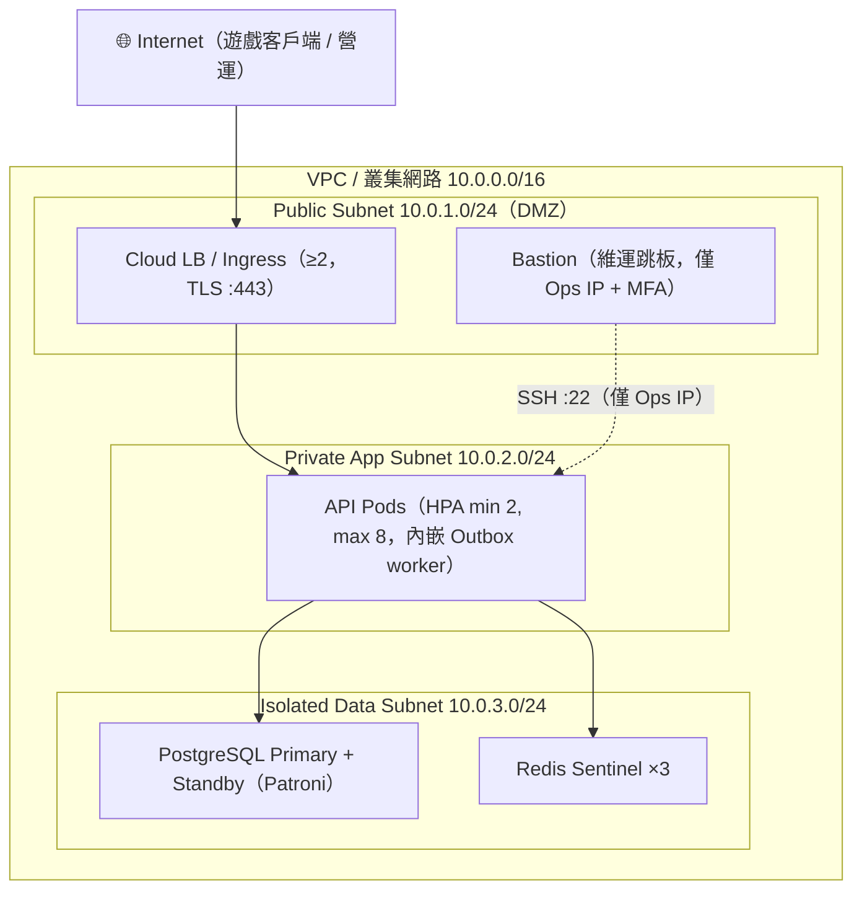

**Security Group 規則：**

| 資源 | 允許 Inbound | 允許 Outbound |
|------|-------------|--------------|
| LB / Ingress | 0.0.0.0/0:443 | App Subnet:8080 |
| API Pods | Ingress:8080、monitoring:8080 | Data Subnet:5432,6379 |
| PostgreSQL | App Subnet:5432 | — |
| Redis | App Subnet:6379 | — |
| Bastion | Ops IP:22 | App Subnet:22 |

- AZ 配置：至少 2 個 AZ（API/DB/Redis 跨 AZ 分散），確保 HA；RTO ≤ 60s（AZ 故障）。
- **本機（local-first）**：Rancher Desktop k8s namespace `yocat-office-backend-local`，以 NodePort/Ingress 暴露 API :8080（參照 `docs/req/postgres.yaml` NodePort 30432 模式）；單一主機內無真實子網分隔，以 NetworkPolicy 模擬隔離。

### 9.5 Compliance Architecture Mapping（合規架構對應）

| 法規 / 標準 | 受影響元件 | 資料類型 | 技術措施 | 稽核日誌 |
|-----------|---------|---------|---------|---------|
| 個人資料保護法（台灣） | member BC, PostgreSQL, Log | 台灣用戶 PII（email, display_name） | 本地化儲存、欄位遮罩、同意管理、`MemberDeleted` 匿名化 | Audit Log（OPS 查 PII） |
| GDPR（若有 EU 用戶） | member BC, DB, Log | EU 用戶 PII | 資料最小化、刪除 API、Log 遮罩 | 年度 DPIA |
| PCI DSS | 不適用（Phase A 假付費，無卡資料） | — | Phase B 以 PSP Token，不自存 PAN | Phase B 完整稽核 |

**稽核日誌架構（對齊 EDD §10.6）：** 認證（登入/登出/失敗）、所有錢包寫入（who/what/when/before/after）、權益購買、OPS 查 PII 均 append-only 記錄，WORM / S3 Object Lock 保留 7 年；格式含 `event_id/timestamp/event_type/actor/resource.before/after/outcome`。

---

## 10. 擴展策略

**水平擴展（HPA，對齊 EDD §11.2）：**

| 元件 | 擴展方式 | Scale-out 觸發 | Scale-in | 冷卻 |
|------|---------|---------------|---------|------|
| API Server | HPA 水平擴展 | CPU > 70% 或 Mem > 75% | CPU < 50% 持續 5min | scale-out 60s / scale-in 300s |
| PostgreSQL（讀） | Read Replica（Phase 2） | 讀 QPS 超單節點 80% | 手動 | 手動規劃 |
| Redis | Sentinel → Cluster（Phase 2） | Memory > 80% | — | 手動規劃 |

**容量規劃（對齊 EDD §11.1/§11.2）：** 峰值 QPS ~35（啟動期 5,000 DAU × 10 req/日 ÷ 86400 × 峰值係數 6）；Pod 數公式 `ceil(QPS × avg_latency / req_per_pod)`，啟動期 ceil(35×0.2/50)=1 → HA 下限 2；DB 連線池 `pods × 10 = 80`（HikariCP 10/pod，PostgreSQL max_connections=200 含餘裕）；成長期 3,000 PCU / 10x QPS ≈ ceil(350×0.2/50)=2，仍在 HPA 2–8 內。

### 10.2 Scalability Ceiling Analysis（擴展上限分析）

**瓶頸上限表（≥4 個瓶頸點）：**

| 瓶頸點 | 現有上限 | 達到上限症狀 | 解決方案 |
|--------|---------|------------|---------|
| PostgreSQL 連線池 | 200 連線（max_connections） | 連線等待 > 1s、503 | PgBouncer 連線池、讀寫分離 |
| 單帳號錢包行鎖 | 單帳號寫入序列化 | 熱帳號鎖等待上升 | 單帳號頻率低；必要時分片 / 批次（EDD §14 風險） |
| 單 PostgreSQL 節點寫入 | ~單機 I/O 上限 | 寫入延遲急升 | 水平分片（Sharding）/ CQRS（Phase 3） |
| 單 Redis 節點記憶體 | ~啟動期 <1 GB（session+榜+限流 ~8MB×3） | OOM / LRU 驅逐、命中率降 | Redis Cluster 分片（Phase 2） |
| API Pod CPU | 單 pod ~50 req/s @ 70% CPU | P99 延遲上升 | HPA（已 max=8）+ 優化查詢 |
| 單 Region 部署 | 受限 Region AZ 數 | Region 故障全不可用 | Multi-Region Active-Passive（Phase 3） |

**架構演進 4 Phase 路線（水平擴展里程碑，非架構切換）：**

> **Iron Constraint**：Phase 1 已採 HA 基線（API ≥2 replica、DB Primary+Standby、Redis Sentinel 3 nodes），以下 Phase 差別只在水平擴展程度，觸發條件以 QPS/PCU 為單位，**不**從單體/單副本出發。

| Phase | 觸發條件（PCU / QPS） | 水平擴展變更 |
|-------|---------------------|------------|
| Phase 1（HA 基線） | 啟動即採 HA，≤ 500 PCU / ~35 QPS | 單體 HA：API ≥2 replica（HPA 2–8）+ DB Primary+Standby + Redis Sentinel ×3；拓撲 A |
| Phase 2 | 500–1,500 PCU / 35–120 QPS | Read Replica 分流榜單/查詢 + PgBouncer 連線池 + Redis Cluster |
| Phase 3 | 1,500–3,000 PCU / 120–350 QPS | 按業務域拆 Microservice（拓撲 B，Outbox 橋接 broker）+ CQRS 分離讀寫 + Multi-Region Active-Passive |
| Phase 4 | > 3,000 PCU / > 350 QPS | 全球分佈 + wallet/leaderboard 資料分片 + 專用榜單引擎 |

---

## 11. 技術棧全覽

> 與 EDD §3.3 技術棧總覽（SSoT）完全一致；版本以 EDD 為權威來源。

| 層次 | 技術 | 版本 | 選型理由 | License |
|------|------|------|---------|---------|
| 後端語言 | Java | 21 (LTS) | Modulith 生態成熟、Virtual Threads 提升 I/O 併發 | GPLv2+CE |
| Runtime | JVM（Eclipse Temurin） | 21 | LTS、GC 成熟、容器友善 | — |
| Web / API Framework | Spring Boot | 3.3.x | 業界標準、與 Modulith 原生整合 | Apache 2.0 |
| 模組化框架 | Spring Modulith | 1.3.x | `@ApplicationModule` 邊界、Event Registry（Outbox）、ModularityTests | Apache 2.0 |
| 資料存取 | Spring Data JDBC | 3.3.x | 貼近 SQL、聚合邊界清晰、原生 `FOR UPDATE` | Apache 2.0 |
| 主資料庫 | PostgreSQL | 16 | JSONB、行鎖、Partition、HA（Patroni）；與原型一致 | PostgreSQL License |
| 快取 | Redis | 7.2 | session/rate-limit/leaderboard cache；Sentinel HA | RSAL/SSPL |
| 訊息/事件 | Spring Modulith Event Registry（JDBC Outbox） | 1.3.x | 同交易可靠事件；啟動期不引入外部 broker | Apache 2.0 |
| 認證 / 授權 | Spring Security + 自管 Opaque Session | 6.3.x | Bearer token filter、RBAC（USER/OPS） | Apache 2.0 |
| 密碼雜湊 | scrypt（Bouncy Castle / `SCryptPasswordEncoder`） | — | 與原型一致（keylen 64、salt 16），抗暴力 | MIT/BC |
| Container Runtime | Docker | 27.x | 標準化部署單元（multi-stage，jre-alpine） | Apache 2.0 |
| 容器編排 | Kubernetes | 1.30 | Day1 HA（≥2 replicas、HPA、PDB）；Local=Rancher Desktop | Apache 2.0 |
| CI | GitHub Actions | — | lint/test/build/deploy/k6 | — |
| CD | ArgoCD | 2.12 | GitOps、Canary | Apache 2.0 |
| 架構守護 | ArchUnit + Spring Modulith `verify()` | 1.3 | CI 攔截跨層/跨 BC 違規 | Apache 2.0 |
| Migration | Flyway | — | 版本化 schema（7 BC） | Apache 2.0 |
| Monitoring | Prometheus + Grafana | — | 指標 + 儀表板 + 告警 | Apache 2.0 |
| Tracing / Logging | OpenTelemetry + Tempo/Jaeger、Loki | — | OTLP、W3C Trace Context、JSON Lines | Apache 2.0 |
| 前端 / 客戶端引擎 | N/A（api-only；算力留本地，客戶端為既有 HTML5 Canvas 遊戲） | — | 純後端信任層 | — |

---

## 12. Observability 架構

> 三支柱對齊 EDD §10；埋點位置明確至各元件，Alert 閾值對應 SLO。

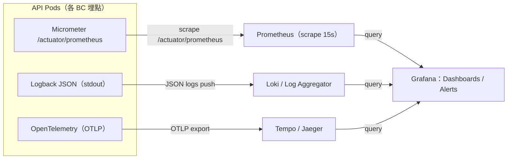

**Metrics（埋點位置 + SLI）：** Micrometer → Prometheus `/actuator/prometheus`。關鍵指標：`http_server_requests`（P50/P95/P99 by endpoint/status，API Controller 埋點）、`wallet_spend_total` / `wallet_ledger_mismatch_total`（wallet UseCase 埋點，對帳不一致應恆 0）、`hikaricp_connections_active`（連線池）、Outbox pending count（OutboxConfig）。

**Logging：** 結構化 JSON（`timestamp/level/service/version/trace_id/span_id/message/context`）；prod INFO、錯誤 100%；PII 遮罩（email），不記 password/token/pass_hash；保留熱 90 天 / 冷 365 天（Prod）、Staging 14 天。

**Tracing：** OpenTelemetry（Micrometer Tracing + OTLP → Tempo/Jaeger）；span 命名 `<module>.<operation>`（如 `wallet.spend`）；W3C Trace Context 傳播；採樣 Prod 10% / Staging 100%（錯誤 100%）。追蹤關鍵路徑：所有 HTTP、DB 查詢（slow query > 200ms）、Redis 操作、Outbox publish/consume。

**Alerting（閾值對應 SLO，EDD §10.4）：** 5xx > 1%（5min）→ P1；P99 > 1000ms（5min）→ P2；`wallet_ledger_mismatch_total > 0` → P0（錢包不一致）；Outbox pending > 100（5min）→ P2；每 P1 告警對應 Runbook。

---

## 13. 外部依賴地圖

> 本系統為 api-only、算力留本地，外部依賴極少（啟動期無第三方 Auth/Email/Storage/CDN）。

| 服務名稱 | 版本 / API | 用途 | SLA 假設 | 我方 Fallback 策略 | 風險等級 |
|---------|-----------|------|---------|------------------|---------|
| PostgreSQL 16 | 16 | 核心持久化（7 BC schema） | 自管 HA 目標 99.9%（Patroni） | 自建 HA 主從 + 備份還原；標準 SQL 可遷移任一相容 Postgres | Critical（P0） |
| Redis 7.2 | 7.2 | session/限流/榜單快取 | Sentinel 99.9% | cache miss 回源 DB（降級，非 500） | High（P1） |
| 金流供應商（Phase B） | 待定（PSP） | 真金流（目前假付費，預留） | 待簽約 | Phase A 不依賴；Phase B 以 Webhook 驗簽 + 冪等對帳 + ACL 隔離 | Medium（P2，Phase B） |
| Container Registry | `registry.sayyogames.internal` | Image 拉取 | 內部 | 本機 `nerdctl build` + `imagePullPolicy: Never`（local） | Medium（P2） |

**依賴風險評估：**

| 風險等級 | 定義 | 對應依賴 |
|---------|------|---------|
| Critical（P0） | 故障直接導致核心功能不可用 | PostgreSQL |
| High（P1） | 故障影響部分功能，有 Fallback | Redis（降級回源） |
| Medium（P2） | 故障影響非核心 / 未啟用功能 | 金流供應商（Phase B）、Registry |

---

## 14. Architecture Decision Records（完整）

> 與 §1.2 索引一一對應；內容對齊 EDD §3.2。

### ADR-001：模組化單體（Spring Modulith）vs Day1 微服務

**狀態**：已接受（Accepted）｜日期：2026-10-30｜決策者：Tech Lead + Architect

**背景（Context）**：7 BC 邊界清晰但啟動期量級小（500 PCU）；需 Day1「可分可合」（PRD §5.5）；錢包需強一致。

**考量選項：**

| 選項 | 優點 | 缺點 |
|------|------|------|
| Spring Modulith 模組化單體（採用） | 運維簡單、交易原子、建置期驗邊界、可後拆 | 共享 JVM/DB 實例 |
| Day1 微服務 | 各 BC 獨立 scale/部署 | 分散式交易複雜、運維重、錢包一致性難 |

**決策（Decision）**：採模組化單體（拓撲 A），以 Outbox 解耦，保留拆分選項。

**後果（Consequences）**：
- 正面：啟動期成本最低、錢包一致性在單 DB 交易內最可靠、ModularityTests 機械化保證邊界。
- 負面：各 BC 無法獨立 scale（啟動期量級不需要）；拆分時 entitlement 購買需改為 Saga（Domain 零改）。

### ADR-002：錢包一致性 — PostgreSQL 交易 + `SELECT FOR UPDATE` vs 樂觀鎖/CAS

**狀態**：已接受｜日期：2026-10-30

**背景**：PRD §9.1 P0 護欄：併發扣款 0 筆不一致、ledger 100% 對帳；原型已用 `SELECT FOR UPDATE`。

**決策**：悲觀行鎖 + 同交易寫 ledger（排除樂觀 CAS，避免尖峰重試風暴）。

**後果**：正面：強一致、與原型一致、對帳恆等；負面：單帳號寫入序列化（熱帳號頻率低，必要時分片，§10.2）。

### ADR-003：認證 — Opaque Session Token（Redis+DB）vs JWT

**狀態**：已接受｜日期：2026-10-30

**背景**：需即時撤銷（客服強制登出）；原型以 `sessions` 表存 opaque token（TTL 30 天）。

**決策**：Opaque Session Token + Redis 快取（排除 JWT 的撤銷難 / JWKS 輪替）。

**後果**：正面：可即時撤銷、無需金鑰輪替；負面：每請求查 session（Redis 快取命中，QPS 低成本可控）。

### ADR-004：事件匯流排 — Spring Modulith Event Registry（JDBC Outbox）vs Kafka

**狀態**：已接受｜日期：2026-10-30

**背景**：需可靠事件投遞；啟動期不願引入外部 broker 運維。

**決策**：Event Publication Registry（JDBC Outbox，同交易）；拆微服務時橋接 NATS/Kafka（程式碼不變）。

**後果**：正面：同交易保證可靠、零額外 broker；負面：啟動期為單體內本地訂閱，跨服務需後續橋接。

### ADR-005：容器編排 — Kubernetes（Local=Rancher Desktop）+ ArgoCD GitOps

**狀態**：已接受｜日期：2026-10-30

**背景**：需 Day1 HA（≥2 replicas、HPA、PDB）+ local-first 全流程本機可跑。

**決策**：Kubernetes 1.30；Local=Rancher Desktop（namespace `yocat-office-backend-local`，Kustomize overlays），Prod=ArgoCD GitOps + Canary。

**後果**：正面：本機與 Prod 拓撲一致、HA 行為可本機驗；負面：開發者需本機 k8s 環境（Rancher Desktop 降低門檻）。

---

## 15. 架構審查檢查清單

> 本次 ARCH 自我驗證結果（NFR 對照 EDD / PRD）。

| # | Non-Functional Requirement | 驗證方式 | 狀態 |
|---|--------------------------|---------|------|
| 1 | 可用性 ≥ 99.9% | SLO Dashboard（§1.1/§12） | ✅ |
| 2 | P99 延遲 ≤ 1000ms @500 PCU | k6 Load Test（§13 CI 閘門） | ✅ |
| 3 | 水平擴展（HPA 2–8） | k8s HPA 測試（§10） | ✅ |
| 4 | 零停機部署 | Canary + Graceful Shutdown + PDB（§7/§17） | ✅ |
| 5 | 資料加密（at-rest + in-transit） | TLS 1.3 + 磁碟加密（§9.4） | ✅ |
| 6 | RBAC 存取控制（USER/OPS + BOLA 防護） | 滲透/越權測試（§9.1/§9.2） | ✅ |
| 7 | 稽核日誌完整性（append-only） | WORM / S3 Object Lock（§9.5） | ✅ |
| 8 | RTO ≤ 30s（Pod/DB）/ ≤30min（Region）、RPO=0/≤5min | DR 演練（§8） | ✅ |
| 9 | 可觀測性（Metrics/Tracing/Logging） | Grafana Dashboard（§12） | ✅ |
| 10 | 依賴服務降級（Circuit Breaker） | Chaos Test（§5.2/§12.3） | ✅ |
| 11 | API Rate Limiting（滑動視窗） | Load Test（§5.2） | ✅ |
| 12 | HA Min Replicas ≥ 2（BRD SLA 追溯） | k8s 副本驗證：API ≥2、DB Primary+Standby、Redis Sentinel×3（§7，BRD 99.9%→ 需 ≥2 消 SPOF） | ✅ |

### 微服務可拆解性（Spring Modulith HC-1～HC-5，MD-01~MD-05）

| # | 項目 | 回答 |
|---|------|------|
| MD-01 | Schema 擁有權 | 每 BC 獨佔 schema（§4：`member`/`wallet`/`deposit`/`entitlement`/`record`/`leaderboard`/`game_save`），無兩 BC 擁有同一 table |
| MD-02 | 跨服務通訊 | 僅透過 Public `@NamedInterface` 或 Domain Event（§5.1/§5.3）；禁跨 BC Repository 直呼（ArchUnit 驗證） |
| MD-03 | 依賴 DAG | member 為葉節點（被依賴），無循環；最長鏈 entitlement→wallet→member（EDD §4.3 `verify()` CONFIRMED） |
| MD-04 | 共享可變狀態 | Redis Key namespace 隔離（§7.1：`member:*`/`leaderboard:*`/`rate:*`，前綴不重疊）；wallet 等走 DB 強一致 |
| MD-05 | 獨立部署接合點 | 拆分需調整：DB schema 遷移順序、Service Discovery、Ingress 路由、entitlement 購買改 Saga、Outbox 橋接 broker（§3.2.1） |

**審查紀錄：**

| 審查日期 | 審查者 | 結果 | 未通過項目 | 下次審查日期 |
|---------|--------|------|-----------|------------|
| 2026-10-30 | Solutions Architect + Backend Engineer + DevOps/SRE | Pass（待 Review loop 確認） | — | 重大架構變更時 |

---

## 16. Cost Optimization & FinOps Architecture

### 16.1 成本分配 Tag 策略

每個資源必須包含以下 Tag（k8s Labels + 雲端 Tags）：

- `Environment`：local / dev / staging / prod
- `Service`：yocat-office-backend-api / postgres / redis
- `Team`：backend
- `CostCenter`：yocat-office

### 16.2 月度成本估算（啟動期，對齊 EDD §11.2 相對成本）

> 以自建/相容雲啟動期量級估算（相對成本：Dev 1x、Staging 2.5x、Prod 4x）。具體月費（USD 量級，含運算+儲存+網路，不含人力）：

| 環境 | API Pods | DB | Redis | 估算月費（USD） | 備註 |
|------|---------|----|----|----------------|------|
| Dev | 2 | 單節點 | 單節點 | ~$60 | 小型節點、可離峰縮至 2（不 scale to 0） |
| Staging | 2 | Primary+Standby | Sentinel×3 | ~$150 | DR 演練、Blue-Green |
| Prod | 2–8（HPA） | Primary+1 Standby（Patroni） | Sentinel×3 | ~$240（尖峰）| 全天候 HA，不可排程停機 |
| **合計（含觀測/網路）** | — | — | — | **~$480/月** | 啟動期 5,000 DAU 量級 |

> 對照 BRD：啟動期預期年收益 ~USD 5K，基礎設施年成本 ~USD 5.8K（$480×12），屬可接受起步投入；成長期 50,000 DAU 隨 HPA + Read Replica 擴容（§10.2）。

### 16.3 成本優化策略

| 策略 | 適用環境 | 預估節省 |
|------|---------|---------|
| 非生產環境離峰縮副本（scale to 2，非 0）⚠️ 僅 dev/staging | dev/staging | 20–40% |
| Spot/Preemptible 節點（非關鍵 dev 工作負載） | dev | 60–80% |
| 物件儲存 Lifecycle（Audit Log 歸檔冷儲存） | all | 60–70% |
| 資源 Requests/Limits 正確配置（避免過度配置） | all | 10–30% |
| Outbox 取代外部 broker（啟動期） | prod | 省一組 broker 叢集成本 |

> ⚠️ **Production HA 強制約束**：Prod 不得排程停機或縮副本至 1；全天候維持 API ≥2 replica、DB Primary+Standby、Redis Sentinel（違反 SLA）。

### 16.4 月度 FinOps Review 規則（預算警報）

- **80% 預算**：自動告警至 Slack（工程負責人）。
- **100% 預算**：通知 VP Engineering + page on-call。
- **120% 預算**：凍結非 Critical 資源部署 + 通知 Engineering Manager/CTO。

月度 Review 議程：實際 vs 預算差異（±10% 需說明）、Top 5 成本驅動、優化節省驗證、下月預測、新功能成本評估。

---

## 17. API Gateway & Service Mesh Architecture

### 17.1 邊緣層職責分離

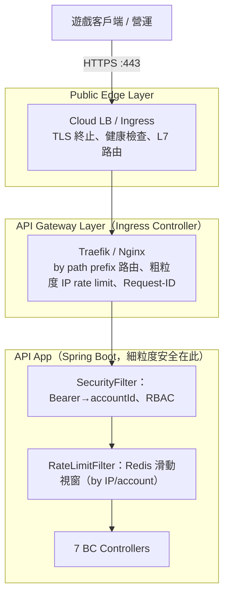

> 啟動期不引入 Service Mesh（單體內模組直呼，以 Modulith/ArchUnit 邊界取代 mTLS）；拆微服務（拓撲 B）時導入 Linkerd/Istio 提供 mTLS + Circuit Breaker + Service Discovery。

### 17.2 Circuit Breaker Pattern（Resilience4j）

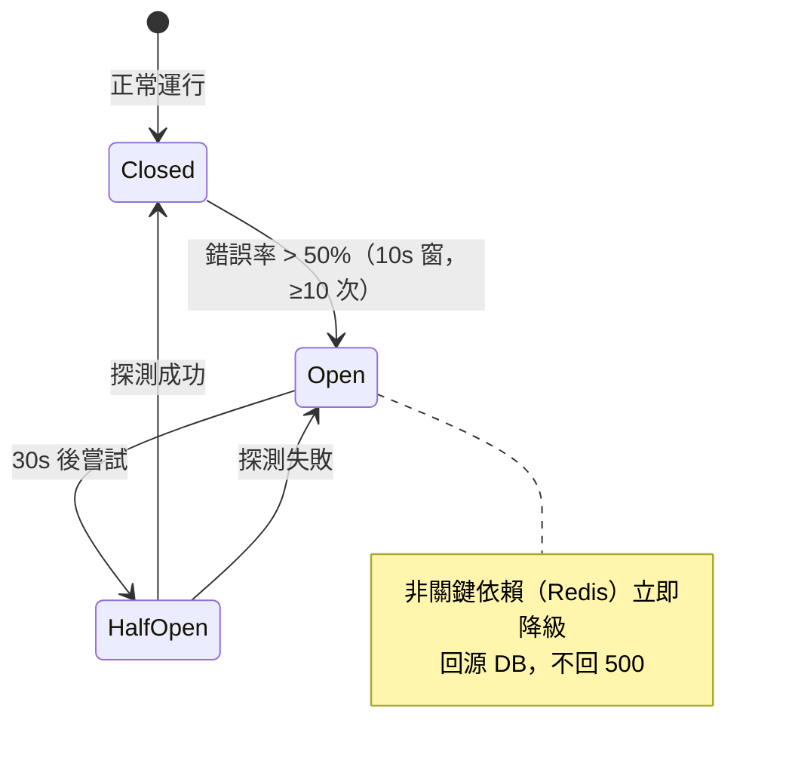

- DB 關鍵路徑（錢包交易）不熔斷（寧失敗回滾不丟一致性）；Redis / 非關鍵熔斷降級。
- Phase B 金流呼叫以 Circuit Breaker + 重試佇列保護（失敗排入重試，回 503 友善訊息）。

---

## 18. Admin Portal 架構（條件章節）

本專案 `has_admin_backend=false`（state file 確認），無 Admin 後台，略過 §18。營運/客服（OPS）以既有 REST 端點唯讀對帳（`GET /leaderboard`、`GET /records`，RBAC 限唯讀 + 稽核日誌），不需獨立 Admin Portal。

---

*文件最後更新：2026-10-30 | 維護者：資深 System Architect | 上游：[EDD.md](EDD.md)（SSoT）*
