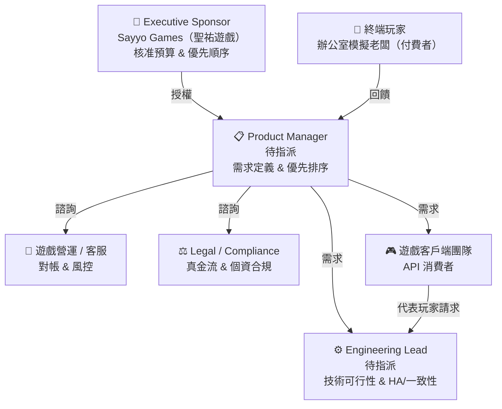
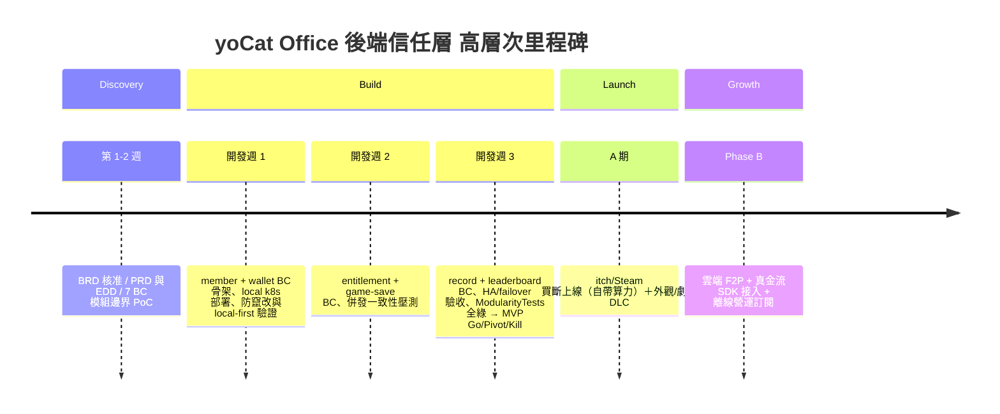

# BRD — Business Requirements Document
<!-- SDLC Requirements Engineering — Layer 1：Business Requirements -->
<!-- 對應學術標準：ISO/IEC/IEEE 29148；對應業界：Strategy Doc / Product Brief / Amazon PR-FAQ -->
<!-- 回答：為什麼做？為誰做？成功長什麼樣？值不值得投資？ -->
<!-- 專案：yoCat Office 後端信任層；核心理念：算力留本地、信任上雲端 -->

---

## Document Control

| 欄位 | 內容 |
|------|------|
| **DOC-ID** | BRD-YOCAT-OFFICE-BACKEND-20261030 |
| **專案名稱** | yoCat Office 後端信任層（yocat-office-backend） |
| **文件版本** | v1.0 |
| **狀態** | DRAFT |
| **作者** | AI Generated（gendoc gen-brd）／ Product Lead 待指派 |
| **日期** | 2026-10-30 |
| **上游 IDEA.md 引用** | IDEA-YOCAT-OFFICE-BACKEND-20261030（docs/IDEA.md） |
| **下游 PRD** | [PRD.md](PRD.md)（待建立） |
| **審閱者** | Engineering Lead、遊戲營運/客服、法務（待指派） |
| **核准者** | Executive Sponsor（Sayyo Games / 聖祐遊戲，boss@yocat.example，待確認） |

---

## Change Log

| 版本 | 日期 | 作者 | 變更摘要 |
|------|------|------|---------|
| v1.0 | 2026-10-30 | gendoc gen-brd | 初稿，由 IDEA.md + docs/req/（企画.md §15–§17、schema.sql）生成 |

---

## 0. 背景研究（Market Intelligence）
<!-- 來自 IDEA.md §7 Market Intelligence 與 docs/req/企画.md §15–§17 -->

本專案聚焦 **yoCat Office（yoCat Office）2.5D 辦公室模擬遊戲** 的「後端信任層」。遊戲核心玩法（本地 LLM 驅動的 NPC 員工、7×24 自主營運、情感依附迴圈、破產 recycle）已端到端實作完成；既有 Node/TypeScript 後端原型 + PostgreSQL 8 表 schema + Rancher Desktop k8s manifest 的信任層 API 已端到端測試全綠（企画 §17.6 test_api.mjs）。本 BRD 的任務，是把此原型依工程原則重構為可收真錢、可維運的雲端信任層。

**研究摘要（來源：IDEA.md §7、Appendix A 研究原始資料）：**

| 研究面向 | 主要發現 | 來源 / 可信度 |
|---------|---------|-------------|
| 模組化架構 | Spring Modulith：module = bounded context；跨模組只走 domain events；ModularityTests 於建置期強制邊界（HC-1~HC-5 的落地工具）；Event Publication Registry = Transactional Outbox 保證事件可靠投遞；wallet 為獨立模組；重複請求視為狀態記錄（冪等思維）。 | Web Research「Spring Modulith bounded context / event publication registry」／高 |
| 遊戲後端最佳實務 | 跨玩家邊界一律 server-authoritative；auth/persistence/anti-cheat 拆服務；append-only ledger 審計；密碼學摘要防竄改；write-behind worker 經 broker（Kafka/NATS）落庫。 | Web Research「game backend server-authoritative wallet anti-cheat」／高 |
| 一致性與冪等 | 錢包餘額跨 failover 一致性需「交易 + SELECT FOR UPDATE + 冪等鍵」；事件可靠投遞走 outbox；金流冪等與對帳需逐筆對帳。 | Web Research「wallet balance consistency failover idempotency outbox」／高 |
| 成本結構趨勢 | 「AI NPC 遊戲」把 AI 互動與遊戲狀態全上雲、按量計費，成本隨量增；本專案反其道，AI 推論與遊戲模擬零邊際成本留本地，只有信任層上雲。 | 企画 §15.1 LLM 跑在哪／中 |

**市場時機（Why Now）：** 核心玩法與變現軌道（商店/劇本/分享，企画 §15.5/§16.10）皆已鋪好，唯一缺口是「收真錢所需的伺服器權威」。既有原型已驗證可行，正是依工程原則重構為可維運雲端信任層的時機。

---

## 1. Executive Summary（PR-FAQ 風格）
<!-- 仿照 Amazon Working Backwards：先寫對外新聞稿，強迫釐清價值主張 -->

### 1.1 假設新聞稿（一頁備忘錄）

> **標題：** Sayyo Games（聖祐遊戲）推出 **yoCat Office 後端信任層**，幫助「要對遊戲收真錢的獨立遊戲團隊與其玩家」解決「身分、錢包、已購權益與經營記錄無伺服器權威、可被竄改且無法跨裝置」的問題
>
> **日期：** 2026-10-30
>
> **第一段（What & Who）：**
> yoCat Office 後端信任層是一條「算力留本地、信任上雲端」的**伺服器權威後端**，專為代表玩家發出信任層請求的遊戲前端客戶端、以及遊戲營運/客服（對帳與風控）設計。它讓玩家能在任何裝置安全地儲值、購買與延續其公司經營史，不再需要把錢包與存檔放在可被 F12 竄改的 `localStorage`。
>
> **第二段（Why Now）：**
> 遊戲核心玩法（本地 LLM 驅動 NPC、情感依附迴圈、破產 recycle）與變現軌道（商店/劇本/分享）皆已實作；差的只是「收真錢需要的伺服器權威」。根據既有原型端到端測試（企画 §17.6 test_api.mjs 全綠），信任層技術可行已驗證；相較「AI 互動上雲按量計費」的競品，本專案把 AI 與遊戲模擬零成本留本地、只上雲薄信任層，具結構性成本優勢。
>
> **第三段（How It Works）：**
> 客戶端只需要 (1) 以帳號登入取得 session token、(2) 對儲值/購買/存檔/上榜發出信任層請求、(3) 只讀顯示伺服器回傳的權威錢包與權益狀態。所有金流動作皆走 append-only ledger，每一筆可稽核。
>
> **用戶引言：**
> 「我儲值買的💎資本與特聘的夢想員工，就算公司破產也不會消失，換手機登入我的辦公室原封不動——這才敢花錢。」— 阿凱，辦公室模擬遊戲重度玩家
>
> **Call to Action：** 核准本 BRD，啟動 PRD 與 7 有界上下文 Spring Modulith 重構，於開發週 3 完成 MVP（防竄改/一致性/HA）驗收。

### 1.2 FAQ（預先回答最困難的問題）

| 問題 | 回答 |
|------|------|
| 為什麼現在做這個？ | 核心玩法與變現軌道已就緒（企画 §16.10），唯一阻擋收真錢的缺口是伺服器權威信任層；既有原型已端到端全綠，重構時機成熟。 |
| 為什麼是我們來做（而不是用 PlayFab/Firebase）？ | 通用 BaaS 會造成供應商鎖定、資料不在本機、對帳/風控受限、成本隨量增。我們以 Spring Modulith 有界上下文 + Clean Architecture 自建，資料留本機、可自主拆分維運、Day1 HA、不被鎖定。 |
| 最大的風險是什麼？ | 錢包餘額在 HA/failover 下的一致性（R1，見 §10）。緩解：交易 + `SELECT FOR UPDATE` + 冪等鍵 + append-only ledger 對帳，MVP 即壓測。 |
| 如果失敗，原因最可能是？ | 「薄信任層足以防竄改且無需上雲遊戲算力」此 Leap of Faith 不成立——若防作弊必須伺服器重算遊戲邏輯，成本護城河崩解，需根本性 Pivot（IDEA §5.3 / §8.2）。 |
| 競品為什麼沒做（差異在哪）？ | AI NPC 遊戲後端把 AI 與遊戲狀態全上雲按量計費（成本高）；通用 BaaS 要你放棄資料主權。我們把「算力位置」當商業決策——只上雲薄信任層——兼得收費所需的防竄改能力與零邊際成本的 AI 護城河。 |

---

## 2. Problem Statement

### 2.1 現狀描述（As-Is Narrative）

> 用數據和具體故事描述現在的世界。避免假設解法，只描述現象。

既有 yoCat Office 原型把錢包、已購項目、存檔都放在客戶端 `localStorage`（企画 §14/§16 的 `W.gems`、`W.crush`、自動存檔約每 4 秒）。在「免費自帶算力、零成本」階段沒問題，但一旦要收真錢（企画 §16 儲值注資、夢想人才、外觀/季票），就出現根本矛盾：

- **一個付費玩家的一天：** 玩家花真錢換💎資本、特聘夢想員工、公司瀕臨破產時儲值救公司；但這些價值全記在他這台裝置的 `localStorage`。按 F12 一行 `W.gems=99999` 即可竄改餘額；排行榜分數由客戶端自報；換手機或重灌，「我的辦公室」與經營史全失。
- **Workaround 現況：** 以 `localStorage` 當唯一真實來源；排行由客戶端自報；存檔綁單一裝置。
- **原型過渡：** 團隊已寫出一版 Node 後端（`accounts.ts`）與 8 表 schema，端到端測試全綠（企画 §17.6），但它是「零依賴、單一行程」的原型——無 HA、無模組邊界、無事件驅動、無對帳/風控工具鏈，不適合作為收真錢的長期可維運底座。
- **痛點頻率：** 金流/竄改風險在「每一次付費與每一次上榜」都發生（100% 金流動作暴露）；跨裝置需求在「每一次換機/重灌」發生。

### 2.2 根本原因（5 Whys）

```
問題現象：要對遊戲收費，但沒有伺服器權威的身分與錢包
  Why 1：錢包/權益/記錄都放客戶端 localStorage
    Why 2：早期設計以「算力與狀態全留本地、零成本」為最高原則
      Why 3：核心護城河是「AI 互動零邊際成本」，團隊刻意避免任何上雲成本
        Why 4：但「收真錢」要求的防竄改/對帳/跨裝置，本質上無法由客戶端自證
          Why 5：缺少一條「與遊戲算力解耦、可獨立上雲」的伺服器權威信任層  ← 這才是我們要解決的
```

*根因不是「要不要上雲」，而是「把什麼上雲」——必須把薄薄的信任層（身分/錢包/權益/記錄/排行/存檔）與胖胖的本地算力切開，只上雲前者。此為可介入的系統性問題。*

### 2.3 問題規模（量化）

| 指標 | 數據 | 來源 | 信心水準 |
|------|------|------|---------|
| 受影響用戶數（全球） | 所有要在本遊戲付費或跨裝置的玩家（全量付費意圖玩家） | 企画 §15/§16 變現設計 | 中 |
| 受影響用戶數（目標市場） | 啟動期 5,000 DAU、成長期目標 50,000 DAU | IDEA §6 Q4（PM Expert 推估） | 中 |
| 竄改/對帳風險暴露面 | 每筆儲值、每筆花費、每次上榜（100% 金流動作） | schema.sql `wallet_ledger` 設計 | 高 |
| 跨裝置需求頻率 | 每次換機/重灌/多裝置玩家（定性：高） | 企画 §17.5 玩家體驗流程 | 中 |
| 市場規模（TAM） | 全球休閒/模擬手遊付費市場數十億美元級；本類型可定址子集 ~ USD 100–300M／年 | 企画 §15.6 GTM + 行業基準（AI 推斷） | 低 |
| 可服務市場（SAM） | 成長期 50,000 DAU × 年 ARPPU 推估 ~ USD 1–3M／年 | 企画 §15.1 + IDEA §6 Q4 | 低 |
| 可獲取市場（SOM，12 個月內） | 啟動期 ~5,000 DAU × 付費轉化 2–5% × 年 ARPPU ~USD 20–40 ≈ 年營收 USD 2K–10K 級起步 | IDEA §6 Q4 + 企画 §16 | 低 |

<!-- SOM 拆解：目標地區（全球 itch/Steam）× 目標用戶滲透率（付費轉化 2–5%）× ARPPU（USD 20–40/年）。初始估算，需 PRD 階段營運數據後更新 -->

---

## 3. Business Objectives
<!-- SMART 原則：Specific / Measurable / Achievable / Relevant / Time-bound -->

### 3.1 商業目標

| # | 目標 | 量化指標（KPI） | 基準值（Baseline） | 目標值 | 時間框架 | 優先度 |
|---|------|---------------|-------------------|-------|---------|--------|
| O1 | 建立可收真錢的伺服器權威信任層（防竄改） | 滲透測試中客戶端可竄改伺服器餘額之路徑數 | 現狀 100%（localStorage 可改） | 0 條路徑可竄改 | MVP 驗收（開發週 3） | Must |
| O2 | Day1 HA：信任層無單點、滾動更新不中斷 | 殺 1 pod / 滾動更新時的服務可用性與錯誤率 | 原型單行程（無 HA） | 無停機、錯誤率 < 0.1% | MVP 驗收（開發週 3） | Must |
| O3 | 錢包一致性可稽核可對帳 | 併發/failover 壓測下不一致筆數、ledger 與餘額相符率 | 無 ledger 權威 | 0 筆不一致、100% 相符 | MVP 驗收（開發週 2–3） | Must |
| O4 | 支撐變現並提升付費轉化 | 付費轉化率（DAU → 付費） | 0%（尚無金流） | ≥ 2%（啟動期） | GA + 3 個月 | Should |
| O5 | 模組可分可合、隨規模演進 | Spring Modulith ModularityTests 通過率、依賴圖循環數 | 原型無模組邊界 | 100% 綠、0 循環依賴 | 每次建置 | Should |

### 3.2 與公司策略的對應

| 公司策略目標 | 本專案如何貢獻 |
|------------|--------------|
| 「不對 AI 收費、賣內容/外觀/規模」的護城河（企画 §15） | 把收費所需的信任層與 AI 算力解耦，守住零邊際成本護城河 |
| A→B→C 算力路線並行、程式與算力位置解耦（企画 §15.7） | 信任層獨立於算力位置，client 僅切換生成來源不影響信任（使能/間接貢獻） |
| 情感變現引擎（人才庫/破產 recycle/儲值注資，企画 §16） | 以伺服器權威保證「付費與心愛的人永不永久失去」的不作惡底線 |

### 3.3 投資報酬分析（ROI）— 三情境模型

> 三情境各自獨立估算。開發主要為既有團隊內部工時（AI 輔助重構），雲端成本因「只上雲信任層」而低。折現率採 10%。

#### 悲觀情境（Pessimistic）
<!-- 假設：付費轉化低於預期、成長停滯、一致性問題延誤交付 -->

| 項目 | 估算 | 驅動假設 |
|------|------|---------|
| 開發成本 | ~ USD 30K（團隊內部工時，重構 + HA + 壓測，延誤） | 一致性問題導致額外壓測與返工 |
| 維護成本（年） | ~ USD 6K（信任層 pods + DB，低負載） | 僅啟動期量級，低流量 |
| 預期收益（年） | ~ USD 5K | 啟動期 5,000 DAU、付費轉化 1%、ARPPU USD 20 |
| Payback Period | ~ 72 個月 | — |
| 3 年 NPV | 約 -USD 20K（折現率 10%） | 悲觀下不回本，需靠 B 期擴散 |

#### 基準情境（Base）
<!-- 假設：依計畫執行，付費轉化符合行業基準 -->

| 項目 | 估算 | 驅動假設 |
|------|------|---------|
| 開發成本 | ~ USD 20K（團隊內部工時，依既有原型重構） | 原型已全綠，重構範圍明確 |
| 維護成本（年） | ~ USD 8K（信任層 pods + DB HA + 備援） | 啟動→成長期過渡量級 |
| 預期收益（年） | ~ USD 40K | 成長期 DAU 爬升、付費轉化 2–3%、ARPPU USD 30 + 買斷/DLC |
| Payback Period | ~ 10 個月 | — |
| 3 年 NPV | 約 +USD 55K（折現率 10%） | 回本且正報酬 |

#### 樂觀情境（Optimistic）
<!-- 假設：病毒分享帶量、B 期雲端 F2P 擴散、季票/儲值轉化佳 -->

| 項目 | 估算 | 驅動假設 |
|------|------|---------|
| 開發成本 | ~ USD 18K（團隊內部工時，順利） | 無重大一致性返工 |
| 維護成本（年） | ~ USD 15K（成長期擴容 + Phase B 金流手續費） | 50,000 DAU 量級 + 真金流 |
| 預期收益（年） | ~ USD 200K+ | 成長期 50,000 DAU、付費轉化 3–5%、ARPPU USD 40 + 儲值注資 + 季票 |
| Payback Period | ~ 3 個月 | — |
| 3 年 NPV | 約 +USD 450K（折現率 10%） | 高報酬，成本護城河放大利潤 |

#### 情境摘要比較

| 情境 | 3 年 NPV | Payback Period | 關鍵驅動假設 |
|------|---------|----------------|------------|
| 悲觀 | -USD 20K | ~72 個月 | 付費轉化 1%、停留啟動期、一致性返工 |
| 基準 | +USD 55K | ~10 個月 | 付費轉化 2–3%、成長期爬升、買斷+DLC |
| 樂觀 | +USD 450K | ~3 個月 | 病毒帶量、B 期 F2P 擴散、儲值+季票 |

**投資決策門檻：** 本專案是所有付費的「可信前提」——即使悲觀情境 NPV < 0，信任層仍是解鎖 B 期雲端 F2P 與全部變現軌道的必要底座（策略性必要投資）。建議門檻：基準情境 Payback Period < 12 個月即視為值得投資（已達成）。

### 3.4 Requirements Traceability Matrix（需求追溯矩陣，RTM）

> RTM 確保每一個業務目標都有對應的成功指標，每一個成功指標都有對應的功能需求。

| 業務目標 | 成功指標 | **Owning Subsystem** | 功能需求（PRD REQ-ID）| 測試覆蓋 | 狀態 |
|---------|---------|:-------------------:|---------------------|---------|------|
| O1：防竄改伺服器權威 | 可竄改路徑數 = 0（§7） | `member`, `wallet` | 待 PRD 生成 | 待 BDD 生成 | 🔲 待填 |
| O2：Day1 HA 無單點 | 無停機、錯誤率 < 0.1%（§7） | 平台底座（全 BC） | 待 PRD 生成 | 待 BDD 生成 | 🔲 待填 |
| O3：錢包一致可對帳 | 0 筆不一致、ledger 100% 相符（§7） | `wallet`, `deposit` | 待 PRD 生成 | 待 BDD 生成 | 🔲 待填 |
| O4：支撐變現/付費轉化 | 付費轉化 ≥ 2%（§7） | `deposit`, `entitlement` | 待 PRD 生成 | 待 BDD 生成 | 🔲 待填 |
| O5：模組可分可合 | ModularityTests 100% 綠、0 循環（§7） | 平台底座（7 BC） | 待 PRD 生成 | 待 BDD 生成 | 🔲 待填 |

*RTM 在 BRD → PRD 過渡時由 PM 維護；PRD 確定後以 REQ-ID 填入並鎖定。*

### 3.5 Benefits Realization Plan（效益實現計畫）

| 效益 | 基準值（Pre-launch）| 目標值 | 測量時間點 | 測量方式 | 負責人 | 若未達標的行動 |
|------|:------------------:|:-----:|----------|---------|--------|--------------|
| 防竄改有效性 | 100% 可竄改（localStorage） | 0 條可竄改路徑 | MVP 驗收（開發週 3）| 滲透測試報告 | Engineering Lead | 啟動 Hotfix Sprint；若需上雲遊戲邏輯則 Pivot |
| 錢包一致性 | 無權威 ledger | 0 筆不一致 | Launch + 3M | 對帳稽核 + 併發壓測 | Engineering Lead | 強化行鎖/冪等；延後擴量 |
| 付費轉化率 | 0% | ≥ 2% | Launch + 3M | Analytics Dashboard | PM | 檢視轉化時刻（企画 §16.8）、調整定價 |
| 跨裝置留存 | 無跨裝置 | 換裝置登入還原成功率 ≥ 99% | Launch + 6M | 存檔還原成功率 | PM + Eng | 調整存檔策略、用戶訪談 |
| 後端單位成本 | N/A（新指標：上線前無付費用戶與真金流，故無單位成本歷史基準，首次量測於 GA 後建立） | 每付費用戶雲端成本 < 收益 20% | Launch + 12M | Finance Report | Finance | 商業模式/容量評審 |

*效益評審節點：Launch + 3M / 6M / 12M，每次由 Executive Sponsor 主持。*

---

## 4. Stakeholders & Users

### 4.1 Stakeholder Map



### 4.2 Target Users（業務層級描述）
<!-- 此層不做詳細 Persona，Persona 在 PRD 展開 -->

| 用戶群 | 規模估算 | 核心需求 | 目前解法 | 痛點 |
|--------|---------|---------|---------|------|
| (A) 遊戲前端客戶端（API 消費者） | 1 個客戶端整合（多平台） | 伺服器以權威方式記錄並回傳最新狀態、API 穩定向後相容 | 直接讀寫 localStorage | 無權威來源、無法防竄改、無法歸戶 |
| (B) 終端玩家（辦公室模擬老闆、付費者） | 啟動期 5,000 DAU → 成長期 50,000 DAU | 跨裝置延續「我的辦公室」、儲值與特聘員工永不失去 | 單裝置 localStorage 存檔 | 換機即失、F12 可竄改、破產恐失心愛角色 |
| (C) 遊戲營運 / 客服 | 小團隊（每日對帳） | 逐筆查詢 append-only ledger 與經營記錄、稽核與風控 | 無工具 | 無法對帳、無法查作弊、無法處理退款 |

### 4.3 Not Our Users（明確排除）

- ❌ **需要後端承載 LLM 推論/遊戲即時模擬的使用者**（原因：核心理念算力留本地，信任層不承擔遊戲運算，否則成本護城河崩解）
- ❌ **需要即時每幀同步的競技/對戰遊戲後端**（原因：本信任層為低頻信任動作設計——登入/儲值/存檔/上榜，非即時狀態同步）
- ❌ **需要完整第三方真金流清算的 Phase A 使用者**（原因：金流先假付費，真金流 SDK 為 Phase B，接口已預留）

### 4.4 RACI Matrix
<!-- R = Responsible、A = Accountable、C = Consulted、I = Informed；每列活動只有一個 A -->

| 主要活動 | Executive Sponsor | Product Manager | Engineering Lead | 遊戲營運/客服 | Legal / Compliance | Finance |
|---------|:-----------------:|:---------------:|:----------------:|:------------:|:------------------:|:-------:|
| 需求定義與範圍確認 | A | R | C | C | C | I |
| 技術可行性評估（HA/一致性）| I | C | R/A | I | I | I |
| 設計審查（模組邊界/對帳接口）| I | A | R | C | I | I |
| 預算核准 | A | C | C | I | I | C |
| 合規與法務初審（真金流/個資）| I | C | I | C | R/A | I |
| 上線決策（Go/No-Go）| A | R | C | C | C | C |
| BRD→PRD Handoff | I | R/A | C | C | I | I |

> 以上依本專案實際角色調整。Design Lead 於後端信任層專案併入 Engineering Lead。

---

## 5. Proposed Solution

### 5.1 解法概述

> 高層次描述方向，**不涉及 UI 設計和技術細節**（那是 PDD 和 EDD 的責任）。

建立一條「算力留本地、信任上雲端」的**伺服器權威信任層**：以 scrypt 密碼雜湊 + session token 管理身分；以 `wallets` + append-only `wallet_ledger` 作權威錢包（花費走交易 + `SELECT FOR UPDATE`、餘額不足回 402）；以原子扣款+授予的 entitlement 保證已購權益永不重複、永不因破產消失；提供跨裝置存檔、經營史記錄與全域排行。全部以 **7 個 Spring Modulith 有界上下文** 承載、**Clean Architecture 四層 + SOLID** 分離、**Day1 即 HA**（≥2 replicas、無 SPOF、HPA + PodDisruptionBudget、BCP from Day1），全程可在 Rancher Desktop k8s（local-first）開發驗收。

### 5.2 核心價值主張（Value Proposition Canvas）

**Customer Jobs（用戶要完成的任務）：**
- Functional：客戶端代表玩家發起儲值/購買/存檔/上榜，要伺服器權威記錄並回傳一致、不可竄改的最新狀態。
- Functional：玩家換裝置時用帳號登入還原「我的辦公室」存檔與經營史。
- Functional（營運）：逐筆查詢 append-only 錢包 ledger 與經營記錄以稽核與風控。
- Emotional：玩家要「我儲值的資本與特聘的夢想員工永遠不會被搞丟」的安全感（企画 §16.9 不作惡底線）。
- Social：玩家在全域排行榜以公司名登榜、分享經營傳奇（企画 §15.3 病毒成長）。

**Pain Relievers（我們如何減輕痛點）：**
- 伺服器權威錢包（`wallets` + append-only `wallet_ledger`、交易 + `SELECT FOR UPDATE`、402 餘額不足），客戶端只讀顯示 → 根除 localStorage 竄改。
- 記錄/存檔以 `account_id` 命名空間、`/save` GET/PUT 跨裝置 → 解決歸戶與跨裝置。
- 每筆異動進 ledger（含 reason/balance/meta）、排行需登入歸戶 → 營運可逐筆稽核。
- Day1 HA（≥2 replicas、HPA、PodDisruptionBudget、BCP）→ 消除單點故障。

**Gain Creators（我們如何創造收益）：**
- 收真錢同時維持零邊際成本護城河（只有信任層上雲，LLM/模擬留本地）。
- Day1 可分可合（7 BC 單體 HA 起步，不改邊界即可逐一拆微服務）。
- 本機即可完整開發驗收（local-first，Rancher Desktop k8s / k3s）。

### 5.3 解法邊界

**In Scope（本版本 MVP）：**
- ✅ member BC：註冊/登入/登出/我的資料（scrypt + session）
- ✅ wallet BC：topup（假付費）/spend，append-only ledger
- ✅ entitlement BC：購買（原子扣款+授予）/列出
- ✅ game-save BC：/save GET/PUT（跨裝置）
- ✅ 平台底座：7 BC Spring Modulith 單體，Day1 HA（≥2 replicas）在 local k8s

**Out of Scope（明確排除，需有理由）：**
- ❌ 真金流清算/發票/退款（原因：Phase B 真金流 SDK，接口先預留）
- ❌ leaderboard/record 的進階反作弊與風控儀表板（原因：先驗證權威寫入，風控工具後置）
- ❌ 跨 BC 全面拆分為獨立微服務（原因：Day1 以單體 HA 最小成本起步，邊界已可分）

**Future Scope（下個版本候選）：**
- 🔮 Phase B 真金流 SDK 接入（真錢 → 💎資本）
- 🔮 風控/對帳儀表板、進階反作弊
- 🔮 依流量將 wallet/deposit 等 BC 拆為獨立微服務

### 5.4 MoSCoW 優先度對應表
<!-- Must：缺少則無法上線 | Should：高價值不阻擋上線 | Could：有餘力才做 | Won't：明確排除 -->

| 功能 / 能力 | MoSCoW 分類 | 對應 BRD 目標 | 業務理由 |
|------------|:----------:|-------------|---------|
| member：身分權威（scrypt + session） | Must Have | O1 | 若缺少，無法識別歸戶，錢包/存檔無從權威 |
| wallet：權威錢包 + append-only ledger | Must Have | O1, O3 | 若缺少，餘額仍可竄改，無法收真錢、無法對帳 |
| entitlement：原子扣款+授予、破產不消失 | Must Have | O1, O4 | 若缺少，已購權益可能重複或遺失，違反不作惡底線 |
| game-save：跨裝置存檔 | Must Have | O4 | 若缺少，換機即失，付費玩家流失 |
| 平台底座：7 BC Spring Modulith + Day1 HA | Must Have | O2, O5 | 若缺少，服務有單點、模組腐化，無法可維運收真錢 |
| record：經營史（破產/成就/傳承） | Should Have | O4 | 支撐情感變現與 recycle，非金流最小閉環 |
| leaderboard：全域排行（歸戶寫入） | Should Have | O4 | 支撐病毒成長與社交登榜 |
| deposit：儲值接口（假付費 → Phase B 真金流預留） | Should Have | O3, O4 | 假付費走 ledger，真金流冪等/對帳接口先預留 |
| 風控/對帳儀表板 | Could Have | O3 | 先有逐筆 ledger 查詢即可，儀表板為營運便利 |
| 真金流清算/發票/退款 | Won't Have（本版） | — | Phase B，接口已預留 |
| 跨 BC 全面微服務拆分 | Won't Have（本版） | — | Day1 單體 HA 最小成本，邊界已可分 |

> Must Have 功能加總為收真錢的最小閉環（身分+錢包+權益+存檔+HA底座），保留緩衝應對一致性不確定性。

### 5.5 子系統分解（Bounded Context）

> 依 Spring Modulith 架構原則，從 Day 1 以 Bounded Context 為邊界設計。此表是 EDD §3.4 Schema Ownership 和 ARCH §4 服務邊界的**業務層輸入**。對應 schema.sql 8 張表。

| 子系統名 | 業務領域（Domain） | 擁有的業務規則 | 不擁有的業務規則 | 業務不變量（Invariant） |
|---------|------------------|--------------|----------------|----------------------|
| `member` | 會員身分 | 帳號創建/驗證/停用、scrypt 雜湊、session 簽發/驗證（accounts, sessions） | 餘額計算、權益授予 | 每個 account_id 對應唯一認證身份；session token 有效期可驗證 |
| `wallet` | 電子錢包 | 餘額（cash/gems）、append-only ledger、交易扣款（wallets, wallet_ledger） | 儲值發起、購買業務規則 | wallet 餘額永遠 ≥ 0；每筆異動必有一筆 ledger（balance 可對帳） |
| `deposit` | 儲值 / 充值 | 儲值請求、假付費確認、Phase B 真金流冪等/對帳（接口預留） | 餘額實際變更（呼叫 wallet BC） | 儲值確認後 wallet 必須變更餘額（最終一致）；冪等鍵不重複入帳 |
| `entitlement` | 已購權益 | 購買（原子扣款+授予）、權益列出、破產不消失（entitlements） | 餘額儲存（呼叫 wallet BC）、遊戲狀態重置 | 同一 (account_id, kind, item_id) 不重複；扣款與授予同一交易；recycle 不觸及已購權益 |
| `record` | 經營史記錄 | 破產/成就/傳承記錄（append-only）（records） | 錢包異動、遊戲狀態 | 記錄 append-only 不可修改；掛 account_id 歸戶 |
| `leaderboard` | 全域排行榜 | 歸戶寫入、公開 Top N 查詢（leaderboard） | 分數的遊戲內計算 | 排行寫入需登入且歸戶；run_id 唯一 |
| `game-save` | 跨裝置存檔 | /save GET/PUT、slot upsert（saves） | 存檔內容的遊戲語意解讀 | 以 (account_id, slot) upsert；換裝置登入可取回最新 |

> **填寫指引：**「擁有的業務規則」= 此子系統是決策者和資料擁有者；「不擁有」= 透過 API 或 Event 請求其他 BC；「業務不變量」= 任何時刻都必須成立（用於 EDD Domain Invariant 設計）。
> **跨 BC 範例：** deposit 確認 → 發 domain event → wallet 入帳（outbox 保證可靠）；entitlement 購買於同一交易呼叫 wallet 扣款。

---

## 6. Market & Competitive Analysis

### 6.1 競品分析

| 競品 | 優勢 | 劣勢 | 我們的差異化 |
|------|------|------|------------|
| PlayFab / Firebase（遊戲 BaaS） | 開箱即用、全託管、擴展快 | 供應商鎖定、資料不在本機、對帳/風控受限、成本隨量增 | 自建 Spring Modulith 信任層、資料留本機、可自主拆分維運、不鎖定 |
| Spring Modulith 範例（payment-system） | module=bounded context、domain events、Event Publication Registry=Outbox、ModularityTests 強制邊界 | 為範例非產品、需自補 HA/金流 | 直接採其邊界與 outbox 範式，疊上 Day1 HA 與遊戲信任層語意（wallet/entitlement/record） |
| 一般「AI NPC 遊戲」雲端後端 | 玩家零硬體門檻 | AI 推論按量計費、成本高、延遲與隱私問題 | 算力留本地零成本，只上雲薄信任層，成本結構結構性更低 |

*競品資料來源：IDEA.md §7.1、企画.md §15.1。*

### 6.2 市場定位

```
          高價值（可自主維運 + 收費所需防竄改）
            ↑
            │      ● 我們（薄信任層 + Day1 HA，算力留本地）
            │
低控制 ─────┼───────────── 高控制（資料主權/對帳/風控）
（鎖定）     │         ● PlayFab / Firebase（託管但受限）
            │    ● AI NPC 雲端後端（成本隨量增）
            ↓
          低價值
```

---

## 7. Success Metrics

### 7.1 北極星指標（North Star Metric）

> 一個最能代表我們為用戶創造核心價值的指標。

**North Star：** **「可信付費動作完成率」= 經伺服器權威成功記錄且不可竄改的金流/權益動作數 ÷ 全部金流/權益動作數。**

**定義：** 每一次儲值/購買/上榜，都在伺服器以 append-only ledger 權威記錄、客戶端無法竄改、可逐筆對帳。此指標直接代表「收真錢的信任底座」是否成立——它是所有變現的前提。測量方式：ledger 稽核 + 滲透測試，目標 100%。

### 7.2 業務指標階層（Input → Output → Outcome）

```
Outcome（最終業務成果）
  ├── 付費轉化率 ≥ 2%（啟動期，Launch + 3M）
  └── 後端單位成本 < 收益 20%（Launch + 12M）

Output（可交付成果）
  ├── 防竄改：0 條可竄改路徑（MVP 驗收）
  ├── 一致性：0 筆錢包不一致、ledger 100% 相符（壓測/對帳）
  └── 跨裝置還原成功率 ≥ 99%（Launch + 6M）

Input（我們可控的行動）
  ├── ModularityTests 100% 綠、0 循環依賴（每次建置）
  ├── HA 滾動更新錯誤率 < 0.1%（每次驗收）
  └── MVP 三項驗收（防竄改/一致性/HA）於開發週 3 完成
```

### 7.3 投資門檻（何時算值得繼續投資）

| 條件 | 量化目標 | 評估時間點 |
|------|---------|-----------|
| 防竄改假設成立（Leap of Faith） | 0 條可竄改路徑且無需上雲遊戲邏輯 | MVP 驗收（開發週 3） |
| 一致性達標 | 併發/failover 下 0 筆不一致 | 併發壓測（開發週 2–3） |
| 付費轉化啟動 | 付費轉化率 ≥ 2% | GA + 3 個月 |

---

## 8. Constraints & Assumptions

### 8.1 業務限制

| 限制 | 類型 | 影響 |
|------|------|------|
| 預算上限：團隊內部工時為主（基準 ~USD 20K） | 軟性 | 影響功能範圍與時程 |
| 上線期限：MVP 於開發週 3 完成驗收 | 硬性 | 影響實作策略（先最小閉環） |
| 核心理念：算力留本地、只上雲信任層 | 硬性 | 不得把 LLM/遊戲模擬上雲（成本護城河） |
| local-first：全程須在 Rancher Desktop k8s 跑完 | 硬性 | 影響基礎設施選型與驗收方式 |
| 金流分期：Phase A 假付費、Phase B 真金流 | 硬性 | 影響金流接口與合規時程 |

### 8.2 關鍵假設（需驗證）

| # | 假設 | 驗證方式 | 驗證時間點 | 若假設錯誤的影響 |
|---|------|---------|-----------|----------------|
| A1 | 薄信任層足以防竄改且無需上雲遊戲算力（最高風險，Leap of Faith） | 滲透測試 + 歸戶/對帳驗證 | MVP 驗收（開發週 3） | 成本護城河崩解，根本性 Pivot（重新定義信任邊界） |
| A2 | 啟動期 5,000 DAU / 500 PCU 下單體 HA（≥2 replicas）足以承載 | 容量/壓力測試 | BRD/EDD 審查前 | 需提前擴容或拆分，調整容量規劃 |
| A3 | 錢包一致性可用「交易 + SELECT FOR UPDATE + 冪等鍵 + outbox」在 HA 下達成 | 併發/failover 壓測 | MVP 驗收 | 出現負餘額/對不上帳，需重新設計一致性策略 |
| A4 | 7 BC 可以 Spring Modulith 單體 Day1 落地並不改邊界下逐一拆微服務 | ModularityTests + 依賴 DAG（PoC） | EDD 完成前 | 調整模組切分 |
| A5 | 既有 8 表 schema 與 API 契約可作重構基礎而不需大改 | 契約比對 + 回歸測試 | BRD 前 | 擴大重構範圍、延長工時 |

*A1/A3 若錯誤，專案應終止或根本性調整（見 §10.2 Kill Criteria）。優先驗證順序：A1 → A3 → A2 → A4 → A5。*

### 8.3 技術約束（Technology Constraints）

<!-- 來源：IDEA.md §6 Q3 技術限制或偏好 → 正式化為 BRD 約束。EDD §3.2 ADR 必須以本節為硬性/軟性邊界輸入 -->

| 約束 | 類型 | 來源（IDEA §段落 / 原文摘錄） | 影響 |
|------|------|--------------------------|------|
| 程式語言：Java（Spring 生態） | 軟性 | IDEA §7.2 技術建議「Spring Boot 3 + Spring Modulith」 | EDD lang_stack 決策上界 |
| 框架：Spring Boot 3 + Spring Modulith | 硬性 | IDEA §6 Q3「需遵循 gendoc 原則（Spring Modulith HC-1~HC-5）」 | EDD 架構選型；7 BC 於單一應用落地 |
| 基礎設施：Kubernetes（Rancher Desktop k3s，local-first） | 硬性 | IDEA §6 Q3「本機開發全程可在 Rancher Desktop k8s 跑完（local-first）」 | ARCH 雲端平台選型；全程本機可跑 |
| 資料庫：PostgreSQL 16 | 硬性 | IDEA §6 Q3 + §7.2；docs/req/schema.sql（既有 8 表）、postgres.yaml | EDD DB 選型；交易 + SELECT FOR UPDATE 保一致 |
| 開源授權 | 硬性 | 法務規定（Phase B 前明確） | 商業使用需相容（Apache/MIT 優先，禁用限制商用之 copyleft） |
| **子系統可拆解性（Spring Modulith HC-1～HC-5）**：各子系統（§5.5）從 Day 1 以 BC 邊界設計；HC-1 禁止跨 BC DB-level FK；HC-2 跨 BC 只透過 Public API 或 Domain Event；HC-3 跨 BC 通訊優先 Async Event；HC-4 無跨 BC Shared Mutable State；HC-5 BC 間依賴為 DAG | **硬性** | IDEA §6 Q3「gendoc 原則」+ §7.1 Spring Modulith 範式 | EDD §3.4、ARCH §4、SCHEMA §9.5、API §1.1 所有設計約束 |
| **Clean Architecture 4 層 + SOLID、HA≥2、SECS、SSOT** | **硬性** | IDEA §6 Q3「Clean Architecture+SOLID、SECS、SSOT」 | EDD 分層、ARCH HA 設計、整體工程守則 |

> **填寫指引：** 硬性 = EDD 不得違反，需書面豁免；軟性 = 有充分理由可在 EDD ADR 說明並覆蓋。
> 此表是 EDD §3.2 ADR 技術決策的硬性/軟性邊界來源。

---

## 9. Regulatory & Compliance Requirements
<!-- 本專案 Phase A（假付費）合規暴露面低；Phase B（真金流）前需法務正式介入 -->

### 9.1 適用法規清單

| 法規 / 標準名稱 | 適用範圍 | 關鍵義務摘要 | 合規截止日 | 負責人 |
|--------------|---------|------------|-----------|--------|
| 台灣個人資料保護法（個資法） | 玩家 email、顯示名稱等 PII 處理 | 蒐集告知與同意、目的限定、資料最小化、安全維護 | Phase B 前 | Legal |
| GDPR（若觸及歐盟玩家） | 歐盟用戶資料處理 | 明示同意、資料可攜/刪除權、72 小時洩漏通報 | Phase B 前 | Legal |
| 各地金流 / 支付監管（PCI-DSS 等，Phase B） | 真金流清算、信用卡/第三方支付 | 不自持卡號（委由金流 SDK）、對帳與發票、稅務 | Phase B 真金流接入前 | Legal + Finance |
| 平台政策（Steam / itch / App Store / Google Play） | 上架與 IAP | 平台抽成、虛擬貨幣條款、未成年消費保護 | 各平台上架前 | PM |

> Phase A 假付費不觸及真金流清算；上表以「真金流接入前須完成」為界。需 Legal 確認。

### 9.2 合規影響評估

| 合規要求 | 對產品設計的影響 | 對工程架構的影響 | 額外成本估算 |
|---------|--------------|--------------|------------|
| 個資最小化 | ledger/記錄僅存必要欄位（schema 已 account_id 命名空間） | 敏感欄位加密/存取控制 | 低（設計內建） |
| 真金流不自持卡號（Phase B） | 委由金流 SDK 代管支付 | deposit BC 預留冪等/對帳接口，不落地卡號 | 中（SDK 整合 + 稽核） |
| 刪除權（被遺忘權） | 帳號刪除流程 | schema 已 `ON DELETE CASCADE`，需補 ledger 法定保留與匿名化平衡 | 中 |

### 9.3 合規時程里程碑

| 里程碑 | 預計完成日 | 負責人 | 狀態 |
|--------|-----------|--------|------|
| 法務初審完成（Phase A 範圍） | BRD 核准後 | Legal | PENDING |
| 隱私衝擊評估（DPIA） | Phase B 前 | Legal + Eng | PENDING |
| 合規架構設計審查（金流/個資） | Phase B 真金流接入前 | Engineering + Legal | PENDING |
| 金流 SDK 合規與對帳稽核 | Phase B | Finance + Legal | PENDING |

### 9.5 Data Governance & Lifecycle Management（資料治理與生命週期管理）

| 資料類型 | 資料擁有人 | 保留期限 | 存取控制政策 | 刪除程序 | 稽核需求 |
|---------|----------|---------|------------|---------|---------|
| 玩家個人資料（PII：email / display_name） | Data Privacy Officer（待指派） | 帳號存續期間；刪號後依法保留必要稽核欄位 | 最小權限（僅業務必需角色） | 用戶請求刪除；`ON DELETE CASCADE` + 稽核欄位匿名化 | 個資法 / GDPR Art. 30 |
| 錢包交易紀錄（wallet_ledger，append-only） | Finance | 依金流/稅務法規（Phase B 真金流後 ~7 年） | Finance + 稽核 + 營運（唯讀） | 法定期限後銷毀/匿名化 | 對帳 / 金流監管 |
| 已購權益 / 經營記錄 / 排行（entitlements/records/leaderboard） | 遊戲營運 | 帳號存續期間 | 營運唯讀、玩家本人可讀 | 隨帳號刪除 CASCADE | 風控稽核 |
| 系統日誌 | SRE / Engineering Lead | 90 日（熱）/ 1 年（冷） | Engineering Lead 核准 | 自動歸檔後刪除 | ISO27001 |
| 存檔（saves，JSONB 遊戲狀態） | 玩家本人 | 帳號存續期間 | 玩家本人（經 session） | 隨帳號刪除 CASCADE | — |

**資料主權聲明：**
- 用戶數據所有權：玩家資料屬玩家所有；本信任層僅處理與保管，資料留本機 PostgreSQL（local-first，不送第三方 BaaS）。
- 跨境傳輸適規聲明：Phase A 全本機無跨境；Phase B 真金流若涉境外支付商，依 GDPR SCCs / 個資法跨境規定評估。

### 9.6 Intellectual Property & Licensing（智慧財產權與授權）

| 項目 | 內容 |
|------|------|
| **專利風景分析** | 伺服器權威錢包/outbox/模組化單體均為業界通用範式，無已知阻擋性專利；需 Legal 於 Phase B 前複核。 |
| **OSS License 合規** | Spring Boot 3（Apache-2.0）、Spring Modulith（Apache-2.0）、PostgreSQL（PostgreSQL License）、HikariCP（Apache-2.0）均商業友善；禁用限制商用之強 copyleft。 |
| **第三方資料授權** | Phase B 金流 SDK 依其使用條款；本信任層不再授權玩家資料予第三方。 |
| **客戶資料所有權** | 明確宣告：玩家資料屬玩家所有，本產品僅處理不持有。 |
| **IP 歸屬** | 產品 IP 歸屬 Sayyo Games（聖祐遊戲）；AI 生成與團隊貢獻之程式碼歸公司，貢獻者 CLA 需求待 Legal 確認。 |

---

## 10. Risk Assessment

### 10.1 業務風險

| 風險 | 類型 | 可能性 | 影響 | 緩解策略 | 負責人 |
|------|------|--------|------|---------|--------|
| R1：錢包餘額跨 failover 不一致（併發扣款/重啟） | 技術 | MEDIUM | HIGH | 交易 + `SELECT FOR UPDATE` + 冪等鍵；append-only ledger 對帳；HA 下壓測 | Engineering Lead |
| R2：事件未可靠投遞導致 BC 間狀態分歧 | 技術 | MEDIUM | HIGH | Spring Modulith Event Publication Registry（Transactional Outbox），失敗重投 | Engineering Lead |
| R3：PostgreSQL 單點成為 SPOF | 技術 | MEDIUM | HIGH | DB HA/備援（主從/備份還原 BCP）、PodDisruptionBudget、連線池重試 | Engineering / SRE |
| R4：Phase B 真金流冪等與對帳缺口（重複扣款） | 執行 | MEDIUM | HIGH | Day1 預留冪等鍵/對帳接口；假付費期即走 ledger，真金流沿用 | PM + Engineering |
| R5：過度工程——薄信任層被塞進遊戲邏輯而破壞成本護城河 | 執行 | MEDIUM | MEDIUM | 嚴守信任邊界（§4.3 非目標）、ModularityTests、架構守則審查 | Engineering Lead |
| R6：真金流與個資合規缺口（金流清算/發票/隱私法規） | 法規 | MEDIUM | HIGH | 真金流接入前法務介入；個資最小化、ledger 僅存必要欄位；依目標市場設計對帳/發票接口 | Legal |
| R7：市場——付費轉化低於預期，啟動期不回本 | 市場 | MEDIUM | MEDIUM | 強化情感轉化時刻（企画 §16.8）、病毒分享帶量、B 期 F2P 擴散 | PM |
| R8：競爭——通用 BaaS 以低整合門檻搶走獨立團隊 | 競爭 | LOW | MEDIUM | 強調資料主權、對帳/風控自主、零邊際成本 AI 護城河之差異化 | PM |

### 10.2 Kill Criteria（何時應該停止）

> 如果以下任一條件發生，重新評估是否繼續（來源：IDEA §8.2）：

- 防竄改假設不成立：滲透測試仍有任一路徑可由客戶端竄改伺服器餘額，且修復需把遊戲邏輯上雲重算（MVP 驗收，開發週 3）。
- 一致性無法達標：併發/failover 壓測出現負餘額或 ledger 與餘額對不上，且無法在不犧牲 HA 下解決（開發週 2–3）。
- 成本護城河崩解：為滿足需求必須把 LLM 推論或遊戲模擬搬上雲（違反核心理念，任一階段審查）。
- local-first 破局：全流程無法在 Rancher Desktop k8s 跑完，必須依賴外部雲端才能開發驗收（開發週 1）。

---

## 11. Business Model
<!-- 本信任層是變現底座：本身不直接定價，但是所有付費的可信前提 -->

### 11.1 商業模式畫布

| 要素 | 內容 |
|------|------|
| **收入來源（Revenue Streams）** | 承載買斷（Steam/itch $10–15）；外觀 cosmetics / 劇本 DLC / 季票；儲值注資（真錢 → 💎資本，Phase B）。信任層本身不直接定價，是所有付費的可信前提。 |
| **定價策略** | A 期自帶算力買斷（$10–15）→ B 期雲端 F2P + IAP/訂閱（離線營運 Pass）；永不對 AI 互動收費（企画 §15.1/§16.3）。 |
| **成本結構（Cost Structure）** | 主要成本：信任層雲端（DB + API pods，因「只上雲信任層」而低）、Phase B 真金流手續費；固定（DB/pods）vs 變動（金流手續費）約 70% vs 30%。 |
| **核心資源（Key Resources）** | PostgreSQL 權威資料、Spring Modulith 信任層、local-first k8s 可移植性。 |
| **關鍵活動（Key Activities）** | 信任層研發與維運、對帳/風控、Phase B 金流整合、合規維護。 |
| **關鍵合作夥伴（Key Partners）** | 遊戲客戶端團隊（API 消費者）、Phase B 真金流 SDK 供應商、發行平台（Steam/itch）。 |
| **獲客管道（Channels）** | 遊戲本體病毒分享（drama clip，企画 §15.3）帶動；信任層為留存/付費轉化服務。 |
| **單位經濟（Unit Economics）** | CAC：以病毒分享為主趨近低額；LTV：買斷 + DLC + 季票 + 儲值；目標 LTV/CAC > 3（需營運數據驗證）。 |

### 11.2 商業模式假設與驗證計畫

| 假設 | 重要性 | 驗證方式 | 驗證時間點 |
|------|--------|---------|-----------|
| 玩家願為「表達/收集/延續」情感付費（企画 §16.8 轉化時刻） | 關鍵 | 收費 Pilot（1 個付費劇本 + 外觀商店） | GA + 3 個月 |
| 病毒分享可帶自然量，降低 CAC | 重要 | drama clip 分享轉化追蹤 | GA + 3 個月 |
| B 期雲端 F2P 可覆蓋推論成本並擴散受眾 | 重要 | B 期訂閱/IAP 覆蓋率 | Phase B |

---

## 12. High-Level Roadmap



---

## 13. Dependencies

| 依賴項 | 類型 | 負責方 | 預計就緒日 | 若延誤的影響 |
|--------|------|--------|-----------|------------|
| PostgreSQL 16（權威資料庫 + HA/備援） | 外部服務 / 基礎設施 | Engineering / SRE | EDD 階段 | 全信任層不可用、金流停擺 |
| Rancher Desktop k8s（k3s，local） | 基礎設施 | Engineering | 現狀 ✅ | 無法本機開發/驗收 |
| 既有 8 表 schema + API 契約 | 內部 | 原型團隊 | 現狀 ✅（全綠） | 重構基礎不穩，擴大工時 |
| Phase B 真金流 SDK（第三方金流） | 外部服務 | PM + 金流商 | Phase B | 無法收真錢（假付費與 ledger 不受影響） |
| 法務合規初審 | 合規審查 | Legal | Phase B 前 | 影響真金流上市時程 |

### 13.1 Vendor & Third-Party Dependency Risk Assessment

| 供應商 / 服務 | 關鍵性（Tier）| 替代方案 | SLA 假設 | 若失敗的影響 | 退出計畫 |
|-------------|:-----------:|---------|---------|------------|---------|
| PostgreSQL 16 | Tier 1（核心，無可替代） | 自建 HA（主從/備份還原）；資料可移植至任一 Postgres | 自管 HA 目標 99.9% | 核心功能停擺 | 標準 SQL + 備份還原，可遷移至任一相容 Postgres |
| Kubernetes（Rancher Desktop k3s / 任一相容叢集） | Tier 1（核心） | 標準 k8s manifest，可移植至任一相容叢集 | local 自管 | 無法開發/部署 | manifest 可攜，切換至任一 CNCF 相容叢集 |
| Phase B 真金流 SDK | Tier 2（重要但可替代） | 多家金流商可選；接口抽象化 | 依金流商（~99.5%） | 無法收真錢（假付費不受影響） | deposit BC 接口抽象，30 天內切換金流商 |
| 發行平台（Steam/itch/App Store/Google Play） | Tier 2 | 多平台並行發行 | 平台自訂 | 單一管道受限 | 多平台發行，分散風險 |

*Tier 定義：Tier 1 = 無此服務即無法運營；Tier 2 = 影響品質但可降級；Tier 3 = 僅影響次要功能。*

---

## 14. Open Questions

| # | 問題 | 影響層級 | 負責人 | 截止日 | 狀態 |
|---|------|---------|--------|--------|------|
| Q1 | PostgreSQL 的 HA/BCP 具體形態（主從？備份還原 RPO/RTO？） | 策略 | Engineering | EDD 階段 | OPEN |
| Q2 | Phase B 真金流 SDK 選型與冪等/對帳契約 | 範圍 | PM + Engineering | Phase B 前 | OPEN |
| Q3 | deposit 與 wallet 的邊界劃分（儲值 vs 錢包異動的職責切割） | 範圍 | Engineering | EDD 階段 | OPEN |
| Q4 | 個資/金流合規範圍（真金流接入前的法務要求） | 法規 | Legal | Phase B 前 | OPEN |
| Q5 | Executive Sponsor 正式指派與預算上限確認 | 策略 | Sayyo Games | BRD 核准前 | OPEN |

---

## 15. Decision Log

| # | 決策日期 | 議題 | 決策內容 | 決策依據 | 決策者 | 影響範圍 |
|---|---------|------|---------|---------|--------|---------|
| D1 | 2026-10-30 | 把什麼上雲 | 只上雲薄信任層（身分/錢包/權益/記錄/排行/存檔），LLM 與遊戲模擬留本地 | 守住「AI 互動零邊際成本」護城河（企画 §15.1/§17.1） | 企画維護者 | 全專案邊界、§4.3、§5.5、§8.3 |
| D2 | 2026-10-30 | Day1 架構形態 | 7 BC 以 Spring Modulith 單體 Day1 HA 起步，不改邊界可逐一拆微服務 | 最小成本 + 可演進（IDEA §6 Q5） | Engineering | §5.3、§5.5、EDD 模組拆分 |
| D3 | 2026-10-30 | 金流分期 | Phase A 假付費走 ledger，Phase B 接真金流 SDK（接口預留冪等/對帳） | 先驗證信任底座，降低合規與整合風險（IDEA §6 Q5） | PM + Engineering | §5.3、§9、§11、API 金流接口 |
| D4 | 2026-10-30 | 基礎設施 | local-first：全程 Rancher Desktop k8s（k3s）開發驗收 | Q3 技術限制、可移植性 | Engineering | §8.1、§8.3、§13 |

---

## 16. Glossary

| 術語 | 業務定義 |
|------|---------|
| 信任層（Trust Layer） | 需由伺服器當權威的薄薄一層：身分/錢包/權益/記錄/排行/存檔；與遊戲算力解耦、可獨立上雲 |
| 伺服器權威（Server-authoritative） | 狀態的唯一真實來源在伺服器，客戶端只讀顯示，無法自行竄改 |
| Bounded Context（有界上下文，BC） | Spring Modulith 的模組邊界；本專案 7 個：member/wallet/deposit/entitlement/record/leaderboard/game-save |
| append-only ledger | 只增不改的錢包異動帳本（wallet_ledger），每筆含 reason/delta/balance/meta，供對帳與防作弊 |
| Transactional Outbox | 於同一交易寫入事件待投遞表，保證跨 BC 事件可靠投遞（Spring Modulith Event Publication Registry）|
| HC-1~HC-5 | Spring Modulith 模組邊界硬約束：禁跨 BC DB FK、只走 Public API/Event、優先 Async、無共享可變狀態、依賴為 DAG |
| 假付費（Phase A） | 不接真金流，儲值走 ledger 記錄以驗證信任底座；真金流為 Phase B |
| recycle（破產重經營） | 公司破產只重置當前現金與營運，保留人才庫/已購權益/成就/排行（企画 §16.7 不作惡底線） |
| HA / SPOF / BCP | 高可用 / 單點故障 / 營運持續計畫；Day1 即 ≥2 replicas、無單點、有備援 |
| local-first | 全程可在本機 Rancher Desktop k8s（k3s）開發與驗收，不依賴外部雲端 |
| DAU / PCU / ARPPU | 日活用戶 / 同時在線峰值 / 每付費用戶平均收入 |

---

## 17. References

- 背景研究報告：IDEA.md §7 Market Intelligence、Appendix A 研究原始資料（Spring Modulith / server-authoritative wallet / wallet consistency）
- 競品分析資料來源：IDEA.md §7.1；docs/req/企画.md §15.1（LLM 跑在哪）
- 上游 IDEA：docs/IDEA.md（IDEA-YOCAT-OFFICE-BACKEND-20261030）
- docs/req/ 素材：
  - docs/req/企画.md（交接聖經，§15 商業化 / §16 獲利 / §17 會員系統與雲端架構）
  - docs/req/schema.sql（8 表伺服器權威 schema）
  - docs/req/postgres.yaml（Rancher Desktop k8s PostgreSQL manifest）
  - docs/req/server-src/（index.ts / accounts.ts / db.ts 信任層 API 原型）
  - docs/req/codebase-tree.txt（專案目錄樹）
- 相關技術標準：Spring Modulith（Apache-2.0）、PostgreSQL 16、Kubernetes（CNCF）、個資法 / GDPR（Phase B）

---

## 18. BRD→PRD Handoff Checklist
<!-- 此 Checklist 為 BRD 進入 PRD 階段的正式交接門檻 -->

### 18.1 Handoff 前置條件確認

| # | 檢查項目 | 負責確認人 | 完成日期 | 狀態 |
|---|---------|----------|---------|------|
| H1 | BRD 已取得所有利害關係人核准（§20 Approval Sign-off 完整簽核） | PM | — | 🔲 PENDING |
| H2 | 北極星指標已明確定義且量化（§7.1 可信付費動作完成率） | PM + Data | — | 🔲 PENDING |
| H3 | 所有 BRD 業務目標均有 SMART 量化指標（§3.1） | PM | 2026-10-30 | ✅ |
| H4 | 技術可行性評估已完成，Engineering Lead 確認無重大技術障礙（既有原型全綠） | Eng Lead | — | 🔲 PENDING |
| H5 | 成功指標（§7.2）已完整量化，含 Baseline 與 Target | PM + Data | 2026-10-30 | ✅ |
| H6 | 法務 / 合規初審已完成，無阻擋性合規問題（§9，Phase A 範圍） | Legal | — | 🔲 PENDING |
| H7 | MoSCoW 功能清單已審核，P0（Must）範圍合理（§5.4） | PM | 2026-10-30 | ✅ |
| H8 | RTM 建立完成（業務目標 → 成功指標對應，§3.4） | PM | 2026-10-30 | ✅ |

### 18.2 Handoff 時移交的文件與產出

| 文件 / 產出 | 說明 | 存放位置 |
|-----------|------|---------|
| 本 BRD（已核准版） | 含所有章節、RACI、Decision Log | docs/BRD.md |
| 上游 IDEA | 原始意圖與假設 | docs/IDEA.md |
| 既有原型與 schema | 重構基礎（全綠） | docs/req/ |
| 技術可行性評估備忘錄 | Engineering Lead 簽核 | 待建立 |
| 合規初審意見書 | Legal 出具 | 待建立 |

### 18.3 PRD Owner 接受確認

| 欄位 | 內容 |
|------|------|
| **PRD Owner** | 待指派（通常為 PM 本人或委任的 Product Lead） |
| **接受日期** | — |
| **確認聲明** | 本人已審閱本 BRD 及所有移交文件，確認 PRD 撰寫所需資訊完整，同意正式啟動 PRD 撰寫工作。 |
| **預計 PRD 初稿完成日** | BRD 核准後 1 週 |

---

## 19. Organizational Change Management（組織變革管理）

### 19.1 變革影響評估

| 受影響部門 / 團隊 | 變革程度 | 主要影響 | 變革冠軍（Change Champion）|
|----------------|:-------:|---------|--------------------------|
| 遊戲客戶端團隊 | 高 | 從讀寫 localStorage 改為呼叫伺服器權威 API，需整合 OpenAPI 契約 | 客戶端 Tech Lead（待指派） |
| 遊戲營運 / 客服 | 中 | 新增逐筆 ledger 對帳與記錄查詢工作流 | 營運主管（待指派） |
| 架構 / 工程 | 高 | 從單行程原型改為 Spring Modulith + Day1 HA + 一致性/outbox | Engineering Lead |
| 法務 | 低（Phase A）/ 高（Phase B） | 真金流與個資合規介入 | Legal |

### 19.2 訓練與溝通計畫

| 目標群體 | 訓練內容 | 溝通形式 | 時程 | 負責人 |
|---------|---------|---------|------|--------|
| 遊戲客戶端團隊 | 信任層 API 契約與假付費流程 | OpenAPI 契約 + 整合說明 | PRD 後 | PM + Eng |
| 遊戲營運 / 客服 | 對帳與風控（ledger/記錄查詢） | 操作手冊 + 範例 | Launch - 1 週 | Eng + 營運 |
| 內部利害關係人 | 成果回顧 | 月報 + demo | Launch + 每月 | PM |

### 19.3 抗拒緩解策略

| 可能的抗拒 | 原因 | 緩解策略 | 早期偵測訊號 |
|-----------|------|---------|------------|
| 客戶端團隊顧慮 API 不穩/破壞相容 | 整合成本與回歸風險 | OpenAPI 契約先行、假付費接口不變、向後相容承諾 | 整合 issue 上升、里程碑 delay |
| 工程顧慮 HA/一致性成本 | 從原型到可維運的複雜度 | gendoc 原則 + ModularityTests 強制、MVP 即壓測 | ModularityTests 違規、壓測不一致筆數 > 0 |
| 營運顧慮對帳工具不足 | 無現成風控儀表板 | 先交付逐筆 ledger 查詢，儀表板列 Could Have | 客服積壓對帳/退款申訴 |

### 19.4 成功衡量（Internal Adoption）

| 指標 | 基準 | 目標（Launch + 3M）|
|------|------|:------------------:|
| 客戶端改用伺服器權威 API 比率 | 0%（全 localStorage） | ≥ 95% 金流/權益動作走伺服器 |
| 舊 localStorage 權威廢棄率 | 100% 使用 localStorage | ≤ 5% 仍以 localStorage 為權威 |
| 營運對帳工作流採用 | N/A | 100% 退款/爭議經 ledger 稽核 |

---

## 20. Approval Sign-off

| 角色 | 姓名 | 簽核狀態 | 簽核日期 | 意見 |
|------|------|---------|---------|------|
| Executive Sponsor | Sayyo Games（待確認） | 🔲 待簽核 | — | |
| Product Lead / PM | 待指派 | 🔲 待簽核 | — | |
| Engineering Lead | 待指派 | 🔲 待簽核 | — | |
| Finance | 待指派 | 🔲 待簽核 | — | |
| Legal / Compliance | 待指派 | 🔲 待簽核 | — | |

---

*本 BRD 由 gendoc gen-brd 依 docs/IDEA.md 與 docs/req/（企画.md §15–§17、schema.sql）生成，全文 zh-TW。核心理念：算力留本地（零邊際成本護城河）、信任上雲端（收真錢的伺服器權威），7 有界上下文 Spring Modulith + Clean Architecture + Day1 HA，全程 local-first 可在 Rancher Desktop k8s 跑完。執行 `/reviewdoc brd` 進行品質審查。*
