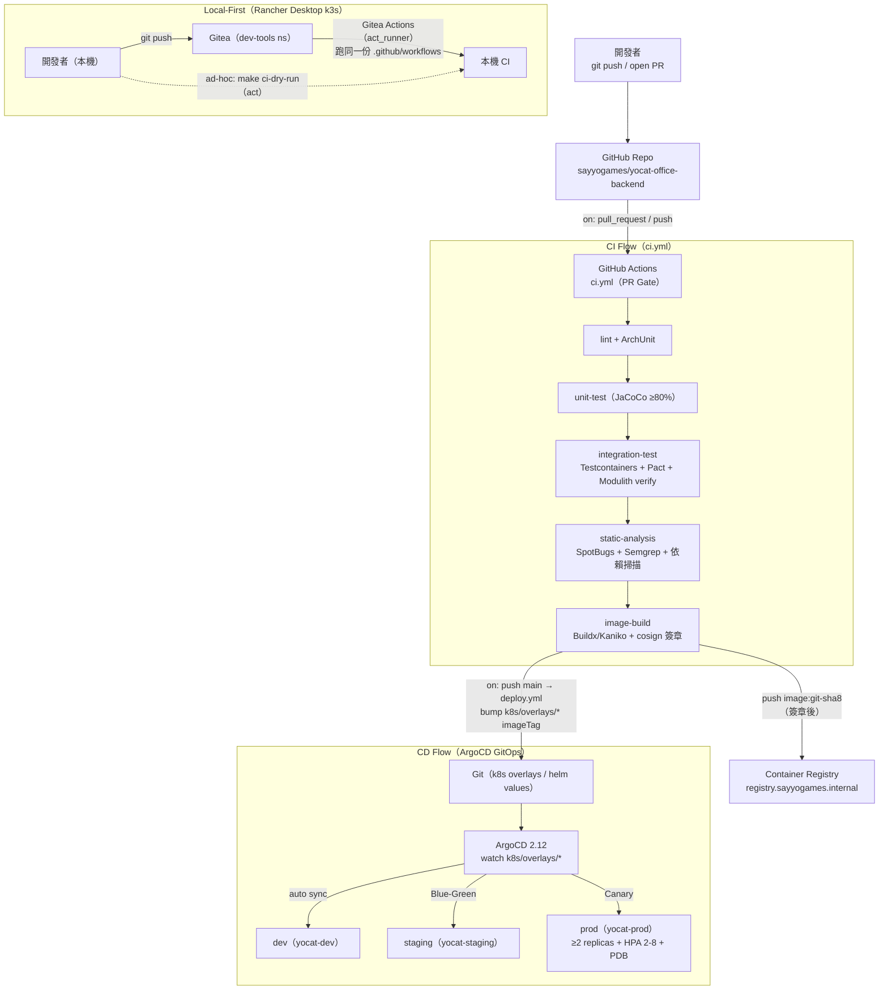
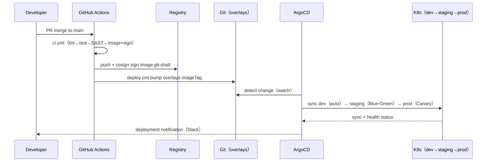
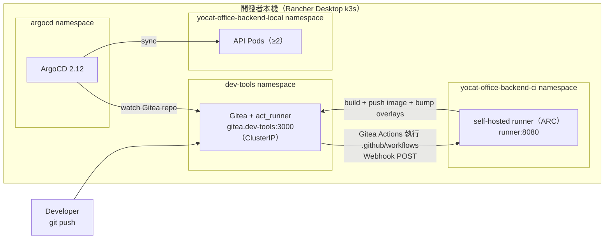

# CI/CD Pipeline Design Document — yoCat Office 後端信任層（yocat-office-backend）

> **本文件描述** yocat-office-backend 的持續整合（CI）與持續交付（CD）設計，包含工具選型、Pipeline 階段、GitHub Actions workflow 骨架、本地 Dry-Run 能力（`act` / Gitea Actions）、以及 Shared Make Targets 模式。
>
> **CI Tool**: GitHub Actions（EDD §3.3）
> **CD Tool**: ArgoCD 2.12（GitOps + Canary，EDD §3.3 / runbook §4.2）
> **Design Principle（Local-First）**：CI 與本地使用**相同的 Make targets 與相同的 workflow YAML**——雲端走 GitHub Actions、本機 Rancher Desktop 以 Gitea Actions / `act` 跑同一份 `.github/workflows`，消除「本地 OK、CI 炸掉」問題（EDD §1.2 Local-First / PRD §5.5 AC-5）。
>
> ⚠️ **CI_TOOL 偵測結果**：EDD §3.3 技術棧明定 **CI 工具 = GitHub Actions、CD 工具 = ArgoCD**；runbook §2 亦載明「ArgoCD GitOps + GitHub Actions」。本文件依 CICD.gen.md §0 的 CI_TOOL 分流，採 **GitHub Actions 分支**（§2 為 `.github/workflows/*.yml`、§3 為 `act` 本地 runner），非 Jenkins 預設骨架。

---

## Document Control

| 欄位 | 值 |
|------|---|
| **CI 工具** | GitHub Actions（EDD §3.3；self-hosted runner on k3s + GitHub-hosted `ubuntu-24.04`） |
| **CD 工具** | ArgoCD 2.12（GitOps、Canary via GitOps，EDD §3.3 / §3.5） |
| **K8s Cluster（CI 執行環境）** | Local: `rancher-desktop`（k3s，Gitea Actions / `act`） / Prod: `prod-cluster`（self-hosted runner、ArgoCD 同步） |
| **Container Registry** | `registry.sayyogames.internal/yocat-office-backend`（EDD §3.5） |
| **Source Repository** | `sayyogames/yocat-office-backend`（EDD Document Control） |
| **Branch Strategy** | GitHub Flow（`main` 受保護，功能走 PR branch；release 以 tag `vX.Y.Z` 標記） |
| **Image Tag 策略** | `git-sha8`（CI 產出，EDD §3.5 / runbook §2） |
| **Base Image** | build `maven:3.9-eclipse-temurin-21` → runtime `eclipse-temurin:21-jre-alpine`（EDD §3.5 / LOCAL_DEPLOY §4.4） |
| **PR Gate Policy** | §5 所有 required-status-checks 通過 + 1 review approval 後方可合併至 `main` |
| **Author** | 資深 DevOps Engineer（gendoc gen CICD） |
| **Last Updated** | 2026-10-30 |

---

## §1 Pipeline Architecture

### 1.1 CI/CD 總架構圖（GitHub Actions + ArgoCD GitOps）



### 1.2 CI Runner / Job 執行環境設計

CI 以兩種 runner 執行，兩者跑**完全相同**的 workflow YAML（Local-First 核心）：

| 屬性 | GitHub-hosted（雲端 PR Gate）| Self-Hosted on k3s（部署 / 本機） |
|------|------------------------------|-----------------------------------|
| **Runner** | `ubuntu-24.04`（GitHub 託管） | actions-runner-controller（ARC）/ Gitea `act_runner` |
| **Namespace** | N/A（GitHub SaaS） | `yocat-office-backend-ci` |
| **Service Account** | N/A | `yocat-ci-runner` |
| **Build 容器 Image** | `maven:3.9-eclipse-temurin-21`（EDD §3.3 build tool = Maven + Java 21） | `maven:3.9-eclipse-temurin-21` |
| **Image Build** | `docker/build-push-action`（buildx，非 privileged DinD） | **Kaniko**（`gcr.io/kaniko-project/executor`，k3s 無 privileged） |
| **CPU Request / Limit** | GitHub 託管規格 | `500m` / `2` |
| **Memory Request / Limit** | GitHub 託管規格 | `1Gi` / `4Gi` |
| **Testcontainers** | 透過 runner 內 Docker | DinD-free：Testcontainers 以 `TESTCONTAINERS_RYUK_DISABLED` + rootless buildkit / 既有 k3s containerd |

> **禁止 DinD**：self-hosted（k3s）影像建置一律用 **Kaniko**（免 privileged container），對齊 Rancher Desktop k3s 預設禁用 privileged 的限制（EDD §3.5）。GitHub-hosted runner 使用官方 `docker/build-push-action`（buildx），非特權 DinD。

### 1.3 Pipeline Stage 總覽（PR → merge → deploy）

```mermaid
graph LR
    S1["Checkout"] --> S2["Lint + ArchUnit<br/>（Clean Arch 依賴規則）"]
    S2 --> S3["Unit Test<br/>JaCoCo ≥80%"]
    S3 --> S4["Integration Test<br/>Testcontainers + Pact<br/>+ Modulith verify()"]
    S4 --> S5["Static Analysis<br/>SpotBugs + Semgrep + 依賴掃描"]
    S5 --> S6["Image Build + Sign<br/>Kaniko/Buildx + cosign"]
    S6 -->|"merge main"| S7["Deploy dev → staging → prod<br/>（ArgoCD GitOps）"]
    S7 --> S8["HA Verify（≥2 replicas）<br/>+ Smoke + k6"]
    S8 -->|"FAIL"| S9["Rollback<br/>（git revert → ArgoCD sync）"]
```



- 6 個 CI stage（S1-S6）為 **PR Gate**（§5）；S7-S9 於 merge `main` 後由 `deploy.yml` + ArgoCD 執行。
- Fail-Fast（test-plan §2.2）：任一 stage 失敗立即中止，不進入下一階段。

---

## §2 CI Workflow 骨架（GitHub Actions — `.github/workflows/ci.yml`）

> CI_TOOL = GitHub Actions：本節取代 Jenkins 預設骨架。所有 action 均鎖定**具體版本號**（YAML-01），不得使用 `@latest` / `@main`。每個 job 均含完整可執行 `steps`。

### 2.1 PR Gate Workflow — `.github/workflows/ci.yml`

```yaml
# .github/workflows/ci.yml — yocat-office-backend PR Gate
# CI ↔ Local 共用：本機以 Gitea Actions（act_runner）或 `make ci-dry-run`（act）跑同一份檔案
name: ci
on:
  pull_request:
    branches: [main]
  push:
    branches: [main]

permissions:
  contents: read
  packages: write
  id-token: write   # cosign keyless（OIDC）簽章需要

concurrency:
  group: ci-${{ github.ref }}
  cancel-in-progress: true

env:
  REGISTRY: registry.sayyogames.internal/yocat-office-backend
  IMAGE_NAME: api
  JAVA_VERSION: "21"

jobs:
  lint:
    name: lint
    runs-on: ubuntu-24.04
    steps:
      - name: Checkout
        uses: actions/checkout@v4
      - name: Set up JDK 21
        uses: actions/setup-java@v4
        with:
          distribution: temurin
          java-version: "21"
          cache: maven
      - name: Spotless / Checkstyle
        run: make ci-lint
      - name: ArchUnit（Clean Architecture 依賴規則）
        run: make ci-archunit   # Domain 不得 import org.springframework.* / java.sql.*（EDD §3.1b）

  unit-test:
    name: unit-test
    needs: lint
    runs-on: ubuntu-24.04
    steps:
      - name: Checkout
        uses: actions/checkout@v4
      - name: Set up JDK 21
        uses: actions/setup-java@v4
        with:
          distribution: temurin
          java-version: "21"
          cache: maven
      - name: Unit Test + JaCoCo 覆蓋率閘（Line ≥80% / Branch ≥70% / 核心交易 100%）
        run: make ci-test-unit   # JaCoCo check goal 低於門檻即 fail（test-plan §3.1）
      - name: Upload JaCoCo report
        if: always()
        uses: actions/upload-artifact@v4
        with:
          name: jacoco-report
          path: apps/api/target/site/jacoco/

  integration-test:
    name: integration-test
    needs: unit-test
    runs-on: ubuntu-24.04
    steps:
      - name: Checkout
        uses: actions/checkout@v4
      - name: Set up JDK 21
        uses: actions/setup-java@v4
        with:
          distribution: temurin
          java-version: "21"
          cache: maven
      - name: Integration Test（Testcontainers：真實 PostgreSQL 16 / Redis 7.2）
        run: make ci-test-integration   # REST-assured + Testcontainers（test-plan §3.2）
      - name: Spring Modulith 邊界驗證 — ApplicationModules.verify()
        run: make ci-test-modulith      # HC-1~HC-5：0 循環依賴、BC 邊界完整（EDD §4.3）
      - name: Pact Consumer-Driven Contract（BC 間 Public API 合約，100% 通過）
        run: make ci-contract-test       # WalletService.debit() 等合約（test-plan §3.2）
      - name: Schema 隔離掃描（跨 BC JOIN = 0，HC-1）
        run: make ci-test-schema-isolation
      - name: Publish test results
        if: always()
        uses: actions/upload-artifact@v4
        with:
          name: integration-test-results
          path: apps/api/target/failsafe-reports/

  static-analysis:
    name: static-analysis
    needs: unit-test
    runs-on: ubuntu-24.04
    steps:
      - name: Checkout
        uses: actions/checkout@v4
      - name: Set up JDK 21
        uses: actions/setup-java@v4
        with:
          distribution: temurin
          java-version: "21"
          cache: maven
      - name: SpotBugs + FindSecBugs（SAST，0 High/Critical）
        run: make ci-spotbugs
      - name: Semgrep（SAST 規則集，0 High/Critical）
        run: make ci-semgrep   # 品質閘：High/Critical = 0（test-plan §2 / PRD §9.3）
      - name: 依賴漏洞掃描（OWASP Dependency-Check / Trivy fs，0 CRITICAL）
        run: make ci-dependency-scan

  image-build:
    name: image-build
    needs: [integration-test, static-analysis]
    runs-on: ubuntu-24.04
    steps:
      - name: Checkout
        uses: actions/checkout@v4
      - name: Compute image tag（git-sha8）
        id: meta
        run: echo "tag=$(git rev-parse --short=8 HEAD)" >> "$GITHUB_OUTPUT"
      - name: Set up Buildx（非特權，取代 DinD）
        uses: docker/setup-buildx-action@v3
      - name: Log in to registry
        uses: docker/login-action@v3
        with:
          registry: registry.sayyogames.internal
          username: ${{ secrets.REGISTRY_USERNAME }}
          password: ${{ secrets.REGISTRY_TOKEN }}
      - name: Build & Push image
        uses: docker/build-push-action@v6
        with:
          context: .
          file: docker/api/Dockerfile   # multi-stage，對齊 LOCAL_DEPLOY §4.4（同一份 Dockerfile）
          push: true
          tags: |
            ${{ env.REGISTRY }}/${{ env.IMAGE_NAME }}:${{ steps.meta.outputs.tag }}
            ${{ env.REGISTRY }}/${{ env.IMAGE_NAME }}:latest
      - name: Install cosign
        uses: sigstore/cosign-installer@v3
      - name: Sign image（cosign keyless / OIDC）
        run: make ci-image-sign IMAGE_TAG=${{ steps.meta.outputs.tag }}
      - name: Trivy image scan（0 CRITICAL 漏洞，品質閘）
        uses: aquasecurity/trivy-action@0.28.0
        with:
          image-ref: ${{ env.REGISTRY }}/${{ env.IMAGE_NAME }}:${{ steps.meta.outputs.tag }}
          severity: CRITICAL,HIGH
          exit-code: "1"           # 發現 CRITICAL/HIGH 即 fail（0 CRITICAL 漏洞閘）
```

### 2.2 Deploy Workflow — `.github/workflows/deploy.yml`（merge main 後，GitOps bump）

```yaml
# .github/workflows/deploy.yml — 環境晉升 dev → staging → prod（GitOps，ArgoCD 同步）
name: deploy
on:
  push:
    branches: [main]
    paths-ignore: ["docs/**", "**/*.md"]
  workflow_dispatch:
    inputs:
      target_env:
        description: "部署目標環境"
        required: true
        default: dev
        type: choice
        options: [dev, staging, prod]

permissions:
  contents: write   # bump overlays imageTag（git commit）需要

env:
  REGISTRY: registry.sayyogames.internal/yocat-office-backend

jobs:
  bump-image-tag:
    name: bump-image-tag
    runs-on: ubuntu-24.04
    steps:
      - name: Checkout
        uses: actions/checkout@v4
      - name: Compute image tag
        id: meta
        run: echo "tag=$(git rev-parse --short=8 HEAD)" >> "$GITHUB_OUTPUT"
      - name: Bump imageTag in overlays（dev → staging → prod 依序 PR/commit）
        run: |
          make cd-bump-image ENV=dev     IMAGE_TAG=${{ steps.meta.outputs.tag }}
          make cd-bump-image ENV=staging IMAGE_TAG=${{ steps.meta.outputs.tag }}
          make cd-bump-image ENV=prod    IMAGE_TAG=${{ steps.meta.outputs.tag }}
      - name: Commit & push（ArgoCD watch 後自動同步）
        run: |
          git config user.name "ci-bot"
          git config user.email "ci-bot@sayyogames.com"
          git commit -am "ci(cd): bump image to ${{ steps.meta.outputs.tag }}" || echo "no change"
          git push

  verify-rollout:
    name: verify-rollout
    needs: bump-image-tag
    runs-on: [self-hosted, k3s]   # self-hosted runner 具 kubectl 權限
    steps:
      - name: Checkout
        uses: actions/checkout@v4
      - name: Wait ArgoCD sync + HA ready（≥2 replicas）
        run: make cd-verify-ha ENV=${{ github.event.inputs.target_env || 'dev' }}
      - name: Smoke test
        run: make ci-smoke ENV=${{ github.event.inputs.target_env || 'dev' }}
      - name: k6 部署後壓測（P99 ≤ 1000ms @ 500 PCU）
        run: make ci-perf ENV=${{ github.event.inputs.target_env || 'dev' }}
```

> **gendoc 原則落實**：`ci.yml` 的 `integration-test` job 強制執行 `ApplicationModules.verify()`（Spring Modulith 邊界）與 ArchUnit（Clean Architecture 依賴規則）；`deploy.yml` 的 `verify-rollout` 強制驗證 **≥2 replicas**（HA）。

---

## §3 Local Pipeline Dry-Run（`act` / Gitea Actions）

### 3.1 為何需要 Local Dry-Run（Local-First）

開發者在開 PR 前應能於本機 Rancher Desktop 模擬完整 CI，避免「本地 OK、CI 炸掉」（EDD §1.2）：

| 問題類型 | 發生率 | Local Dry-Run 可提前發現？ |
|---------|-------|-------------------------|
| Makefile target 語法 / 名稱錯誤 | 高 | ✅ 是 |
| workflow YAML 語法錯誤 | 中 | ✅ 是（`act` 解析同一份 `.github/workflows`） |
| JaCoCo 覆蓋率未達 80% | 高 | ✅ 是（`make ci-test-unit` 本機即跑 JaCoCo gate） |
| Testcontainers 整合測試失敗 | 中 | ✅ 是（本機 Docker/containerd 起真實 PostgreSQL/Redis） |
| Modulith / ArchUnit 邊界違規 | 中 | ✅ 是（`make ci-test-modulith` / `make ci-archunit`） |
| 自架 runner image 不相容 | 低 | 部分（需相同 build image） |

### 3.2 `act` 安裝（本機跑 GitHub Actions）

```bash
# 方式 A：choco（Windows）
choco install act-cli

# 方式 B：下載 release（鎖定版本，與 CI runner 對齊）
ACT_VERSION="0.2.69"
curl -L "https://github.com/nektos/act/releases/download/v${ACT_VERSION}/act_Windows_x86_64.zip" -o /tmp/act.zip
unzip /tmp/act.zip -d /c/tools/act
```

### 3.3 Local Dry-Run 執行

```bash
# 方式 A：act 跑 PR Gate（與 CI 完全相同的 .github/workflows/ci.yml）
act pull_request \
  -W .github/workflows/ci.yml \
  --container-architecture linux/amd64 \
  -P ubuntu-24.04=catthehacker/ubuntu:act-24.04 \
  --secret-file ci/mock-secrets/env

# 方式 B：Gitea Actions（act_runner）— 本機 push 到 Gitea 自動觸發（見 §8）
#   Gitea Actions 與 GitHub Actions 語法相容，直接複用 .github/workflows

# 方式 C（推薦日常）：透過 make target
make ci-dry-run
```

### 3.4 Mock Secrets 設定（本機假值，不含真實憑證）

```bash
mkdir -p ci/mock-secrets

cat > ci/mock-secrets/env << 'EOF'
REGISTRY_USERNAME=ci-mock-user
REGISTRY_TOKEN=ci-mock-token-not-real
DB_PASSWORD=ci-mock-password-not-real
SESSION_SIGNING_KEY=ci-mock-session-signing-key-not-real-64chars
ENCRYPTION_KEY=ci-mock-encryption-key-not-real-32chars
EOF

# 真實憑證請用 .real 後綴並由 .gitignore 保護
echo "ci/mock-secrets/*.real" >> .gitignore
```

> **說明**：`ci/mock-secrets/env` 存放本機 dry-run 用的假值（可進版控供他人參考）；真實憑證一律 `.real` 後綴且被 `.gitignore` 保護，不進 git 歷史。Mock 清單涵蓋 §2 workflow 所有 `secrets.*` 引用（`REGISTRY_USERNAME` / `REGISTRY_TOKEN`）與應用 Secret（對齊 LOCAL_DEPLOY §3.5）。

---

## §4 Shared Make Targets（CI ↔ Local 共用介面）

> **設計原則**：GitHub Actions / Gitea Actions / 開發者本機使用**相同的 Make targets**。§2 workflow 的每個 step 均呼叫 `make`，確保雲端 CI 與本機行為一致（消除 CI-as-snowflake）。

### 4.1 標準 Make Target 清單（CI stage ↔ Make target ↔ LOCAL_DEPLOY §6 對照）

| CI Stage（§2 job）| Make Target | 底層 | 對齊 LOCAL_DEPLOY §6 |
|-------------------|-------------|------|----------------------|
| lint | `make ci-lint` | `make lint`（`./mvnw spotless:check`）| ✅ 既有（§6 `lint`） |
| lint | `make ci-archunit` | `./mvnw -pl apps/api test -Dtest=ArchUnitRulesTest` | ⚠️ 新增，需同步加入 LOCAL_DEPLOY §6 |
| unit-test | `make ci-test-unit` | `make test-unit` + JaCoCo check（`./mvnw -pl apps/api test jacoco:check`）| ✅ 既有（§6 `test-unit`，追加 JaCoCo gate） |
| integration-test | `make ci-test-integration` | `make test-integration`（`./mvnw verify -Pintegration`，Testcontainers）| ✅ 既有（§6 `test-integration`） |
| integration-test | `make ci-test-modulith` | `make test-modulith`（`./mvnw test -Dtest=ModularityTests`）| ✅ 既有（§6 `test-modulith`） |
| integration-test | `make ci-contract-test` | `./mvnw -pl apps/api test -Dpact` | ⚠️ 新增，需同步加入 LOCAL_DEPLOY §6 |
| integration-test | `make ci-test-schema-isolation` | `make test-schema-isolation` | ✅ 既有（§6 `test-schema-isolation`） |
| static-analysis | `make ci-spotbugs` / `ci-semgrep` / `ci-dependency-scan` | SpotBugs / Semgrep / Trivy fs | ⚠️ 新增，需同步加入 LOCAL_DEPLOY §6 |
| image-build | `make image-build-api` | `nerdctl --namespace k8s.io build ...`（本機）/ buildx（CI）| ✅ 既有（§6 `image-build-api`） |
| image-build | `make ci-image-sign` | `cosign sign ...` | ⚠️ 新增，需同步加入 LOCAL_DEPLOY §6 |
| verify-rollout | `make cd-verify-ha` | `kubectl rollout status` + `grep -c Running ≥ 2` | ⚠️ 新增（HA 驗證），需同步加入 LOCAL_DEPLOY §6 |
| verify-rollout | `make ci-smoke` | `make health-check` 包裝 | ✅ 既有（§6 `health-check`） |
| verify-rollout | `make ci-perf` | `k6 run tests/performance/load-test.js` | ⚠️ 新增，需同步加入 LOCAL_DEPLOY §6 |
| rollback | `make ci-rollback` | `kubectl rollout undo` + git revert | ⚠️ 新增，需同步加入 LOCAL_DEPLOY §6 |
| dry-run | `make ci-dry-run` | `act pull_request -W .github/workflows/ci.yml` | ⚠️ 新增，需同步加入 LOCAL_DEPLOY §6 |

> **對齊備註（R-03）**：以 LOCAL_DEPLOY §6 既有 target（`lint` / `test-unit` / `test-integration` / `test-modulith` / `test-schema-isolation` / `image-build-api` / `health-check`）為準，CI 以 `ci-*` wrapper 包裝呼叫；標記 ⚠️ 的新增 target（含 CI 專屬 SAST / 簽章 / HA 驗證 / rollback / dry-run）**需同步加入 LOCAL_DEPLOY.md §6**。

### 4.2 Makefile 實作範例（CI/CD 區塊）

```makefile
# ── CI/CD Make targets — yocat-office-backend ──────────────────
# 所有 ci-* / cd-* targets 於 GitHub Actions、Gitea Actions、本機均可執行
IMAGE_TAG     ?= $(shell git rev-parse --short=8 HEAD)
REGISTRY      ?= registry.sayyogames.internal/yocat-office-backend
PROJECT_SLUG  ?= yocat-office-backend
ENV           ?= dev
NS_dev        := yocat-dev
NS_staging    := yocat-staging
NS_prod       := yocat-prod
NS_local      := yocat-office-backend-local

.PHONY: ci-lint ci-archunit ci-test-unit ci-test-integration ci-test-modulith \
        ci-contract-test ci-spotbugs ci-semgrep ci-dependency-scan \
        ci-image-sign ci-smoke ci-perf ci-rollback ci-dry-run \
        cd-bump-image cd-verify-ha

ci-lint:
	./mvnw -pl apps/api spotless:check
	@echo "✅ Lint passed"

ci-archunit:
	./mvnw -pl apps/api test -Dtest=ArchUnitRulesTest   # Clean Arch 依賴規則（EDD §3.1b）
	@echo "✅ ArchUnit passed（Domain 無 Spring/JDBC import）"

ci-test-unit:
	./mvnw -pl apps/api test jacoco:report jacoco:check  # Line ≥80% / Branch ≥70% / 核心 100%
	@echo "✅ Unit tests + JaCoCo gate passed"

ci-test-integration:
	./mvnw -pl apps/api verify -Pintegration             # Testcontainers（PostgreSQL 16 / Redis 7.2）
	@echo "✅ Integration tests passed"

ci-test-modulith:
	./mvnw -pl apps/api test -Dtest=ModularityTests      # ApplicationModules.verify()（HC-1~HC-5）
	@echo "✅ Spring Modulith boundary verified"

ci-contract-test:
	./mvnw -pl apps/api test -Dpact                      # Pact consumer-driven contract（100%）
	@echo "✅ Pact contracts passed"

ci-spotbugs:
	./mvnw -pl apps/api com.github.spotbugs:spotbugs-maven-plugin:check
ci-semgrep:
	semgrep --config=auto --error --severity=ERROR apps/api/src
ci-dependency-scan:
	trivy fs --severity CRITICAL,HIGH --exit-code 1 .    # 0 CRITICAL 漏洞閘

ci-image-sign:
	cosign sign --yes $(REGISTRY)/api:$(IMAGE_TAG)        # keyless（OIDC）

cd-bump-image:
	cd k8s/overlays/$(ENV) && kustomize edit set image \
	  $(REGISTRY)/api=$(REGISTRY)/api:$(IMAGE_TAG)

cd-verify-ha:
	kubectl rollout status deployment/$(PROJECT_SLUG)-api -n $(NS_$(ENV)) --timeout=300s
	@n=$$(kubectl get pods -l app=$(PROJECT_SLUG)-api -n $(NS_$(ENV)) | grep -c Running); \
	 echo "running replicas = $$n"; test $$n -ge 2   # Iron Constraint：≥2 replicas（EDD §3.7）

ci-smoke:
	curl -sf https://api.yocat.sayyogames.com/health/ready | jq .   # prod；其他環境替換 host
	@echo "✅ Smoke test passed"

ci-perf:
	k6 run tests/performance/load-test.js                # P99 ≤ 1000ms @ 500 PCU（test-plan §5）

ci-rollback:
	kubectl rollout undo deployment/$(PROJECT_SLUG)-api -n $(NS_$(ENV))
	kubectl rollout status deployment/$(PROJECT_SLUG)-api -n $(NS_$(ENV)) --timeout=120s
	@echo "⚠️  Rolled back（並以 git revert 同步 GitOps 真相）"

ci-dry-run:
	act pull_request -W .github/workflows/ci.yml \
	  -P ubuntu-24.04=catthehacker/ubuntu:act-24.04 \
	  --secret-file ci/mock-secrets/env
```

---

## §5 PR Gate

所有 Pull Request 必須通過以下 GitHub Actions jobs 後方可合併至 `main`。

### 5.1 PR Gate 清單

| Stage（§2 job）| 必須通過 | 允許跳過條件 |
|----------------|---------|------------|
| Checkout | ✅ 必須 | 無 |
| lint + ArchUnit（`make ci-lint` / `ci-archunit`）| ✅ 必須 | 無 |
| unit-test + JaCoCo ≥80%（`make ci-test-unit`）| ✅ 必須 | 無 |
| integration-test（Testcontainers + Pact + Modulith verify）| ✅ 必須 | 無 |
| static-analysis（SpotBugs + Semgrep + 依賴掃描，0 High/Critical）| ✅ 必須 | 無 |
| image-build + cosign sign + Trivy（0 CRITICAL）| ✅ 必須（PR 建置驗證）| `[skip-image]` commit prefix（僅 docs-only PR）|

### 5.2 Branch Protection Rules（GitHub）— `required-status-checks`

```yaml
# .github/branch-protection.yml（參考；實際於 GitHub UI / API 設定）
# contexts 必須與 §2 ci.yml 的 job name 完全一致
main:
  required_status_checks:
    strict: true
    contexts:
      - "lint"
      - "unit-test"
      - "integration-test"
      - "static-analysis"
      - "image-build"
  required_pull_request_reviews:
    required_approving_review_count: 1
    dismiss_stale_reviews: true
  enforce_admins: true
  required_linear_history: true
```

> **一致性（R-04）**：`contexts` 清單（`lint` / `unit-test` / `integration-test` / `static-analysis` / `image-build`）與 §2 `ci.yml` 的 5 個 job `name` 完全對應，與 §4 的 CI Stage 欄一致。

### 5.3 開發者 Pre-PR Checklist

```bash
# 1. 本機 lint + ArchUnit（Clean Arch 依賴規則）
make ci-lint && make ci-archunit

# 2. 單元測試 + JaCoCo 覆蓋率閘（≥80%）
make ci-test-unit

# 3. 整合測試（需本機 Docker/containerd 起 Testcontainers）
make ci-test-integration

# 4. Spring Modulith 邊界 + Pact 合約
make ci-test-modulith && make ci-contract-test

# 5. 靜態分析（SpotBugs + Semgrep + 依賴掃描）
make ci-spotbugs && make ci-semgrep && make ci-dependency-scan

# 6. 選配：模擬完整 Pipeline（act）
make ci-dry-run

# 7. 確認 workflow / manifest 無裸 placeholder
grep -rE '\{\{[A-Z_]+\}\}' .github/workflows/ k8s/overlays/ && echo "⚠️ 有 placeholder 未替換" || echo "✅ 無裸 placeholder"

# 8. 確認無明文 credential
grep -rE 'password\s*=\s*[^$\{\[]' .github/workflows/ Makefile && echo "⚠️ 潛在明文 credential" || echo "✅ 無明文"
```

---

## §6 Self-Hosted Runner on k3s — 安裝與設定

> CI_TOOL = GitHub Actions：本節取代「Jenkins on k3s」。本機 / 自建環境以 **actions-runner-controller（ARC）** 或 **Gitea `act_runner`** 在 k3s 執行 self-hosted runner，用於需 `kubectl` 權限的部署驗證（§2 `verify-rollout`）與 Local-First CI。Runner namespace 統一為 `yocat-office-backend-ci`。

### 6.1 安裝 actions-runner-controller（Helm）

```bash
# 加入 ARC Helm repo
helm repo add actions-runner-controller https://actions-runner-controller.github.io/actions-runner-controller
helm repo update

# 建立 CI runner namespace
kubectl create namespace yocat-office-backend-ci

# 安裝 ARC（使用 GitHub App / PAT 認證，Secret 於 §10）
helm upgrade --install arc actions-runner-controller/actions-runner-controller \
  -n yocat-office-backend-ci \
  -f ci/arc-values.yaml \
  --wait
```

### 6.2 arc-values.yaml / RunnerDeployment 範例

```yaml
# ci/arc-values.yaml（controller 資源）
authSecret:
  create: false
  name: controller-manager   # 由 §10 kubectl create secret 建立
resources:
  requests: { cpu: "500m", memory: "512Mi" }
  limits:   { cpu: "2",    memory: "2Gi" }
---
# ci/runner-deployment.yaml — ephemeral runner（Kaniko 建置，免 privileged DinD）
apiVersion: actions.summerwind.dev/v1alpha1
kind: RunnerDeployment
metadata:
  name: yocat-ci-runner
  namespace: yocat-office-backend-ci
spec:
  replicas: 2                   # ≥2 runner，CI 並行且無 SPOF
  template:
    spec:
      repository: sayyogames/yocat-office-backend
      labels: [self-hosted, k3s]
      serviceAccountName: yocat-ci-runner
      resources:
        requests: { cpu: "500m", memory: "1Gi" }
        limits:   { cpu: "2",    memory: "4Gi" }
      dockerEnabled: false      # 禁 DinD；image build 走 Kaniko job
```

### 6.3 Runner Service Account + RBAC（最小權限）

```yaml
# k8s/ci/rbac.yaml
apiVersion: v1
kind: ServiceAccount
metadata:
  name: yocat-ci-runner
  namespace: yocat-office-backend-ci
---
# LOCAL / Dev 環境：為簡化本機驗證可用 cluster-admin（下方註明僅限 LOCAL）
# Staging / Production：必須改為 namespace-scoped Role（僅部署目標 namespace）
apiVersion: rbac.authorization.k8s.io/v1
kind: Role
metadata:
  name: yocat-ci-deployer
  namespace: yocat-office-backend-ci
rules:
  - apiGroups: [""]
    resources: ["pods", "pods/log", "pods/exec"]
    verbs: ["get", "list", "watch", "create", "update", "patch", "delete"]
  - apiGroups: ["apps"]
    resources: ["deployments", "replicasets"]
    verbs: ["get", "list", "watch", "update", "patch"]
---
apiVersion: rbac.authorization.k8s.io/v1
kind: RoleBinding
metadata:
  name: yocat-ci-deployer
  namespace: yocat-office-backend-ci
roleRef: { apiGroup: rbac.authorization.k8s.io, kind: Role, name: yocat-ci-deployer }
subjects:
  - kind: ServiceAccount
    name: yocat-ci-runner
    namespace: yocat-office-backend-ci
```

> **RBAC 原則（R-07）**：**LOCAL ONLY** 環境可暫用 `ClusterRole=cluster-admin` 以簡化本機驗證（須明確註記「Production 禁止 cluster-admin」）；**Staging / Production** 一律使用上方 namespace-scoped `Role`，僅授予 `pods` / `pods/exec` / `pods/log` / `deployments` 的最小 verbs，禁止 `nodes` / `clusterroles` / 跨 namespace `secrets` 寫入權限。

### 6.4 Registry Credentials Secret

```bash
# 私有 registry token → K8s Secret（供 Kaniko / runner 推 image）
kubectl create secret docker-registry registry-credentials \
  -n yocat-office-backend-ci \
  --docker-server=registry.sayyogames.internal \
  --docker-username="$(powershell -c "[System.Runtime.InteropServices.Marshal]::PtrToStringAuto([System.Runtime.InteropServices.Marshal]::SecureStringToBSTR((Get-StoredCredential -Target yocat-registry).Password))")"
  # Windows Credential Manager 讀取（LOCAL_DEPLOY §3.5 層 2 OS Keychain）；密碼不落地明文
```

> Runner namespace 一致性：§6.1 Helm `-n`、§6.3 RBAC `metadata.namespace`、§6.4 `kubectl create secret -n`、§9 `dev-tools-install` runner 安裝 `-n`、§8.4 Webhook URL namespace 片段，**五處均為 `yocat-office-backend-ci`**。

---

## §7 ArgoCD CD Integration（GitOps）

### 7.1 ArgoCD 安裝（本地 / Staging / Prod）

```bash
# 安裝 ArgoCD 2.12
kubectl create namespace argocd
kubectl apply -n argocd \
  -f https://raw.githubusercontent.com/argoproj/argo-cd/v2.12.3/manifests/install.yaml

# 等待 ArgoCD 就緒
kubectl wait --for=condition=Ready pods --all -n argocd --timeout=180s

# 取得初始 admin password
argocd admin initial-password -n argocd
```

### 7.2 ArgoCD Application 定義（每環境一個）

```yaml
# k8s/argocd/app.yaml（以 prod 為例；dev/staging 同結構，改 path 與 namespace）
apiVersion: argoproj.io/v1alpha1
kind: Application
metadata:
  name: yocat-office-backend-prod
  namespace: argocd
spec:
  project: default
  source:
    # Prod/Staging/Dev: https://github.com/sayyogames/yocat-office-backend
    # LOCAL（Rancher Desktop）: http://gitea.dev-tools.svc.cluster.local:3000/dev/yocat-office-backend.git
    repoURL: https://github.com/sayyogames/yocat-office-backend
    targetRevision: main
    path: k8s/overlays/prod
  destination:
    server: https://kubernetes.default.svc
    namespace: yocat-prod
  syncPolicy:
    automated: { prune: true, selfHeal: true }
    syncOptions: ["CreateNamespace=true"]
```

### 7.3 環境晉升（dev → staging → prod）

| 環境 | Namespace | ArgoCD 同步策略 | 觸發 | 品質閘 |
|------|-----------|----------------|------|--------|
| **dev** | `yocat-dev` | auto sync（prune + selfHeal） | merge `main` 後 `deploy.yml` bump | CI 全綠 |
| **staging** | `yocat-staging` | Blue-Green（EDD §3.5） | dev 驗證通過 + SAST/DAST（ZAP）0 High/Critical | k6 煙霧 + 滲透測試 0 可竄改路徑（test-plan §5） |
| **prod** | `yocat-prod` | **Canary via GitOps**（EDD §3.5 / runbook §4.2） | staging 驗證通過 + release tag `vX.Y.Z` | HA ≥2 + 5XX ≤0.1% + 錢包對帳 0 不一致（runbook §4.2） |



### 7.4 回滾（Rollback）

| 層級 | 方法 | 指令 |
|------|------|------|
| **即時止血** | `kubectl rollout undo`（脫離 GitOps，暫時） | `make ci-rollback ENV=prod` |
| **GitOps 真相回復** | git revert bump commit → ArgoCD 自動同步回舊版 | `git revert <bump-sha> && git push` |
| **ArgoCD history** | ArgoCD 回滾至前一 synced revision | `argocd app rollback yocat-office-backend-prod <id>` |
| **DB migration** | Flyway **不 drop**，採 expand-contract 向後相容；程式回滾不需回滾 schema（runbook §7.10 / SCHEMA §8） | `flyway:repair` + 新 contract migration |

> **回滾後**：`cd-verify-ha` 確認 ≥2 replicas Running、smoke 通過，並於 `#deploy-yocat-office-backend` 公告（runbook §4.2）。

---

## §8 Local Developer Platform（Gitea）

> Gitea 作為本機 Git Server + **Gitea Actions**（GitHub Actions 相容），讓整條 CI/CD 在 Rancher Desktop 完全自給自足——不依賴外部 GitHub。開發者 push 到本機 Gitea → Gitea Actions（`act_runner`）跑**同一份 `.github/workflows`** → ArgoCD 從 Gitea 讀 overlays → k3s 同步。這是 Local-First 的本機閉環（EDD §1.2 / PRD §5.5 AC-5）。

### 8.1 架構圖



### 8.2 Gitea 安裝（Helm）

```bash
helm repo add gitea-charts https://dl.gitea.com/charts/
helm repo update

kubectl create namespace dev-tools

helm upgrade --install gitea gitea-charts/gitea \
  -n dev-tools \
  -f k8s/dev-tools/gitea-values.yaml \
  --wait
```

### 8.3 gitea-values.yaml 範例

```yaml
# k8s/dev-tools/gitea-values.yaml
gitea:
  admin:
    username: "gitea-admin"
    existingSecret: gitea-admin-secret     # 引用 K8s Secret，禁止明文/inline placeholder
    email: "admin@local.dev"
  config:
    server:
      DOMAIN: gitea.dev-tools.svc.cluster.local
      ROOT_URL: http://gitea.dev-tools.svc.cluster.local:3000/
    actions:
      ENABLED: "true"                        # 啟用 Gitea Actions（GitHub Actions 相容）

service:
  type: ClusterIP                            # 禁 NodePort / LoadBalancer（Port 分離原則）
  port: 3000

persistence:
  enabled: true
  size: 256Mi

resources:
  requests: { cpu: "100m", memory: "128Mi" }
  limits:   { cpu: "500m", memory: "512Mi" }
```

> **Gitea admin 密碼安全（R-15）**：密碼**不得以明文或 inline placeholder 寫入文件**。改以 Gitea Helm 的 `existingSecret: gitea-admin-secret` 引用 K8s Secret，該 Secret 由 `scripts/bootstrap-secrets.sh` 以 `openssl rand -hex 16` 生成並存入 OS Keychain（LOCAL_DEPLOY §3.5 層 1/2），於部署時建立：
> ```bash
> kubectl create secret generic gitea-admin-secret -n dev-tools \
>   --from-literal=username=gitea-admin \
>   --from-literal=password="$(openssl rand -hex 16)"   # 一次性生成，不落地明文
> ```

### 8.4 Gitea Actions / Webhook 設定

Gitea → self-hosted runner / Gitea Actions（ClusterIP 直連，不需 Ingress）：

```
http://runner.yocat-office-backend-ci.svc.cluster.local:8080/gitea-webhook/post
```

> 注意：URL 中的 namespace 片段為 `yocat-office-backend-ci`（與 §6 runner 安裝 namespace 相同），不得硬編碼 `ci`。Gitea Actions 原生讀取 repo 內 `.github/workflows` / `.gitea/workflows`，與 GitHub Actions 語法相容，故本機與雲端共用同一份 workflow 定義。

### 8.5 ArgoCD 從 Gitea 讀取（本地環境專用）

```yaml
# k8s/argocd/app-local.yaml（LOCAL 環境專用）
apiVersion: argoproj.io/v1alpha1
kind: Application
metadata:
  name: yocat-office-backend-local
  namespace: argocd
spec:
  project: default
  source:
    repoURL: http://gitea.dev-tools.svc.cluster.local:3000/dev/yocat-office-backend.git
    targetRevision: main
    path: k8s/overlays/local
  destination:
    server: https://kubernetes.default.svc
    namespace: yocat-office-backend-local
  syncPolicy:
    automated: { prune: true, selfHeal: true }
    syncOptions: ["CreateNamespace=true"]
```

> **Port 分離原則**：App domain（`yocat-office-backend-local`）對外走單一 Ingress port 80（LOCAL_DEPLOY §2）。Dev-tools domain（Gitea 3000 / runner 8080 / ArgoCD 8443）使用各自獨立 port，不與 App port 衝突。

---

## §9 Makefile dev-tools Targets

於 `Makefile` 加入以下 dev-tools 管理 target，與 §4 Shared Make Targets 配套，用於本機一鍵建置 Local-First CI/CD 平台。

```makefile
# ── Dev-Tools 管理（Gitea + self-hosted runner + ArgoCD）────────
dev-tools-install:  ## 安裝 Gitea + self-hosted runner（ARC）+ ArgoCD
	kubectl create namespace dev-tools --dry-run=client -o yaml | kubectl apply -f -
	kubectl create namespace yocat-office-backend-ci --dry-run=client -o yaml | kubectl apply -f -
	kubectl create namespace argocd --dry-run=client -o yaml | kubectl apply -f -
	helm upgrade --install gitea gitea-charts/gitea -n dev-tools -f k8s/dev-tools/gitea-values.yaml --wait
	helm upgrade --install arc actions-runner-controller/actions-runner-controller \
	  -n yocat-office-backend-ci -f ci/arc-values.yaml --wait
	kubectl apply -n argocd -f k8s/argocd/app-local.yaml

dev-tools-status:   ## 檢查 dev-tools 所有元件狀態
	kubectl get pods -n dev-tools
	kubectl get pods -n yocat-office-backend-ci
	kubectl get pods -n argocd

dev-tools-forward:  ## Port-forward dev-tools（背景執行）
	kubectl port-forward -n dev-tools svc/gitea-http 3000:3000 &
	kubectl port-forward -n yocat-office-backend-ci svc/yocat-ci-runner 8080:8080 &
	kubectl port-forward -n argocd svc/argocd-server 8443:443 &
	@echo "Gitea:   http://localhost:3000"
	@echo "Runner:  http://localhost:8080"
	@echo "ArgoCD:  https://localhost:8443"

dev-tools-clean:    ## 卸載 dev-tools（保留資料 PVC）
	helm uninstall gitea -n dev-tools || true
	helm uninstall arc -n yocat-office-backend-ci || true

ci-setup-credentials:  ## 設定 CI 所需的 K8s Secrets（見 §10 Secret 表格）
	@echo "請執行 LOCAL_DEPLOY.md §3.5 bootstrap-secrets 腳本，並以 §6.4 建立 registry-credentials / ARC 認證 Secret"
```

> **5 個必要 target 齊備**：`dev-tools-install` / `dev-tools-status` / `dev-tools-forward` / `dev-tools-clean` / `ci-setup-credentials`。`dev-tools-install` 中 runner 的 `-n` 參數為 `yocat-office-backend-ci`（非硬編碼 `ci`）、Gitea 的 `-n` 為 `dev-tools`；均不與 §4 的 `ci-*` / `cd-*` target 命名衝突。

---

## §10 Security & Secret Management in CI

### 10.1 Secret Location 表格（對齊 LOCAL_DEPLOY §3.5 三層策略）

| Secret | 類型（LOCAL_DEPLOY §3.5）| 存放位置 | 使用方式 |
|--------|--------------------------|----------|---------|
| `DB_PASSWORD` | 層 1 Ephemeral（重啟可重生） | `bootstrap-secrets.sh`（`openssl rand`）→ K8s Secret `yocat-office-backend-api-secret` | Pod env injection（secretKeyRef） |
| `SESSION_SIGNING_KEY` | 層 1 Ephemeral | 同上（`openssl rand -hex 64`） | Pod env injection |
| `ENCRYPTION_KEY` | 層 1 Ephemeral | 同上（`openssl rand -hex 32`） | Pod env injection |
| Gitea admin 密碼 | 層 1 Ephemeral | K8s Secret `gitea-admin-secret`（`openssl rand -hex 16`，OS Keychain） | Gitea Helm `existingSecret` 引用（不落地明文） |
| `REGISTRY_TOKEN` / `REGISTRY_USERNAME` | 層 2 OS Keychain（固定憑證） | Windows Credential Manager → GitHub Actions `secrets.*` / K8s `registry-credentials` | `docker/login-action` / Kaniko docker config |
| GitHub App / PAT（ARC runner 認證） | 層 2 OS Keychain | K8s Secret `controller-manager`（§6.2） | ARC controller 讀取 |
| cosign signing（keyless OIDC） | 無長期金鑰 | GitHub OIDC token（`id-token: write`） | `cosign sign --yes`（Fulcio/Rekor） |
| Phase B 金流 API key | 層 3 Enterprise（本機不需） | Sealed Secrets / Vault（EDD §3.5） | Phase B init container 注入 |

> **禁止**：任何 credential 不得以明文出現在 `.github/workflows/*`、`Makefile`、K8s manifest 或任何版本控制檔案。workflow 一律以 `${{ secrets.NAME }}` 引用；Makefile 一律以 `$(VAR)` / 環境變數引用。

### 10.2 供應鏈安全（Supply Chain）

| 控制 | 工具 | 品質閘 |
|------|------|--------|
| SAST（原始碼） | SpotBugs + FindSecBugs + Semgrep | 0 High/Critical（test-plan §2 / PRD §9.3） |
| 依賴漏洞 | OWASP Dependency-Check / Trivy fs | 0 CRITICAL |
| 容器映像掃描 | Trivy image | 0 CRITICAL（§2 image-build，`exit-code: 1`） |
| 映像簽章 | cosign（keyless，Fulcio + Rekor 透明日誌） | 所有 push 至 registry 的 image 均簽章並可驗證 |
| DAST（部署後） | OWASP ZAP | 進 Staging 前 0 High/Critical（test-plan §5） |

---

## §11 Observability

### 11.1 Pipeline / 應用 Metrics（Prometheus）

```yaml
# 應用 metrics endpoint（Spring Boot Actuator / Micrometer，EDD §3.5 / LOCAL_DEPLOY §5）
#   http://<host>/actuator/prometheus
# CI/CD 指標（GitHub Actions telemetry + DORA）
github_actions_workflow_run_duration_seconds        # workflow 耗時
github_actions_workflow_run_conclusion_total        # success / failure 計數
dora_deployment_frequency                           # 部署頻率
dora_change_failure_rate                            # 變更失敗率（回滾/修補 比例）
dora_lead_time_for_changes_seconds                  # 交付前置時間
dora_mean_time_to_restore_seconds                   # MTTR
```

> 應用 Prometheus metrics endpoint 為 `/actuator/prometheus`（LOCAL_DEPLOY §5 / §12 Port Reference 確認），與 ARCH 可觀測性章節一致。

### 11.2 Build / Deploy Notification

| 事件 | 通知方式 | 通知目標 |
|------|---------|---------|
| PR gate 失敗 | GitHub Status Check + Slack | `#ci-alerts-yocat-office-backend` |
| `main` build 失敗 | Slack + Email | `#oncall-yocat-office-backend` |
| Deployment 完成 / 回滾 | Slack | `#deploy-yocat-office-backend`（runbook §4.1 既有慣例） |

> Deploy 通知頻道 `#deploy-yocat-office-backend` 來自 runbook §4.1 既有公告慣例；`#ci-alerts-yocat-office-backend` / `#oncall-yocat-office-backend` 依同一命名慣例衍生（格式 `#<用途>-<project-slug>`），EDD §3.4 未另指定時以此為準（待確認實際 Slack channel）。

---

## Appendix：CI/CD 工具選型決策

| 工具 | 選用理由 | 替代方案 |
|------|---------|---------|
| **GitHub Actions**（CI） | 與 repo（`sayyogames/yocat-office-backend`）原生整合；Local-First 可用 Gitea Actions / `act` 跑同一份 workflow；生態成熟、免維運 CI server（EDD §3.3 / runbook §2） | Jenkins（需自建 server + agent pod，運維重）、GitLab CI（需遷移 repo）、Tekton（YAML 複雜度高） |
| **ArgoCD 2.12**（CD） | GitOps 宣告式 + 自動 drift 修正；支援 Canary（prod）/ Blue-Green（staging）；UI 直覺；Helm + Kustomize（EDD §3.3 / §3.5） | Flux（UI 較弱）、Spinnaker（重量級） |
| **Kaniko / Buildx**（Image Build） | 免 Docker-in-Docker（不需 privileged container）；k3s native；對齊 Rancher Desktop 禁 privileged 限制 | Buildah、`docker build`（需 DinD，禁用） |
| **cosign**（Image Sign） | keyless（OIDC）供應鏈簽章，無長期金鑰；Rekor 透明日誌 | Notary v2（整合成本高） |
| **JaCoCo + SpotBugs + Semgrep + Pact**（品質閘） | 覆蓋率 ≥80% hard gate、SAST 0 High/Critical、合約 100%，於 PR merge 前機械化驗收（test-plan §2/§3） | SonarQube（需自建 server，啟動期不划算） |
