# EDD — Engineering Design Document (Tech Spec)
<!-- 對應學術標準：IEEE 1016 (SDD)；對應業界：Google Design Doc / Amazon Tech Spec -->
<!-- 本文件回答「怎麼實作」，上游 PRD 回答「做什麼」。全文 zh-TW。 -->

---

## Document Control

| 欄位 | 內容 |
|------|------|
| **DOC-ID** | EDD-YOCAT-OFFICE-BACKEND-20261030 |
| **專案名稱** | yoCat Office 後端信任層（yocat-office-backend） |
| **Project Slug** | `yocat-office-backend` |
| **GitHub Org** | `sayyogames` |
| **GitHub Repo** | `yocat-office-backend` |
| **文件版本** | v1.0 |
| **狀態** | IN_REVIEW |
| **作者（Tech Lead）** | 資深 Backend Architect（gendoc gen EDD） |
| **日期** | 2026-10-30 |
| **上游 PDD** | [PDD.md](PDD.md)（本專案 client_type=api-only，無 PDD；靜默跳過） |
| **上游 PRD** | [PRD.md](PRD.md) |
| **上游 CONSTANTS** | [CONSTANTS.md](CONSTANTS.md)、[constants.json](constants.json) |
| **審閱者** | 資深 Software Architect、資深 DevOps/SRE Expert、資深 Security Expert |
| **核准者** | Tech Lead + Architect + PM |

---

## Change Log

| 版本 | 日期 | 作者 | 變更摘要 |
|------|------|------|---------|
| v1.0 | 2026-10-30 | gendoc gen EDD | 初稿：依 Spring Boot 3 + Spring Modulith（7 BC）+ Clean Architecture 4 層 + SOLID + Day1 HA，從 IDEA/BRD/PRD/CONSTANTS 與 req 原始碼（schema.sql / accounts.ts）生成完整工程設計 |

---

## 1. Overview & Design Goals

### 1.1 技術摘要

本系統將現有 Node/TypeScript 單檔原型（`accounts.ts` + PostgreSQL 8 表）重構為 **Spring Boot 3.3 + Spring Modulith 1.3 的模組化單體（Modular Monolith）**，內含 7 個有界上下文（Bounded Context）：`member`、`wallet`、`deposit`、`entitlement`、`record`、`leaderboard`、`game-save`。核心決策：**(1)** 採 Clean Architecture 四層（Presentation → Application → Domain ← Infrastructure），Domain 層零技術依賴，確保「算力留本地、信任上雲端」的信任層職責單純且可測；**(2)** 以 Spring Modulith 強制模組邊界（HC-1~HC-5），各 BC 獨佔 PostgreSQL schema、跨模組只走 Public NamedInterface 或 Domain Event（Event Publication Registry = Transactional Outbox，`spring.modulith.events.jdbc.enabled=true`），讓 Day1 以最低成本跑單體 HA，未來可零改模型拆成獨立微服務；**(3)** 錢包一致性以 **PostgreSQL 交易 + `SELECT ... FOR UPDATE` 行鎖 + 冪等鍵** 保證併發扣款 0 筆不一致（PRD §9.1 P0 護欄）。

**Trade-off**：選模組化單體而非一開始就微服務，犧牲了「各 BC 獨立 scale 的即時彈性」，換取「啟動期 500 PCU 量級下更低的運維複雜度與更快的交付」；模組邊界以 ModularityTests 於建置期機械化驗證，保留隨時拆分的選項（PRD §5.5 AC-3/AC-4）。

### 1.2 設計原則

1. **Clean Architecture**：嚴格遵守 Presentation → Application → Domain → Infrastructure 四層，依賴方向只能由外向內；Domain 層不得引用任何 Infrastructure 具體類別（JDBC / HTTP / Spring）。詳見 §3.1b。
2. **SOLID**：每個 Service 單一職責（SRP）；透過介面擴展而非修改（OCP）；高層模組依賴介面不依賴實作（DIP）；詳見 §3.1b SOLID 對應表。
3. **Server-Authoritative（伺服器權威）**：錢包、權益、記錄、排行一律以伺服器為唯一真相；客戶端只讀顯示，不得竄改。所有寫入走交易 + 審計帳本（append-only `wallet_ledger`）。
4. **HA-First（Day1 高可用）**：所有可部署單元 ≥ 2 replicas、無 SPOF、PostgreSQL Primary-Standby、PodDisruptionBudget、HPA，從 Day1 即為架構前提而非選項（PRD §5.5 / §7.2）。
5. **Idempotent（冪等）**：所有寫入操作支援重試不產生副作用（logout 冪等、save upsert、leaderboard upsert、Domain Event dedup by event_id）。
6. **Local-First**：全流程可於 Rancher Desktop k8s 跑完（≥2 副本、測試全綠），無需外部雲端（PRD §5.5 AC-5）。

### 1.3 PRD 需求追溯

<!-- 確保所有 PRD P0 AC 在本文件有對應的技術設計 -->

| PRD AC# | 需求摘要 | 技術實現章節 | 備註 |
|---------|---------|------------|------|
| US-MEM-001 / AC-1 | 註冊成功建立 accounts+wallets+init ledger | §5.2 `POST /auth/register`、§7.1、§4.6.1 `MemberRegistered` | 交易內建帳 |
| US-MEM-001 / AC-2 | email 重複回 409 | §5.4 錯誤碼、§7.1 | DB unique + 409 |
| US-MEM-001 / AC-3 | 格式/名稱/密碼驗證回 400 | §9.2 輸入驗證、§4.5.4 | Bean Validation |
| US-MEM-001 / AC-4 | 登入簽發 session（TTL 30 天） | §5.2 `POST /auth/login`、§9.1 | `SESSION_TTL_DAYS=30` |
| US-MEM-001 / AC-5 | 帳密錯誤回 401，timingSafeEqual | §9.1、§9.5 Spoofing | scrypt + 常數時間比對 |
| US-MEM-001 / AC-6 | 無/過期 token 回 401 | §9.1、§5.3 | Bearer token filter |
| US-WAL-001 / AC-1 | topup 同交易加值 + topup ledger | §5.2 `POST /wallet/topup`、§7.1、§4.5.4 | balance=異動後餘額 |
| US-WAL-001 / AC-2 | spend 行鎖扣款 + 負 delta ledger | §5.2 `POST /wallet/spend`、§4.5.4、§4.7 | `SELECT FOR UPDATE` |
| US-WAL-001 / AC-3 | 餘額不足回 402、交易回滾 | §8.1、§5.4、§4.5.4 Error Path | 不寫 ledger |
| US-WAL-001 / AC-4 | amount ≤ 0 回 400 | §9.2、§5.4 | `TOPUP_AMOUNT_MIN=1` |
| US-WAL-001 / AC-5 | 併發 spend 0 筆不一致 | §4.7 演算法、§11.1、§12.2 TC-BIZ | 行鎖序列化 |
| US-ENT-001 / AC-1 | buy 原子扣款+授予 | §5.2 `POST /entitlements/buy`、§7.1、§4.5.6 | 單交易內跨模組 |
| US-ENT-001 / AC-2 | 已擁有回 409 | §5.4、§4.5.6 Idempotency | UNIQUE(account,kind,item) |
| US-ENT-001 / AC-3 | 餘額不足回 402 交易回滾 | §8.1、§4.5.4 | ROLLBACK |
| US-ENT-001 / AC-4 | kind 非法回 400 | §9.2 | enum 驗證 |
| US-ENT-001 / AC-5 | 破產後權益仍在 | §4.6.1、§14 | recycle 不觸及 entitlement BC |
| US-SAVE-001 / AC-1~5 | 跨裝置存檔 upsert/還原 | §5.2 `/save`、§6.1、§4.5.6 | (account_id,slot) upsert |
| US-PLAT-001 / AC-1 | ≥2 replicas 殺 pod 不中斷 | §3.6、§3.7、§12.2 HA-01 | PDB + readiness |
| US-PLAT-001 / AC-2 | 滾動更新 5xx<0.1% | §3.6.5 Graceful Shutdown、§13.2 | |
| US-PLAT-001 / AC-3 | ModularityTests 0 循環 | §4.3 DAG + verify() | HC-1~HC-5 |
| US-PLAT-001 / AC-4 | 跨 BC 僅 Public API/Event | §3.4、§4.6、§21 | Outbox |
| US-PLAT-001 / AC-5 | 本機一鍵部署全綠 | §3.7.2、§13.1 | Rancher Desktop |

---

## 2. System Context
<!-- C4 Model Level 1：系統邊界 -->

> ⚠️ 本節所有圖表使用 Mermaid，無 ASCII art。

### 2.1 系統上下文圖（C4 Level 1）

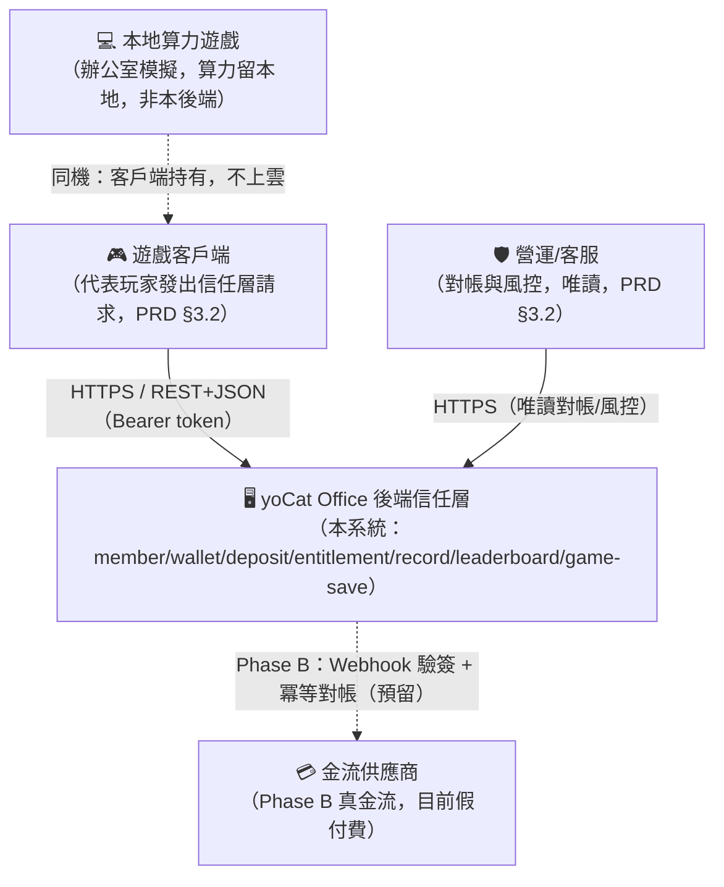

- Actor 名稱來自 PRD §3.2：遊戲客戶端（代表玩家）、營運/客服。
- 本地算力遊戲為客戶端本地模擬，**不屬本後端**；信任層僅透過 `wallet_ledger.reason`（如 `rescue`）感知其結果。

### 2.2 Container 圖（C4 Level 2）

> **自洽性（IC-01）**：本系統為 **模組化單體（Modular Monolith）**。7 個 BC 是單一可部署單元（`yocat-office-backend-api`）內的 7 個 Spring Modulith 模組，而非 7 個獨立 Container。§3.6 要求 ≥2 replicas 的部署單元即此單一 API 應用，故 §2.2 顯示一個 API Container（內含 7 模組）與資料層，與 §3.4/§3.6/§3.7 完全一致。未來任一 BC 可零改模型拆為獨立 Container。

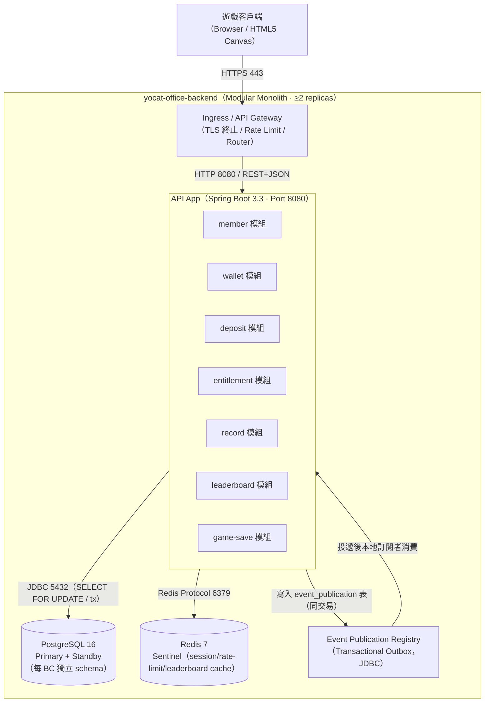

- 每個容器節點標注技術棧 + 埠號；技術棧與 §3.3 一致。
- Outbox 與業務寫入同一 PostgreSQL 交易，保證事件「至少一次」可靠投遞。

---

## 3. Architecture Design

### 3.1 架構模式

**選用模式：** Modular Monolith（Spring Modulith）+ Clean Architecture（Hexagonal）+ Event-Driven（模組間）。

**分層說明：**

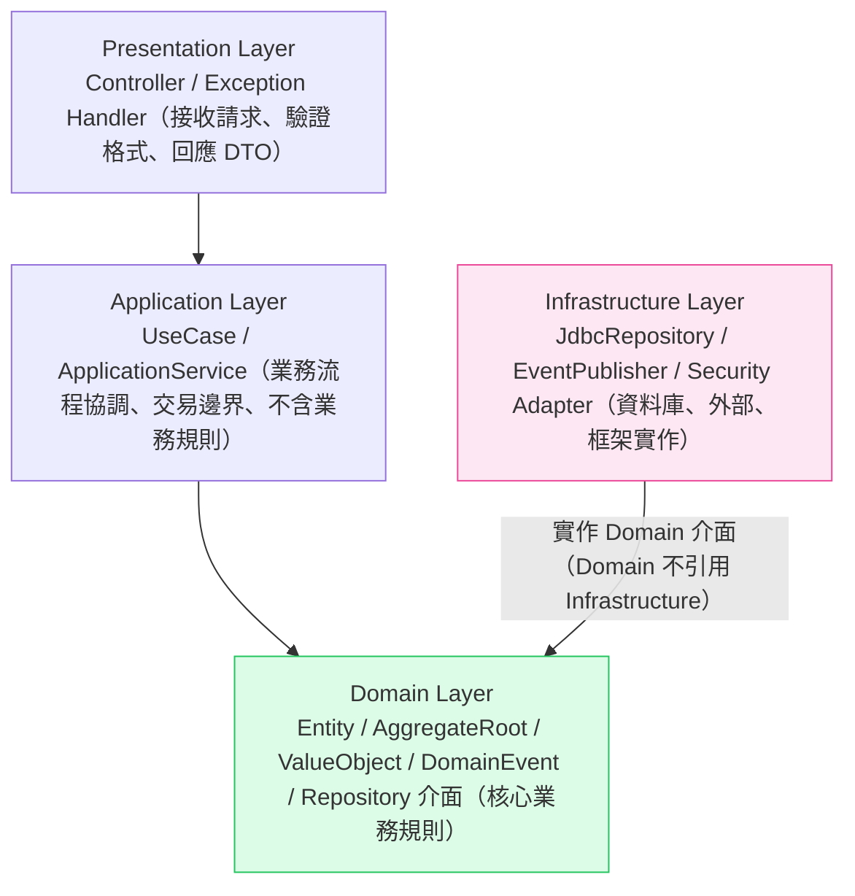

為何此模式匹配業務規模（§3.1/Review #7）：啟動期 5,000 DAU / 500 PCU（CONSTANTS §8），信任層請求頻率低（登入/儲值/存檔/上榜，非每幀），單體足以承載；7 BC 邊界清晰但團隊規模小，微服務的分散式交易與運維成本不划算。排除純單體（無模組邊界）的理由：無法機械化驗證 BC 隔離，日後拆分成本高。排除 Day1 微服務的理由：分散式錢包一致性複雜、運維重、啟動期量級不需要。

### 3.1b Clean Architecture & SOLID 原則

**SOLID 原則對應表（每格引用本系統具體 class/interface）**

| 原則 | 全名 | 本系統實作方式 |
|------|------|--------------|
| SRP | Single Responsibility | `WalletService` 只處理錢包加值/扣款與帳本；`MemberService` 只處理註冊/登入/會話；`LeaderboardService` 只處理上榜/查榜。每個 Service 對應單一 BC 單一職責。 |
| OCP | Open / Closed | 儲值包透過 `DepositPackCatalog`（介面）擴展：新增寶石包只需新增 `GemPackPolicy` 設定或實作，不改 `TopUpWalletUseCase`。新增破產救援策略實作 `RescueStrategy` 介面即可。 |
| LSP | Liskov Substitution | 所有 `WalletRepository` 子型別（`JdbcWalletRepository` 正式、`InMemoryWalletRepository` 測試）可互換，呼叫端 `WalletService` 行為不變；合約測試保證替換後語意一致。 |
| ISP | Interface Segregation | 讀寫分離：`WalletReadRepository`（`findBalance`）/ `WalletWriteRepository`（`debitWithLock`/`credit`）；`LedgerAppender` 僅暴露 `append(entry)`，不強迫實作無關方法。 |
| DIP | Dependency Inversion | 高層 `SpendWalletUseCase` 依賴 Domain 的 `WalletRepository` 介面與 `DomainEventPublisher` 介面；具體 `JdbcWalletRepository`、`ModulithEventPublisher`（Infrastructure）由 Spring DI 於組態注入，Domain/Application 不 import 任何 JDBC/Spring 類別。 |

**Dependency Rule（依賴方向）**

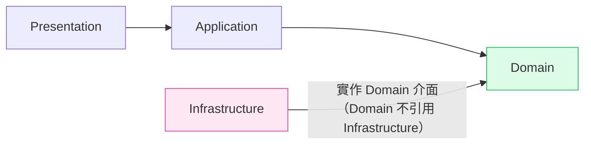

**禁止清單（硬性）**：
- Domain 層不得 `import` 任何 ORM / JDBC / HTTP / Spring / 外部 SDK（以 ArchUnit + Spring Modulith 於 CI 驗證）。
- Application 層不得 `new` 任何 Infrastructure 具體類別，一律建構子注入 Interface。
- 跨層呼叫一律透過 DI 注入的 Interface。

**生成驗證**：每原則均含具體 class/interface（`WalletService`/`WalletRepository`/`JdbcWalletRepository` 等）；Dependency Rule 中 Domain 無向外箭頭；無 placeholder 殘留。

### 3.2 技術選型決策（ADR）

#### ADR-001：模組化單體（Spring Modulith）vs 微服務

| 欄位 | 內容 |
|------|------|
| **狀態** | ACCEPTED |
| **背景** | 7 BC 邊界清晰但啟動期量級小（500 PCU）；需 Day1 可分可合（PRD §5.5）。 |
| **選項比較** | Option A：Spring Modulith 模組化單體（優：運維簡單、交易原子、可建置期驗邊界、可後拆；劣：共享 JVM/DB 實例）<br>Option B：Day1 微服務（優：各 BC 獨立 scale/部署；劣：分散式交易複雜、運維重、錢包一致性難） |
| **決策** | 選用 Option A（Spring Modulith）。 |
| **理由** | 啟動期量級單體足夠；ModularityTests 機械化保證邊界，保留拆分選項；錢包一致性在單 DB 交易內最簡單可靠。 |
| **後果** | 需以 Event Publication Registry（Outbox）做模組解耦；拆分時 Domain 模型零改，只換傳輸層。 |

#### ADR-002：錢包一致性 — PostgreSQL 交易 + SELECT FOR UPDATE vs 樂觀鎖/CAS

| 欄位 | 內容 |
|------|------|
| **狀態** | ACCEPTED |
| **背景** | PRD §9.1 P0 護欄：併發扣款 0 筆不一致、ledger 100% 對帳；原型已用 `SELECT ... FOR UPDATE`（accounts.ts L200）。 |
| **選項比較** | Option A：悲觀行鎖 `SELECT FOR UPDATE` + 同交易寫 ledger（優：強一致、簡單、與原型一致；劣：熱帳號序列化）<br>Option B：樂觀版本號 CAS retry（優：無鎖高併發；劣：寫衝突重試邏輯複雜、尖峰重試風暴） |
| **決策** | 選用 Option A（悲觀行鎖）。 |
| **理由** | 單帳號寫入頻率低（非每幀），熱點不嚴重；強一致最符合「伺服器權威錢包」與對帳要求。 |
| **後果** | 單帳號寫入序列化；以 `idx_ledger_acct` 與對帳稽核保證 0 不一致；熱帳號若未來成瓶頸再評估分片。 |

#### ADR-003：認證 — Opaque Session Token（Redis+DB）vs JWT

| 欄位 | 內容 |
|------|------|
| **狀態** | ACCEPTED |
| **背景** | 原型以 `sessions` 表存 opaque token（32 bytes hex，TTL 30 天，accounts.ts L67）。需可即時撤銷（logout / 強制登出）。 |
| **選項比較** | Option A：Opaque Session Token（存 `sessions` 表 + Redis 快取）（優：可即時撤銷、無需金鑰輪替、與原型一致；劣：每請求查 session）<br>Option B：JWT（優：無狀態、免查庫；劣：撤銷難、需 JWKS/輪替） |
| **決策** | 選用 Option A（Opaque Session Token + Redis cache）。 |
| **理由** | 需即時撤銷（客服強制登出）；信任層 QPS 低，查 session 成本可控（Redis 快取命中）。 |
| **後果** | session 驗證走 Redis（miss 回源 DB）；`SESSION_TTL_DAYS=30`。 |

#### ADR-004：資料庫 / 快取 / 事件匯流排選型

| 欄位 | 內容 |
|------|------|
| **狀態** | ACCEPTED |
| **背景** | 原型用 PostgreSQL 16（postgres.yaml）；需可靠事件投遞與快取。 |
| **決策** | DB=PostgreSQL 16（JSONB、`FOR UPDATE`、Partition）；Cache=Redis 7（Sentinel）；事件=Spring Modulith Event Publication Registry（JDBC Outbox，不引入 Kafka，降低運維）。 |
| **理由** | 與原型一致、HA 成熟；Outbox 以同交易保證事件可靠，啟動期不需獨立 broker。 |
| **後果** | 事件投遞為單體內本地訂閱（@ApplicationModuleListener）；拆微服務時再將 Outbox 橋接至外部 broker（NATS/Kafka）。 |

### 3.3 技術棧總覽

> 本節為整個專案技術決策的 **唯一真實來源（SSoT）**。下游（ARCH/API/SCHEMA/BDD/runbook/LOCAL_DEPLOY）均從此讀取。

| 層次 | 技術 | 版本 | 選型理由 |
|------|------|------|---------|
| 後端語言 | Java | 21 (LTS) | Spring Modulith 生態成熟、Virtual Threads 提升 I/O 併發 |
| 後端 Runtime 平台 | JVM (Eclipse Temurin) | 21 | LTS、GC 成熟、容器友善 |
| Web / API Framework | Spring Boot | 3.3.x | 業界標準、與 Modulith 原生整合 |
| 模組化框架 | Spring Modulith | 1.3.x | @ApplicationModule 邊界、Event Publication Registry（Outbox）、ModularityTests |
| ORM / 資料存取層 | Spring Data JDBC | 3.3.x | 貼近 SQL、聚合邊界清晰、避免 JPA lazy 陷阱；錢包行鎖用原生 `FOR UPDATE` |
| 資料庫 | PostgreSQL | 16 | JSONB、行鎖、Partition、HA（Patroni/RDS Multi-AZ）；與原型一致 |
| 快取 | Redis | 7.2 | session/rate-limit/leaderboard cache；Sentinel HA |
| 訊息佇列 | Spring Modulith Event Registry（JDBC Outbox） | 1.3.x | 同交易可靠事件；啟動期不引入外部 broker |
| 認證 / 授權函式庫 | Spring Security + 自管 Opaque Session | 6.3.x | Bearer token filter、RBAC（USER/OPS）、scrypt 密碼 |
| 密碼雜湊 | scrypt（Bouncy Castle / `SCryptPasswordEncoder`） | — | 與原型一致（keylen 64、salt 16），抗暴力 |
| Container Runtime | Docker | 27.x | 標準化部署單元（multi-stage，jre-alpine） |
| 容器編排 | Kubernetes | 1.30 | Day1 HA（≥2 replicas、HPA、PDB）；Local=Rancher Desktop |
| CI 工具 | GitHub Actions | — | 與 repo 整合；lint/test/build/deploy/k6 |
| CD 工具 | ArgoCD | 2.12 | GitOps、Canary |
| 單元測試框架 | JUnit 5 + Mockito | 5.11 | 標準 |
| 整合 / E2E 測試框架 | Testcontainers + REST-assured + k6 | — | 真實 PostgreSQL/Redis；E2E 關鍵流程；k6 壓測 |
| 架構守護 | ArchUnit + Spring Modulith `verify()` | 1.3 | CI 攔截跨層/跨 BC 違規 |
| 前端語言（若有） | N/A | — | 純後端 API 服務（client_type=api-only） |
| 前端框架（若有） | N/A | — | 純後端 API 服務 |
| 客戶端引擎（若有） | **N/A（算力留本地，客戶端為既有 HTML5 Canvas 遊戲，不屬本後端）** | — | 遊戲模擬在玩家端本地算力，信任層不含客戶端引擎 |

**lang_stack（語言/框架）：Java 21 + Spring Boot 3.3 + Spring Modulith 1.3（後端）。**
**客戶端引擎：N/A（算力留本地，客戶端為既有 HTML5 Canvas 遊戲，不屬本後端）。**

#### §3.3.x SSoT Authority 宣告（下游強制遵守）

**規則 1：Package 命名權威**

| 應用 | `artifactId` / package | 目錄名 | 部署名 |
|-----|------------------------|--------|--------|
| API Server | `yocat-office-backend-api` / `com.sayyogames.yocat` | `apps/api/` | `yocat-office-backend-api` |
| Player Frontend | N/A（api-only，無 web app） | — | — |
| Admin Frontend | N/A（has_admin_backend=false → `_ADMIN_FRAMEWORK=none`） | — | — |

**規則 2：計算公式權威** — 所有業務公式（排行 score 透傳、記憶體預算、容量公式）在 EDD 定義一次（§4.7 / §11.2），下游只引用「見 EDD §x.y」，不得改寫。

**規則 3：Package 選型唯一性** — 每個選型欄位為唯一確定值（如 ORM=Spring Data JDBC、Cache=Redis 7.2、scrypt keylen=64），無「A 或 B」、無「≥N」模糊。

**規則 4：Item Catalog 完整性** — 儲值包 enum（`pack`）與權益 `kind` 的完整 catalog：

| pack key（enum 合法值）| currency | 加值量 | 加贈 | 使用條件 |
|------------------------|----------|-------|------|---------|
| `g_small` | gems | +60 | 0% | none |
| `g_mid` | gems | +330 | +10%（vs 基準 300） | none |
| `g_big` | gems | +700 | +16%（vs 基準 600） | none |
| `cap_1000` | cash | +1000 | 0%（假付費，測試用） | none |

| entitlement kind（enum）| 語意 | 扣款 reason | 破產是否消失 |
|------------------------|------|------------|------------|
| `cosmetic` | 外觀 | `buy_cosmetic` | 否（永不消失） |
| `dream` | 夢想員工（特聘靈魂） | `buy_dream`（語意別名 `hire_dream`） | 否 |
| `scenario` | 劇本解鎖 | `buy_scenario` | 否 |

**_ADMIN_FRAMEWORK：`none`（has_admin_backend=false，不生成 ADMIN_IMPL）。**

### 3.4 Bounded Context & Context Map（DDD / Spring Modulith HC-1、HC-5）

**本系統的 Bounded Context：**

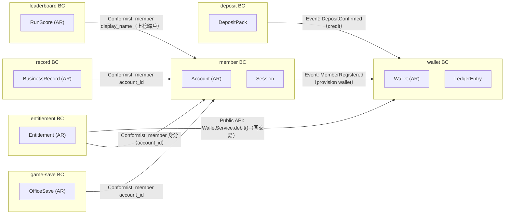

**Context Map 關係說明：**

| 上游 BC | 下游 BC | 整合模式 | 說明 |
|--------|--------|---------|------|
| member | wallet | Customer/Supplier（Event） | 註冊成功發 `MemberRegistered`，wallet 建錢包 + init ledger |
| deposit | wallet | Customer/Supplier（Event） | 儲值確認發 `DepositConfirmed`，wallet 入帳 |
| entitlement | wallet | Customer/Supplier（Sync Public API） | buy 於同交易呼叫 `WalletService.debit()`（原子扣款+授予） |
| member | wallet/entitlement/record/leaderboard/game-save | Conformist | 各 BC 以 `account_id`（ID-only）參照 member 身分，不跨 BC 存 FK |

**Schema 擁有權（Schema Ownership Table，HC-1）：**

| Bounded Context | 擁有的 DB Schema / Tables | 對外 Public Interface |
|----------------|--------------------------|----------------------|
| member | `member`: `accounts`, `sessions` | REST `/auth/*`；`MemberService.verifySession()`；Event `MemberRegistered` |
| wallet | `wallet`: `wallets`, `wallet_ledger` | REST `/wallet/*`；`WalletService.debit()/credit()`；Event `WalletBalanceChanged` |
| deposit | `deposit`: `deposit_pack`（包目錄，`deposit_order` Phase B） | REST `/wallet/topup`（pack 解析）；Event `DepositConfirmed` |
| entitlement | `entitlement`: `entitlements` | REST `/entitlements/*`；Event `EntitlementGranted` |
| record | `record`: `records` | REST `/records/*`；Event `BusinessRecordAdded` |
| leaderboard | `leaderboard`: `leaderboard` | REST `/leaderboard`（公開 Top N + 上榜）；Event `RunScoreSubmitted` |
| game-save | `game_save`: `saves` | REST `/save`（GET/PUT） |

> **HC-1 強制規則**：(1) 無兩個 BC 宣告擁有同一張 Table；(2) **移除原型中跨 BC 的 DB-level FK**——原 schema.sql 中 `wallets/entitlements/records/leaderboard/saves/sessions/wallet_ledger` 皆 FK 參照 `accounts(id)`；重構後各 BC 以 `account_id BIGINT`（application-layer ID，加注 `-- Cross-BC: enforced at application layer`）參照，**不設跨 schema FK**。帳號刪除以 `MemberDeleted` 事件驅動各 BC 匿名化/級聯清理（§6.3）。跨 BC 資料存取只能透過 Public API 或 Domain Event；禁止跨 BC JOIN。

### 3.5 部署環境規格（Deployment Environment Matrix）

#### 雲端平台基礎

| 欄位 | 內容 |
|------|------|
| **雲端服務商** | 自建機房 / 相容雲（啟動期；Local=Rancher Desktop） |
| **主要 Region** | region-a（Primary） |
| **DR / Failover Region** | region-b（Hot Standby；啟動期可為同 region 跨 AZ，成長期跨 Region） |
| **K8s 託管服務** | Local=Rancher Desktop；Prod=自建 kubeadm 或託管 k8s |
| **K8s 版本** | 1.30 |
| **Container Registry URL** | `registry.sayyogames.internal/yocat-office-backend` |
| **Docker Base Image** | `eclipse-temurin:21-jre-alpine` |
| **Image Tag 策略** | git-sha8（CI 產出） |
| **Secret 管理工具** | K8s Sealed Secrets（啟動期）；Prod 可升 HashiCorp Vault |
| **Secret 路徑前綴** | `secret:yocat-office-backend/`（如 `secret:yocat-office-backend/db-password`） |

#### 環境矩陣

| 欄位 | Local（本機）| Development | Staging | Production |
|------|------------|------------|---------|------------|
| **K8s Cluster** | `rancher-desktop` | `dev-cluster` | `staging-cluster` | `prod-cluster` |
| **K8s Namespace** | `yocat-office-backend-local` | `yocat-dev` | `yocat-staging` | `yocat-prod` |
| **kubectl Context** | `rancher-desktop` | `dev-k8s` | `staging-k8s` | `prod-k8s` |
| **API 副本數** | 2（HA 測試最低） | 2 | 2 | 2–8（HPA min–max） |
| **Worker/事件處理** | 同 API Pod（Outbox 排程於 API 內） | 同 API | 同 API | 同 API（≥2） |
| **API CPU Req/Limit** | 250m / 1000m | 250m / 1000m | 500m / 1500m | 500m / 2000m |
| **API Mem Req/Limit** | 512Mi / 1Gi | 512Mi / 1Gi | 768Mi / 1.5Gi | 1Gi / 2Gi |
| **DB Host（Pattern）** | `yocat-pg.yocat.svc.cluster.local`（資料層位於既有 `yocat` namespace，跨 namespace 連線，沿用 docs/req/postgres.yaml） | `dev-pg` | `staging-pg` | `pg-primary.yocat-prod`（Patroni VIP） |
| **DB 類型/規格** | K8s StatefulSet（單節點本機） | 單節點 | Primary+Standby | Primary + 1 Standby（Patroni，同步複本） |
| **Redis Host** | `redis.yocat-office-backend-local.svc` | `dev-redis` | `staging-redis` | `redis-sentinel.yocat-prod`（3 nodes） |
| **Config/Secret 路徑** | `k8s/overlays/local/secrets.env`（不提交） | SealedSecret | SealedSecret | `secret:yocat-office-backend/*`（Vault/Sealed） |
| **部署方式** | `kubectl apply -k k8s/overlays/local/` | ArgoCD auto | ArgoCD（Blue-Green） | ArgoCD（Canary via GitOps） |
| **Image 來源** | `nerdctl build`（`imagePullPolicy: Never`） | Registry | Registry | Registry（Always） |
| **存取控制** | 本機，無需 VPN | 開發人員 | Dev+QA，需 VPN | SRE + on-call，MFA + 稽核 |

#### 服務 Port 對照表

| 服務 | K8s Internal Port | Local port-forward | 說明 |
|------|------------------|--------------------|------|
| api-server | `8080` | `8080` | REST API；`/health`、`/health/ready`、`/actuator/prometheus` |
| PostgreSQL | `5432` | `5432` | 主資料庫 |
| Redis | `6379` | `6379` | session / rate-limit / leaderboard cache |
| Prometheus | `9090` | `9090` | 指標（local 觀測） |
| Grafana | `3000` | `3001` | 儀表板（local 觀測） |

> **注意**：生產環境帳號、密碼、Token 不得寫入本文件；使用 Secret Manager 路徑（如 `secret:yocat-office-backend/db-password`），由 CD pipeline 或 init container 注入。

### 3.6 HA / SPOF / SCALE / BCP Architecture Specification

> **Iron Law**：本節是所有下游 HA 設計的權威來源。本系統從 Day 1 採 HA-First。

#### §3.6.1 SPOF 分析與消除清單

| 元件 | SPOF 風險 | 消除方式 | Min Replicas |
|------|-----------|---------|--------------|
| API Server（Modular Monolith） | 單 pod 故障 → 服務中斷 | ≥ 2 pod，K8s Deployment + HPA + PDB | 2 |
| 事件處理（Outbox 投遞） | 事件停滯 | 內嵌於 API Pod（≥2），`@Scheduled` + 冪等消費 + DB 鎖避免重複 | 2 |
| PostgreSQL | 主節點故障 → 寫入停止 | Primary-Standby（Patroni / RDS Multi-AZ），同步複本 | Primary + 1 Standby |
| Redis | 單節點故障 → session/cache 失效 | Sentinel（3 nodes），cache miss 回源 DB | 3 |
| Ingress / API Gateway | 單節點故障 → 流量中斷 | ≥ 2 replicas，Cloud LB 多 AZ | 2 |

> **強制**：所有核心元件 Min Replicas ≥ 2（含 Local）。部署腳本不得出現 `replicas: 1`（本機 PostgreSQL/Redis 單節點為資料層本機例外，見 §3.7.2）。

#### §3.6.2 HA 設計原則

| 原則 | 說明 | 實作要求 |
|------|------|---------|
| **Stateless API** | API 不保存本地 session | session 存 `sessions` 表 + Redis，Pod 可任意重啟 |
| **冪等 Worker** | Outbox 事件被多副本消費只生效一次 | `event_publication` 完成標記 + `SELECT FOR UPDATE SKIP LOCKED` + event_id dedup |
| **Graceful Shutdown** | SIGTERM 後停收新請求、等 in-flight | `server.shutdown=graceful`、`spring.lifecycle.timeout-per-shutdown-phase=30s`、`terminationGracePeriodSeconds: 60` |
| **Health Check** | Liveness + Readiness | Liveness `/health/live`（5s）、Readiness `/health/ready`（3s，含 DB/Redis 連線） |
| **Circuit Breaker** | 依賴故障快速失敗降級 | Resilience4j：錯誤率 > 50%（10s 窗）→ Open；30s 後 Half-Open（DB 關鍵路徑不熔斷，Redis/非關鍵熔斷降級） |
| **Auto-Scaling** | 流量增水平擴，不 scale to 0 | HPA min=2 max=8，CPU 70% → scale up；scale down 冷卻 300s |

#### §3.6.3 SLO / RTO / RPO

| 指標 | 目標 | 測量窗口 | 說明 |
|------|------|---------|------|
| 可用性（Availability） | ≥ 99.9% | 30 天滾動 | 月度停機 ≤ 43.8 分鐘（CONSTANTS §4） |
| RTO（API Pod） | ≤ 30s | — | Pod 重啟到可接受流量 |
| RTO（DB Failover） | ≤ 30s | — | Standby 提升（Patroni） |
| RPO | 0（同步複本 WAL） | — | 已確認寫入不遺失（錢包交易 0 丟失，PRD §9.1） |
| P99 API 延遲 | ≤ 1000ms @ 500 PCU | 5 分鐘 | 成長期 3,000 PCU ≤ 1500ms（CONSTANTS §4） |
| Deploy 期間 5XX 率 | ≤ 0.1% | — | Graceful Shutdown + Readiness 保障（PRD §5.5 AC-2） |

#### §3.6.4 BCP（Business Continuity Plan）

| 場景 | 觸發條件 | 自動/手動 | 恢復步驟 | RTO |
|------|---------|---------|---------|-----|
| API Pod 崩潰 | Liveness 連 3 次失敗 | 自動（K8s 重啟） | K8s 重建 Pod，Readiness 通過後接流量 | ≤ 30s |
| DB Primary 故障 | Primary 無法連線 > 30s | 自動（Patroni failover） | Standby 提升新 Primary，連線 VIP 不變，應用 pool 重連 | ≤ 30s |
| Redis 主節點故障 | Sentinel 偵測 master 下線 | 自動（Sentinel 選主） | 選新 Master，session 回源 DB，cache miss 降級（非 500） | ≤ 30s |
| AZ 完全故障 | 整個 AZ 不可用 | 自動（多 AZ LB 切換） | 流量切至存活 AZ Pod | ≤ 60s |
| Region 完全故障 | 主 Region 不可用 | 手動觸發 DR | DR Region 提升（詳見 §13.5 / Runbook） | ≤ 30 min |

#### §3.6.5 Graceful Shutdown 流程

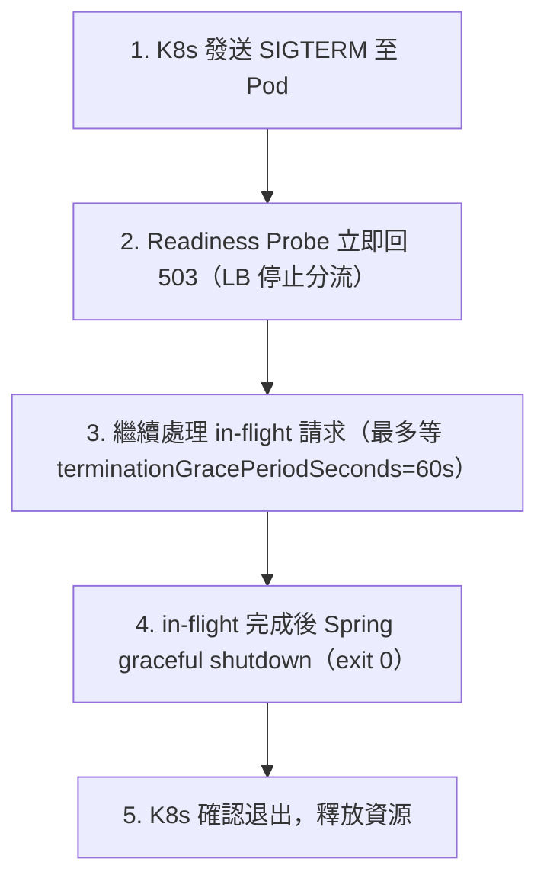

Java/Spring 實作：`server.shutdown=graceful`、`spring.lifecycle.timeout-per-shutdown-phase=30s`；K8s `terminationGracePeriodSeconds: 60`、`preStop: sleep 5`。

> **驗證**（test-plan @ha @graceful-shutdown）：Pod 收 SIGTERM → 處理中的 5 秒請求正常完成 → 新請求轉其他 Pod → 期間 5XX 率 = 0%。

### 3.7 最小完整度架構圖（Minimum Viable HA Architecture）

#### §3.7.1 Figure A — 生產環境 HA-HA Active-Active 部署圖

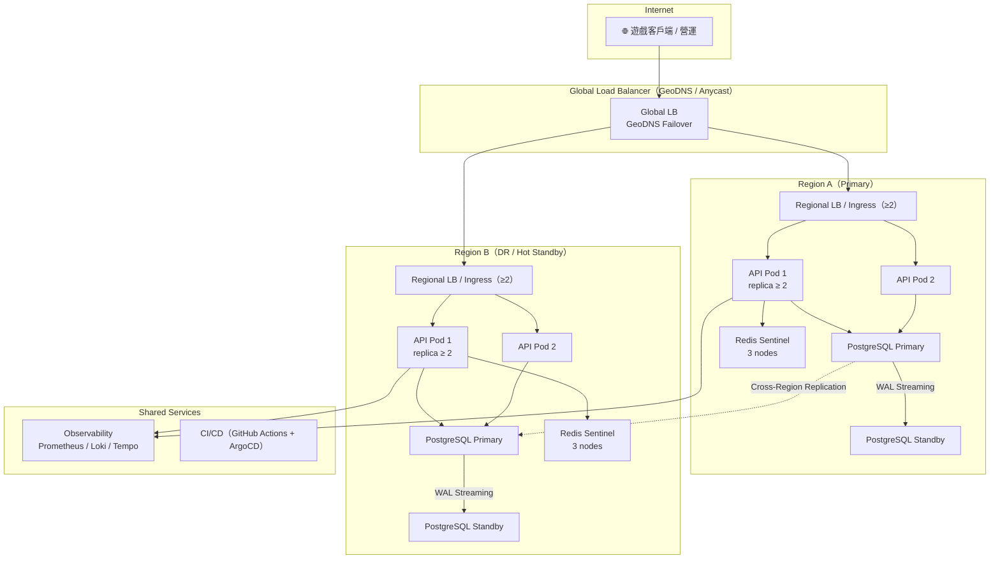

**最小 Replica 要求（生產環境）：**

| 元件 | Min Replicas | 部署說明 |
|------|-------------|---------|
| API Server / Region | 2 | HPA min=2 max=8，CPU 70% 觸發 scale up |
| 事件處理（內嵌 API） | 2 | 隨 API Pod；冪等 + SKIP LOCKED |
| PostgreSQL / Region | Primary + 1 Standby | Patroni / Multi-AZ 同步複本 |
| Redis | 3（Sentinel） | 選主，3 nodes 避免腦裂 |
| Message Queue | N/A（Outbox 於 DB） | 啟動期不引入外部 broker |
| Ingress / Region | 2 | Cloud LB 多 AZ |

#### §3.7.2 Figure B — 本地開發環境最小 HA 架構圖

> **本地 HA 必要性**：HA 程式行為（Stateless session 共享、Outbox 冪等、競態）必須在本地可驗。本地只跑單副本等於沒測 HA 關鍵路徑。

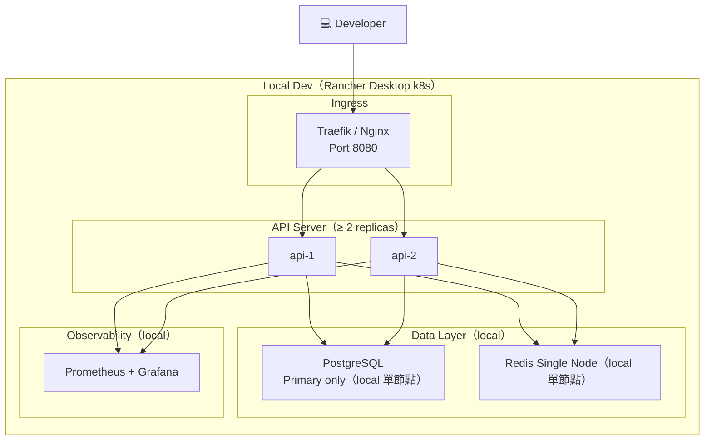

**本地最小 Replica 要求：**

| 元件 | Min Replicas（Local）| 說明 |
|------|---------------------|------|
| API Server | **≥ 2** | 必須 ≥ 2 以測 session 共享（Redis）、Outbox 冪等、競態 |
| 事件處理（內嵌 API） | **≥ 2** | 必須 ≥ 2 以測 Outbox 競態消費與冪等防重入 |
| PostgreSQL | 1（Local OK） | 本機允許單節點 |
| Redis | 1（Local OK） | 本機允許單節點 |

> **驗證指令**：
> ```bash
> kubectl get pods -l app=yocat-office-backend-api -n yocat-office-backend-local | grep -c "Running"  # 應輸出 ≥ 2
> ```

### 3.8 Backend 目錄結構與模組掛載骨架（lang_stack=java）

**目錄結構（Maven，`base-package`=`com.sayyogames.yocat`）：**

```
apps/api/src/main/java/com/sayyogames/yocat/
├── YocatOfficeApplication.java      # @SpringBootApplication + @Modulithic 入口
├── shared/                          # 橫切（SharedKernel：AccountId VO、Money、錯誤型別、ApiError）
│   ├── AccountId.java
│   └── Money.java
├── member/                          # BC：身分
│   ├── package-info.java            # @ApplicationModule(allowedDependencies={})
│   ├── api/                         # Presentation：AuthController
│   ├── application/                 # RegisterMemberUseCase / MemberService
│   ├── domain/                      # Account(AR) / Session / MemberRepository(介面) / MemberRegistered(Event)
│   └── infra/                       # JdbcMemberRepository / ScryptPasswordEncoder / SessionStore(Redis)
├── wallet/                          # BC：錢包
│   ├── package-info.java            # @ApplicationModule(allowedDependencies={"member"})
│   ├── api/ application/ domain/ infra/
├── deposit/   entitlement/   record/   leaderboard/   gamesave/   # 其餘 5 BC 同結構
└── platform/                        # 底座：SecurityConfig / RateLimitFilter / ObservabilityConfig / OutboxConfig
apps/api/src/test/java/com/sayyogames/yocat/
├── ModularityTests.java             # ApplicationModules.of(...).verify()
└── <bc>/...ModuleTest.java          # @ApplicationModuleTest 各 BC 隔離測試
pom.xml  /  Dockerfile（multi-stage）  /  k8s/
```

**Spring Boot 自動組態順序（說明，無需手動 register）：**
1. `application.yml` 讀取（DataSource、Redis、session TTL、Outbox）。
2. Spring Security filter chain（`SecurityConfig`：Bearer token filter → RBAC）。
3. `RateLimitFilter`（Redis 滑動視窗，在 auth filter 之前，見 §11.3C）。
4. `@RestController` 自動掃描（由 `@SpringBootApplication` 觸發）。
5. Spring Modulith Event Publication Registry 初始化（`spring.modulith.events.jdbc.enabled=true`）。

**重要約束**：各 BC 目錄對應一個 `@ApplicationModule`；`domain/` 禁止 import `org.springframework.*` / `java.sql.*`（ArchUnit 驗證）；跨 BC 僅透過 `*/api` 的 `@NamedInterface` 或 Domain Event。

---

## 4. Module / Component Design

### 4.1 wallet 模組（核心：伺服器權威錢包）

**職責：** 伺服器權威錢包的加值（topup/credit）、扣款（spend/debit），維護 append-only `wallet_ledger` 審計帳本，保證併發一致（PRD §5.2）。

**介面定義（Public NamedInterface，供 deposit/entitlement 呼叫）：**

```java
public interface WalletService {
    WalletView topUp(AccountId accountId, Currency currency, long amount, String reason, Map<String,Object> meta);
    WalletView debit(AccountId accountId, Currency currency, long amount, String reason, Map<String,Object> meta); // 餘額不足擲 InsufficientBalanceException
    WalletView findWallet(AccountId accountId);
}
```

**依賴（Dependency）：**

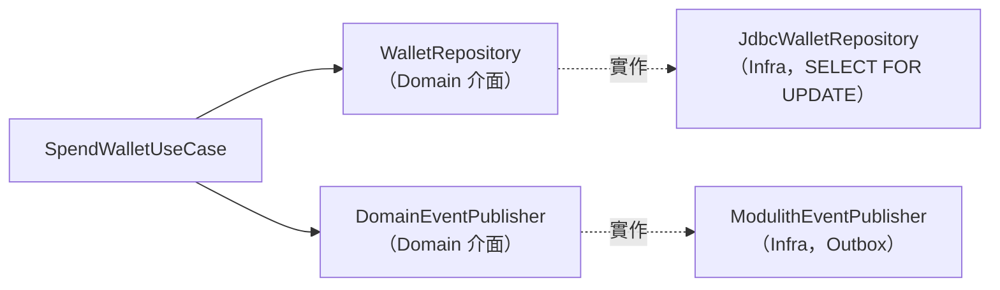

**不變量（Invariants）：**
- `wallet.cash >= 0` 且 `wallet.gems >= 0`（扣款後不得為負；underflow guard）。
- 每筆 `wallet_ledger.balance` = 該 currency 異動後餘額；Σ(delta) by currency = 當前 balance（對帳恆等，0 筆不一致）。
- `amount` ∈ [1, 10,000,000]（`TOPUP_AMOUNT_MIN`/`MAX`）。

### 4.2 member 模組（身分權威）

**職責：** 註冊 / 登入 / 登出 / 我的資料；scrypt 密碼雜湊 + opaque session token（TTL 30 天）（PRD §5.1）。

**介面定義：**

```java
public interface MemberService {
    RegisterResult register(String email, String displayName, String rawPassword); // 發 MemberRegistered 事件
    LoginResult login(String email, String rawPassword);        // 驗 scrypt（timingSafeEqual），簽發 session
    void logout(String token);                                  // 冪等刪除 session
    Optional<Account> verifySession(String token);              // Bearer token 驗證（Redis 快取 → DB）
}
```

**不變量：** `display_name` 長度 ∈ [1,24]；`password` ≥ 6 碼；email 全域唯一（DB unique + 409）。

### 4.3 跨模組依賴 DAG 驗證（HC-5）

> **HC-5**：所有模組間依賴必須構成有向無環圖（DAG）。任何循環依賴為缺陷，Review 前消除。

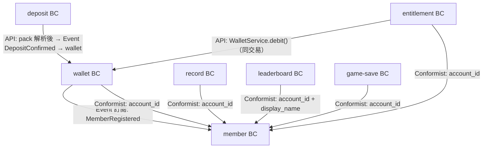

**DAG 驗證宣告：**

| 驗證項目 | 結果 | 說明 |
|---------|------|------|
| 是否存在循環依賴 | NO | 無任何 A→…→A 路徑 |
| 依賴圖為 DAG | CONFIRMED | member 為葉節點（被依賴），無反向邊 |
| 最長依賴鏈 | 3 層 | entitlement → wallet → member |

**Spring Modulith 自動化驗證（Test Skeleton）：**

```java
@Test
void verify_modulith_module_structure() {
    ApplicationModules modules = ApplicationModules.of(YocatOfficeApplication.class);
    // verify()：1) 無循環依賴 2) 無跨 BC Repository 直接呼叫 3) BC 邊界完整
    modules.verify(); // 違反 HC-1~HC-5 擲 AssertionError，CI 阻斷 merge
}

@ApplicationModuleTest
class WalletModuleTest {
    @Test
    void module_is_self_contained(ApplicationModuleTestExecution execution) {
        assertThat(execution.getModules().getModuleByName("wallet")).isPresent();
    }
}
```

> `ApplicationModules.verify()` 擲 `AssertionError` 代表 HC-5 循環或 HC-1/HC-2 邊界違規，CI 必須阻斷 merge。

### 4.5 UML 9 大圖（強制）

> §4.5 = UML 圖集；§4.6 = Domain Events。兩者不同。
> **顯式覆蓋對應**見各小節末對應表。

#### §4.5.1 Use Case Diagram

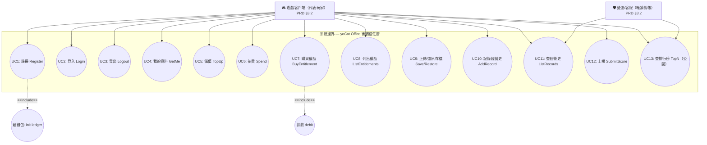

**UC → PRD AC Traceability Table：**

| UC ID | UC 名稱 | PRD 章節 | PRD AC | Precondition | Postcondition |
|-------|---------|---------|--------|-------------|--------------|
| UC1 | Register | §5.1 | AC-1~3 | email 未註冊 | accounts+wallets+init ledger 建立，回 token |
| UC2 | Login | §5.1 | AC-4,5 | 帳號存在 | 簽發 session（TTL 30 天） |
| UC3 | Logout | §5.1 | — | 持有 token | session 刪除（冪等） |
| UC4 | GetMe | §5.1 | AC-6 | 已登入 | 回 account+wallet+entitlements |
| UC5 | TopUp | §5.2 | AC-1,4 | 已登入 | 餘額增加 + topup ledger |
| UC6 | Spend | §5.2 | AC-2,3,5 | 已登入、餘額足 | 行鎖扣款 + 負 delta ledger |
| UC7 | BuyEntitlement | §5.3 | AC-1~4 | 已登入、未擁有、餘額足 | 扣款 + 授予（原子） |
| UC8 | ListEntitlements | §5.3 | AC-5 | 已登入 | 回權益清單 |
| UC9 | Save/Restore | §5.4 | AC-1~5 | 已登入 | upsert / 回最新存檔 |
| UC10 | AddRecord | §5.3/§4.1 | — | 已登入 | 插入 records |
| UC11 | ListRecords | §4.1 | — | 已登入 | 回 ≤100 筆 |
| UC12 | SubmitScore | §4.1 | — | 已登入 | upsert leaderboard（by run_id） |
| UC13 | TopN | §4.1 | — | 無需登入 | 回 Top N（limit≤100） |

**<<include>> 語意**：UC1 註冊強制包含「建錢包+init ledger」（必定執行）；UC7 購買強制包含「扣款 debit」（amount>0 時）。

**RBAC Matrix：**

| UC | Player(USER) | Ops(OPS，唯讀) | 匿名 | 備註 |
|----|------|-----|------|------|
| UC1/UC2/UC3 | ✅ | ❌ | ✅（註冊/登入） | — |
| UC4~UC10,UC12 | ✅ | ❌ | ❌ | 需 Bearer token |
| UC11 ListRecords | ✅（自己） | ✅（對帳，Phase B 範圍查） | ❌ | OPS 唯讀 |
| UC13 TopN | ✅ | ✅ | ✅ | 公開查詢 |

#### §4.5.2 Class Diagram ⭐（依層次分 3 張）

**（1）class-domain（wallet + member 核心）**

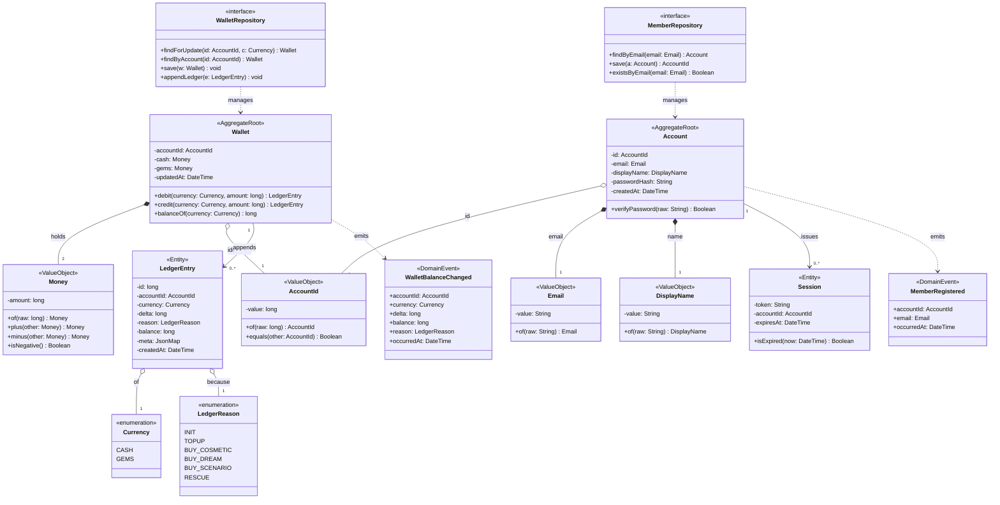

**Invariant Table（Wallet AggregateRoot）：**

| 欄位 | 型別 | 約束條件 | 執行位置 |
|-----|------|---------|---------|
| cash | Money | >= 0 | `debit()` guard + DB CHECK |
| gems | Money | >= 0 | `debit()` guard + DB CHECK |
| ledger.balance | long | = 異動後餘額；Σdelta=balance | `debit()/credit()` + 對帳稽核 |

**Invariant Table（Account AggregateRoot）：**

| 欄位 | 型別 | 約束條件 | 執行位置 |
|-----|------|---------|---------|
| email | Email | 格式合法、全域唯一 | `Email.of()` + DB unique |
| displayName | DisplayName | 長度 ∈ [1,24] | `DisplayName.of()` |

**（2）class-application**

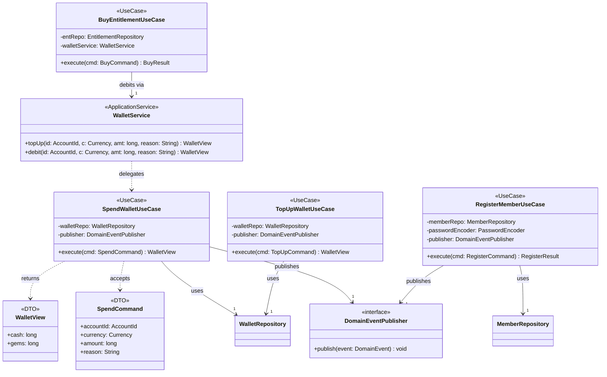

**（3）class-infra-presentation**

```mermaid
classDiagram
    class WalletController {
        <<Controller>>
        -topUp: TopUpWalletUseCase
        -spend: SpendWalletUseCase
        +postTopUp(req: TopUpRequest, me: Principal) TopUpResponse
        +postSpend(req: SpendRequest, me: Principal) WalletResponse
    }
    class AuthController {
        <<Controller>>
        -memberService: MemberService
        +postRegister(req: RegisterRequest) AuthResponse
        +postLogin(req: LoginRequest) AuthResponse
        +postLogout(auth: String) OkResponse
        +getMe(me: Principal) MeResponse
    }
    class JdbcWalletRepository {
        <<RepositoryImpl>>
        -jdbc: NamedParameterJdbcTemplate
        +findForUpdate(id: AccountId, c: Currency) Wallet
        +save(w: Wallet) void
        +appendLedger(e: LedgerEntry) void
    }
    class ModulithEventPublisher {
        <<Adapter>>
        -events: ApplicationEventPublisher
        +publish(event: DomainEvent) void
    }
    class ScryptPasswordEncoder {
        <<Adapter>>
        +encode(raw: String) String
        +matches(raw: String, stored: String) Boolean
    }
    class BearerTokenFilter {
        <<Adapter>>
        -memberService: MemberService
        +doFilter(req: HttpRequest) void
    }
    class TopUpRequest {
        <<RequestDTO>>
        +pack: String
        +currency: String
        +amount: long
    }
    class WalletResponse {
        <<ResponseDTO>>
        +ok: Boolean
        +currency: String
        +balance: long
        +wallet: WalletView
    }

    WalletController --> "1" TopUpWalletUseCase : delegates
    WalletController --> "1" SpendWalletUseCase : delegates
    AuthController --> "1" MemberService : delegates
    WalletRepository <|.. JdbcWalletRepository : implements
    DomainEventPublisher <|.. ModulithEventPublisher : implements
    WalletController ..> TopUpRequest : accepts
    WalletController ..> WalletResponse : returns
    BearerTokenFilter --> "1" MemberService : verifies
```

**Class Inventory 表格（含 src/test 路徑）：**

| Class | Stereotype | Layer | src 路徑 | test 路徑 |
|-------|-----------|-------|---------|---------|
| Wallet | AggregateRoot | Domain | `wallet/domain/Wallet.java` | `wallet/domain/WalletTest.java` |
| LedgerEntry | Entity | Domain | `wallet/domain/LedgerEntry.java` | `wallet/domain/LedgerEntryTest.java` |
| Money | ValueObject | Domain | `shared/Money.java` | `shared/MoneyTest.java` |
| AccountId | ValueObject | Domain | `shared/AccountId.java` | `shared/AccountIdTest.java` |
| Currency | enumeration | Domain | `wallet/domain/Currency.java` | — |
| LedgerReason | enumeration | Domain | `wallet/domain/LedgerReason.java` | — |
| Account | AggregateRoot | Domain | `member/domain/Account.java` | `member/domain/AccountTest.java` |
| Session | Entity | Domain | `member/domain/Session.java` | `member/domain/SessionTest.java` |
| Email | ValueObject | Domain | `member/domain/Email.java` | `member/domain/EmailTest.java` |
| DisplayName | ValueObject | Domain | `member/domain/DisplayName.java` | `member/domain/DisplayNameTest.java` |
| WalletRepository | Repository(interface) | Domain | `wallet/domain/WalletRepository.java` | （合約測試） |
| MemberRepository | Repository(interface) | Domain | `member/domain/MemberRepository.java` | — |
| WalletBalanceChanged | DomainEvent | Domain | `wallet/domain/WalletBalanceChanged.java` | — |
| MemberRegistered | DomainEvent | Domain | `member/domain/MemberRegistered.java` | — |
| SpendWalletUseCase | UseCase | Application | `wallet/application/SpendWalletUseCase.java` | `wallet/application/SpendWalletUseCaseTest.java` |
| TopUpWalletUseCase | UseCase | Application | `wallet/application/TopUpWalletUseCase.java` | `wallet/application/TopUpWalletUseCaseTest.java` |
| BuyEntitlementUseCase | UseCase | Application | `entitlement/application/BuyEntitlementUseCase.java` | `entitlement/application/BuyEntitlementUseCaseTest.java` |
| RegisterMemberUseCase | UseCase | Application | `member/application/RegisterMemberUseCase.java` | `member/application/RegisterMemberUseCaseTest.java` |
| WalletService | ApplicationService | Application | `wallet/api/WalletService.java` | `wallet/api/WalletServiceTest.java` |
| DomainEventPublisher | Port(interface) | Application | `shared/DomainEventPublisher.java` | — |
| WalletController | Controller | Presentation | `wallet/api/WalletController.java` | `wallet/api/WalletControllerTest.java` |
| AuthController | Controller | Presentation | `member/api/AuthController.java` | `member/api/AuthControllerTest.java` |
| JdbcWalletRepository | RepositoryImpl | Infrastructure | `wallet/infra/JdbcWalletRepository.java` | `wallet/infra/JdbcWalletRepositoryIT.java` |
| ModulithEventPublisher | Adapter | Infrastructure | `platform/ModulithEventPublisher.java` | — |
| ScryptPasswordEncoder | Adapter | Infrastructure | `member/infra/ScryptPasswordEncoder.java` | `member/infra/ScryptPasswordEncoderTest.java` |
| BearerTokenFilter | Adapter | Infrastructure | `platform/BearerTokenFilter.java` | `platform/BearerTokenFilterTest.java` |

#### §4.5.3 Object Diagram

**（Wallet — 扣款後狀態實例）**

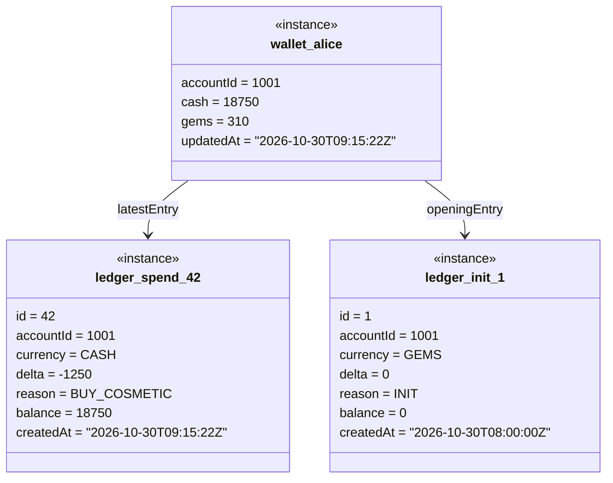

**（Account — 已登入狀態實例）**

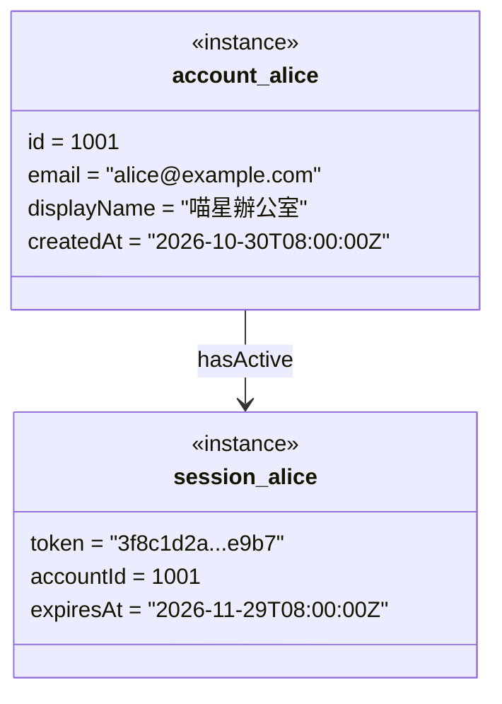

#### §4.5.4 Sequence Diagram

**§4.5.4.1 — `POST /wallet/spend` Happy Path**

```mermaid
sequenceDiagram
    participant Client as Client（遊戲客戶端）
    participant Ctrl as WalletController
    participant UC as SpendWalletUseCase
    participant Repo as WalletRepository（interface）
    participant DB as PostgreSQL
    participant Pub as DomainEventPublisher（Outbox）

    Client->>Ctrl: POST /wallet/spend {currency, amount, reason}（Bearer token）
    Note over Client,Ctrl: RequestDTO：currency:"cash"|"gems"(required), amount:long(required,≥1,≤1e7), reason:string(≤40)
    Ctrl->>UC: execute(SpendCommand{accountId, currency, amount, reason})
    UC->>DB: BEGIN TRANSACTION
    DB-->>UC: OK
    UC->>Repo: findForUpdate(accountId, currency)
    Note right of UC: timeout:1000ms, retry:0（行鎖不重試）
    Repo->>DB: SELECT cash FROM wallet.wallets WHERE account_id=$1 FOR UPDATE
    DB-->>Repo: balance=20000
    alt 餘額 >= amount（20000 >= 1250）
        UC->>Repo: save(wallet.debit) + appendLedger(delta=-1250, balance=18750)
        Repo->>DB: UPDATE wallet.wallets SET cash=cash-1250 ; INSERT wallet.wallet_ledger(...)
        DB-->>Repo: OK
        UC->>Pub: publish(WalletBalanceChanged{accountId, CASH, -1250, 18750})
        Pub->>DB: INSERT event_publication(...)（同交易）
        UC->>DB: COMMIT
        Ctrl-->>Client: 200 OK
        Note over Ctrl,Client: ResponseDTO：{ok:true, currency:"cash", balance:18750, wallet:{cash:18750,gems:310}}
    end
```

**§4.5.4.2 — `POST /wallet/spend` Error Paths（3 類）**

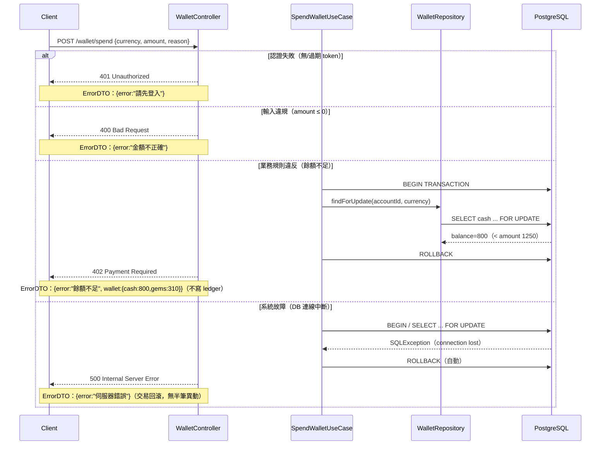

**§4.5.4.3 — `POST /entitlements/buy` Happy Path（跨模組原子扣款+授予）**

```mermaid
sequenceDiagram
    participant Client as Client
    participant Ctrl as EntitlementController
    participant UC as BuyEntitlementUseCase
    participant WS as WalletService（wallet Public API）
    participant ER as EntitlementRepository
    participant DB as PostgreSQL

    Client->>Ctrl: POST /entitlements/buy {kind, itemId, currency, amount}
    Note over Client,Ctrl: RequestDTO：kind:"cosmetic"|"dream"|"scenario"(required), itemId:string(required), currency:string, amount:long(≥0)
    Ctrl->>UC: execute(BuyCommand{accountId, kind, itemId, currency, amount})
    UC->>DB: BEGIN TRANSACTION
    UC->>ER: existsOwned(accountId, kind, itemId)
    ER->>DB: SELECT 1 FROM entitlement.entitlements WHERE ... 
    DB-->>ER: none
    alt 未擁有 且 (amount==0 或 餘額足)
        UC->>WS: debit(accountId, currency, amount, "buy_"+kind)（同交易）
        WS->>DB: SELECT ... FOR UPDATE ; UPDATE wallet ; INSERT ledger
        DB-->>WS: newBalance
        UC->>ER: grant(accountId, kind, itemId)
        ER->>DB: INSERT entitlement.entitlements(...)
        UC->>DB: COMMIT
        Ctrl-->>Client: 200 OK
        Note over Ctrl,Client: ResponseDTO：{ok:true, wallet:{...}, entitlements:[...]}
    end
```

**§4.5.4.4 — `POST /entitlements/buy` Error Paths**

```mermaid
sequenceDiagram
    participant Client as Client
    participant Ctrl as EntitlementController
    participant UC as BuyEntitlementUseCase
    participant WS as WalletService
    participant DB as PostgreSQL

    Client->>Ctrl: POST /entitlements/buy {kind, itemId, currency, amount}
    alt kind 非法或缺 itemId
        Ctrl-->>Client: 400
        Note over Ctrl,Client: ErrorDTO：{error:"項目不正確"}
    else 已擁有同一 (kind,itemId)
        UC->>DB: BEGIN ; SELECT owned → found
        UC->>DB: ROLLBACK
        Ctrl-->>Client: 409 Conflict
        Note over Ctrl,Client: ErrorDTO：{error:"已經擁有這個項目"}
    else 餘額不足
        UC->>WS: debit(...) → InsufficientBalanceException
        UC->>DB: ROLLBACK
        Ctrl-->>Client: 402
        Note over Ctrl,Client: ErrorDTO：{error:"餘額不足", wallet:{...}}
    end
```

**§4.5.4.5 — `POST /auth/register` Happy Path（含跨 BC 事件）**

```mermaid
sequenceDiagram
    participant Client as Client
    participant Ctrl as AuthController
    participant UC as RegisterMemberUseCase
    participant MR as MemberRepository
    participant DB as PostgreSQL
    participant Pub as DomainEventPublisher
    participant WL as wallet 模組（@ApplicationModuleListener）

    Client->>Ctrl: POST /auth/register {email, displayName, password}
    Note over Client,Ctrl: RequestDTO：email(required,format), displayName(required,1-24), password(required,≥6)
    Ctrl->>UC: execute(RegisterCommand{email, displayName, password})
    UC->>DB: BEGIN TRANSACTION
    UC->>MR: existsByEmail(email)
    MR->>DB: SELECT 1 FROM member.accounts WHERE email=$1
    DB-->>MR: none
    UC->>MR: save(Account{email, name, scryptHash})
    MR->>DB: INSERT member.accounts RETURNING id
    DB-->>MR: accountId=1001
    UC->>Pub: publish(MemberRegistered{accountId, email})
    Pub->>DB: INSERT event_publication（同交易）
    UC->>DB: COMMIT
    DB-->>WL: （提交後）投遞 MemberRegistered
    WL->>DB: INSERT wallet.wallets(1001,0,0) ; INSERT wallet.wallet_ledger(gems,0,'init',0)
    Ctrl-->>Client: 200 OK {token, account, wallet:{cash:0,gems:0}}
```

**Sequence 覆蓋對應表：**

| Endpoint group | Happy | Error |
|---------------|-------|-------|
| `/wallet/spend` | §4.5.4.1 | §4.5.4.2 |
| `/entitlements/buy` | §4.5.4.3 | §4.5.4.4 |
| `/auth/register`（+MemberRegistered 事件） | §4.5.4.5 | （400/409 見 §4.5.4.4 同模式 + §5.4） |
| `/wallet/topup` | 同 §4.5.4.1 模式（credit，無餘額檢查） | 400 amount 不正確（§5.4） |
| `/auth/login`、`/save`、`/records`、`/leaderboard` | §7 主流程 + §5.2 | §5.4 錯誤碼 |

#### §4.5.5 Communication Diagram

```mermaid
flowchart LR
    Client["Client（HTML5）"]
    Auth["AuthController<br/>(Spring Boot)"]
    Member["MemberService<br/>(member BC)"]
    Outbox["Outbox<br/>(event_publication)"]
    Wallet["wallet 模組<br/>(@ModuleListener)"]
    DB["PostgreSQL 16"]

    Client -->|"1: POST /auth/register（HTTP/REST）"| Auth
    Auth -->|"2: register()（in-JVM）"| Member
    Member -->|"3: INSERT accounts（JDBC）"| DB
    Member -.->|"4: publish MemberRegistered [async]（Outbox）"| Outbox
    Outbox -.->|"5: deliver MemberRegistered [async]"| Wallet
    Wallet -->|"6: INSERT wallets + init ledger（JDBC）"| DB
    Auth -->|"7: 200 {token,account,wallet}（HTTP/REST）"| Client
```

> 本系統模組間非同步通訊透過 Spring Modulith Event Publication Registry（Outbox）；同步跨 BC（entitlement→wallet）為 in-JVM Public API 呼叫。

#### §4.5.6 State Machine Diagram

**（1）Wallet 餘額生命週期（每 currency）**

```mermaid
stateDiagram-v2
    [*] --> Zero : register [always] / emitInitLedger
    Zero --> Positive : topUp(amount) [amount>=1] / appendLedger(+delta)
    Positive --> Positive : topUp(amount) [amount>=1] / appendLedger(+delta)
    Positive --> Positive : spend(amount) [balance>=amount] / appendLedger(-delta)
    Positive --> Zero : spend(amount) [balance==amount] / appendLedger(-delta)
    Zero --> Zero : spendRejected(amount) [balance<amount] / return402_noLedger
    Positive --> Positive : spendRejected(amount) [balance<amount] / return402_noLedger
    note right of Zero : 餘額恆 >= 0（underflow guard）；拒絕扣款不寫 ledger
```

**Invalid Transition Table（Wallet）：**

| From | To | Behavior | Log |
|------|----|----------|-----|
| Zero/Positive | Negative | 靜默拒絕（擲 InsufficientBalanceException → 402），交易回滾 | WARN |

**Idempotency Table（Wallet）：**

| Trigger | From | Idempotent? | 重複觸發行為 |
|---------|------|------------|------------|
| spend(amount) | Positive | ❌ 非冪等 | 每次都扣（業務預期）；併發以行鎖序列化 |
| topUp(pack) Phase B | any | ✅（冪等鍵 order_id） | 同 order_id 重放只入帳一次（Outbox dedup） |

**（2）OfficeSave / 存檔生命週期（PRD §6.3）**

```mermaid
stateDiagram-v2
    [*] --> NoSave : accountCreated [always] / none
    NoSave --> Saved : putSave(data) [data!=null] / upsert(account_id,slot)
    Saved --> Saved : putSave(data) [data!=null] / upsert(updated_at=now)
    Saved --> Restored : getSave(slot) [exists] / returnData
    NoSave --> NoSave : getSave(slot) [notExists] / returnNull(非404)
    Restored --> Saved : putSave(data) [data!=null] / upsert
    note right of NoSave : 首次無存檔回 {save:null}，供客戶端判斷首次
```

**Invalid Transition Table（OfficeSave）：**

| From | To | Behavior | Log |
|------|----|----------|-----|
| any | Saved（data==null） | 拒絕，回 400「缺 data」，不寫入 | WARN |

**（3）Entitlement 生命週期**

```mermaid
stateDiagram-v2
    [*] --> Unowned : accountCreated [always] / none
    Unowned --> Owned : buy(kind,itemId) [not owned and (amount==0 or balance>=amount)] / debitAndGrant
    Unowned --> Unowned : buy(kind,itemId) [balance<amount] / return402_rollback
    Owned --> Owned : buy(kind,itemId) [already owned] / return409_noDup
    Owned --> Owned : bankruptcyRecycle [always] / keep（破產不奪走權益）
    note right of Owned : recycle 僅影響遊戲內狀態，不觸及 entitlement BC（PRD §5.3 AC-5）
```

**Idempotency Table（Entitlement）：**

| Trigger | From | Idempotent? | 重複觸發行為 |
|---------|------|------------|------------|
| buy(kind,itemId) | Owned | ✅ 是 | 回 409「已經擁有」，不重複扣款/授予 |

#### §4.5.7 Activity Diagram

**§4.5.7.1 — US-WAL-001 spend 主線（泳道 + 決策點）**

```mermaid
flowchart TD
    subgraph Client ["Client（遊戲客戶端）"]
        A1["發送 POST /wallet/spend{currency,amount,reason}"]
    end
    subgraph API ["API Server（WalletController + SpendWalletUseCase）"]
        B1["BearerTokenFilter 驗證 session"]
        B2{"token 有效？"}
        B3{"amount >= 1 且 <= 1e7（long）？"}
        B4["BEGIN TX + SELECT cash FOR UPDATE"]
        B5{"balance >= amount（long 比較）？"}
        B6["UPDATE wallet - amount ; INSERT 負 delta ledger ; publish WalletBalanceChanged ; COMMIT"]
        B7["ROLLBACK"]
        R401["回 401 請先登入"]
        R400["回 400 金額不正確"]
        R402["回 402 餘額不足 + 現有 wallet"]
        R200["回 200 最新 wallet"]
    end
    subgraph DB ["Database（PostgreSQL）"]
        D1["wallet.wallets（行鎖）+ wallet.wallet_ledger"]
    end
    A1 --> B1 --> B2
    B2 -->|"否（無/過期 token）"| R401
    B2 -->|"是（已登入）"| B3
    B3 -->|"否（amount 非法）"| R400
    B3 -->|"是（合法金額）"| B4
    B4 --> D1
    D1 --> B5
    B5 -->|"否（餘額不足）"| B7 --> R402
    B5 -->|"是（餘額足）"| B6 --> D1
    B6 --> R200
```

**§4.5.7.2 — US-MEM-001 register 系統流程（含並行副作用）**

```mermaid
flowchart TD
    subgraph API ["API Server（AuthController + RegisterMemberUseCase）"]
        A1["接收 register 請求"]
        A2{"email 格式合法 且 name∈[1,24] 且 pw>=6？"}
        A3{"email 已存在？（SELECT）"}
        A4["BEGIN TX ; INSERT accounts ; publish MemberRegistered ; COMMIT"]
        F1["[[ 並行開始：提交後事件驅動 ]]"]
        P1["wallet 模組：建 wallets(0,0)"]
        P2["wallet 模組：寫 init ledger(gems,0)"]
        J1["[[ 並行結束：ALL-REQUIRED 等 P1 AND P2 完成；任一失敗→Outbox 重試 ]]"]
        A5["簽發 session token（TTL 30 天）"]
        R400["回 400 欄位錯誤"]
        R409["回 409 email 已註冊"]
        R200["回 200 {token,account,wallet}"]
    end
    A1 --> A2
    A2 -->|"否（驗證失敗）"| R400
    A2 -->|"是（驗證通過）"| A3
    A3 -->|"是（重複）"| R409
    A3 -->|"否（可註冊）"| A4
    A4 --> A5 --> R200
    A4 --> F1 --> P1 --> J1
    F1 --> P2 --> J1
```

**§4.5.7.3 — 破產補償/救援流程（Exception/Compensation）**

```mermaid
flowchart TD
    subgraph Client ["Client（本地算力遊戲）"]
        C1["偵測 cash < BANKRUPT_CASH(-15000)"]
        C2{"玩家選擇？"}
        C3["選①繼續投資（注資）"]
        C4["選②讓它倒（破產）"]
    end
    subgraph API ["API Server（wallet + record BC）"]
        B1["POST /wallet/spend{currency:gems,amount:20,reason:rescue}"]
        B2{"gems 餘額 >= 20（RESCUE_GEMS_COST）？"}
        B3["扣 20 資本(gems) ; 寫 rescue ledger ; 客戶端本地現金補至 >= 8000 跑道"]
        B4["POST /records{type:bankruptcy,payload}"]
        B5["INSERT records（append-only，掛帳號）"]
        RB["補償：餘額不足→回 402，玩家改選②或儲值後重試（逆向：不扣款、不救援）"]
    end
    C1 --> C2
    C2 -->|"①注資"| C3 --> B1 --> B2
    B2 -->|"是"| B3
    B2 -->|"否（gems 不足）"| RB
    C2 -->|"②倒閉"| C4 --> B4 --> B5
```

> **補償執行語意**：`Choreography`（事件驅動）——破產記錄與救援扣款為各自獨立交易；救援扣款失敗（402）時逆向為「不扣款、不補現金」，玩家可改選倒閉或先儲值，不產生半筆異動。

#### §4.5.8 Component Diagram

```mermaid
flowchart LR
    subgraph DMZ ["DMZ / Ingress（Public-facing）"]
        Ingress["API Gateway / Ingress<br/>TLS 1.3 終止 / Rate Limit<br/>Port 443"]
    end
    subgraph Internal ["Internal VPC（Private）"]
        API["yocat-office-backend-api<br/>Java 21 / Spring Boot 3.3<br/>Port 8080<br/>（member/wallet/deposit/entitlement/record/leaderboard/game-save）"]
    end
    subgraph DataZone ["Data Zone（Private）"]
        DB["PostgreSQL 16<br/>Port 5432"]
        Redis["Redis 7.2 Sentinel<br/>Port 6379"]
    end
    subgraph External ["External（Phase B）"]
        Pay["金流供應商<br/>Payment Gateway API（Phase B）"]
    end

    Ingress -->|"HTTPS:443 TLS1.3"| API
    API -->|"TCP:5432 PostgreSQL Wire（tx + FOR UPDATE）"| DB
    API -->|"TCP:6379 Redis Protocol"| Redis
    API -.->|"TCP:4222/443 Webhook 驗簽 async（Phase B）"| Pay
```

**Inter-Service Communication Contract Table：**

| From | To | Protocol | Version | Port | Timeout | Retry Policy | Auth Method |
|------|-----|---------|---------|------|---------|-------------|------------|
| Ingress | API | HTTP/REST | 1.1 | 8080 | 5s | 0（冪等讀可 1x） | Bearer token（內部 mTLS 選配） |
| API | PostgreSQL | PostgreSQL Wire | 16 | 5432 | 3s（query）/1s（lock） | 0（交易不重試） | user/pass（Secret） |
| API | Redis | Redis | 7.2 | 6379 | 500ms | 1x | AUTH（Secret） |
| API | Payment（Phase B） | HTTPS Webhook | v1 | 443 | 10s | 3x exp backoff | HMAC 驗簽 |

**Resilience Pattern Table：**

| Source → Dest | Timeout | Circuit Breaker | Fallback | Bulkhead | P99 SLA |
|--------------|---------|-----------------|----------|----------|---------|
| API → PostgreSQL | 3s | 不熔斷（關鍵路徑；失敗即 503） | 無（寫入必須強一致） | HikariCP pool: 依 §11.2 | < 1000ms |
| API → Redis | 500ms | fail-after 50%/10s，reset 30s | session 回源 DB、rate-limit fail-open | pool: 16 | < 50ms |
| API → Payment（Phase B） | 10s | fail-after 5 errors / reset 30s | queue 待對帳 | pool: 8 | < 2s |

**Public vs Internal**：Ingress 對外（Public，443）；API/DB/Redis 僅內部 VPC（Private）。

**Cache Contract（Redis）：**

| Cache Key Pattern | 資料來源 | TTL | 失效觸發 | 策略 | Stale-Read 容忍 |
|-----------------|---------|-----|---------|------|--------------|
| `prod:member:session:{token}` | member.sessions | 1800s | logout / 過期 | write-through | 0（登出須即時） |
| `prod:leaderboard:top:{mode}:{limit}` | leaderboard 查詢 | 30s | POST /leaderboard 上榜 | write-behind | ≤ 30s（可接受） |
| `prod:rate:{action}:{identifier}` | 計算值 | 60s | sliding window | write-on-read | 0 |

> 無外部 Message Queue（Outbox 於 DB）；故 Messaging Contract Spec 標注：本系統模組間事件透過 Spring Modulith Event Publication Registry（JDBC Outbox，delivery=at-least-once，retention=完成後保留 7 天供審計，replay=重啟自動重投未完成事件，無 DLQ 但 `completion_date IS NULL` 即未決事件，重試上限由排程器控制）。

#### §4.5.9 Deployment Diagram

```mermaid
flowchart TD
    subgraph Internet["Internet"]
        User["遊戲客戶端 / 營運"]
    end
    subgraph DMZ["DMZ / Ingress Zone"]
        Ingress["Ingress Controller<br/>Image: ingress-nginx:1.11<br/>CPU req/limit: 100m/500m<br/>Mem req/limit: 128Mi/256Mi<br/>Replicas: 2<br/>PullPolicy: Always"]
    end
    subgraph AppZone["Internal / App Zone"]
        API["yocat-office-backend-api<br/>Image: registry.sayyogames.internal/yocat-office-backend:git-sha8<br/>CPU req/limit: 500m/2000m<br/>Mem req/limit: 1Gi/2Gi<br/>Replicas: 2-8 (HPA: CPU>70%)<br/>PullPolicy: Always"]
    end
    subgraph DataZone["Data Zone"]
        PG["PostgreSQL 16<br/>Image: postgres:16-alpine<br/>CPU req/limit: 500m/2000m<br/>Mem req/limit: 1Gi/4Gi<br/>Primary + 1 Standby (Patroni)"]
        Redis["Redis 7.2 Sentinel<br/>Image: redis:7.2-alpine<br/>CPU req/limit: 100m/500m<br/>Mem req/limit: 256Mi/512Mi<br/>Replicas: 3"]
        Vol[("PersistentVolume<br/>StorageClass: local-path/gp3")]
    end

    User -->|"HTTPS:443 TLS 1.3"| Ingress
    Ingress -->|"HTTP:8080"| API
    API -->|"TCP:5432 PostgreSQL Wire"| PG
    API -->|"TCP:6379 Redis Protocol"| Redis
    PG -->|"PVC: pg-data 50Gi SSD"| Vol
```

**HPA Configuration Table：**

| Service | minReplicas | maxReplicas | Scale-Up Metric | Target | Scale-Down Cooldown |
|---------|------------|------------|----------------|--------|-------------------|
| yocat-office-backend-api | 2 | 8 | CPU Utilization | 70% | 300s |

**Storage Specification Table：**

| Service | PVC Name | Size | StorageClass | IOPS | Backup Frequency | Retention |
|---------|---------|------|------------|------|-----------------|----------|
| PostgreSQL | pg-data | 50Gi | gp3（prod）/ local-path（local，2Gi） | 3000 | hourly 增量 + daily 全量 | 30 days |

**Network Policy Table：**

| Source Zone | Dest Zone | Allowed Ports | Protocol | Notes |
|------------|---------|--------------|---------|-------|
| Internet | DMZ | 443 | HTTPS | 僅 Ingress |
| DMZ | App | 8080 | TCP | Ingress → API |
| App | Data | 5432, 6379 | TCP | API → PG/Redis |
| App | Internet | 443（Phase B 金流）| HTTPS | 預設 DENY，金流白名單例外 |

---

### 4.6 Domain Events（領域事件）

| 事件名稱 | Owning BC | 觸發時機 | Payload 主要欄位 | 訂閱者 | 冪等保證 | `event_schema_version` | `topic_name` |
|---------|----------|---------|---------------|--------|---------|----------------------|-------------|
| `MemberRegistered` | member | 註冊成功提交後 | `{accountId, email, occurredAt}` | wallet | 是（event_id dedup） | v1 | `member.account.registered` |
| `MemberDeleted` | member | 帳號刪除後 | `{accountId, deletedAt}` | wallet, entitlement, record, leaderboard, game-save | 是 | v1 | `member.account.deleted` |
| `WalletBalanceChanged` | wallet | 加值/扣款提交後 | `{accountId, currency, delta, balance, reason, occurredAt}` | record（BC-internal 分析） | 是 | v1 | `wallet.balance.changed` |
| `DepositConfirmed` | deposit | 儲值確認（Phase B 金流） | `{accountId, orderId, currency, amount, occurredAt}` | wallet | 是（orderId dedup） | v1 | `deposit.order.confirmed` |
| `EntitlementGranted` | entitlement | 授予成功後 | `{accountId, kind, itemId, occurredAt}` | （BC-internal） | 是 | v1 | `entitlement.item.granted` |
| `BusinessRecordAdded` | record | 記錄寫入後 | `{accountId, type, occurredAt}` | （BC-internal） | 是 | v1 | `record.history.added` |
| `RunScoreSubmitted` | leaderboard | 上榜 upsert 後 | `{runId, accountId, mode, score, occurredAt}` | （BC-internal，觸發 cache 失效） | 是（runId dedup） | v1 | `leaderboard.run.submitted` |

#### §4.6.1 Domain Events 完整清單

| Owning BC | Event Class | Trigger | Payload 主要欄位 | Consumer BC(s) | topic_name | version |
|-----------|------------|---------|----------------|----------------|-----------|---------|
| member | `MemberRegistered` | accounts INSERT 提交後 | accountId, email | wallet | `member.account.registered` | v1 |
| member | `MemberDeleted` | 帳號刪除 | accountId | wallet, entitlement, record, leaderboard, game-save | `member.account.deleted` | v1 |
| wallet | `WalletBalanceChanged` | 加值/扣款提交後 | accountId, currency, delta, balance, reason | record（BC-internal 分析/稽核） | `wallet.balance.changed` | v1 |
| deposit | `DepositConfirmed` | Phase B 金流確認 | accountId, orderId, currency, amount | wallet | `deposit.order.confirmed` | v1 |
| entitlement | `EntitlementGranted` | 授予後 | accountId, kind, itemId | （BC-internal，不跨 BC 消費） | `entitlement.item.granted` | v1 |
| record | `BusinessRecordAdded` | records INSERT 後 | accountId, type | （BC-internal，不跨 BC 消費） | `record.history.added` | v1 |
| leaderboard | `RunScoreSubmitted` | upsert 後 | runId, accountId, mode, score | （BC-internal，觸發 cache 失效） | `leaderboard.run.submitted` | v1 |

> 驗證：§4.5.2 Class Diagram 的 `<<DomainEvent>>` class（`MemberRegistered`、`WalletBalanceChanged`）均有對應行；Consumer BC 皆為 §3.4 實際 BC 名稱；同一 topic_name 僅屬一個 Owning BC。

### 4.7 核心演算法規格（Core Algorithm Spec）

> 觸發：PRD 含「積分/排行榜」，且 wallet/entitlement 涉多表寫入+計算。

**演算法 1：併發安全扣款（Atomic Debit with Row Lock）**

| 欄位 | 內容 |
|------|------|
| 演算法名稱 | `SpendWalletUseCase.execute`（對應 `POST /wallet/spend`） |
| 輸入 | accountId: long（>0）；currency: enum{cash,gems}；amount: long [1,1e7]；reason: string(≤40) |
| 輸出 | balance: long（≥0，異動後餘額）；或 InsufficientBalanceException → 402 |
| 複雜度 | Time O(1)；Space O(1)（單列行鎖） |

```java
// lang_stack=java；table：wallet.wallets / wallet.wallet_ledger
@Transactional
WalletView execute(SpendCommand cmd) {
    if (cmd.amount() < 1 || cmd.amount() > 10_000_000)
        throw new InvalidAmountException();                 // → 400
    long balance = repo.selectBalanceForUpdate(cmd.accountId(), cmd.currency()); // SELECT ... FOR UPDATE
    if (balance < cmd.amount())
        throw new InsufficientBalanceException(balance);    // → 402，交易回滾、不寫 ledger
    long newBalance = balance - cmd.amount();
    repo.updateBalance(cmd.accountId(), cmd.currency(), newBalance);
    repo.appendLedger(cmd.accountId(), cmd.currency(), -cmd.amount(), cmd.reason(), newBalance);
    publisher.publish(new WalletBalanceChanged(cmd.accountId(), cmd.currency(), -cmd.amount(), newBalance, cmd.reason()));
    return new WalletView(newBalance);
}
```

Test Vector：
- `{balance:20000, amount:1250}` → `newBalance:18750`，ledger delta=-1250。
- `{balance:800, amount:1250}` → 擲 InsufficientBalanceException（402），balance 不變、無 ledger（邊界：餘額不足）。
- 併發 `{balance:100, 兩筆 amount:100 同時}` → 行鎖序列化：一筆成功 newBalance=0，另一筆 402；最終 balance=0 且 Σdelta 對帳一致（邊界：競態）。

**演算法 2：排行榜 Top N（score 透傳 + upsert）**

| 欄位 | 內容 |
|------|------|
| 演算法名稱 | `LeaderboardService.topN` / `submit`（`GET`/`POST /leaderboard`） |
| 輸入 | submit：runId: string（required）、mode: string（預設 sandbox）、score: long；query：mode、limit: int（夾擠 [1,100]，預設 20） |
| 輸出 | topN：List<{runId, name, mode, score, grade, updatedAt}> 依 score DESC |
| 複雜度 | query Time O(log N + K)（`idx_lb_mode_score`，K=limit）；submit O(1) upsert |

```java
List<RunScore> topN(String mode, int limit) {
    int k = Math.min(Math.max(limit, 1), 100);  // LEADERBOARD_LIMIT_DEFAULT=20, MAX=100
    // SELECT ... FROM leaderboard.leaderboard WHERE (mode='' OR mode=?) ORDER BY score DESC LIMIT k
    return repo.findTop(mode, k);
}
void submit(String runId, long accountId, String displayName, String mode, long score, ...) {
    if (runId.isBlank()) throw new InvalidRunIdException(); // → 400
    // INSERT ... ON CONFLICT(run_id) DO UPDATE SET score, grade, detail, mode, updated_at（分數最新覆蓋，by run_id）
    repo.upsert(runId, accountId, displayName, mode, score, ...);
}
```

Test Vector：
- query `{mode:"sandbox", limit:0}` → k 夾擠為 1，回 Top 1（邊界：limit 下限）。
- query `{mode:"", limit:200}` → k 夾擠為 100，全模式 Top 100（邊界：空 mode + 上限）。
- submit `{runId:"r1", score:5000}` 後再 submit `{runId:"r1", score:5200}` → upsert 覆蓋為 5200（冪等 by run_id）。

**演算法 3：scrypt 密碼雜湊與驗證**

| 欄位 | 內容 |
|------|------|
| 演算法名稱 | `ScryptPasswordEncoder.encode/matches` |
| 輸入 | rawPassword: string（≥6）；驗證另含 stored: `salt_hex$hash_hex` |
| 輸出 | encode：`salt(16B hex)$hash(64B hex)`；matches：Boolean |
| 複雜度 | Time O(scrypt N·r·p)（刻意高成本）；Space O(scrypt 記憶體） |

```java
String encode(String raw) {
    byte[] salt = secureRandom(16);                  // SCRYPT_SALT_BYTES=16
    byte[] h = scrypt(raw, salt, /*keylen*/64);      // SCRYPT_KEYLEN=64
    return hex(salt) + "$" + hex(h);
}
boolean matches(String raw, String stored) {
    var parts = stored.split("\\$");
    byte[] hh = scrypt(raw, unhex(parts[0]), 64);
    return constantTimeEquals(hh, unhex(parts[1]));  // timingSafeEqual，防時序攻擊
}
```

Test Vector：
- `encode("secret1")` → 格式 `^[0-9a-f]{32}\$[0-9a-f]{128}$`（salt 16B=32 hex、hash 64B=128 hex）。
- `matches("secret1", stored)` → true；`matches("wrong", stored)` → false（常數時間，邊界：錯密碼）。

---

## 5. API Design

### 5.1 API 設計原則

- **Base URL**：`https://api.yocat.sayyogames.com`（無 `/api/` 前綴，與原型一致）；版本策略：目前 v1 隱含（路徑即 `/auth/*` 等），破壞性變更時引入 `/v2`。
- **認證**：`Authorization: Bearer <session_token>`（opaque，32B hex）；公開端點 `GET /leaderboard`、`POST /auth/register`、`POST /auth/login` 不需 token。
- **格式**：Request/Response 皆 `application/json; charset=utf-8`。
- **統一錯誤格式**：`{ "error": "<zh-TW 訊息>" }`（可 i18n key 化）；錢包相關 402 另附 `wallet`。
- **冪等**：logout、PUT /save、POST /leaderboard 皆冪等（by token / (account,slot) / run_id）。

### 5.2 Endpoint Inventory Table（§5 必填，API.gen.md 輸入清單）

| Method | Path | BC | 說明 | 認證 | API.md 章節（待補） |
|--------|------|----|------|------|-------------------|
| `GET` | `/health/live` | 平台底座 | Liveness | 否 | § — |
| `GET` | `/health/ready` | 平台底座 | Readiness（含 DB/Redis） | 否 | § — |
| `POST` | `/auth/register` | member | 註冊（建帳+錢包+init ledger） | 否 | § — |
| `POST` | `/auth/login` | member | 登入（簽發 session） | 否 | § — |
| `POST` | `/auth/logout` | member | 登出（刪 session，冪等） | 是 | § — |
| `GET` | `/auth/me` | member | 我的資料（彙整 wallet+entitlements） | 是 | § — |
| `POST` | `/wallet/topup` | wallet/deposit | 儲值（假付費，pack 或自訂） | 是 | § — |
| `POST` | `/wallet/spend` | wallet | 花費（行鎖扣款） | 是 | § — |
| `GET` | `/entitlements` | entitlement | 列出已購權益 | 是 | § — |
| `POST` | `/entitlements/buy` | entitlement/wallet | 購買（原子扣款+授予） | 是 | § — |
| `GET` | `/save` | game-save | 取存檔（slot 預設 main） | 是 | § — |
| `PUT` | `/save` | game-save | 上傳存檔（upsert） | 是 | § — |
| `POST` | `/records` | record | 記經營史（bankruptcy/achievement/legacy） | 是 | § — |
| `GET` | `/records` | record | 查經營史（≤100 筆） | 是 | § — |
| `GET` | `/leaderboard` | leaderboard | 公開 Top N | 否 | § — |
| `POST` | `/leaderboard` | leaderboard | 上榜（upsert by run_id） | 是 | § — |

> `rest_endpoint_count` = 16（含 2 健康檢查）。每個 BC（§3.4）≥1 列；無重複 Method+Path。

### 5.2b 關鍵端點設計（請求/回應摘要）

| 端點 | Request（主要欄位） | Response 200 | 主要錯誤 |
|------|-------------------|--------------|---------|
| POST /auth/register | `{email, displayName(1-24), password(≥6)}` | `{token, account, wallet:{cash:0,gems:0}}` | 400 格式；409 email 重複 |
| POST /auth/login | `{email, password}` | `{token, account, wallet}` | 401 帳密錯 |
| POST /wallet/topup | `{pack}` 或 `{currency, amount(1..1e7)}` | `{ok, currency, amount, balance, wallet}` | 400 金額不正確；401 |
| POST /wallet/spend | `{currency, amount, reason(≤40)}` | `{ok, currency, balance, wallet}` | 400；402 餘額不足；401 |
| POST /entitlements/buy | `{kind, itemId, currency, amount(≥0)}` | `{ok, wallet, entitlements}` | 400；402；409 已擁有 |
| PUT /save | `{slot?, data}` | `{ok:true}` | 400 缺 data；401 |
| GET /save?slot= | — | `{save:{data,updatedAt}}` 或 `{save:null}` | 401 |
| POST /records | `{type, payload}` | `{ok:true}` | 400 type 不正確；401 |
| POST /leaderboard | `{runId, mode?, score, grade?, detail?}` | `{ok:true}` | 400 缺 runId；401 |
| GET /leaderboard?mode=&limit= | — | `{leaderboard:[...]}` | — |

### 5.3 標準 Request / Response Headers

- Request：`Authorization: Bearer <token>`（需登入端點）、`Content-Type: application/json`、`X-Request-Id`（可選，traceparent）。
- Response：`Content-Type: application/json; charset=utf-8`、`X-Request-Id`、`Retry-After`（429 時）。
- CORS：`Access-Control-Allow-Origin`（Phase A `*`，正式收斂白名單）、`Allow-Methods: GET,POST,PUT,OPTIONS`、`Allow-Headers: Content-Type,Authorization`；OPTIONS 回 204。

### 5.4 Error Code Registry（錯誤碼清冊）

| HTTP | 語意 | 觸發情境 | 回應 |
|------|------|---------|------|
| 200 | 成功 | 正常完成 | 對應資源 |
| 204 | 無內容 | CORS 預檢 OPTIONS | — |
| 400 | 參數錯誤 | email 格式、名稱越界、密碼過短、金額不正確、kind/type 非法、缺 data/runId | `{error}` |
| 401 | 未授權 | 無/過期/無效 token；登入帳密錯 | `{error:"請先登入"/"email 或密碼錯誤"}` |
| 402 | 餘額不足 | spend/buy 餘額 < amount | `{error:"餘額不足", wallet}` |
| 404 | 找不到 | 命中前綴但無路由 | `{error:"api not found"}` |
| 409 | 衝突 | email 已註冊；已擁有 (kind,item) | `{error}` |
| 429 | 限流 | 超過 rate limit（§11.3C） | `{error:"請求過於頻繁"}` + Retry-After |
| 500 | 伺服器錯誤 | 未預期例外（交易回滾） | `{error}` |

---

## 6. Data Model

### 6.1 核心實體關係圖（ERD）

> 兩段式呈現：先欄位說明表，後 DDL（SCHEMA.md 承接完整 CREATE TABLE）。

**欄位說明（核心表，依 BC schema 歸屬）：**

| 表（schema.table） | 欄位 | 型別 | Nullable | 預設 | 說明 |
|--------------------|------|------|----------|------|------|
| member.accounts | id | BIGSERIAL PK | N | — | 帳號 ID（AccountId） |
| member.accounts | email | TEXT UNIQUE | N | — | 登入識別，全域唯一 |
| member.accounts | display_name | TEXT | N | — | 公司/老闆名（1-24 字） |
| member.accounts | pass_hash | TEXT | N | — | scrypt `salt$hash` |
| member.sessions | token | TEXT PK | N | — | opaque session（32B hex） |
| member.sessions | account_id | BIGINT | N | — | Cross-BC: app-layer ID（無 FK） |
| member.sessions | expires_at | TIMESTAMPTZ | N | — | TTL 30 天 |
| wallet.wallets | account_id | BIGINT PK | N | — | app-layer ID |
| wallet.wallets | cash | BIGINT | N | 0 | 資本（CHECK ≥ 0） |
| wallet.wallets | gems | BIGINT | N | 0 | 寶石（CHECK ≥ 0） |
| wallet.wallet_ledger | id | BIGSERIAL PK | N | — | 帳本序號 |
| wallet.wallet_ledger | currency | TEXT | N | — | cash\|gems |
| wallet.wallet_ledger | delta | BIGINT | N | — | 異動量（±） |
| wallet.wallet_ledger | reason | TEXT | N | — | init/topup/buy_*/rescue |
| wallet.wallet_ledger | balance | BIGINT | N | — | 異動後餘額 |
| entitlement.entitlements | (account_id,kind,item_id) | — UNIQUE | N | — | 防重複授予 |
| game_save.saves | (account_id,slot) | — PK | N | slot='main' | 跨裝置存檔 |
| record.records | type | TEXT | N | — | bankruptcy/achievement/legacy |
| leaderboard.leaderboard | run_id | TEXT PK | N | — | 單場次 ID（upsert 鍵） |
| leaderboard.leaderboard | score | BIGINT | N | — | 分數（排序鍵） |

**ER 圖（Mermaid，含約束）：**

```mermaid
erDiagram
    accounts ||--o| wallets : "1:1（app-layer account_id）"
    accounts ||--o{ sessions : "1:N"
    accounts ||--o{ wallet_ledger : "1:N（app-layer）"
    accounts ||--o{ entitlements : "1:N"
    accounts ||--o| saves : "1:N（by slot）"
    accounts ||--o{ records : "1:N"
    accounts ||--o{ leaderboard : "1:N（by run_id）"

    accounts {
        bigserial id PK
        text email UK "NOT NULL"
        text display_name "NOT NULL 1-24"
        text pass_hash "NOT NULL scrypt"
        timestamptz created_at
    }
    wallets {
        bigint account_id PK "app-layer"
        bigint cash "NOT NULL DEFAULT 0 CHECK>=0"
        bigint gems "NOT NULL DEFAULT 0 CHECK>=0"
        timestamptz updated_at
    }
    wallet_ledger {
        bigserial id PK
        bigint account_id "app-layer"
        text currency "NOT NULL cash|gems"
        bigint delta "NOT NULL"
        text reason "NOT NULL"
        bigint balance "NOT NULL"
        jsonb meta
        timestamptz created_at
    }
    sessions {
        text token PK
        bigint account_id "app-layer"
        timestamptz expires_at "NOT NULL"
    }
    entitlements {
        bigserial id PK
        bigint account_id
        text kind "NOT NULL"
        text item_id "NOT NULL"
        timestamptz acquired_at
    }
    saves {
        bigint account_id PK
        text slot PK "DEFAULT main"
        jsonb data "NOT NULL"
        timestamptz updated_at
    }
    records {
        bigserial id PK
        bigint account_id
        text type "NOT NULL"
        jsonb payload "NOT NULL"
        timestamptz created_at
    }
    leaderboard {
        text run_id PK
        bigint account_id
        text display_name "NOT NULL"
        text mode "NOT NULL"
        bigint score "NOT NULL"
        text grade
        jsonb detail
        timestamptz updated_at
    }
```

**對應 DDL（節錄，完整見 SCHEMA.md；每 BC 獨立 schema）：**

```sql
-- wallet schema（HC-1：account_id 為 app-layer，不設跨 schema FK）
CREATE TABLE wallet.wallets (
  account_id BIGINT PRIMARY KEY,              -- Cross-BC: enforced at application layer
  cash  BIGINT NOT NULL DEFAULT 0 CHECK (cash >= 0),
  gems  BIGINT NOT NULL DEFAULT 0 CHECK (gems >= 0),
  updated_at TIMESTAMPTZ NOT NULL DEFAULT now()
);
CREATE TABLE wallet.wallet_ledger (
  id BIGSERIAL PRIMARY KEY,
  account_id BIGINT NOT NULL,                 -- Cross-BC: app-layer
  currency TEXT NOT NULL, delta BIGINT NOT NULL,
  reason TEXT NOT NULL, balance BIGINT NOT NULL, meta JSONB,
  created_at TIMESTAMPTZ NOT NULL DEFAULT now()
);
CREATE INDEX idx_ledger_acct ON wallet.wallet_ledger(account_id, created_at DESC);
```

### 6.2 索引策略

| 索引 | 表 | 查詢模式 | 目的 |
|------|----|---------|------|
| `accounts_email_key`（unique） | member.accounts | 登入/註冊查 email | 唯一 + 等值查 O(log N) |
| `idx_sessions_acct` | member.sessions | 依帳號查 session | 列舉/清理 |
| PK(token) | member.sessions | Bearer 驗證 | O(log N)（+ Redis 快取） |
| `idx_ledger_acct(account_id, created_at DESC)` | wallet.wallet_ledger | 帳本對帳/查近期 | 範圍掃描 |
| `UNIQUE(account_id,kind,item_id)` | entitlement.entitlements | 防重複授予 + 查擁有 | 冪等 |
| `idx_records_acct(account_id,type,created_at DESC)` | record.records | 依帳號/類型查史 | 範圍 |
| `idx_lb_mode_score(mode, score DESC)` | leaderboard.leaderboard | Top N by mode | O(log N + K)（P99<300ms） |

### 6.3 資料生命週期

| 資料 | 策略 | 保留 |
|------|------|------|
| wallet_ledger | append-only，永不 UPDATE/DELETE（Phase B 按月 Partition） | 永久（審計；帳號刪除時依法匿名化保留） |
| sessions | 過期自動清理（`expires_at < now()` 定時刪 + Redis TTL） | ≤ 30 天 |
| saves | upsert（覆蓋最新），無歷史版本 | 隨帳號 |
| records | append-only | 永久（經營史） |
| 帳號刪除（GDPR/個資） | 發 `MemberDeleted` → 各 BC 匿名化/刪除對應 account_id 資料；ledger 匿名化保留供審計 | — |

> Redis storage（兩段式）：key 說明表見 §21 Redis Key Namespace Table；對應操作語法見 §11.3。

---

## 7. Key Sequence Flows

### 7.1 主流程（Happy Path）— 登入 → 儲值 → 購買 → 存檔

```mermaid
sequenceDiagram
    participant C as 遊戲客戶端
    participant API as yocat-office-backend-api
    participant DB as PostgreSQL
    C->>API: POST /auth/login {email,password}
    API->>DB: 驗 scrypt、簽發 session（TTL 30 天）
    API-->>C: 200 {token, account, wallet}
    C->>API: POST /wallet/topup {pack:"g_mid"}（Bearer）
    API->>DB: credit gems+330 ; topup ledger（同交易）
    API-->>C: 200 {balance, wallet}
    C->>API: POST /entitlements/buy {kind:"cosmetic",itemId,currency,amount}
    API->>DB: SELECT FOR UPDATE ; debit ; buy_cosmetic ledger ; grant（原子）
    API-->>C: 200 {wallet, entitlements}
    C->>API: PUT /save {slot:"main", data}
    API->>DB: upsert saves(account_id,slot)
    API-->>C: 200 {ok:true}
```

### 7.2 錯誤流程（Error Flow）— 餘額不足扣款

```mermaid
sequenceDiagram
    participant C as 客戶端
    participant API as API
    participant DB as PostgreSQL
    C->>API: POST /wallet/spend {currency:"cash", amount:99999}
    API->>DB: BEGIN ; SELECT cash FOR UPDATE → 800
    Note over API,DB: 800 < 99999 → 餘額不足
    API->>DB: ROLLBACK（不寫 ledger）
    API-->>C: 402 {error:"餘額不足", wallet:{cash:800,gems:...}}
```

---

## 8. Error Handling & Resilience

### 8.1 錯誤分類與處理策略

| 類別 | 範例 | HTTP | 處理 |
|------|------|------|------|
| 驗證錯誤 | amount≤0、kind 非法 | 400 | fail-fast，不進交易 |
| 認證錯誤 | 無/過期 token | 401 | filter 攔截 |
| 業務規則 | 餘額不足、已擁有 | 402/409 | 交易回滾，回現狀 |
| 系統錯誤 | DB/Redis 故障 | 500/503 | 回滾、記錄、告警；不留半筆 |

全域例外處理：`@RestControllerAdvice`（`GlobalExceptionHandler`）統一轉換為 `{error}` JSON。

### 8.2 Retry 策略

| 操作 | Retry | Backoff |
|------|-------|---------|
| 寫交易（wallet/entitlement） | 0（不重試，避免重複扣款） | — |
| Redis 讀（session/cache） | 1 | 固定 100ms |
| Phase B 金流 Webhook | 3 | 指數 1s/2s/4s |
| Outbox 事件投遞 | 排程重投（至 completion） | 指數，上限由 scheduler |

### 8.3 Circuit Breaker（Resilience4j）

- Redis：錯誤率 > 50%（10s 窗，min 20 calls）→ Open；30s 後 Half-Open（3 探測）。Open 時 session 回源 DB、rate-limit fail-open。
- PostgreSQL（關鍵路徑）：不熔斷，失敗即 503 + 告警（寫入須強一致）。

### 8.4 Idempotency

- logout（by token）、PUT /save（by account,slot）、POST /leaderboard（by run_id）、entitlements/buy（by UNIQUE(account,kind,item)）、Domain Event（by event_id）皆冪等。
- Phase B topup 以 `order_id` 冪等鍵防金流重放。

### 8.5 Graceful Degradation Strategy

| 依賴 | 降級觸發 | 降級行為 | 恢復條件 |
|------|---------|---------|---------|
| Redis（session cache） | CB Open / timeout | session 驗證回源 DB（慢但正確） | CB Half-Open 通過 |
| Redis（leaderboard cache） | CB Open | 直查 DB（`idx_lb_mode_score`） | CB Close |
| Redis（rate limit） | CB Open | fail-open（放行，記 WARN，避免拒絕正常用戶） | CB Close |

- **Bulkhead**：HikariCP（DB，見 §11.2 連線池）、Redis pool=16、Phase B 金流 pool=8，彼此隔離。
- **Circuit Breaker 配置**：錯誤閾值 50% / Open 30s / Half-Open 3 探測（見 §8.3）。

---

## 9. Security Design

### 9.1 認證與授權

- **認證方式**：Opaque Session Token（Bearer），存 `member.sessions` + Redis 快取。
- **Token 生命週期**：Session TTL = 30 天（`SESSION_TTL_DAYS`，可環境覆寫）；logout 立即撤銷；無 refresh token（opaque 可即時撤銷，不需 refresh）。
- **密碼**：scrypt（salt 16B、keylen 64B），`timingSafeEqual` 常數時間比對（防時序攻擊，PRD §5.1 AC-5）。
- **角色權限矩陣（RBAC）**：

| 角色 | 可存取 Endpoint | 說明 |
|------|----------------|------|
| 匿名 | POST /auth/register, /auth/login, GET /leaderboard, /health/* | 公開 |
| USER（玩家） | 全部自身資源（/auth/me, /wallet/*, /entitlements/*, /save, /records, POST /leaderboard, /auth/logout） | 僅限自己的 account_id（BOLA 防護：token→account_id，不信任 body 的 account_id） |
| OPS（營運/客服） | GET /leaderboard、GET /records（對帳，Phase B 範圍查）唯讀 | 不可寫；稽核日誌記錄 |

### 9.2 輸入驗證原則

- Bean Validation（`@Valid` + DTO 約束）+ 服務層再驗：email regex、displayName [1,24]、password ≥6、amount [1,1e7]、kind/type enum 白名單、reason 截斷 40 字、request body ≤ 4MB（`REQUEST_BODY_MAX`，超過中斷連線）。
- 全部使用參數化查詢（Spring Data JDBC / NamedParameterJdbcTemplate），杜絕 SQL Injection。

### 9.3 Secrets 管理

- 工具：K8s Sealed Secrets（啟動期）/ Vault（Prod 可升）；路徑前綴 `secret:yocat-office-backend/`。
- 分類：DB credentials（`.../db-password`）、Redis AUTH（`.../redis-password`）、Phase B 金流 HMAC key（`.../payment-hmac`）。
- Rotation：DB/Redis 密碼每 90 天；金流 key 每 180 天。啟動時 fail-fast 驗證所有必填 secret 存在；Log 遮罩前 4 + 後 2 字元。**文件中無任何明文 secret。**

### 9.4 敏感資料處理

- PII：email（登入識別）、display_name。儲存於 member schema；Log 遮罩 email（`a***@e***`）；不記錄 password / pass_hash / token 明文。
- 傳輸 TLS 1.3；at-rest 由 PostgreSQL / 磁碟加密（Prod）。帳號刪除走 `MemberDeleted` 匿名化（§6.3）。

### 9.5 OWASP Top 10 對應

| # | 風險 | 本系統對策 |
|---|------|----------|
| A01 | Broken Access Control | Bearer token → account_id（不信任 body account_id，防 BOLA）；RBAC（USER/OPS）；每端點明確授權 |
| A02 | Cryptographic Failures | scrypt 密碼、TLS 1.3 everywhere、磁碟加密；token 32B 高熵 |
| A03 | Injection | 全參數化查詢（JDBC NamedParameter）、輸入白名單驗證 |
| A04 | Insecure Design | 伺服器權威錢包、交易+行鎖、threat modeling（§9.6）、fail-fast 啟動 |
| A05 | Security Misconfiguration | 環境變數驗證、prod 禁 debug/actuator 敏感端點、CORS 收斂白名單 |
| A06 | Vulnerable Components | Dependabot/Renovate + OWASP Dependency-Check（CI SAST） |
| A07 | Auth Failures | rate limit（login 10/min/IP）、scrypt + timingSafeEqual、session 可撤銷 |
| A08 | Data Integrity | append-only ledger、Domain Event event_id 冪等、Phase B 金流 HMAC 驗簽 |
| A09 | Logging Failures | 結構化 JSON log、遮罩 PII、不記 secret/token、稽核日誌 append-only |
| A10 | SSRF | 無任意 server-side fetch；Phase B 金流 URL allowlist |

### 9.6 Threat Model（STRIDE 分析）

| 威脅類型 | 具體威脅 | 緩解控制 | 殘餘風險 |
|---------|---------|---------|---------|
| Spoofing | session token 竊取/偽造；登入暴力破解 | 32B 高熵 token、TLS、rate limit、scrypt+timingSafeEqual | LOW |
| Tampering | 竄改錢包/權益請求（改 account_id/amount） | 伺服器權威、token→account_id、行鎖交易、ledger 稽核 | LOW |
| Repudiation | 否認曾儲值/購買 | append-only `wallet_ledger` + 稽核日誌（who/what/when） | LOW |
| Information Disclosure | PII（email）洩漏、他人資料越權讀 | 欄位遮罩、BOLA 防護、OPS 唯讀稽核 | MEDIUM |
| Denial of Service | 爬排行榜、刷登入、大 body | rate limit、body ≤4MB、HPA、Ingress WAF | MEDIUM |
| Elevation of Privilege | 水平越權（存他人錢包/存檔） | 每次 API 以 token 的 account_id 判定資源歸屬 | LOW |

**P1 高風險詳述 — Tampering（錢包竄改）**：
- 攻擊向量：客戶端竄改 `POST /wallet/spend` body 的 account_id 或負 amount 試圖加值。
- 緩解：account_id 一律取自 token（忽略 body）；amount 強制 >0 且走 debit 分支；行鎖 + ledger 對帳稽核任一不一致即 P0 告警。
- 測試：TC-SEC 併發/越權測試 + 對帳稽核（§12.2 TC-BIZ-005、HA-01）。

---

## 10. Observability Design

### 10.1 Logging

結構化 JSON（Logback JSON encoder）：`timestamp/level/service/version/trace_id/span_id/message/context`。等級：prod INFO、錯誤 100% 記錄。PII 遮罩（email），不記 password/token/pass_hash。保留：熱 90 天 / 冷 365 天（Prod）、Staging 14 天（CONSTANTS §8）。

### 10.2 Metrics

Micrometer → Prometheus（`/actuator/prometheus`）。關鍵指標：`http_server_requests`（P50/P95/P99、by endpoint/status）、`wallet_spend_total`、`wallet_ledger_mismatch_total`（對帳不一致，應恆 0）、`hikaricp_connections_active`、Outbox pending count。

### 10.3 Distributed Tracing

OpenTelemetry（Micrometer Tracing + OTLP → Tempo/Jaeger）。span 命名 `<module>.<operation>`（如 `wallet.spend`）；W3C Trace Context 傳播；採樣：Prod 10% / Staging 100%（錯誤 100%）（CONSTANTS §11）。

### 10.4 Alerting

Grafana Alerting：5xx > 1%（持續 5 分鐘）→ P1；P99 > 1000ms（5 分鐘）→ P2；`wallet_ledger_mismatch_total > 0` → P0（錢包不一致）；Outbox pending > 100（5 分鐘）→ P2。

### 10.5 SLO / SLI / Error Budget

**SLI**：Availability = 成功/總請求；Latency P99；Error Rate = 5xx/總請求。

| SLO | 目標 | 量測窗口 | 告警（消耗 50% Error Budget）|
|-----|------|---------|------|
| Availability | ≥ 99.9% | 30 天滾動 | < 99.95% |
| Latency P99 | ≤ 1000ms @500 PCU | 7 天 | > 800ms |
| Error Rate（5xx） | ≤ 1% | 1 小時 | > 0.5% |
| 排行榜 Top N P99 | ≤ 300ms | 7 天 | > 250ms |
| 寫入 TPS | ≥ 200 txn/s | 壓測 | < 200 |
| 錢包對帳一致 | 0 筆不一致 | 持續 | > 0（即 P0） |

**Error Budget Policy**：0-50% 正常開發；50-75% 限高風險變更；75-100% 僅 hotfix；>100% 凍結非 SLO 相關部署。

### 10.6 Audit Log Design

事件：認證（登入/登出/失敗）、所有錢包寫入（who/what/when/before/after）、權益購買、OPS 查詢 PII、權限變更。格式：

```json
{
  "event_id": "uuid",
  "timestamp": "ISO8601 UTC",
  "event_type": "wallet.spend",
  "actor": { "account_id": "1001", "ip_address": "...", "user_agent": "..." },
  "resource": { "type": "wallet", "id": "1001", "before": {"cash":20000}, "after": {"cash":18750} },
  "outcome": "SUCCESS"
}
```

不可篡改：append-only（WORM / S3 Object Lock），保留 7 年。

### 10.7 Synthetic Monitoring & Health Check

- `GET /health/live` → `{"status":"ok"}`（Liveness）。
- `GET /health/ready` → `{"status":"ok","checks":{"db":"ok","redis":"ok"}}`（Readiness，含依賴）。
- Synthetic：每 5 分鐘跑關鍵路徑（register→login→topup→spend→save）合成腳本驗證。

---

## 11. Performance Design

### 11.1 容量規劃

| 指標 | 估算值 | 推算依據 |
|------|--------|---------|
| 峰值 QPS | ~35 req/s（啟動期） | 5,000 DAU × ~10 次信任請求/日 ÷ 86400 × 峰值係數 6 ≈ 35 |
| 並發連線 | 500 PCU | CONSTANTS §8（啟動期） |
| 寫入 TPS | ≥ 200 txn/s | wallet/entitlement 交易下限（PRD §7.1） |
| 資料量/日 | ~50k ledger rows | 5,000 DAU × ~10 寫 |
| 儲存增長/年 | ~5-10 GB | ledger + records + saves（JSONB） |

### 11.2 Capacity Planning Math

- 峰值 QPS 公式：`QPS = DAU × req_per_user_per_day / 86400 × peak_factor` = `5000 × 10 / 86400 × 6 ≈ 35`。
- Pod 數公式：`Pods = ceil(QPS × avg_latency_s / req_per_pod_per_s)`；以 avg_latency 0.2s、單 pod 50 req/s → `ceil(35×0.2/50)=1`，HA 下限 2，HPA max 8（成長期 3,000 PCU / 10x QPS ≈ ceil(350×0.2/50)=2 → 仍在 2-8）。
- DB 連線池：`pool_size = pods × connections_per_pod` = `8 × 10 = 80`（HikariCP max 10/pod；PostgreSQL max_connections 設 200 含餘裕）。
- 成本估算（啟動期月估，相對單位）：

| 環境 | API Pods | DB | Redis | 相對成本 |
|------|---------|----|----|---------|
| Dev | 2 | 單節點 | 單節點 | 1x |
| Staging | 2 | Primary+Standby | Sentinel×3 | 2.5x |
| Prod | 2-8 | Primary+Standby | Sentinel×3 | 4x（尖峰） |

- 擴展觸發：CPU > 70% 或 記憶體 > 75% → HPA scale up；冷卻 300s。

### 11.3 Redis 快取設計

#### A. 鍵命名規範與清單

格式 `{env}:{service}:{entity}:{id}`（env ∈ prod/staging/dev，禁空格/大寫）。

| 鍵模板 | 資料結構 | TTL | TTL Jitter | 用途 |
|-------|---------|-----|-----------|------|
| `prod:member:session:{token}` | String | 1800s（熱快取，DB 權威 TTL 30 天） | ±10% | session 驗證快取 |
| `prod:leaderboard:top:{mode}:{limit}` | String(JSON) | 30s | ±10% | Top N 查詢快取 |
| `prod:rate:login:{ip}` | Sorted Set | 60s | 無 | 登入限流滑動視窗 |
| `prod:rate:topup:{account}` | Sorted Set | 60s | 無 | 金流限流 |

**TTL Jitter**：`actual_ttl = base_ttl × rand(0.9,1.1)`（批次過期場景套用，防雪崩）。

#### B. 資料結構選型

| 場景 | 結構 | 命令 | 理由 |
|------|------|------|------|
| session 快取 | String | `SET EX`/`GET` | O(1) K-V |
| 排行榜快取 | String(JSON) | `SET EX`/`GET` | 整頁快取 |
| 限流 | Sorted Set | `ZADD`/`ZREMRANGEBYSCORE`/`ZCARD` | O(log N) 滑動視窗 |

#### C. 限流鍵設計（滑動視窗 Lua，原子）

```lua
local key = KEYS[1]
local now = tonumber(ARGV[1]); local window = tonumber(ARGV[2]); local limit = tonumber(ARGV[3])
redis.call('ZREMRANGEBYSCORE', key, 0, now - window)
local count = redis.call('ZCARD', key)
if count < limit then
  redis.call('ZADD', key, now, now); redis.call('PEXPIRE', key, window); return 1
end
return 0
```

| 端點 | 鍵模板 | window_sec | limit | 超限 |
|------|-------|-----------|-------|------|
| POST /auth/login | `prod:rate:login:{ip}` | 60 | 10 | 429 |
| POST /auth/register | `prod:rate:register:{ip}` | 60 | 5 | 429 |
| POST /wallet/topup,/spend | `prod:rate:wallet:{account}` | 60 | 60 | 429 |
| POST /entitlements/buy | `prod:rate:buy:{account}` | 60 | 30 | 429 |
| GET /leaderboard | `prod:rate:lb:{ip}` | 60 | 120 | 429 |

#### D. 記憶體預算估算

公式：`total = key_count × avg_value_size × replication × 1.2`。

| 場景 | key_count | avg_value_size | replication | 估算 |
|------|----------|---------------|------------|------|
| session cache | DAU 5,000 | 300 B | 3（Sentinel） | ~5.4 MB |
| leaderboard cache | modes × limits ~50 | 8 KB | 3 | ~1.4 MB |
| rate limit | active IP/acct ~2,000 | 200 B | 3 | ~1.4 MB |

#### E. 快取失效對策

| 問題 | 場景 | 對策 | 實作 |
|------|------|------|------|
| 穿透 | 查不存在 token | 空值快取 TTL 30s | `SET key "" EX 30` |
| 擊穿 | 熱門排行榜過期 | 分散鎖防同時重建 | `SET lock NX EX 5` |
| 雪崩 | 批次同時過期 | TTL Jitter + CB | 套 §A Jitter 公式 |

---

## 12. Testing Strategy

### 12.1 測試分層

| 層次 | 比例 | 工具 | 策略 |
|------|------|------|------|
| Unit | 60% | JUnit 5 + Mockito | mock I/O，測 Domain/UseCase 業務邏輯 |
| Integration | 30% | Testcontainers（PostgreSQL+Redis）+ REST-assured | 真實 DB/Redis，不 mock；含 `@ApplicationModuleTest` |
| E2E | 10% | REST-assured + k6 | 關鍵流程（register→login→topup→buy→save）+ 壓測 |

Mock 邊界：只 mock 外部 I/O（Phase B 金流）；業務邏輯、DB 查詢不 mock。

### 12.2 測試重點場景

**業務場景（TC-BIZ）：**
- TC-BIZ-001（AC-WAL-1）：topup 加值 + topup ledger。
- TC-BIZ-002（AC-WAL-2/3）：spend 行鎖扣款 / 餘額不足 402 回滾。
- TC-BIZ-003（AC-ENT-1/2）：buy 原子扣款+授予 / 已擁有 409。
- TC-BIZ-004（AC-SAVE-5）：跨裝置 PUT 後另裝置 GET 還原。
- TC-BIZ-005（AC-WAL-5）：併發 spend 0 筆不一致（對帳稽核）。

**標準 HA 驗證場景（4 個）：**
1. **HA-01 API Pod Kill**：`chaoskube --labels app=yocat-office-backend-api` 殺 1 pod → 驗收：(1) K8s 在 ≤30s（§3.6.3 RTO）重建；(2) 其他 pod 承接，P99 ≤ 2000ms（SLO 2x）；(3) 無 5xx 可見錯誤（錯誤率 < 0.1%，AC-PLAT-1）。
2. **HA-02 DB Primary Failover**：`pg_ctl stop -m fast` → 驗收：(1) Standby 在 ≤30s（§3.6.3）提升；(2) HikariCP 自動重連；(3) 已確認寫入 RPO=0 不丟失。
3. **HA-03 Redis Sentinel 主節點斷線**：停 Redis Master → 驗收：(1) Sentinel 選新 Master；(2) 應用在 500ms（§3.6.2 timeout）內切換；(3) cache miss 期間 session 回源 DB，服務降級非 500。
4. **HA-04 Single-Region 節點重啟**（啟動期單 Region）：模擬節點重啟 → 驗收：單節點 DB 重啟後應用自動恢復；成長期跨 Region 時替換為 Global LB 切換（RTO ≤ 30 min，§3.6.4）。

### 12.3 Chaos Engineering

僅 Staging 執行，Prod 需 SRE Approval。≥ 3 實驗：

| 實驗 | 目標 | 注入故障 | 假設 |
|------|------|---------|------|
| DB 連線池耗盡 | 驗 pool 行為 | pool 設 1 | 用戶看 503，恢復後自動復原 |
| Redis 延遲 500ms | 驗 CB + 降級 | 注入 500ms | session 回源 DB，無 500 |
| Pod 隨機重啟 | 驗 K8s 自愈 | 殺 1 of N | ≤30s 恢復、5xx<0.1% |
| 錢包併發扣款 | 驗行鎖一致性 | 100 併發 spend | 最終 balance≥0 且對帳 0 不一致 |

---

## 13. Deployment & Operations

### 13.1 部署架構

Rancher Desktop k8s（Local，Kustomize overlays）；Prod：ArgoCD GitOps + Canary。單一 Deployment `yocat-office-backend-api`（≥2 replicas）+ PostgreSQL StatefulSet/Patroni + Redis Sentinel。一鍵本機部署 `kubectl apply -k k8s/overlays/local/`（PRD §5.5 AC-5）。

### 13.2 Deployment Strategy

| 策略 | 切換 | Rollback | 適用 |
|------|------|---------|------|
| Rolling（dev） | 逐步替換 Pod | 數分鐘 | 一般 |
| Blue-Green（staging） | LB 切換 | < 30s | 驗證 |
| Canary（prod） | 0.1%→1%→10%→50%→100% | 數分鐘 | 高風險 |

閘門條件（每階段）：Error Rate < 0.1% 持續 15 分鐘 且 P99 < 1000ms → 擴展；否則自動 Rollback。PodDisruptionBudget `minAvailable: 1`（2 副本時）保證滾動更新不全下線。

### 13.3 Migration 策略

Flyway 版本化 migration（`V1__init.sql` 對應 7 BC schema）；向後相容（先加欄位再切流量）；migration 於部署前以 initContainer/Job 執行。

### 13.4 Rollback Plan

ArgoCD 回滾至前一 healthy revision（image git-sha8）；DB migration 採 expand-contract，避免破壞性；Canary 失敗自動回滾。

### 13.5 Disaster Recovery（DR）

| 指標 | 目標 | 量測 |
|------|------|------|
| RTO | ≤ 30 分鐘（Region 級） | DR 演練計時 |
| RPO | ≤ 5 分鐘（Region 級；同 Region 同步複本 RPO=0） | 備份/複本驗證 |
| MTTR | ≤ 2 小時 | Incident 分析 |

備份：PostgreSQL 每小時增量 + 每日全量（保留 30 天）；Audit Log 串流 WORM（7 年）；設定 Git + Sealed Secrets。DR 演練每季於 Staging。

### 13.6 CI/CD Pipeline Specification

```mermaid
flowchart TD
    trigger["push / PR → main"]
    lint["lint + ArchUnit + Modulith verify()"]
    test["test（unit + integration Testcontainers + coverage ≥ 80%）"]
    sast["SAST（OWASP Dependency-Check，無 CRITICAL）"]
    build["build Docker（multi-stage，jre-alpine，tag git-sha8）"]
    deploy["deploy Rancher Desktop k8s（local）/ ArgoCD（env）"]
    k6["k6 load test（通過 §11 門檻：P99<1000ms、err<0.1%）"]
    docs["build HTML docs → GitHub Pages"]
    trigger --> lint --> test --> sast --> build --> deploy --> k6 --> docs
```

5 階段品質閘門：lint/verify 綠 → 覆蓋率 ≥80% → SAST 無 CRITICAL → 部署健康 → k6 達標。各環境部署策略見 §13.2；Canary 核准：prod 10%→50% 需 SRE 核准。

### 13.7 Runbook Framework

每個 P1 告警對應 Runbook，模板：
- 嚴重度 / 首次回應 SLA（P0 15 分鐘 / P1 30 分鐘）。
- 診斷步驟（確認範圍 → 檢查結構化 log/trace → 確認依賴 DB/Redis 健康）。
- 常見原因與解法表（症狀/原因/解法）。
- Escalation：15 分鐘未解通知 Engineering Manager。
- 範例 Runbook：`runbook-wallet-mismatch`（對帳不一致 P0）、`runbook-db-failover`、`runbook-redis-sentinel`、`runbook-outbox-stuck`。

---

## 14. Risk Assessment

| 風險 | 可能性 | 影響 | 緩解 |
|------|-------|------|------|
| 熱帳號行鎖競爭成為瓶頸 | 中 | 中 | 單帳號寫入頻率低；監控鎖等待；必要時分片/批次 |
| Outbox 事件堆積/重複 | 低 | 中 | 冪等消費（event_id）、SKIP LOCKED、pending 告警 |
| 跨 BC FK 移除後孤兒資料 | 中 | 中 | `MemberDeleted` 事件級聯清理 + 對帳稽核 |
| Phase A CORS `*` 過寬 | 中 | 中 | 正式收斂白名單（§5.3） |
| scrypt 成本過高致登入慢 | 低 | 低 | 調參平衡安全/延遲；壓測驗 P99 |
| 原型 `hire_dream` vs `buy_dream` 命名分歧 | 低 | 低 | 統一以 `buy_<kind>` 為 reason 真實集合，`hire_dream` 為語意別名（CONSTANTS §9 已標記） |

---

## 15. Technical Debt & Known Compromises

| 技術債 | 說明 | 償還計畫 |
|-------|------|---------|
| Outbox 內嵌而非外部 broker | 啟動期為降運維以 DB Outbox 取代 Kafka/NATS | 成長期或拆微服務時橋接外部 broker |
| 單一 DB 實例（多 schema） | 7 BC 共用 PostgreSQL 實例 | 拆服務時各 BC 獨立 DB |
| 假付費（無真金流） | Phase A `/wallet/topup` 直接入帳 | Phase B 接金流 SDK + Webhook 驗簽 + 冪等對帳（deposit BC 已預留） |
| OPS 後台為唯讀 API（無 UI） | has_admin_backend=false | 若需後台再評估（ADMIN_IMPL=none） |

---

## 16. Implementation Plan

### 16.1 里程碑

| 里程碑 | 範圍 | 退出標準 |
|-------|------|---------|
| M1 底座 + member | Spring Modulith 骨架、Clean Arch、member BC、session、SecurityConfig | register/login/me/logout 綠；ModularityTests 綠 |
| M2 wallet + deposit | 行鎖扣款、ledger、topup、MemberRegistered 事件 | TC-BIZ-001/002/005 綠、對帳 0 不一致 |
| M3 entitlement + record | buy 原子、records、破產不消失 | TC-BIZ-003 綠 |
| M4 leaderboard + game-save | Top N、上榜 upsert、存檔 upsert、cache | TC-BIZ-004 綠、P99<300ms |
| M5 HA + 觀測 + CI/CD | ≥2 replicas、HPA/PDB、Prometheus/Grafana/Tracing、Canary | HA-01~04 綠、本機一鍵部署全綠 |

### 16.2 實作順序（依賴關係）

shared（AccountId/Money）→ member → wallet（依 member 事件）→ deposit（依 wallet）→ entitlement（依 wallet）→ record / leaderboard / game-save（依 member）→ 平台底座 HA/觀測 → CI/CD。

---

## 17. Open Questions

| # | 問題 | 負責 | 期限 |
|---|------|------|------|
| OQ-1 | Phase B 金流供應商選型（冪等鍵/Webhook 規格） | Backend + 商務 | Phase B 啟動前 |
| OQ-2 | 成長期是否拆 wallet 為獨立服務的觸發閾值（TPS/鎖等待） | Architect | 成長期評估 |
| OQ-3 | OPS 對帳查詢的範圍與權限細節（是否需後台 UI） | PM + Security | M3 後 |
| OQ-4 | CORS 白名單正式網域清單 | Security | 上線前 |

---

## 18. References

- PRD.md、BRD.md、IDEA.md、CONSTANTS.md / constants.json
- docs/req/schema.sql、docs/req/server-src/accounts.ts、docs/req/postgres.yaml、企画.md
- Spring Modulith Reference（@ApplicationModule、Event Publication Registry）
- Clean Architecture（Robert C. Martin）、DDD（Eric Evans）
- OWASP Top 10 2021、STRIDE Threat Modeling

---

## 19. Approval Sign-off

| 角色 | 姓名 | 簽核 | 日期 |
|------|------|------|------|
| Tech Lead | （待簽） | ☐ | — |
| Architect | （待簽） | ☐ | — |
| PM | （待簽） | ☐ | — |
| Security Engineer | （待簽） | ☐ | — |
| DevOps/SRE | （待簽） | ☐ | — |

---

## 20. Feature Flag Engineering

### 20.1 功能開關策略 / 20.2 Flag 命名規範

命名 `<type>.<domain>.<feature_name>`（全小寫 + 底線）。

| Flag 類型 | 用途 | 命名範例 |
|----------|------|---------|
| Release | 控制新功能可見性 | `release.deposit.real_payment`（Phase B 真金流） |
| Experiment | A/B 測試 | `exp.leaderboard.ranking_cache_v2` |
| Ops | 緊急關閉 | `ops.wallet.disable_topup`（金流異常時緊急關儲值） |
| Permission | 權限控制 | `perm.ops.record_range_query` |
| Infrastructure | 基礎設施切換 | `infra.cache.use_redis_cluster` |

### 20.3 Flag 管理工具選型

選用 **Unleash（開源，自建）**。理由：local-first 可本機跑、開源無 SaaS 依賴、支援漸進發佈與 SDK（Java）。排除 LaunchDarkly（SaaS 成本/依賴外部）、Flipt（功能較少）。

### 20.4 Flag 評估邏輯設計

評估順序：Ops kill-switch（最高優先，OFF 立即生效）→ Permission → Experiment（分流 by account_id hash）→ Release（百分比）。預設關閉（fail-safe）。

### 20.5 金絲雀發佈（Canary Release）流程

0.1% → 1% → 10% → 50% → 100%，每階段統計顯著性門檻 p < 0.05；關鍵守護指標（5xx、P99、對帳不一致）超標即回滾。

### 20.6 Flag 技術債管理

- 90 天 Zombie Flag 強制清理政策（CI 掃描超期 flag 告警）。
- Flag 生命週期 Checklist（創建/啟用/全量/清除 4 階段）。

## Flag 生命週期檢查清單

- [ ] 創建：命名符合規範、記錄 owner + 到期日。
- [ ] 啟用：Canary 分階段、守護指標就緒。
- [ ] 全量：100% 後標記待清除。
- [ ] 清除：移除 flag 判斷與死碼，關閉條目（≤ 90 天）。

### 20.7 緊急回滾程序（Ops Flags Circuit Breaker）

Ops Flag OFF → 立即生效（不需重部署）；例：金流異常時 `ops.wallet.disable_topup=OFF` 關閉儲值，保護帳本一致性。

---

## 21. Cross-Cutting Concerns

### 21.1 可觀測性三支柱實作

- 日誌：Loki（結構化 JSON，見 §10.1）。
- 指標：Prometheus + Grafana（§10.2）。
- 追蹤：Tempo / OpenTelemetry（§10.3）。

**結構化日誌（JSON Lines）**
```json
{ "timestamp":"ISO8601", "level":"INFO", "service":"yocat-office-backend-api",
  "version":"<semver>", "trace_id":"...", "span_id":"...",
  "message":"wallet.spend ok", "context":{"account_id":"1001","currency":"cash"} }
```
PII 禁記規則：email/password/token/pass_hash 不得出現在日誌（email 需遮罩）。

### 21.2 分散式追蹤

- span 命名慣例：`<module>.<operation>`（如 `wallet.spend`、`member.register`、`leaderboard.topN`）。
- 業務屬性：`wallet.currency`、`wallet.delta`、`account.id`（遮罩）、`leaderboard.mode`。
- W3C Trace Context 傳播（`traceparent` header）。

### 21.3 Redis Key Namespace Table（HC-4 強制）

> 所有 BC 的 Redis key prefix 集中定義，禁止各 BC 自行決定（防 cache 互污染）。

| BC | Key Pattern | TTL | 說明 |
|----|-------------|-----|------|
| member | `member:session:{token}` | 1800s | session 驗證快取 |
| leaderboard | `leaderboard:top:{mode}:{limit}` | 30s | Top N 查詢快取 |
| 平台底座（rate limit，橫切） | `rate:{action}:{identifier}` | 60s | 滑動視窗限流（login/register/wallet/buy/lb） |

生成規則：key 以 BC 短名為 namespace 前綴；不同 BC 前綴不重疊；TTL 具體數字。wallet/deposit/entitlement/record/game-save 無獨立 Redis key（強一致走 DB），故不列。

**Quality Gate**：所有用 Redis 的 BC 均有 key namespace；無兩 BC 共用 prefix；每 key pattern 有明確 TTL。
