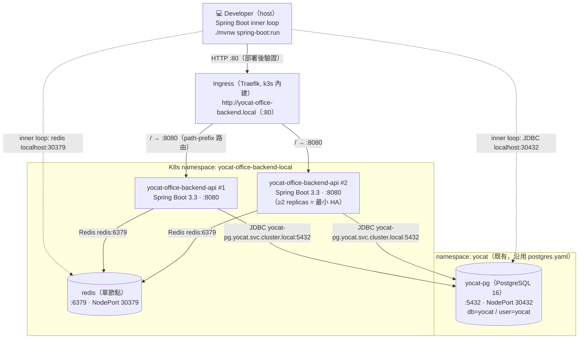
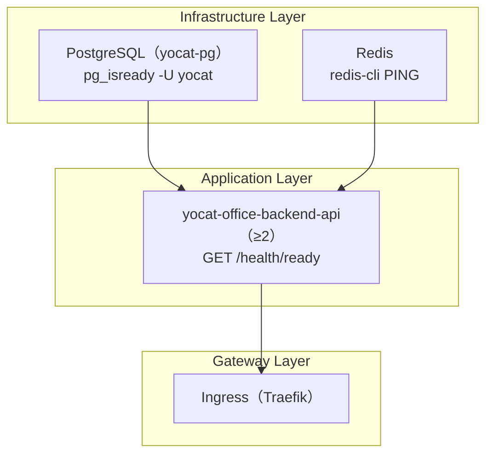
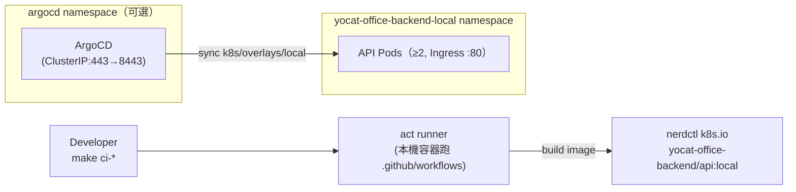

# LOCAL_DEPLOY — 本機一鍵部署與開發內循環指南（Rancher Desktop + Kubernetes）

> 全文 zh-TW。本文件回答「如何在本機（Rancher Desktop k3s）跑完整條流程」——從開發內循環（Spring Boot 本機跑 + 連 in-cluster PostgreSQL）到一鍵部署（≥2 replicas 最小 HA）、冒煙驗證與清理。
> **Local-First 原則（PRD §5.5 AC-5 / EDD §1.2）**：整條流程必須能在 Rancher Desktop k8s 跑完，≥2 副本、測試可驗，無需任何外部雲端。
> 上游真相來源：EDD §3.3/§3.5/§3.6/§3.7、ARCH §2/§3.2.1/§7、runbook §1.2/§2/§4.4、API.md、CONSTANTS.md、`docs/req/postgres.yaml`（既有本機 PostgreSQL 基準）。本文件主架構為 **Kubernetes**；Docker Compose 僅為 §19 輔助方案。

---

## Document Control

| 欄位 | 內容 |
|------|------|
| **DOC-ID** | LOCAL_DEPLOY-YOCAT-OFFICE-BACKEND-20261030 |
| **專案** | yoCat Office 後端信任層（yocat-office-backend） |
| **版本** | v1.0 |
| **狀態** | DRAFT |
| **作者** | 資深 DevOps Engineer（gendoc gen LOCAL_DEPLOY） |
| **日期** | 2026-10-30 |
| **上游 EDD** | [EDD.md](EDD.md) |
| **上游 ARCH** | [ARCH.md](ARCH.md) |
| **上游 runbook** | [runbook.md](runbook.md) |
| **本機 PostgreSQL 基準** | [req/postgres.yaml](req/postgres.yaml)（namespace `yocat`、`yocat-pg`、NodePort 30432） |
| **技術棧** | Java 21 + Spring Boot 3.3 + Spring Modulith 1.3 + PostgreSQL 16 + Redis 7.2 + Kubernetes 1.30（client_engine=N/A，api-only） |
| **本機平台** | Rancher Desktop k3s（containerd / nerdctl）；kubectl context `rancher-desktop` |

> **專案性質（重要）**：本專案為**純後端 API 服務**（`client_type=api-only`，EDD §3.3）。因此本文件**無 web-app / minio / mailpit / pgadmin / admin 前端**章節；所有「前端 / 客戶端引擎」相關段落標記「純後端服務，不適用」。遊戲模擬與 LLM 算力留玩家本機（算力留本地），後端只承載信任層。

---

## 1. 前置需求（Prerequisites）

本機採 **Windows 11 + Rancher Desktop + Git Bash**。安裝並驗證下列工具後再往下走。

| 工具 | 最低版本 | 安裝 | 驗證指令 |
|------|---------|------|---------|
| Windows | 11（10.0.26100+） | — | `ver` |
| **Rancher Desktop** | 1.13 | [rancherdesktop.io](https://rancherdesktop.io)（Container Engine 選 **containerd**） | `rdctl version` |
| kubectl | 1.30 | 隨 Rancher Desktop 內建 | `kubectl version --client` |
| nerdctl | 1.7 | 隨 Rancher Desktop 內建 | `nerdctl version` |
| helm | 3.14 | 隨 Rancher Desktop 內建 | `helm version` |
| **JDK（Eclipse Temurin）** | 21 (LTS) | [adoptium.net](https://adoptium.net) | `java -version` |
| **Maven** | 3.9 | [maven.apache.org](https://maven.apache.org)（或用專案內 `./mvnw`） | `mvn -v` |
| Git | 2.40 | [git-scm.com](https://git-scm.com)（含 Git Bash + openssl） | `git --version` |
| Make | 4.3 | Git Bash: `pacman`/`choco install make`（選配，所有 `make` 均附等同指令） | `make --version` |
| psql client | 16 | `choco install postgresql16` 或 `scoop install postgresql` | `psql --version` |
| jq | 1.7 | `choco install jq` 或 `scoop install jq` | `jq --version` |
| k9s（選配） | 0.32 | `choco install k9s` 或 `scoop install k9s` | `k9s version` |
| mkcert（選配，§13） | 1.4 | `choco install mkcert` | `mkcert --version` |

> **Rancher Desktop 設定**：GUI → **Preferences → Virtual Machine → Hardware**，至少 **8 GB RAM / 4 CPU**（API 2 副本 ×（512Mi req / 1Gi limit，EDD §3.5）+ PostgreSQL + Redis）。**Preferences → Container Engine** 選 **containerd（nerdctl）**。**Preferences → Kubernetes** 勾選 Enable Kubernetes，版本 1.30。
>
> **Windows PATH（Git Bash）**：Rancher Desktop 工具位於 `~/Program Files/Rancher Desktop/resources/resources/win32/bin`。若 `kubectl` / `nerdctl` 找不到，將此路徑加入 PATH：
> ```bash
> export PATH="/c/Program Files/Rancher Desktop/resources/resources/win32/bin:$PATH"
> ```
>
> **kubectl context**：Rancher Desktop 啟動後自動注入 `rancher-desktop` context。執行 `kubectl config use-context rancher-desktop` 確認。

---

## 2. 架構總覽（Architecture Overview）

本機完全在 Rancher Desktop k3s 內執行，與 staging / production 採相同 K8s 資源模型（Deployment / Service / ConfigMap / Secret / Ingress）。**API 維持 ≥2 replicas**（EDD §3.7.2 圖 B），用以驗證 HA 程式行為（Redis 共享 session、Outbox 冪等競態）。

**命名空間拓撲（本機）：**

- 應用層 namespace：`yocat-office-backend-local`（API + Redis；本文件建立）。
- 資料層 namespace：`yocat`（**既有 PostgreSQL**，沿用 `docs/req/postgres.yaml`；`yocat-pg`，NodePort 30432，db/user 皆 `yocat`）。
- 跨 namespace 連線：API（在 `yocat-office-backend-local`）以 K8s DNS `yocat-pg.yocat.svc.cluster.local:5432` 連既有 PostgreSQL；開發內循環時 Spring Boot 在本機（host）以 `localhost:30432`（NodePort）連同一顆 DB。



**K8s 資源對照（本機）：**

| 服務 | Kind | Image | Namespace | ConfigMap / Secret |
|------|------|-------|-----------|--------------------|
| yocat-office-backend-api | Deployment（replicas: 2） | `yocat-office-backend/api:local`（`imagePullPolicy: Never`） | `yocat-office-backend-local` | `yocat-office-backend-api-config` / `yocat-office-backend-api-secret` |
| redis | Deployment（replicas: 1，本機例外） | `redis:7.2-alpine` | `yocat-office-backend-local` | — |
| yocat-pg（既有） | Deployment（replicas: 1，本機例外） | `postgres:16-alpine` | `yocat` | `yocat-pg`（既有 Secret） |

> **路由（Single External Port）**：所有對外存取走單一 Ingress（:80）。API 無 `/api` 前綴——端點為 `/auth/*`、`/wallet/*`、`/entitlements`、`/records`、`/leaderboard`、`/save`、`/health/*`（API.md）。Ingress 以 `path: /`（Prefix）將全部請求轉送至 `yocat-office-backend-api:8080`，**不做路徑重寫**（下游收到原始 path）。
>
> **資料層本機例外（EDD §3.6.1 / §3.7.2）**：PostgreSQL 與 Redis 本機允許單節點；**API 與 Outbox（內嵌 API Pod）必須 ≥2**。

### 2.1 Bounded Context 對照（Spring Modulith，7 BC 合部署）

本機以 **Modular Monolith** 部署：7 個 BC 同一個 `yocat-office-backend-api` Deployment（同一 JVM），跨 BC 僅走 Public `@NamedInterface` 或 Domain Event（Outbox）。各 BC 於程式碼層完全隔離（HC-1 Schema Ownership），可隨時零改模型拆為微服務（ARCH §3.2.1「可分可合」）。

| BC（子系統） | Spring Module | 擁有的 DB Schema | Public API Prefix | Domain Event |
|------------|---------------|-----------------|-------------------|--------------|
| member | `com.sayyogames.yocat.member` | `member`（accounts, sessions） | `/auth/*` | `MemberRegistered` / `MemberDeleted` |
| wallet | `com.sayyogames.yocat.wallet` | `wallet`（wallets, wallet_ledger） | `/wallet/*` | `WalletBalanceChanged` |
| deposit | `com.sayyogames.yocat.deposit` | `deposit`（deposit_pack） | `/wallet/topup`、`/deposit/packs` | `DepositConfirmed` |
| entitlement | `com.sayyogames.yocat.entitlement` | `entitlement`（entitlements） | `/entitlements/*` | `EntitlementGranted` |
| record | `com.sayyogames.yocat.record` | `record`（records） | `/records` | `BusinessRecordAdded` |
| leaderboard | `com.sayyogames.yocat.leaderboard` | `leaderboard`（leaderboard） | `/leaderboard` | `RunScoreSubmitted` |
| game-save | `com.sayyogames.yocat.gamesave` | `game_save`（saves） | `/save` | — |
| 平台底座（橫切） | `com.sayyogames.yocat.platform` | `modulith`（event_publication）/ `platform` | `/health/*`、`/actuator/*` | — |

---

## 3. Quick Start（5 分鐘上手）

適合已熟 Rancher Desktop 的工程師。初次設定見 §4。全部指令於專案根目錄的 Git Bash 執行。

```bash
# 0. 進入專案 + 確認 context
cd <project-root>
kubectl config use-context rancher-desktop

# 1. 生成本機假密碼（冪等；確保既有 yocat-pg Secret 並產出 secrets.env）
./scripts/bootstrap-secrets.sh

# 2. 確保既有 PostgreSQL（沿用 postgres.yaml，namespace yocat）
make db-up
# 等同：kubectl apply -f docs/req/postgres.yaml

# 3. 建立 app namespace + Secret + 部署 Redis
make k8s-init

# 4. Build API image（nerdctl，載入 k3s 的 containerd k8s.io namespace）
make image-build-api

# 5. 部署 API（≥2 replicas）+ Redis + Ingress
make k8s-apply

# 6. 等待所有 Pod 就緒
kubectl wait --for=condition=Ready pods --all -n yocat-office-backend-local --timeout=180s

# 7. 初始化資料庫（Flyway migration + seed）
make db-migrate
make db-seed

# 8. 驗證健康
make health-check
```

預期輸出：

```
[OK] api-server   http://yocat-office-backend.local/health/ready → {"status":"ok","checks":{"db":"ok","redis":"ok"}}
[OK] api replicas 2 Running（HA 最小副本數）
[OK] postgres     yocat-pg（namespace yocat）— Running
[OK] redis        redis — Running
```

任何 `[FAIL]` 請見 §10（常見問題）。

---

## 3.5 Secret Bootstrap（密碼安全管理）

> **原則**：所有 K8s Secret **禁止進 git**，禁止靜態明文密碼。本機密碼全為隨機假值，可隨時重生成。

### 禁止規則（`.gitignore` 必含）

```gitignore
# Secret files — never commit
*.env
.env
.env.*
secrets.env
k8s/overlays/local/secrets.env
scripts/*.local
```

### 三層 Secret 策略

| 層 | 類型 | 適用密碼 | 管理方式 |
|----|------|---------|---------|
| **層 1** | Ephemeral（每次可重生成） | `DB_PASSWORD`、`SESSION_SIGNING_KEY`、`ENCRYPTION_KEY`、`ADMIN_INIT_PASSWORD` | `scripts/bootstrap-secrets.sh` 以 `openssl rand` 生成 |
| **層 2** | OS Keychain（固定憑證） | Container Registry token（Phase B 推 image 才需要） | Windows Credential Manager |
| **層 3** | Enterprise（可選） | Phase B 金流 API key | Sealed Secrets / Vault（本機不需要） |

> 本專案 Phase A 無 OAuth、無金流 API key（EDD §9：opaque session token，非 JWT/JWKS），層 3 於本機不使用。

### 層 1：Ephemeral 密碼 Bootstrap（必做）

`scripts/bootstrap-secrets.sh`（macOS/Linux/Git Bash）——冪等：確保既有 `yocat-pg` Secret、對齊 DB 密碼、產出 `secrets.env`。

```bash
#!/usr/bin/env bash
# scripts/bootstrap-secrets.sh — 生成本機假密碼，never commit 輸出
set -euo pipefail

APP_NS="yocat-office-backend-local"
DB_NS="yocat"
SECRETS_DIR="k8s/overlays/local"
SECRETS_ENV="${SECRETS_DIR}/secrets.env"

echo "[bootstrap-secrets] 確保 namespace ${APP_NS} / ${DB_NS}"
for ns in "${APP_NS}" "${DB_NS}"; do
  kubectl create namespace "${ns}" --dry-run=client -o yaml | kubectl apply -f -
done

# 1) 既有 yocat-pg Secret：不存在則生成（postgres image 需 POSTGRES_USER/PASSWORD/DB）
if ! kubectl get secret yocat-pg -n "${DB_NS}" >/dev/null 2>&1; then
  echo "[bootstrap-secrets] yocat-pg Secret 不存在 → 生成（user=yocat db=yocat）"
  kubectl create secret generic yocat-pg -n "${DB_NS}" \
    --from-literal=POSTGRES_USER="yocat" \
    --from-literal=POSTGRES_DB="yocat" \
    --from-literal=POSTGRES_PASSWORD="$(openssl rand -hex 32)"
else
  echo "[bootstrap-secrets] 沿用既有 yocat-pg Secret"
fi

# 2) 讀出 DB 密碼，讓 app secret 與 DB 一致
DB_PASSWORD="$(kubectl get secret yocat-pg -n "${DB_NS}" -o jsonpath='{.data.POSTGRES_PASSWORD}' | base64 -d)"

# 3) 產出 app secrets.env（app 命名空間用；全假值）
mkdir -p "${SECRETS_DIR}"
cat > "${SECRETS_ENV}" <<EOF
# AUTO-GENERATED by bootstrap-secrets.sh — 本機假值，禁止提交 git
DB_PASSWORD=${DB_PASSWORD}
SESSION_SIGNING_KEY=$(openssl rand -hex 64)
ENCRYPTION_KEY=$(openssl rand -hex 32)
ADMIN_INIT_PASSWORD=$(openssl rand -base64 16 | tr -dc 'a-zA-Z0-9' | head -c 16)
EOF

echo "[bootstrap-secrets] ✅ 已寫入 ${SECRETS_ENV}（已被 .gitignore 忽略）"
echo "[bootstrap-secrets] ⚠️  本機假密碼，正式環境請改用 Sealed Secrets / Vault"
```

```bash
chmod +x scripts/bootstrap-secrets.sh
./scripts/bootstrap-secrets.sh
```

`scripts/bootstrap-secrets.ps1`（Windows PowerShell 等效，CSPRNG）：

```powershell
# scripts/bootstrap-secrets.ps1 — 生成本機假密碼，never commit 輸出
$ErrorActionPreference = "Stop"
$AppNs = "yocat-office-backend-local"; $DbNs = "yocat"
$SecretsEnv = "k8s/overlays/local/secrets.env"

foreach ($ns in @($AppNs, $DbNs)) {
    kubectl create namespace $ns --dry-run=client -o yaml | kubectl apply -f -
}

function New-RandomHex([int]$bytes) {
    $rng = [System.Security.Cryptography.RandomNumberGenerator]::Create()
    $buf = New-Object byte[] $bytes; $rng.GetBytes($buf)
    ([System.BitConverter]::ToString($buf) -replace '-','').ToLower()
}

$exists = kubectl get secret yocat-pg -n $DbNs --ignore-not-found
if (-not $exists) {
    kubectl create secret generic yocat-pg -n $DbNs `
        --from-literal="POSTGRES_USER=yocat" `
        --from-literal="POSTGRES_DB=yocat" `
        --from-literal="POSTGRES_PASSWORD=$(New-RandomHex 32)"
}
$dbPwB64 = kubectl get secret yocat-pg -n $DbNs -o jsonpath='{.data.POSTGRES_PASSWORD}'
$DbPassword = [System.Text.Encoding]::UTF8.GetString([System.Convert]::FromBase64String($dbPwB64))

New-Item -ItemType Directory -Force -Path "k8s/overlays/local" | Out-Null
@"
# AUTO-GENERATED — 本機假值，禁止提交 git
DB_PASSWORD=$DbPassword
SESSION_SIGNING_KEY=$(New-RandomHex 64)
ENCRYPTION_KEY=$(New-RandomHex 32)
ADMIN_INIT_PASSWORD=$(New-RandomHex 16)
"@ | Set-Content -NoNewline -Path $SecretsEnv
Write-Host "[bootstrap-secrets] OK -> $SecretsEnv"
```

**重生成時機：** 執行 `make k8s-clean`（刪 app namespace）或 `make db-reset` 後，重跑 `./scripts/bootstrap-secrets.sh`。

### 驗證 Secret

```bash
# app Secret（值 base64 遮罩）
kubectl get secret yocat-office-backend-api-secret -n yocat-office-backend-local

# .gitignore 已涵蓋
grep -E '\*\.env|secrets\.env' .gitignore && echo "✅ .gitignore OK" || echo "❌ 補 .gitignore"
```

---

## 4. 逐步設定（Step-by-Step Setup）

> **前置**：若 `k8s/overlays/local/` 尚未由下游 gen-k8s 步驟建立，本節 §4.5 附完整 inline manifest，可直接複製建立後再 `kubectl apply -k`。

### 4.1 Clone & 進入專案

```bash
git clone git@github.com:sayyogames/yocat-office-backend.git
cd yocat-office-backend
git status   # Expected: On branch main
```

> 本機工作目錄即 `<project-root>`。

### 4.2 Rancher Desktop 設定

```bash
# 1. 確認 context
kubectl config get-contexts        # 應見 rancher-desktop 標 *（current）
kubectl config use-context rancher-desktop

# 2. 確認 k3s API server 可連線
kubectl cluster-info               # Expected: control plane is running at https://127.0.0.1:6443

# 3. 設定 hosts（讓 Ingress domain 可解析）— Windows 需以系統管理員身分
#    檔案：C:\Windows\System32\drivers\etc\hosts，加入一行：
#    127.0.0.1   yocat-office-backend.local
#  Git Bash（系統管理員）一次性寫入：
echo "127.0.0.1   yocat-office-backend.local" >> /c/Windows/System32/drivers/etc/hosts
```

### 4.6 初始化資料庫（Flyway migration + seed）

ORM = Spring Data JDBC，migration 工具 = **Flyway**（runbook §7.10、SCHEMA §8 `platform.schema_migrations`）。Spring Boot 啟動時自動執行 Flyway；亦可手動觸發：

```bash
# 執行所有 pending migration（在任一 API Pod 內觸發 Flyway，或由啟動自動完成）
make db-migrate
# 等同（Pod 內以 actuator 觸發 / 或改用 Flyway Maven 於 host）：
# kubectl exec -n yocat-office-backend-local deploy/yocat-office-backend-api -- \
#   java -jar /app/app.jar --spring.flyway.migrate-only=true
# 或 host 端（inner loop）：
#   ./mvnw -pl apps/api flyway:migrate \
#     -Dflyway.url=jdbc:postgresql://localhost:30432/yocat -Dflyway.user=yocat

# 查看 migration 狀態
make db-status
# 等同：
# kubectl exec -n yocat-office-backend-local statefulset/yocat-pg -- true 2>/dev/null; \
# psql "postgres://yocat@localhost:30432/yocat" -c "SELECT version, description, success FROM platform.schema_migrations ORDER BY installed_rank;"

# 載入 seed（idempotent）
make db-seed
```

預期 migration 輸出：

```
Successfully validated N migrations
Migrating schema "member" to version 001 - create accounts sessions ... OK
Migrating schema "wallet" to version 001 - create wallets wallet_ledger ... OK
...
Successfully applied N migrations（含 7 BC schema + modulith + platform）
```

### 4.7 驗證所有服務健康

```bash
make health-check
```

個別驗證：

```bash
# API health（透過 Ingress，真實路徑 /health/ready）
curl -s http://yocat-office-backend.local/health/ready | jq .
# Expected: {"status":"ok","checks":{"db":"ok","redis":"ok"}}

curl -s -o /dev/null -w "%{http_code}\n" http://yocat-office-backend.local/health/live
# Expected: 200

# PostgreSQL（既有，NodePort 直連）
# ⚠️ WARNING: 下方密碼由 yocat-pg Secret 提供，僅本機開發，staging/production 禁止使用。
PGPASSWORD="$(kubectl get secret yocat-pg -n yocat -o jsonpath='{.data.POSTGRES_PASSWORD}' | base64 -d)" \
  psql "postgres://yocat@localhost:30432/yocat" -c "SELECT 1;"
# Expected: 1 row

# Redis（NodePort 直連）
redis-cli -h localhost -p 30379 ping
# Expected: PONG
```

### 4.8 單一子系統獨立啟動驗證（Spring Modulith 可拆解性）

> 本機快速驗證各 BC 可獨立冷啟動（HC-2 / HC-4），確認微服務可拆性。由於本機為單體部署，以 ModularityTests 於 host 驗證，不需拆 Pod。

```bash
# 以 Spring Modulith verify() 驗證 7 BC 邊界無循環、無跨 BC 違規（EDD §4.3）
./mvnw -pl apps/api test -Dtest=ModularityTests
# Expected: BUILD SUCCESS；ApplicationModules.of(...).verify() 不擲 AssertionError

# 跨 BC SQL 違規掃描（HC-1，應為 0）
make test-schema-isolation
# Expected: cross_bc_queries: 0
```

### 服務啟動 / 關閉順序（Startup / Shutdown Sequencing）

**啟動依賴圖（Dependency Graph）：**



**就緒判斷（readiness gate）：**

| 服務 | Readiness Check | 逾時 | 失敗行為 |
|-----|----------------|------|---------|
| PostgreSQL（yocat-pg） | `pg_isready -h localhost -p 30432 -U yocat` | 30s | 停止啟動，顯示錯誤 |
| Redis | `redis-cli -p 30379 ping` → PONG | 10s | 停止啟動 |
| yocat-office-backend-api | `GET /health/ready` → 200 + `"status":"ok"` | 60s | 停止啟動，查 §10 |
| Ingress（Traefik） | `curl http://yocat-office-backend.local/health/live` → 200 | 90s | 查 /etc/hosts + traefik pod |

**優雅關閉（Graceful Shutdown，EDD §3.6.5）：**

| 關閉順序 | 服務 | drain / grace | 強制 kill |
|---------|-----|---------------|----------|
| 1 | Ingress（停止分流） | Readiness 立即 503 | — |
| 2 | yocat-office-backend-api | in-flight 完成（≤ `terminationGracePeriodSeconds=60s`、`timeout-per-shutdown-phase=30s`） | 60s |
| 3 | Redis / PostgreSQL | 不 drain | 10s |

---

## 5. 服務參考（Service Reference）

### Ingress 存取（需 /etc/hosts）

| 服務 | URL | 說明 |
|------|-----|------|
| api-server | `http://yocat-office-backend.local/` | REST API（path-prefix，無 `/api` 前綴） |
| health（liveness） | `http://yocat-office-backend.local/health/live` | 存活檢查 |
| health（readiness） | `http://yocat-office-backend.local/health/ready` | 就緒檢查（含 DB/Redis） |
| metrics | `http://yocat-office-backend.local/actuator/prometheus` | Micrometer/Prometheus 指標 |

> 純後端服務，無前端 UI / admin 路由。

### NodePort / port-forward 直連

| 服務 | 存取方式 | 本地 URL |
|------|---------|---------|
| api-server | ClusterIP（內部:8080，對外走 gateway）或 `kubectl port-forward -n yocat-office-backend-local deploy/yocat-office-backend-api 8080:8080` | `http://localhost:30088` / `http://localhost:8080` |
| redis | NodePort 30379 或 `kubectl port-forward -n yocat-office-backend-local deploy/redis 6379:6379` | `localhost:30379` |
| yocat-pg（既有） | NodePort 30432（postgres.yaml）或 `kubectl port-forward -n yocat deploy/yocat-pg 5432:5432` | `localhost:30432` |

> **Make shortcuts**：`make pf-api`、`make pf-db`、`make pf-redis` 背景啟動 port-forward 並記 PID；`make pf-stop` 全停。

---

## 6. 開發指令（Development Commands）

所有 `make` 指令從 repo root 執行（`<project-root>`）。未安裝 make 時，使用右欄等同底層指令。

### Image & Deployment

| 指令 | 等同底層命令 | 使用時機 |
|------|------------|---------|
| `make image-build-api` | `nerdctl --namespace k8s.io build -t yocat-office-backend/api:local -f docker/api/Dockerfile .` | 修改後端程式碼後 |
| `make db-up` | `kubectl apply -f docs/req/postgres.yaml` | 確保既有 PostgreSQL |
| `make k8s-init` | 建立 namespace + `kubectl create secret ... --from-env-file=k8s/overlays/local/secrets.env` + 部署 Redis | 初次設定 / 更新 Secret |
| `make k8s-apply` | `kubectl apply -k k8s/overlays/local/` | 變更 manifest 後 |
| `make k8s-restart-api` | `kubectl rollout restart deploy/yocat-office-backend-api -n yocat-office-backend-local` | build 新 image 後套用 |
| `make k8s-delete` | `kubectl delete -k k8s/overlays/local/` | 重新部署（保留 PostgreSQL / PVC） |
| `make k8s-clean` | `kubectl delete namespace yocat-office-backend-local` | 完全重置 app（不動 yocat DB） |

### 觀察 & 偵錯

| 指令 | 等同命令 |
|------|---------|
| `make pods` | `kubectl get pods -n yocat-office-backend-local` |
| `make logs-api` | `kubectl logs -f -l app=yocat-office-backend-api -n yocat-office-backend-local --max-log-requests=2` |
| `make shell-api` | `kubectl exec -it deploy/yocat-office-backend-api -n yocat-office-backend-local -- sh` |
| `make shell-db` | `kubectl exec -it -n yocat deploy/yocat-pg -- psql -U yocat -d yocat` |
| `make health-check` | 依序 `curl http://yocat-office-backend.local/health/ready` + `kubectl get pods -n yocat-office-backend-local`（見 §4.7） |
| `make k9s` | `k9s -n yocat-office-backend-local` |

### 測試（對齊 test-plan.md）

| 指令 | 等同命令 |
|------|---------|
| `make test-unit` | `./mvnw -pl apps/api test`（JUnit 5 + Mockito，不需 K8s） |
| `make test-integration` | `./mvnw -pl apps/api verify -Pintegration`（Testcontainers 起真實 PostgreSQL/Redis） |
| `make test-bdd` | `./mvnw -pl apps/api test -Dcucumber`（執行 `features/*.feature` Server BDD） |
| `make test-modulith` | `./mvnw -pl apps/api test -Dtest=ModularityTests`（HC-1~HC-5 邊界驗證） |
| `make test-schema-isolation` | 跨 BC SQL 違規掃描（應輸出 `cross_bc_queries: 0`） |
| `make lint` | `./mvnw -pl apps/api spotless:check`（或 checkstyle，依專案設定） |

> 本專案 `client_type=api-only`，**無 Playwright / E2E client 測試**（無 `features/client/`）；關鍵路徑以 REST-assured + k6 覆蓋（EDD §3.3）。

---

## 7. 資料庫操作（Database Operations）

> 本機沿用既有 `yocat-pg`（namespace `yocat`，db/user `yocat`，NodePort 30432）。各 BC 於同一 db `yocat` 內各擁獨立 schema（member / wallet / deposit / entitlement / record / leaderboard / game_save + modulith / platform）。

### 進入 psql Shell

> ⚠️ **安全注意**：下方以 `yocat-pg` Secret 的密碼連線，僅本機開發；禁止複製至 staging / production（正式用 Sealed Secrets / Vault）。

```bash
# 方法 1：kubectl exec（不需 port-forward）
kubectl exec -it -n yocat deploy/yocat-pg -- psql -U yocat -d yocat

# 方法 2：NodePort + 本地 psql client
PGPASSWORD="$(kubectl get secret yocat-pg -n yocat -o jsonpath='{.data.POSTGRES_PASSWORD}' | base64 -d)" \
  psql "postgres://yocat@localhost:30432/yocat"

# Make shortcut
make shell-db
```

### 執行 / 查詢 / 回滾 Migration（Flyway）

```bash
# 執行所有 pending migration
make db-migrate
# 等同（host inner loop）：
# ./mvnw -pl apps/api flyway:migrate -Dflyway.url=jdbc:postgresql://localhost:30432/yocat -Dflyway.user=yocat

# 查看 migration 狀態
make db-status
# 等同：
# ./mvnw -pl apps/api flyway:info -Dflyway.url=jdbc:postgresql://localhost:30432/yocat -Dflyway.user=yocat

# Flyway 社群版不支援自動 undo；回滾採 expand-contract 向後相容新 migration（runbook §7.10）。
# 本機完全重來用 make db-reset（銷毀資料）。
```

### Seed 測試資料

```bash
make db-seed   # 載入所有 seed（idempotent，可重複執行）
```

### 重置為乾淨狀態（僅本機）

```bash
# Drop 7 BC schema + 重建 + migrate + seed（銷毀本機資料）
make db-reset
# 等同：
# psql "postgres://yocat@localhost:30432/yocat" -c \
#  "DROP SCHEMA IF EXISTS member,wallet,deposit,entitlement,record,leaderboard,game_save,modulith,platform CASCADE;"
# 然後 make db-migrate && make db-seed
```

### Backup / Restore

> ⚠️ **安全注意**：連線字串密碼僅本機開發用。

```bash
# Backup（NodePort）
PGPASSWORD="$(kubectl get secret yocat-pg -n yocat -o jsonpath='{.data.POSTGRES_PASSWORD}' | base64 -d)" \
  pg_dump "postgres://yocat@localhost:30432/yocat" > backups/local-$(date +%Y%m%d-%H%M%S).sql

# Restore
PGPASSWORD="$(kubectl get secret yocat-pg -n yocat -o jsonpath='{.data.POSTGRES_PASSWORD}' | base64 -d)" \
  psql "postgres://yocat@localhost:30432/yocat" < backups/local-20261030-093000.sql
```

### 對帳快檢（錢包一致性，P0 零容忍，runbook §7.8）

```bash
kubectl exec -it -n yocat deploy/yocat-pg -- psql -U yocat -d yocat -c \
 "SELECT w.account_id, w.cash, w.gems
  FROM wallet.wallets w JOIN (
    SELECT account_id,
           SUM(CASE WHEN currency='cash' THEN delta ELSE 0 END) cash_sum,
           SUM(CASE WHEN currency='gems' THEN delta ELSE 0 END) gems_sum
    FROM wallet.wallet_ledger GROUP BY account_id) l ON l.account_id=w.account_id
  WHERE w.cash <> l.cash_sum OR w.gems <> l.gems_sum;"
# Expected: 0 rows（餘額與 ledger 完全相符）
```

---

## 8. 測試資料與 Fixtures（Test Data & Fixtures）

`make db-seed` 後以下帳號與資料固定可用。角色來源：PRD §3.2（遊戲客戶端＝玩家 USER、營運/客服 OPS）；RBAC 見 EDD §4.5.1。

### Default User Accounts

| Role（RBAC） | Email | Password | 說明 |
|------|-------|----------|------|
| USER（玩家，Persona B 阿凱） | `player@yocat-office-backend.local` | `Password1!` | 可註冊/登入/儲值/花費/購買/存檔/上榜/記經營史 |
| USER（第二玩家，併發測試用） | `player2@yocat-office-backend.local` | `Password1!` | 用於排行榜與併發 spend 測試 |
| OPS（營運/客服，Persona C 小婷，唯讀） | `ops@yocat-office-backend.local` | `Password1!` | 唯讀對帳與風控（ledger/records 查詢） |

> 密碼以 scrypt 雜湊儲存（EDD §4.2，keylen 64 / salt 16）；`Password1!` 強度足夠本機開發。

### Sample Data（業務表，來源 SCHEMA §1.2）

| Entity（schema.table） | Count | 說明（涵蓋狀態） |
|--------|-------|------|
| `member.accounts` | 3 | USER×2 + OPS×1，密碼同上 |
| `wallet.wallets` | 3 | 每帳號 1 錢包（cash / gems）；含餘額 0 與非 0 |
| `wallet.wallet_ledger` | ≥ 8 | 涵蓋 reason：init / topup / buy_cosmetic / buy_dream / buy_scenario / rescue（append-only 對帳用） |
| `deposit.deposit_pack` | 4 | pack 目錄：`g_small` / `g_mid` / `g_big` / `cap_1000`（EDD §3.3.x 規則 4） |
| `entitlement.entitlements` | 3 | 涵蓋 kind：cosmetic / dream / scenario（破產不消失驗證） |
| `record.records` | 5 | 經營史：破產 / 成就 / 傳承（append-only） |
| `leaderboard.leaderboard` | 10 | 多 run_id 上榜，涵蓋 Top N 查詢邊界（limit ≤ 100） |
| `game_save.saves`（edge case） | 2 | 最大欄位長度 + 特殊字元（Unicode CJK，如「辦公室🐱」），跨 slot upsert |

### DB 瀏覽（psql，純後端無 pgadmin）

```bash
# 以 psql 瀏覽（本專案 api-only，無 pgadmin 容器）
kubectl exec -it -n yocat deploy/yocat-pg -- psql -U yocat -d yocat -c "\dn"       # 列出所有 schema
kubectl exec -it -n yocat deploy/yocat-pg -- psql -U yocat -d yocat -c "\dt wallet.*"  # wallet BC 的表
```

---

## 9. ConfigMap & Secret Reference

### ConfigMap — `yocat-office-backend-api-config`

| Key | 本機預設值 | 說明 |
|-----|-----------|------|
| `SPRING_PROFILES_ACTIVE` | `local` | Spring profile |
| `SERVER_PORT` | `8080` | API 監聽 port |
| `DATABASE_URL` | `jdbc:postgresql://yocat-pg.yocat.svc.cluster.local:5432/yocat` | PostgreSQL（跨 namespace K8s DNS，非 localhost） |
| `DATABASE_USER` | `yocat` | DB 使用者（既有 yocat-pg） |
| `REDIS_HOST` | `redis` | Redis service DNS（同 namespace，非 localhost） |
| `REDIS_PORT` | `6379` | Redis port |
| `SESSION_TTL_DAYS` | `30` | opaque session TTL（EDD ADR-003） |
| `LOG_LEVEL` | `DEBUG` | `DEBUG` / `INFO` / `WARN` / `ERROR` |

### Secret — `yocat-office-backend-api-secret`（從 `k8s/overlays/local/secrets.env` 建立）

| Key | 說明 | 設定方式 |
|-----|------|---------|
| `DB_PASSWORD` | PostgreSQL 密碼（與 yocat-pg Secret 一致） | `secrets.env`（bootstrap 對齊） |
| `SESSION_SIGNING_KEY` | opaque session 簽署金鑰 | `secrets.env`（`openssl rand -hex 64`） |
| `ENCRYPTION_KEY` | 敏感欄位加密金鑰 | `secrets.env`（`openssl rand -hex 32`） |
| `ADMIN_INIT_PASSWORD` | 初始 OPS 帳號密碼（seed 用） | `secrets.env`（CSPRNG） |

> Secret 表只列 Key 名稱，不含任何值。DB 連線的 `DATABASE_URL` 使用 K8s internal DNS（`yocat-pg.yocat.svc.cluster.local`），`REDIS_HOST` 使用 service 名稱 `redis`——皆非 `localhost`。

### 查看 / 更新

```bash
# 查看 ConfigMap
kubectl get configmap yocat-office-backend-api-config -n yocat-office-backend-local -o yaml

# 查看 Secret key（值 base64 遮罩）
kubectl get secret yocat-office-backend-api-secret -n yocat-office-backend-local -o yaml

# 更新後需 rolling restart 才生效
kubectl apply -k k8s/overlays/local/ && make k8s-restart-api
```

---

## 10. 常見問題與修復（Common Issues & Fixes）

| Issue | Symptom | Root Cause | Fix |
|-------|---------|------------|-----|
| Pod stuck `Pending` | `kubectl get pods` 顯示 Pending | 資源不足 | `kubectl describe pod <name> -n yocat-office-backend-local` 查 Events；Rancher Desktop RAM 調至 ≥ 8 GB |
| Pod `CrashLoopBackOff` | api Pod 反覆重啟 | 設定錯誤 / DB 未就緒 / Flyway 失敗 | `kubectl logs <pod> -n yocat-office-backend-local --previous` 查上次崩潰；Flyway 失敗見 §7 expand-contract |
| `ImagePullBackOff` | 找不到 image | image 未 build 或未進 k8s.io namespace | `nerdctl --namespace k8s.io images \| grep yocat-office-backend`；重跑 `make image-build-api`（確認 `--namespace k8s.io`） |
| Ingress 無法解析 | `curl: Could not resolve host` | hosts 未設定 | 確認 `C:\Windows\System32\drivers\etc\hosts` 有 `127.0.0.1 yocat-office-backend.local`；確認 traefik pod：`kubectl get pods -n kube-system -l app.kubernetes.io/name=traefik` |
| DB 連線拒絕 | api log `Connection refused` / `checks.db: fail` | yocat-pg 未就緒或跨 namespace DNS 失敗 | `kubectl wait --for=condition=Ready pod -l app=yocat-pg -n yocat --timeout=60s`；確認 `DATABASE_URL` 用 `yocat-pg.yocat.svc.cluster.local` |
| DB 密碼不符 | api log `password authentication failed for user "yocat"` | app secret 與 yocat-pg Secret 密碼不一致 | 重跑 `./scripts/bootstrap-secrets.sh`（會對齊密碼）後 `make k8s-init && make k8s-restart-api` |
| Flyway migration 失敗 | `relation already exists` / 校驗失敗 | migration 被部分套用 | 本機用 `make db-reset`（銷毀資料重跑）；正式採 `flyway:repair` + expand-contract |
| Redis 連線失敗 | api log `checks.redis: fail` | redis pod 未就緒 | `kubectl get pod -l app=redis -n yocat-office-backend-local`；`kubectl rollout restart deploy/redis -n yocat-office-backend-local` |
| 副本數 < 2 | `grep -c Running` 回 1 | replicas 被改為 1 | 確認 `api-deployment.yaml` `replicas: 2`；`kubectl scale deploy/yocat-office-backend-api --replicas=2 -n yocat-office-backend-local` |
| Rancher Desktop k8s 未啟動 | `kubectl: connection refused` | k3s 未運行 | 開 Rancher Desktop GUI → Kubernetes 頁確認 Ready |
| nerdctl build network 失敗 | build 時 Maven 下載失敗 | containerd 沙箱 DNS | `nerdctl --namespace k8s.io build --network=host ...`；或重啟 Rancher Desktop |

> **框架特定（Java / Spring，EDD §3.3 推斷）：**
> - Flyway migration checksum 不符：`./mvnw -pl apps/api flyway:repair`（修 history 後重跑），本機可直接 `make db-reset`。
> - HikariCP 連線池耗盡（本機 2 副本共用 yocat-pg）：確認 `pg_stat_activity` 無 `idle in transaction` 長交易（runbook §7.5.1）；`make k8s-restart-api` 釋放連線。
> - Redis maxmemory：本機單節點預設無上限；如需限制於 redis.yaml 加 `--maxmemory 256mb --maxmemory-policy allkeys-lru`。

---

## 11. Logs & Debugging

### 查看 Pod 日誌

```bash
# 即時 tail 所有 api 副本（2 副本）
kubectl logs -f -l app=yocat-office-backend-api -n yocat-office-backend-local --max-log-requests=2
# Make shortcut
make logs-api

# 查看上次 crash 日誌
kubectl logs -l app=yocat-office-backend-api -n yocat-office-backend-local --previous

# PostgreSQL（既有 namespace yocat）
kubectl logs -f deploy/yocat-pg -n yocat
# Redis
kubectl logs -f deploy/redis -n yocat-office-backend-local
```

> 無 worker / web Deployment（Outbox 內嵌 API Pod，純後端無前端），故無 `logs-worker` / `logs-web`。

### 進入 Pod Shell

```bash
kubectl exec -it deploy/yocat-office-backend-api -n yocat-office-backend-local -- sh
make shell-api

# 查看注入的環境變數（ConfigMap + Secret）
kubectl exec deploy/yocat-office-backend-api -n yocat-office-backend-local -- env | sort

# 版本資訊（Java runtime）
kubectl exec deploy/yocat-office-backend-api -n yocat-office-backend-local -- java -version
```

### 查看 Pod 事件（啟動失敗時最有用）

```bash
kubectl describe pod <pod-name> -n yocat-office-backend-local
# 重點看 Events 區塊的 Warning
```

### 常見 Log 模式

| Pattern | 含義 | 處理 |
|---------|------|------|
| `[ERROR] HikariPool ... Connection is not available` | DB 連線池耗盡或 yocat-pg 不可達 | 確認 yocat-pg Ready；查 `idle in transaction`（runbook §7.5.1） |
| `[WARN] Redis connection lost, retrying` | Redis 暫時不可用 | 通常自動恢復；cache miss 回源 DB（非 500） |
| `[ERROR] FlywayException: Migration ... failed` | migration SQL 異常 | 查完整錯誤；本機 `make db-reset` |
| `[INFO] Outbox published event_id=...` | Domain Event 正常投遞 | 正常，無需處理 |
| `[ERROR] wallet_ledger_mismatch` | 錢包對帳不一致（P0 零容忍） | 立即凍結該帳號，執行 §7 對帳快檢，查併發 spend / Outbox 重複消費 |

### k9s（推薦）

```bash
k9s -n yocat-office-backend-local
# :pod 查 pod / l 看 log / s 進 shell / d describe / p 看前次 crash log
```

---

## 12. Port Reference

### Ingress（需 /etc/hosts 設定）

| Path | 服務 | 說明 |
|------|------|------|
| `http://yocat-office-backend.local/` | api-server | REST API（path-prefix 全部轉送 :8080；純後端無前端 UI） |
| `http://yocat-office-backend.local/health/live` | api-server | 存活檢查 |
| `http://yocat-office-backend.local/health/ready` | api-server | 就緒檢查（DB/Redis） |
| `http://yocat-office-backend.local/actuator/prometheus` | api-server | 指標 |

### NodePort / port-forward（直連）

| 服務 | 存取 | 本地 Port |
|------|------|---------|
| api-server | `make pf-api`（ClusterIP，無對外 NodePort） | `8080` / `30088` |
| yocat-pg（既有，namespace yocat） | `make pf-db`（或 NodePort 30432） | `30432` → container `5432` |
| redis | `make pf-redis`（或 NodePort 30379） | `30379` → container `6379` |

> 全部 port-forward：`make pf-all`；停止：`make pf-stop`。NodePort 與 §2 架構圖標注一致（api 8080 / pg 5432@30432 / redis 6379@30379）。

---

## 13. Local HTTPS 設定

> **可跳過**：本專案 Phase A 採 **opaque session token（Bearer header）**，**無 OAuth 2.0 回調、無 `SameSite=Secure` cookie 需求**（EDD ADR-003），本機開發用 HTTP 即可。僅在需測 TLS 行為（如 HSTS、憑證鏈）時執行本節。

```bash
# 1. 建立本地 CA（只需一次）
mkcert -install

# 2. 為本地 domain 生成憑證
mkcert "yocat-office-backend.local"
# 生成 yocat-office-backend.local.pem 與 yocat-office-backend.local-key.pem

# 3. 建立 K8s TLS Secret
kubectl create secret tls yocat-office-backend-local-tls \
  --cert=yocat-office-backend.local.pem \
  --key=yocat-office-backend.local-key.pem \
  -n yocat-office-backend-local \
  --dry-run=client -o yaml | kubectl apply -f -

# 4. 在 ingress.yaml 的 spec 加入 tls 區塊後重新 apply：
#    tls:
#      - hosts: [yocat-office-backend.local]
#        secretName: yocat-office-backend-local-tls
kubectl apply -k k8s/overlays/local/
```

> `.gitignore` 須加入憑證私鑰：`yocat-office-backend.local-key.pem`（已被 `*.pem` 未涵蓋時手動補）。

---

## 14. Mock Services & 跨 BC Stub

本專案 Phase A **無外部依賴服務**（EDD §2.1：金流供應商為 Phase B 虛線預留；無 Email / Storage / SMS / OAuth / CDN）。故本機**無需 mailpit / minio / mock-oauth**。

| 外部依賴（EDD §2.1） | Phase | 本機替代 | 說明 |
|---------------------|-------|---------|------|
| 金流供應商（Payment） | Phase B | 不啟用（假付費走 `/wallet/topup` pack 解析） | Phase A 儲值為假付費，deposit BC 直接入帳，無外部 webhook |
| Email / Storage / SMS / OAuth | 不適用 | — | api-only 信任層無此依賴 |

### 14.1 跨 BC 內部 Stub（Spring Modulith HC-2 驗證）

只開發單一 BC 時，其他 BC 的 Public API 以 **WireMock stub** 替代（開發者不需啟動全部子系統，同時確保只透過 Public API 互動，HC-2）。本機以 Testcontainers/WireMock 於整合測試內啟動，不需獨立 Pod。

```
src/test/resources/wiremock/
  member/ get-member-by-id.json     ← stub: GET 內部 MemberService.verifySession 對應 mock
  wallet/ get-balance.json          ← stub: WalletService.findWallet
```

> WireMock mapping 與 Pact Consumer test 共用 stub 定義；`make test-integration` 自動載入。

---

## 15. Inner Loop — 開發內循環

每次改碼不需重建整個環境。本機提供兩種內循環：**(A) Spring Boot 本機跑 + 連 in-cluster PostgreSQL（最快，秒級）**、**(B) rebuild image + rolling restart（最貼近 k8s）**。

### 方法 A：Spring Boot 本機跑（host）+ 連 in-cluster 服務（推薦，秒級熱重載）

API 在 host 以 Maven 執行，透過 NodePort 連叢集內 PostgreSQL（30432）與 Redis（30379）：

```bash
# 1. 確保 DB / Redis 在叢集內運行（NodePort 已開）
make db-up
kubectl apply -k k8s/overlays/local/   # 至少讓 redis 起來

# 2. host 端啟動 Spring Boot（local-host profile 指向 NodePort）
DATABASE_URL="jdbc:postgresql://localhost:30432/yocat" \
DATABASE_USER="yocat" \
DATABASE_PASSWORD="$(kubectl get secret yocat-pg -n yocat -o jsonpath='{.data.POSTGRES_PASSWORD}' | base64 -d)" \
REDIS_HOST="localhost" REDIS_PORT="30379" \
  ./mvnw -pl apps/api spring-boot:run

# 3. 開發：Spring Boot DevTools 自動偵測 classpath 變更熱重載（改 Java 存檔即重啟 context）
#    驗證：
curl -s http://localhost:8080/health/ready | jq .
```

> **熱重載**：加入 `spring-boot-devtools` 依賴後，IDE 編譯輸出變更即觸發自動重啟（約 1–3 秒），遠快於重建 image。此模式只跑**單一** API 實例——HA 專屬行為（Redis 共享 session、Outbox 競態）仍需走方法 B 的 ≥2 副本叢集驗證。

### 方法 B：rebuild image + rolling restart（貼近 k8s，30–60 秒）

```bash
make image-build-api && make k8s-restart-api
# 等同：
# nerdctl --namespace k8s.io build -t yocat-office-backend/api:local -f docker/api/Dockerfile .
# kubectl rollout restart deploy/yocat-office-backend-api -n yocat-office-backend-local
kubectl rollout status deploy/yocat-office-backend-api -n yocat-office-backend-local --timeout=120s
```

### 前端 inner loop

> 純後端服務，無前端 inner loop（`client_engine=N/A`）。

### Skaffold（選配，完整 inner loop）

若安裝 skaffold（`skaffold.yaml` 於 repo root，`local` profile 對應 `k8s/overlays/local/`）：

```bash
skaffold dev --profile local     # watch 原始碼，變更自動 build + deploy（Ctrl+C 停止）
skaffold run --profile local     # 一次性 build + deploy
skaffold delete --profile local  # 清除
```

---

## 16. Cleanup

### 停止 port-forward

```bash
make pf-stop
```

### 刪除 app 資源（保留既有 PostgreSQL 與資料）

```bash
make k8s-delete
# 等同：
kubectl delete -k k8s/overlays/local/
# 注意：不動 namespace yocat 的 yocat-pg（既有共用 DB）
```

### 完全重置 app namespace（不動 yocat DB）

```bash
make k8s-clean
# 等同：
kubectl delete namespace yocat-office-backend-local
# yocat-pg（namespace yocat）與其 PVC yocat-pg-data 保留
```

### 連 DB 資料一併清除（謹慎）

```bash
# 只清 app schema（保留 DB）
make db-reset
# 或連既有 PostgreSQL 一起刪（會影響其他使用 yocat namespace 的服務，謹慎）：
# kubectl delete -f docs/req/postgres.yaml   # 連 PVC yocat-pg-data 一起刪 → 資料永久消失
```

### 重建本地環境（一鍵）

```bash
make k8s-clean 2>/dev/null; ./scripts/bootstrap-secrets.sh && make db-up && make k8s-init && \
  make image-build-api && make k8s-apply && \
  kubectl wait --for=condition=Ready pods --all -n yocat-office-backend-local --timeout=180s && \
  make db-migrate && make db-seed && make health-check
```

### 確認清除

```bash
kubectl get namespace yocat-office-backend-local    # Expected: Error from server (NotFound)
nerdctl --namespace k8s.io images | grep yocat-office-backend
# 清除本機 image：
# nerdctl --namespace k8s.io rmi yocat-office-backend/api:local
```

---

## 17. Tunnel Access（單一對外 Port，AI 可測試模式）

所有服務透過同一個 Ingress（port 80）路由，tunnel 只需暴露一個 port。供 AI 代理或遠端協作以單一 URL 存取完整 API。

### ngrok（推薦）

```bash
# 安裝（一次性）
choco install ngrok   # 或 scoop install ngrok

# 啟動 tunnel → Ingress port 80（帶 host header 讓 Traefik 正確路由）
ngrok http 80 --host-header=yocat-office-backend.local
# 輸出範例：Forwarding https://a1b2c3d4.ngrok-free.app -> http://localhost:80
_TUNNEL_URL="https://a1b2c3d4.ngrok-free.app"
```

### Cloudflare Tunnel（無公開 URL 限制）

```bash
choco install cloudflared
cloudflared tunnel --url http://localhost:80
# 輸出範例：https://random-name.trycloudflare.com
_TUNNEL_URL="https://random-name.trycloudflare.com"
```

### Ingress 接受任意 Host（tunnel 動態域名用）

```bash
# 方法 1（推薦）：ngrok 加 --host-header=yocat-office-backend.local（如上）
# 方法 2：ingress.yaml 移除 host（或設空字串）接受所有 host，再 apply：
#   spec.rules[0].host: ""   # 接受任意 host（僅本機 tunnel 用，勿用於正式）
kubectl apply -k k8s/overlays/local/
```

### 驗證 Tunnel 可存取

```bash
# API health（純後端：驗 health，無前端 UI）
curl -s -o /dev/null -w "%{http_code}\n" "${_TUNNEL_URL}/health/live"
# Expected: 200
curl -s "${_TUNNEL_URL}/health/ready" | jq .
# Expected: {"status":"ok","checks":{"db":"ok","redis":"ok"}}

# 公開端點（不需 token）
curl -s "${_TUNNEL_URL}/leaderboard?limit=10" | jq '. | length'
# Expected: 數字（seed 後 ≤ 10）
```

> 純後端服務：保留 API health / 公開端點驗證，無「開啟瀏覽器測前端 UI」步驟。

---

## 18. AI Agent Quick Start

AI 代理可執行以下腳本，從零啟動完整本機環境並驗證 API 可存取，**無需任何人工介入**。這是整份 LOCAL_DEPLOY 的「最終大目標」：前面所有步驟都為了此腳本能成功跑完。

`docs/ai-quickstart.sh`：

```bash
#!/usr/bin/env bash
# ai-quickstart.sh — AI 一鍵啟動 yoCat Office 後端信任層本機 K8s 環境
set -e
cd "$(dirname "$0")/.."    # 專案根目錄

echo "=== [1/6] 確認 kubectl context ==="
kubectl config use-context rancher-desktop
kubectl cluster-info

echo "=== [2/6] 生成本機假密碼 + 既有 PostgreSQL + app namespace/Secret/Redis ==="
# local 全為假值，secrets.env 自動生成（冪等，已存在則沿用）
[[ -f k8s/overlays/local/secrets.env ]] || ./scripts/bootstrap-secrets.sh
./scripts/bootstrap-secrets.sh
kubectl apply -f docs/req/postgres.yaml      # 沿用既有 postgres.yaml（namespace yocat）
make k8s-init

echo "=== [3/6] 建置 API Image（nerdctl → k8s.io）==="
make image-build-api

echo "=== [4/6] 部署 API（≥2 replicas）+ Redis + Ingress ==="
make k8s-apply
kubectl wait --for=condition=Ready pods --all -n yocat-office-backend-local --timeout=300s

echo "=== [5/6] 初始化資料庫（Flyway migration + seed）==="
make db-migrate
make db-seed

echo "=== [6/6] 驗證環境健康 + HA 副本數 ==="
make health-check
REPLICAS=$(kubectl get pods -l app=yocat-office-backend-api -n yocat-office-backend-local | grep -c "Running")
echo "api Running replicas = ${REPLICAS}（需 ≥ 2）"

echo ""
echo "✅ yoCat Office 後端信任層本機環境已就緒"
echo "   API      → http://yocat-office-backend.local/health/ready"
echo "   DB（既有）→ yocat-pg（namespace yocat，NodePort 30432）"
echo ""
echo "如需 Tunnel（AI 遠端測試）："
echo "  ngrok http 80 --host-header=yocat-office-backend.local"
```

```bash
chmod +x docs/ai-quickstart.sh
./docs/ai-quickstart.sh
```

`secrets.example.env`（變數名稱唯一來源，值全假；`cp` 即可，無需人工填）：

```bash
# secrets.example.env — 複製為 secrets.env：cp secrets.example.env k8s/overlays/local/secrets.env
# 本機假值；真實密碼由 bootstrap-secrets.sh 以 openssl rand 生成
DB_PASSWORD=change-me-local-only
SESSION_SIGNING_KEY=change-me-local-only
ENCRYPTION_KEY=change-me-local-only
ADMIN_INIT_PASSWORD=change-me-local-only
```

> **本機環境變數範本（gencode 友善）**：repo 根目錄附 `.env.example`（涵蓋 §9 ConfigMap + Secret 全部變數，值為安全佔位）。`cp .env.example .env.local` 後填入真實值（`.env.local` 已被 `.gitignore`）；K8s Secret 仍由 `scripts/bootstrap-secrets.sh` 以 `openssl rand` 生成。

> **AI 測試完整流程**：`ai-quickstart.sh` → ngrok tunnel → 以 curl/HTTP client 對 `_TUNNEL_URL` 執行 `features/*.feature` 所述的 Server BDD 關鍵路徑（register → login → topup → spend → buy → save → leaderboard）。本專案 api-only，無前端 UI，故以 REST 斷言驗證，不需 Playwright。

### 冒煙驗證腳本（關鍵業務流程，register→儲值→扣款）

`docs/smoke-test.sh`（真實端點，路徑取自 API.md）：

```bash
#!/usr/bin/env bash
# smoke-test.sh — register → login → topup → spend 冒煙驗證
set -e
BASE="${1:-http://yocat-office-backend.local}"
EMAIL="smoke+$(date +%s)@yocat-office-backend.local"

echo "[1] health/ready"
curl -sf "${BASE}/health/ready" | jq -e '.status=="ok"' >/dev/null

echo "[2] register（建 accounts+wallets+init ledger）"
TOKEN=$(curl -sf -X POST "${BASE}/auth/register" \
  -H 'Content-Type: application/json' \
  -d "{\"email\":\"${EMAIL}\",\"displayName\":\"Smoke\",\"password\":\"Password1!\"}" \
  | jq -r '.token')
[ -n "${TOKEN}" ] && [ "${TOKEN}" != "null" ] || { echo "register 失敗"; exit 2; }

echo "[3] topup（儲值 gems）"
curl -sf -X POST "${BASE}/wallet/topup" \
  -H "Authorization: Bearer ${TOKEN}" -H 'Content-Type: application/json' \
  -d '{"pack":"g_small"}' | jq -e '.wallet.gems >= 60' >/dev/null

echo "[4] spend（扣款，行鎖）"
curl -sf -X POST "${BASE}/wallet/spend" \
  -H "Authorization: Bearer ${TOKEN}" -H 'Content-Type: application/json' \
  -d '{"currency":"gems","amount":10,"reason":"smoke"}' | jq -e '.wallet.gems >= 0' >/dev/null

echo "[5] 餘額不足回 402（交易回滾不寫 ledger）"
CODE=$(curl -s -o /dev/null -w "%{http_code}" -X POST "${BASE}/wallet/spend" \
  -H "Authorization: Bearer ${TOKEN}" -H 'Content-Type: application/json' \
  -d '{"currency":"gems","amount":999999999,"reason":"smoke-overdraw"}')
[ "${CODE}" = "402" ] || { echo "預期 402，實得 ${CODE}"; exit 2; }

echo "✅ smoke test passed"
```

```bash
chmod +x docs/smoke-test.sh
./docs/smoke-test.sh http://yocat-office-backend.local   # Expected: ✅ smoke test passed
```

---

## 19. Docker Compose（輔助方案）

> **定位**：Docker Compose 是 K8s 的**輔助工具**，非主要部署方式（本文件主架構為 k8s）。僅用於不需 k8s 的快速 API 驗證。所有行為以 K8s 為準。

### 服務對照

| K8s 資源 | Docker Compose Service | Image |
|---------|----------------------|-------|
| yocat-office-backend-api | `api` | `yocat-office-backend/api:local` |
| redis | `cache` | `redis:7.2-alpine` |
| yocat-pg（既有） | `db` | `postgres:16-alpine` |

### `docker-compose.yml`（含 ≥2 replicas 的 api）

```yaml
services:
  db:
    image: postgres:16-alpine
    environment:
      POSTGRES_USER: yocat
      POSTGRES_DB: yocat
      POSTGRES_PASSWORD: ${DB_PASSWORD:?set in .env}
    ports: ["30432:5432"]
    healthcheck:
      test: ["CMD","pg_isready","-U","yocat","-d","yocat"]
      interval: 5s
      timeout: 3s
      retries: 10
  cache:
    image: redis:7.2-alpine
    ports: ["30379:6379"]
  api:
    image: yocat-office-backend/api:local
    environment:
      DATABASE_URL: jdbc:postgresql://db:5432/yocat
      DATABASE_USER: yocat
      DATABASE_PASSWORD: ${DB_PASSWORD:?set in .env}
      REDIS_HOST: cache
      REDIS_PORT: "6379"
    depends_on:
      db: { condition: service_healthy }
      cache: { condition: service_started }
    deploy:
      replicas: 2        # 本機最小 HA，禁止填 1（對齊 k8s）
```

### 啟動步驟

```bash
# .env 內 DB_PASSWORD 可取自 bootstrap 或 yocat-pg secret
docker info                           # 確認 Rancher Desktop dockerd（或改用 nerdctl compose）
docker compose build
docker compose up -d
docker compose ps                     # Expected: api 顯示 2 個 Running 實例
# migration + seed（任一 api 容器內）
docker compose exec api java -jar /app/app.jar --spring.flyway.migrate-only=true
# 驗證
curl -s http://localhost:8080/health/ready | jq .
```

副本數驗證：

```bash
docker compose ps
# Expected：api 服務顯示 2 個 Running 實例
```

### 對外 Port（docker-compose 模式）

| 服務 | 本地 Port | 說明 |
|------|---------|------|
| api | `8080` | REST API |
| db | `30432` | PostgreSQL（直連） |
| cache | `30379` | Redis（直連） |

> 純後端：無 web / minio / mailpit port。docker-compose 模式各服務各自暴露 port（與 k8s 單一 Ingress 80 不同）。

### 測試（docker-compose 模式）

> 純後端專案（`client_type=api-only`）：無前端 E2E（Playwright）；測試為 Unit + Integration + Smoke。

```bash
# Unit test（host 直接跑，不需容器）
./mvnw -pl apps/api test
# Expected: BUILD SUCCESS，Tests run: N, Failures: 0, Errors: 0

# Integration test（在 api 容器內跑，連 compose 的 db/cache）
docker compose exec api sh -c './mvnw -pl apps/api verify -Pintegration'
# Expected: BUILD SUCCESS（Testcontainers 或連 compose db/cache 的整合測試全綠）

# Smoke test（關鍵業務路徑，對 compose 的 api :8080）
./docs/smoke-test.sh http://localhost:8080
# Expected: ✅ smoke test passed
```

### 停止與清除

```bash
docker compose stop            # 保留資料
docker compose down            # 移除 container（保留 volume）
docker compose down -v         # 完全重置（移除 volume，資料永久刪除）
```

---

## 20. k9s Quick Reference（互動式 K8s 操作）

> k9s 是 kubectl 的互動式補充層，適合快速診斷。`kubectl` 仍是 canonical 工具（腳本/CI/Makefile 皆用 kubectl）。

```bash
# 指定 app namespace 啟動
k9s -n yocat-office-backend-local
# 看既有 DB（namespace yocat）
k9s -n yocat
```

### 資源切換（按 `:` 進入後輸入）

| 命令 | 說明 |
|------|------|
| `:pod` | 查看所有 Pod |
| `:deploy` | 查看 Deployment |
| `:svc` | 查看 Service |
| `:cm` | 查看 ConfigMap |
| `:secret` | 查看 Secret |
| `:ing` | 查看 Ingress |
| `:event` | 查看 Events |

### 常用按鍵（選中 resource 後）

| 按鍵 | 說明 | kubectl 等效 |
|------|------|------------|
| `l` | 查看 logs（即時串流） | `kubectl logs -f` |
| `p` | 前次容器 logs（CrashLoopBackOff 用） | `kubectl logs --previous` |
| `s` | exec 進 container shell | `kubectl exec -it -- sh` |
| `d` | describe | `kubectl describe` |
| `shift-f` | port-forward | `kubectl port-forward` |
| `/` | 文字篩選（支援正則） | `grep` |
| `q` | 退出 | — |

### 篩選技巧

```bash
# :pod 清單中篩選 api
/yocat-office-backend-api
# :event 中篩選 Warning
/Warning
# :pod 中篩選崩潰 Pod
/CrashLoop
```

### 與 Makefile 整合

```bash
make k9s   # 等同 k9s -n yocat-office-backend-local
```

---

## 21. CI/CD 本地模擬（act / GitHub Actions on k3s）

> EDD §3.3：CI = **GitHub Actions**、CD = **ArgoCD**。本節讓開發者在本機重現 CI Pipeline，確保 `make ci-*` targets 在 push 前可驗證，避免 PR 被 pipeline reject。因 CI_TOOL=GitHub Actions，本機 CI 模擬採 **`act`**（非 Jenkins）。

### 21.0 Local Developer Platform 整體架構

本機 CI/CD 平台：以 `act` 在本機容器內跑 GitHub Actions workflow；CD 以 ArgoCD（可選）在 k3s 內 watch 本地 Git。



| 元件 | Namespace | Port | 本地存取 |
|------|-----------|------|---------|
| act runner（CI） | 本機容器（非 k8s） | — | `act -j <job>` |
| ArgoCD（CD，可選） | `argocd` | 443 | `kubectl port-forward svc/argocd-server -n argocd 8443:443` → https://localhost:8443 |
| App Ingress | `yocat-office-backend-local` | 80 | http://yocat-office-backend.local |

### 21.1 安裝 act（GitHub Actions 本機模擬）

```bash
choco install act-cli    # 或 scoop install act
act --version
# act 使用 Rancher Desktop 的 container engine；首次執行選 medium image
```

### 21.2 本機跑 CI Workflow

```bash
# 列出 workflow jobs
act -l

# 跑 PR gate（lint + test + build），使用假 secrets 避免外洩
act pull_request \
  -s DB_PASSWORD=mock-db-password \
  -s SESSION_SIGNING_KEY=mock-session-key

# 只跑單一 job（如 build）
act -j build
```

### 21.3 jenkinsfile-runner

> 不適用（本專案 CI_TOOL = GitHub Actions，非 Jenkins）。以 §21.1–§21.2 的 `act` 取代。

### 21.4 CI 所需 Secrets（本機假值）

```bash
# act 以 -s 傳入假 secrets（§21.2）；或放 .secrets 檔（已在 .gitignore）：
cat > .secrets <<'EOF'
DB_PASSWORD=mock-db-password
SESSION_SIGNING_KEY=mock-session-key
ENCRYPTION_KEY=mock-encryption-key
EOF
act pull_request --secret-file .secrets

# 分類（對齊 §3.5 三層）：
#  Ephemeral（openssl rand）：DB_PASSWORD / SESSION_SIGNING_KEY / ENCRYPTION_KEY → secrets.env / .secrets
#  Fixed（Phase B 才需）：REGISTRY_TOKEN → OS Keychain，不在本機 CI 列出
```

### 21.5 ArgoCD CD 層（可選，GitOps）

```bash
kubectl create namespace argocd
kubectl apply -n argocd -f https://raw.githubusercontent.com/argoproj/argo-cd/stable/manifests/install.yaml
kubectl rollout status deployment/argocd-server -n argocd --timeout=300s
kubectl port-forward svc/argocd-server -n argocd 8443:443
# 初始密碼
kubectl -n argocd get secret argocd-initial-admin-secret -o jsonpath="{.data.password}" | base64 -d
# 建立 Application（對應 k8s/overlays/local）
argocd app create yocat-office-backend-local \
  --repo https://github.com/sayyogames/yocat-office-backend.git \
  --path k8s/overlays/local \
  --dest-server https://kubernetes.default.svc \
  --dest-namespace yocat-office-backend-local \
  --sync-policy automated
```

### 21.6 Shared Make Targets（CI ↔ 本地對齊）

| Target | 作用 | CI 階段 | 本地可重現 |
|--------|------|---------|-----------|
| `make ci-build` | `./mvnw -pl apps/api clean package` | Build | ✅ |
| `make ci-test-unit` | `./mvnw -pl apps/api test` | Unit Test | ✅ |
| `make ci-test-integration` | `./mvnw -pl apps/api verify -Pintegration`（Testcontainers） | Integration Test | ✅（需 container engine） |
| `make ci-build-image` | `nerdctl --namespace k8s.io build -t yocat-office-backend/api:local -f docker/api/Dockerfile .` | Build Image | ✅ |
| `make ci-deploy` | `kubectl apply -k k8s/overlays/local/` | Deploy | ✅ |
| `make ci-smoke` | `./docs/smoke-test.sh http://yocat-office-backend.local` | Smoke Test | ✅ |
| `make ci-rollback` | `kubectl rollout undo deploy/yocat-office-backend-api -n yocat-office-backend-local` | post failure | ✅ |

> 確保 Makefile 上述 targets 存在，CI 與本地用完全相同 target 名稱。

### 21.7 PR Gate 驗證（Pre-Push Checklist）

```bash
make ci-build
make ci-test-unit
make test-modulith          # ModularityTests verify（HC-1~HC-5）
make ci-test-integration    # 需 container engine
make ci-build-image
make ci-deploy && make ci-smoke
# 全部通過後才 push
git push origin feature/your-branch
```

### 21.8 常見問題排查

| 問題 | 原因 | 解決 |
|------|------|------|
| `act: command not found` | act 未安裝 | `choco install act-cli` |
| act 無法連 container engine | Rancher Desktop dockerd 未啟或 socket 路徑錯 | 確認 Rancher Desktop 運行；`act --container-daemon-socket -` 自動偵測 |
| `ImagePullBackOff`（部署後） | image 未進 k8s.io namespace | `make ci-build-image`（含 `--namespace k8s.io`） |
| `ArgoCD: App not synced` | path 錯或未 commit | 確認 `--path k8s/overlays/local` 存在且已 commit |
| `ci-test-integration` 失敗 | container engine 未運行（Testcontainers 需要） | 啟動 Rancher Desktop container engine |

---

## Self-Check 總結（生成後自檢）

| 檢查項 | 結果 |
|--------|------|
| PROJECT_SLUG `yocat-office-backend` 全文一致（來自 EDD Document Control） | ✅ |
| K8S_NAMESPACE `yocat-office-backend-local`（EDD §3.5 Local 欄） | ✅ |
| 既有 PostgreSQL 沿用 postgres.yaml（namespace yocat、NodePort 30432、db/user yocat） | ✅ |
| 所有 port 來自 EDD §3.5（api 8080 / pg 5432@30432 / redis 6379@30379） | ✅ |
| MIGRATE = Flyway（Spring Data JDBC；runbook/SCHEMA 佐證），非裸 placeholder | ✅ |
| ConfigMap URL 用 K8s internal DNS（yocat-pg.yocat.svc / redis），非 localhost | ✅ |
| API ≥ 2 replicas（含驗證指令）；資料層單節點本機例外 | ✅ |
| Secret 用 `--from-env-file`；bootstrap 用 `openssl rand`；`.gitignore` 涵蓋 `*.env`/`secrets.env` | ✅ |
| 真實端點路徑（/auth/* /wallet/* /health/*，無自行加 /api 前綴，API.md 原文） | ✅ |
| Smoke test（register→topup→spend→402）+ §17 Tunnel + §18 AI Quick Start 具備 | ✅ |
| K8s-First（主架構 k8s；Docker Compose 僅 §19 輔助） | ✅ |
| 全文無裸雙大括號模板 placeholder（已全部替換為具體值） | ✅ |
| nerdctl 建置含 `--namespace k8s.io`（Rancher Desktop containerd） | ✅ |
