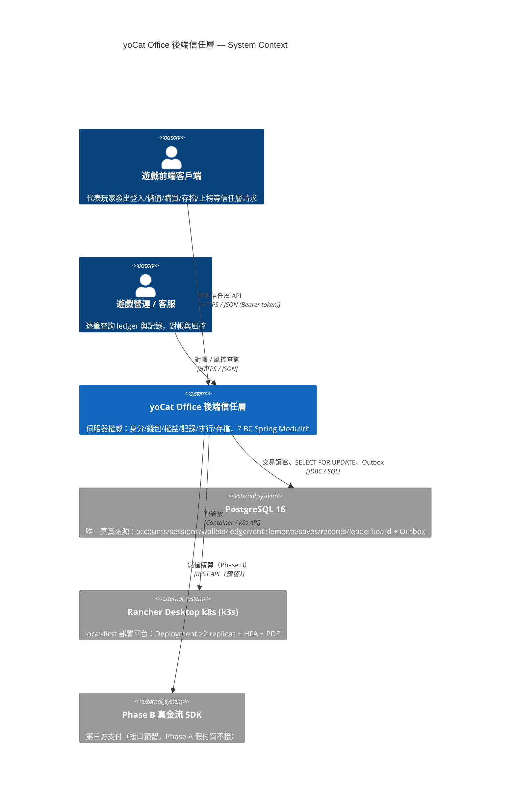
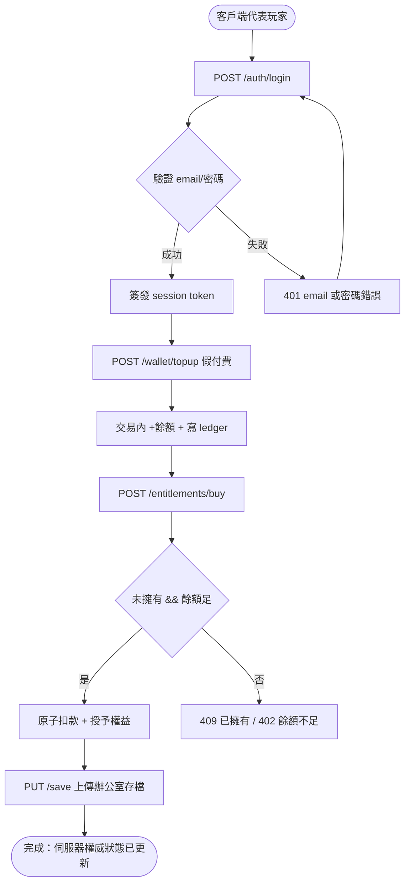
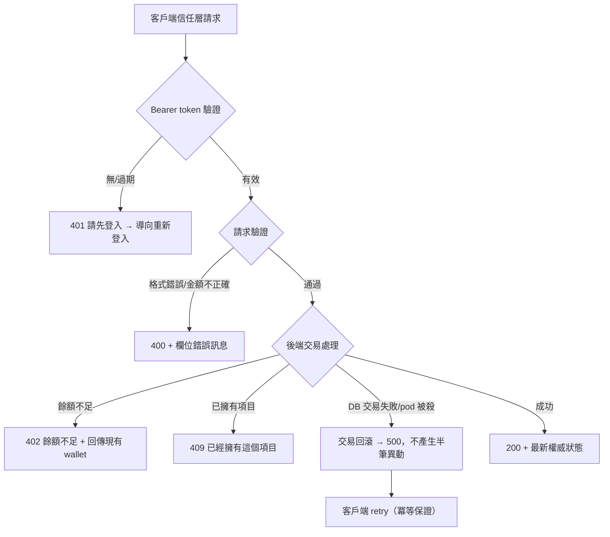
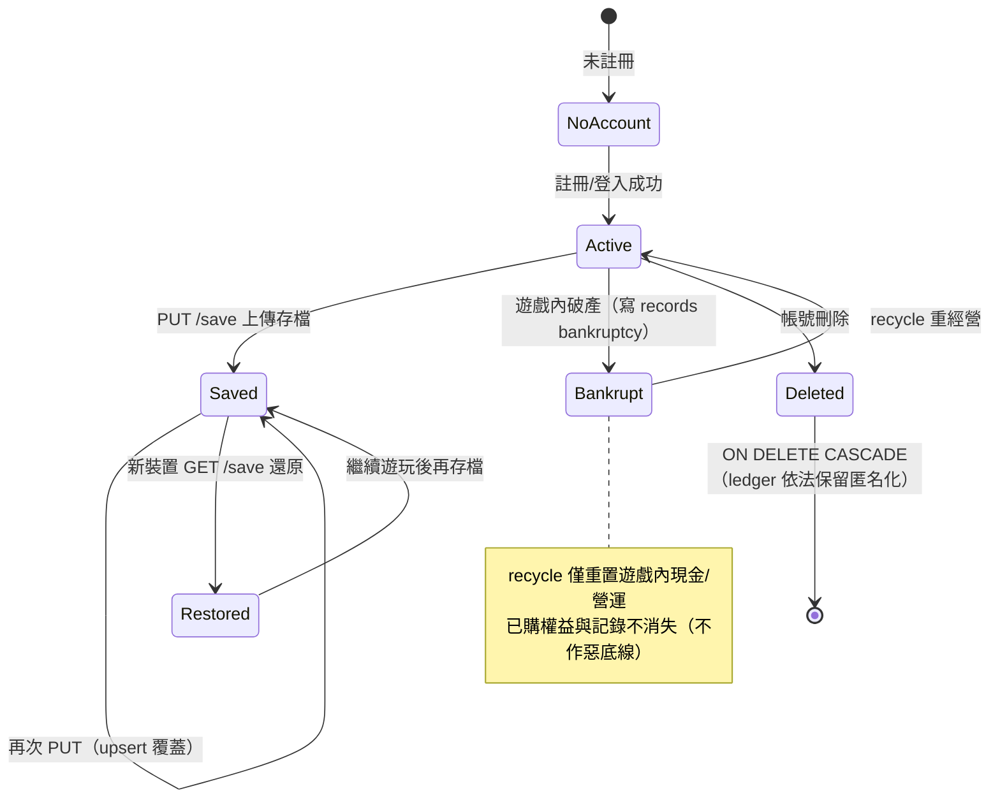

# PRD — Product Requirements Document
<!-- 對應學術標準：IEEE 830 (SRS)，對應業界：Google PRD / Amazon PRFAQ -->
<!-- 專案：yoCat Office 後端信任層；核心理念：算力留本地、信任上雲端 -->

---

## Document Control

| 欄位 | 內容 |
|------|------|
| **DOC-ID** | PRD-YOCAT-OFFICE-BACKEND-20261030 |
| **產品名稱** | yoCat Office 後端信任層（yocat-office-backend） |
| **文件版本** | v1.0 |
| **狀態** | DRAFT |
| **作者（PM）** | AI Generated（gendoc gen-prd）／ Product Lead 待指派 |
| **日期** | 2026-10-30 |
| **上游 BRD** | [BRD.md](BRD.md) §3（商業目標）、§5（Proposed Solution）、§7（Success Metrics）、§8（Constraints）、§9（Compliance） |
| **上游 IDEA** | [IDEA.md](IDEA.md)（IDEA-YOCAT-OFFICE-BACKEND-20261030） |
| **審閱者** | 資深 UX Expert、資深 PM Expert、資深 QA Expert |
| **核准者** | Executive Sponsor（Sayyo Games / 聖祐遊戲，boss@yocat.example，待確認） |
| **client_type** | api-only（state 確認；信任層對外為 HTTP/JSON API，無直接 C 端 UI） |
| **has_admin_backend** | false（本版本無 Admin 後台，見 §19） |

---

## Change Log

| 版本 | 日期 | 作者 | 變更摘要 |
|------|------|------|---------|
| v0.1 | 2026-10-30 | AI Generated (gendoc-gen-prd) | 初始生成 |
| v1.0 | 2026-10-30 | gendoc gen-prd | 初稿，由 IDEA.md + BRD.md + docs/req/（企画.md §17、schema.sql、server-src/accounts.ts）生成 |

---

## 1. Executive Summary

> **一段話**：本產品解決什麼問題、為誰解決、預期產生什麼價值。

yoCat Office 後端信任層是一條「算力留本地、信任上雲端」的**伺服器權威後端 API 服務**，為代表玩家發出信任層請求的遊戲前端客戶端、以及遊戲營運/客服（對帳與風控）而建。它解決「要對遊戲收真錢，但身分、錢包、已購權益與經營記錄放在客戶端 `localStorage`、可被 F12 一行 `W.gems=99999` 竄改、無法歸戶、無法跨裝置、無法對帳」的根本矛盾。解法是把薄薄的信任層（身分/錢包/權益/記錄/排行/存檔）與胖胖的本地算力（LLM 推論、遊戲模擬）切開，只讓信任層上雲：以 scrypt + session token 管理身分、以 `wallets` + append-only `wallet_ledger` 作伺服器權威錢包（花費走交易 + `SELECT FOR UPDATE`、餘額不足回 402）、以原子扣款+授予的 entitlement 保證已購權益永不重複永不因破產消失，並提供跨裝置存檔、經營史記錄與全域排行。全部以 7 個 Spring Modulith 有界上下文（member / wallet / deposit / entitlement / record / leaderboard / game-save）承載、Clean Architecture 四層 + SOLID 分離、Day1 即 HA（≥2 replicas、無 SPOF、HPA + PodDisruptionBudget、BCP from Day1），全程可在 Rancher Desktop k8s（local-first）開發驗收。預期價值：解鎖遊戲商業化（買斷 → F2P），後端因「只上雲信任層」維持零邊際成本護城河，且每一筆金流動作皆可稽核對帳。

---

## 2. Problem Statement
<!-- IEEE 830 §3.1 Product Perspective -->

### 2.1 現狀痛點

既有 yoCat Office 原型把錢包、已購項目、存檔都放在客戶端 `localStorage`（企画 §14/§16 的 `W.gems`、`W.crush`、自動存檔約每 4 秒）。在「免費自帶算力、零成本」階段沒問題，但一旦要收真錢（企画 §16 儲值注資、夢想人才、外觀/季票），就出現根本矛盾：

- **竄改成本為零**：玩家按 F12 一行 `W.gems=99999` 即可竄改餘額；排行榜分數由客戶端自報；已購權益可偽造。
- **無法歸戶、無法跨裝置**：存檔與經營史綁單一裝置的 `localStorage`，換手機或重灌即全失。
- **無法對帳與風控**：營運/客服無任何逐筆帳本可稽核，無法處理退款爭議、無法查作弊。
- **原型不可維運**：團隊已寫出一版 Node 後端（`accounts.ts`）與 8 表 schema，端到端測試全綠（企画 §17.6），但它是「零依賴、單一行程」的原型——無 HA、無模組邊界、無事件驅動、無對帳工具鏈，不適合作為收真錢的長期底座。

**痛點頻率**：金流/竄改風險在「每一次付費與每一次上榜」都發生（100% 金流動作暴露）；跨裝置需求在「每一次換機/重灌」發生。

### 2.2 根本原因分析

為什麼現狀存在這個問題？早期設計以「算力與狀態全留本地、零成本」為最高原則（護城河是 AI 互動零邊際成本），但「收真錢」要求的防竄改/對帳/跨裝置，本質上無法由客戶端自證。根本原因（5 Whys 收斂）是：**缺少一條「與遊戲算力解耦、可獨立上雲」的伺服器權威信任層**。根因不是「要不要上雲」，而是「把什麼上雲」——必須把薄信任層與本地算力切開，只上雲前者。

### 2.3 機會假設

> 如果我們解決這個問題，我們假設會發生什麼？（可驗證的假設）

- 假設 1：若提供伺服器權威錢包與權益，則客戶端可竄改伺服器餘額的路徑數將由 100%（localStorage）降至 0 條（滲透測試驗證，MVP 開發週 3）。
- 假設 2：若提供跨裝置存檔與歸戶，則付費轉化率（DAU → 付費）將由 0% 提升至 ≥ 2%（GA + 3 個月）。
- 假設 3：若信任層與遊戲算力解耦、只上雲前者，則後端單位成本將維持在「每付費用戶雲端成本 < 收益 20%」（GA + 12 個月）。

### 2.4 System Context Diagram
<!-- C4 Model Level 1：呈現系統邊界與外部關係 -->



> **圖例說明：**
> - `Person`：直接與系統互動的使用者或外部角色（客戶端、營運）
> - `System`：本次交付的系統邊界（In Scope）
> - `System_Ext`：現有外部系統，本次不修改（PostgreSQL、k8s、Phase B 金流）
> - `Rel`：關係標註格式為（來源, 目標, 動詞標籤, 協定）

---

## 3. Stakeholders & Users
<!-- IEEE 830 §3.2 Product Functions；業界：RACI Matrix -->

### 3.1 Stakeholder Map

| 角色 | 關係 | 主要關切 | 溝通頻率 |
|------|------|---------|---------|
| Executive Sponsor（Sayyo Games） | 出資 / 核准 | ROI、商業化可行性、上市時間 | 月 |
| Product Manager（待指派） | 負責人 | 範圍、優先順序、付費轉化 | 每日 |
| Engineering Lead（待指派） | 技術實作 | HA、一致性、模組邊界、技術債 | 每日 |
| 遊戲客戶端團隊 | API 消費者 | API 穩定性、向後相容、整合成本 | 每週 |
| 遊戲營運 / 客服 | 對帳 / 風控 | 逐筆稽核、退款處理、作弊偵測 | 每日 |
| Legal / Compliance | 合規 | 真金流合規、個資（Phase B） | 里程碑 |
| Finance | 財務 | 後端單位成本、對帳正確性 | 月 |
| 終端玩家 | 使用者 / 付費者 | 跨裝置、儲值與員工永不失去 | - |

### 3.2 User Personas
<!-- 每個 Persona 代表一類真實用戶群 -->

#### Persona A：客戶端整合工程師 Kevin（API 消費者）

| 欄位 | 內容 |
|------|------|
| **背景** | 28 歲，遊戲客戶端工程師，負責把 yoCat Office 前端從 localStorage 權威改為呼叫伺服器信任層 |
| **目標** | (1) 以穩定 OpenAPI 契約整合登入/儲值/購買/存檔/上榜；(2) 假付費與真金流接口不變，升級無痛 |
| **痛點** | (1) 怕 API 破壞向後相容導致回歸；(2) 怕錯誤碼語意不清無法處理 402/409；(3) 怕整合文件缺失 |
| **技術熟悉度** | 高（HTTP / OpenAPI / JSON） |
| **使用頻率** | 每次登入 / 金流 / 存檔觸發（整合期每日） |
| **成功樣貌** | 照契約串接即可通過，錯誤路徑（402/409/401）行為可預期，無需追問後端 |

#### Persona B：辦公室模擬老闆 阿凱（終端玩家 / 付費者）

| 欄位 | 內容 |
|------|------|
| **背景** | 32 歲，上班族，重度辦公室模擬玩家，會為「心愛的員工與自己建立的公司」付費 |
| **目標** | (1) 跨裝置延續「我的辦公室」；(2) 儲值的💎資本與特聘夢想員工永不因破產消失 |
| **痛點** | (1) 換手機就全失；(2) 怕花了錢餘額被判無效或消失；(3) 怕破產時心愛角色被清掉 |
| **技術熟悉度** | 低（只透過客戶端操作，不直接碰 API） |
| **使用頻率** | 每日 / 每週遊玩，偶發儲值 |
| **成功樣貌** | 換手機登入辦公室原封不動、儲值即時到帳且永久保存——「這才敢花錢」 |

#### Persona C：營運客服 小婷（對帳 / 風控）

| 欄位 | 內容 |
|------|------|
| **背景** | 30 歲，遊戲營運/客服，負責每日對帳、退款爭議與作弊偵測 |
| **目標** | (1) 逐筆查詢某帳號的 append-only 錢包 ledger 與經營記錄；(2) 判斷爭議交易真偽 |
| **痛點** | (1) 原型無任何對帳工具；(2) 無法證明某筆異動是否伺服器權威產生 |
| **技術熟悉度** | 中（能讀 ledger 查詢結果、理解帳本語意） |
| **使用頻率** | 每日對帳 |
| **成功樣貌** | 每筆爭議都能在 ledger 中逐筆追溯（含 reason/delta/balance/meta），退款有據 |

---

## 4. Scope

### 4.1 In Scope（本版本交付）

**In Scope（P0 / Must Have，MVP 收真錢最小閉環）：**
- [ ] member BC：註冊 / 登入 / 登出 / 我的資料（scrypt + session token）
- [ ] wallet BC：topup（假付費）/ spend（扣款），append-only `wallet_ledger`
- [ ] entitlement BC：購買（原子扣款 + 授予）/ 列出，破產不消失
- [ ] game-save BC：/save GET / PUT（跨裝置 slot upsert）
- [ ] 平台底座：7 BC Spring Modulith 單體 + Clean Architecture 4 層，Day1 HA（≥2 replicas）於 local k8s

**In Scope（P1 / Should Have，Phase 2）：**
- [ ] record BC：經營史記錄（破產 / 成就 / 傳承，append-only）
- [ ] leaderboard BC：全域排行（歸戶寫入 + 公開 Top N 查詢）
- [ ] deposit BC：儲值接口（假付費走 ledger；Phase B 真金流冪等/對帳接口預留）

### 4.2 Out of Scope（明確排除）
<!-- 明確寫出排除項，避免 scope creep；對應 BRD §5.3 Won't Have -->

- ❌ 真金流清算 / 發票 / 退款（原因：Phase B 真金流 SDK，接口先預留；Phase A 以假付費驗證信任底座）
- ❌ leaderboard/record 的進階反作弊與風控儀表板（原因：先驗證權威寫入，風控工具列 Could Have 後置）
- ❌ 跨 BC 全面拆分為獨立微服務（原因：Day1 以單體 HA 最小成本起步，模組邊界已可分）
- ❌ 後端承載 LLM 推論 / 遊戲即時模擬（原因：核心理念算力留本地，上雲將破壞成本護城河）
- ❌ 即時每幀狀態同步（原因：本信任層為低頻信任動作設計，非即時對戰同步）

### 4.3 Future Scope（下個版本候選）

- 🔮 Phase B 真金流 SDK 接入（真錢 → 💎資本）
- 🔮 風控 / 對帳儀表板、進階反作弊
- 🔮 依流量將 wallet / deposit 等 BC 拆為獨立微服務
- 🔮 PostgreSQL 主從 HA + 讀寫分離擴展

### 4.4 MoSCoW 優先度對照表

| 功能 / 能力 | MoSCoW | REQ-ID | 對應 BRD 目標 | 優先度 |
|------------|:------:|--------|-------------|:------:|
| member：身分權威（scrypt + session） | Must | US-MEM-001 | O1 | P0 |
| wallet：權威錢包 + append-only ledger | Must | US-WAL-001 | O1, O3 | P0 |
| entitlement：原子扣款+授予、破產不消失 | Must | US-ENT-001 | O1, O4 | P0 |
| game-save：跨裝置存檔 | Must | US-SAVE-001 | O4 | P0 |
| 平台底座：7 BC Spring Modulith + Day1 HA | Must | US-PLAT-001 | O2, O5 | P0 |
| record：經營史（破產/成就/傳承） | Should | US-REC-001 | O4 | P1 |
| leaderboard：全域排行（歸戶寫入） | Should | US-LB-001 | O4 | P1 |
| deposit：儲值接口（假付費 → Phase B 預留） | Should | US-DEP-001 | O3, O4 | P1 |
| 風控 / 對帳儀表板 | Could | — | O3 | P2 |
| 真金流清算 / 發票 / 退款 | Won't（本版） | — | — | Out |
| 跨 BC 全面微服務拆分 | Won't（本版） | — | — | Out |

---

## 5. User Stories & Acceptance Criteria
<!-- IEEE 830 §3.2；INVEST 原則 -->

> **分組（Epic）**：Epic 1 身分與信任底座（MEM, PLAT）；Epic 2 錢包與金流（WAL, DEP）；Epic 3 權益與存檔（ENT, SAVE）；Epic 4 經營史與社交（REC, LB）。優先級標準：Must=P0（缺則無法上線），Should=P1（高價值不阻擋上線）。**估算標準**：每個 P0 US 附 T-Shirt Size（S/M/L/XL）作為 Sprint Planning 起點，標注估算假設；XL 建議拆分為更小 Story（符合 INVEST）。

### 5.1 member — 會員身分（P0 / Must Have）

**User Story：**
> 作為 **客戶端整合工程師 Kevin（代表玩家）**，
> 我希望能 **以 email + 密碼註冊 / 登入取得 session token，並查詢「我的資料」（帳號 + 錢包 + 權益）**，
> 以便 **讓伺服器以權威方式識別並歸戶每一位玩家，使後續錢包與存檔都有可信的身分錨點**。

**REQ-ID：** US-MEM-001（對應 BRD §3 O1、§5.5 member）
**優先度：** P0（Must Have）
**關聯 BRD 目標：** §3 O1（防竄改伺服器權威）
**活動圖（Activity Diagram）：** [activity-member-login.md](../docs/diagrams/activity-member-login.md)（[待生成：/gendoc-gen-diagrams]）
**估算（T-Shirt Size）：** M（假設：沿用既有 scrypt+session 原型邏輯，重構為 Clean Architecture member BC；符合 INVEST）

**Acceptance Criteria（可測試、無歧義）：**

| REQ-ID / AC# | Given（前提） | When（行動） | Then（結果） | 測試類型 |
|--------------|-------------|------------|------------|---------|
| US-MEM-001 / AC-1 | email 格式合法、名稱 1–24 字、密碼 ≥ 6 碼且 email 未註冊 | POST /auth/register | 回 200，建立 accounts + wallets(cash=0,gems=0) + 一筆 `init` ledger，回傳 token + account + wallet | E2E |
| US-MEM-001 / AC-2 | email 已存在 | POST /auth/register | 回 409 `{error:"這個 email 已經註冊過了"}`，不建立重複帳號 | Integration |
| US-MEM-001 / AC-3 | email 格式錯誤 / 名稱 > 24 字 / 密碼 < 6 碼 | POST /auth/register | 回 400，附欄位錯誤訊息，不寫入任何資料 | Unit |
| US-MEM-001 / AC-4 | 正確 email + 密碼 | POST /auth/login | 回 200，簽發新 session token（TTL 30 天），回傳 account + wallet | E2E |
| US-MEM-001 / AC-5 | 錯誤 email 或密碼 | POST /auth/login | 回 401 `{error:"email 或密碼錯誤"}`；密碼比對使用 `timingSafeEqual` 防時序攻擊 | Integration |
| US-MEM-001 / AC-6 | 無 / 過期 / 無效 Bearer token | GET /auth/me | 回 401 `{error:"請先登入"}` | Integration |

**邊界條件 / Edge Cases：**
- 名稱邊界：長度 = 0 → 400；長度 = 24 → 通過；長度 = 25 → 400。
- 密碼邊界：長度 = 5 → 400；長度 = 6 → 通過。
- session 過期：`expires_at <= now()` → 視為未登入回 401。
- 並發：同一 email 併發註冊 → DB `UNIQUE(email)` 約束保證僅一筆成功，其餘回 409。
- 登出：POST /auth/logout 刪除該 token；無 token 亦回 200（冪等）。

### 5.2 wallet — 伺服器權威錢包（P0 / Must Have）

**User Story：**
> 作為 **客戶端整合工程師 Kevin（代表玩家）**，
> 我希望能 **呼叫儲值（topup）與花費（spend）使伺服器權威變更餘額，且每一筆異動都寫入 append-only ledger**，
> 以便 **根除 localStorage 竄改、讓餘額成為不可偽造的唯一真實來源，並使營運可逐筆對帳**。

**REQ-ID：** US-WAL-001（對應 BRD §3 O1/O3、§5.5 wallet）
**優先度：** P0（Must Have）
**關聯 BRD 目標：** §3 O1（防竄改）、O3（錢包一致可對帳）
**活動圖（Activity Diagram）：** [activity-wallet-spend.md](../docs/diagrams/activity-wallet-spend.md)（[待生成：/gendoc-gen-diagrams]）
**估算（T-Shirt Size）：** L（假設：含交易 + SELECT FOR UPDATE + append-only ledger + 併發一致性壓測，風險較高故偏大）

**Acceptance Criteria：**

| REQ-ID / AC# | Given（前提） | When（行動） | Then（結果） | 測試類型 |
|--------------|-------------|------------|------------|---------|
| US-WAL-001 / AC-1 | 已登入、amount 介於 1 與 10,000,000 | POST /wallet/topup | 回 200，餘額於同一交易增加並寫入 `reason='topup'` ledger（balance = 異動後餘額），回傳最新 wallet | E2E |
| US-WAL-001 / AC-2 | 已登入、餘額 ≥ amount | POST /wallet/spend | 回 200，`SELECT ... FOR UPDATE` 行鎖後扣款，寫入負 delta ledger，回傳最新 wallet | E2E |
| US-WAL-001 / AC-3 | 已登入、餘額 < amount | POST /wallet/spend | 回 402 `{error:"餘額不足"}`，餘額不變、不寫 ledger | Integration |
| US-WAL-001 / AC-4 | amount ≤ 0 或非數字 | POST /wallet/topup 或 /spend | 回 400 `{error:"金額不正確"}` | Unit |
| US-WAL-001 / AC-5 | 同帳號併發多筆 spend | 併發 POST /wallet/spend | 行鎖序列化執行，最終餘額 ≥ 0 且 = 初始 − Σ 成功扣款，ledger 筆數與餘額可對帳（0 筆不一致） | Integration（併發壓測） |

**邊界條件 / Edge Cases：**
- 金額邊界：amount = 0 → 400；amount = 1 → 通過；amount = 10,000,000 → 通過；amount > 10,000,000 → 400（topup 上限）。
- 幣別：currency ∈ {cash, gems}，非法值預設 cash。
- 並發：同一 wallet 併發扣款以 `SELECT FOR UPDATE` 序列化，保證餘額永遠 ≥ 0。
- failover：交易中途 pod 被殺 → 交易回滾，不產生半筆異動（ledger 與餘額恆一致）。
- 冪等（Phase B 預留）：真金流 topup 將以冪等鍵防重複入帳。

### 5.3 entitlement — 已購權益（P0 / Must Have）

**User Story：**
> 作為 **辦公室模擬老闆 阿凱（透過客戶端）**，
> 我希望能 **以原子交易購買外觀 / 夢想員工 / 劇本（扣款與授予同一交易），且已購權益不重複、不因破產消失**，
> 以便 **確保「我花錢買的與特聘的夢想員工永遠不會被搞丟」的不作惡底線**。

**REQ-ID：** US-ENT-001（對應 BRD §3 O1/O4、§5.5 entitlement）
**優先度：** P0（Must Have）
**關聯 BRD 目標：** §3 O1（防竄改）、O4（支撐變現）
**活動圖（Activity Diagram）：** [activity-entitlement-buy.md](../docs/diagrams/activity-entitlement-buy.md)（[待生成：/gendoc-gen-diagrams]）
**估算（T-Shirt Size）：** M（假設：原子扣款+授予同一交易、UNIQUE 約束防重複；依賴 wallet BC 扣款）

**Acceptance Criteria：**

| REQ-ID / AC# | Given（前提） | When（行動） | Then（結果） | 測試類型 |
|--------------|-------------|------------|------------|---------|
| US-ENT-001 / AC-1 | 已登入、kind ∈ {cosmetic,dream,scenario}、未擁有、餘額足 | POST /entitlements/buy | 回 200，同一交易扣款 + 寫 `buy_<kind>` ledger + 插入 entitlement，回傳最新 wallet + entitlements | E2E |
| US-ENT-001 / AC-2 | 已擁有同一 (kind,item_id) | POST /entitlements/buy | 回 409 `{error:"已經擁有這個項目"}`，不重複扣款、不重複授予 | Integration |
| US-ENT-001 / AC-3 | 餘額 < amount | POST /entitlements/buy | 回 402 `{error:"餘額不足"}`，不扣款、不授予（交易回滾） | Integration |
| US-ENT-001 / AC-4 | kind 非法或缺 itemId | POST /entitlements/buy | 回 400 `{error:"項目不正確"}` | Unit |
| US-ENT-001 / AC-5 | 帳號曾破產（遊戲內 recycle） | GET /entitlements | 已購權益仍完整列出（recycle 僅影響遊戲內狀態，不觸及 entitlement BC） | E2E |

**邊界條件 / Edge Cases：**
- 重複購買：`UNIQUE(account_id, kind, item_id)` + 交易內先查 owned → 409，保證冪等。
- amount = 0：允許免費授予（如活動贈與），不寫 ledger 僅插 entitlement。
- 並發：同帳號併發購買同項目 → 行鎖 + UNIQUE 約束保證僅一次授予，其餘 409。
- 破產 recycle：記錄 append-only、權益隔離於遊戲狀態重置（呼應不作惡底線）。

### 5.4 game-save — 跨裝置存檔（P0 / Must Have）

**User Story：**
> 作為 **辦公室模擬老闆 阿凱（透過客戶端）**，
> 我希望能 **以帳號將「我的辦公室」存檔上傳（PUT /save）並在任何裝置還原（GET /save）**，
> 以便 **換手機或重灌後延續公司經營進度，不再因綁單一裝置而全失**。

**REQ-ID：** US-SAVE-001（對應 BRD §3 O4、§5.5 game-save）
**優先度：** P0（Must Have）
**關聯 BRD 目標：** §3 O4（支撐變現 / 跨裝置留存）
**活動圖（Activity Diagram）：** [activity-game-save-sync.md](../docs/diagrams/activity-game-save-sync.md)（[待生成：/gendoc-gen-diagrams]）
**估算（T-Shirt Size）：** S（假設：單純 (account_id, slot) upsert + GET，JSONB 直存，邏輯單純）

**Acceptance Criteria：**

| REQ-ID / AC# | Given（前提） | When（行動） | Then（結果） | 測試類型 |
|--------------|-------------|------------|------------|---------|
| US-SAVE-001 / AC-1 | 已登入、body 含 data（JSON） | PUT /save（slot 預設 main） | 回 200，以 (account_id, slot) upsert 寫入 saves，updated_at 更新 | E2E |
| US-SAVE-001 / AC-2 | 已登入、該 slot 已有存檔 | GET /save?slot=main | 回 200，回傳最新 data + updatedAt | E2E |
| US-SAVE-001 / AC-3 | 已登入、該 slot 無存檔 | GET /save?slot=main | 回 200 `{save:null}`（非 404，供客戶端判斷首次） | Integration |
| US-SAVE-001 / AC-4 | body 缺 data | PUT /save | 回 400 `{error:"缺 data"}`，不寫入 | Unit |
| US-SAVE-001 / AC-5 | 裝置 A PUT 後、裝置 B 登入 | 裝置 B GET /save | 回傳裝置 A 寫入的最新存檔（跨裝置還原成功率目標 ≥ 99%） | E2E |

**邊界條件 / Edge Cases：**
- slot 預設 main；多 slot 以 (account_id, slot) 主鍵區分。
- 大存檔：data 為 JSONB，單筆請求 body 上限 4MB（原型 readBody 限制），超過則中斷連線。
- 並發：同 slot 併發 PUT → 後寫覆蓋（last-write-wins，upsert），updated_at 作時間戳參考。
- 空 data 物件 `{}` → 視為合法存檔寫入（非 null）。

### 5.5 平台底座 — 7 BC Spring Modulith + Day1 HA（P0 / Must Have）

**User Story：**
> 作為 **Engineering Lead（代表維運團隊）**，
> 我希望能 **以 7 個 Spring Modulith 有界上下文（Clean Architecture 4 層）承載信任層，並以 Day1 HA（≥2 replicas、HPA、PodDisruptionBudget）部署於 local k8s**，
> 以便 **讓信任層無單點故障、滾動更新不中斷，且模組邊界可在不改邊界下逐一拆微服務，達成可維運地收真錢**。

**REQ-ID：** US-PLAT-001（對應 BRD §3 O2/O5、§8.3 技術約束）
**優先度：** P0（Must Have）
**關聯 BRD 目標：** §3 O2（Day1 HA 無單點）、O5（模組可分可合）
**活動圖（Activity Diagram）：** [activity-platform-rolling-update.md](../docs/diagrams/activity-platform-rolling-update.md)（[待生成：/gendoc-gen-diagrams]）
**估算（T-Shirt Size）：** XL（假設：7 BC Modulith 骨架 + Clean Architecture 分層 + Outbox + k8s HA/HPA/PDB；建議拆為「模組骨架」「HA 部署」「Outbox 事件」等子 Story）

**Acceptance Criteria：**

| REQ-ID / AC# | Given（前提） | When（行動） | Then（結果） | 測試類型 |
|--------------|-------------|------------|------------|---------|
| US-PLAT-001 / AC-1 | 服務以 ≥ 2 replicas 部署於 local k8s | 殺 1 個 pod | 服務持續可用、錯誤率 < 0.1%、無請求中斷 | E2E（混沌測試） |
| US-PLAT-001 / AC-2 | 新版本部署 | 執行滾動更新（rolling update） | 無停機、HTTP 5xx 比率 < 0.1%，PodDisruptionBudget 保證最小可用數 | E2E |
| US-PLAT-001 / AC-3 | 7 BC 原始碼 | 執行 Spring Modulith ModularityTests | 100% 綠、BC 間依賴為 DAG、0 循環依賴（HC-1~HC-5 合規） | Unit（建置期） |
| US-PLAT-001 / AC-4 | 跨 BC 需通訊（如 deposit → wallet 入帳） | 觸發跨 BC 事件 | 僅透過 Public API 或 Domain Event（Transactional Outbox），無跨 BC DB FK、無共享可變狀態 | Integration |
| US-PLAT-001 / AC-5 | 全新 clone 的開發環境 | 於 Rancher Desktop k8s 一鍵部署 + 測試 | 全流程本機跑完、測試全綠，無需外部雲端（local-first） | E2E |

**邊界條件 / Edge Cases：**
- HPA 觸發：CPU / 請求量達閾值時自動擴容（基準 PCU 500，上限 3,000）。
- DB 連線池：依 Q4 容量設定 HikariCP 池大小，pod 重啟時連線重試。
- Outbox failover：事件投遞失敗 → 重投（at-least-once），消費端冪等。
- 單 pod 啟動期 readiness probe 未通過前不接流量。

### 5.6 record — 經營史記錄（P1 / Should Have）

**User Story：**
> 作為 **辦公室模擬老闆 阿凱（透過客戶端）**，
> 我希望能 **以 append-only 方式記錄破產 / 成就 / 傳承等經營史，並可依時間或類型查詢**，
> 以便 **保留公司的情感軌跡、且破產記錄歸戶後不因重經營而消失，並供營運逐筆對帳**。

**REQ-ID：** US-REC-001（對應 BRD §3 O4、§4.4 MoSCoW record）
**優先度：** P1（Should Have）
**關聯 BRD 目標：** §3 O4（支撐變現 / 情感留存）
**估算（T-Shirt Size）：** S（假設：append-only INSERT + 依 account_id/type 查詢，JSONB meta 直存，邏輯單純）

**Acceptance Criteria：**

| REQ-ID / AC# | Given（前提） | When（行動） | Then（結果） | 測試類型 |
|--------------|-------------|------------|------------|---------|
| US-REC-001 / AC-1 | 已登入、type ∈ {bankruptcy,achievement,legacy} | POST /records | 回 200，以 append-only 方式寫入 `records` 並歸屬該 account_id；GET /records 可依建立時間由新到舊回傳，並可依 type 篩選（單次上限 100 筆） | Integration |

**邊界條件 / Edge Cases：**
- type 非法（如 victory / refund / 空字串）→ 400 `{error:"type 不正確"}`，不寫入任何記錄。
- 無 / 過期 / 無效 Bearer token 寫入或查詢 → 401 `{error:"請先登入"}`，不寫入任何記錄。
- 查詢排序：預設依 `created_at` DESC（由新到舊）；type 篩選只回傳符合類型的記錄。
- 查詢筆數：單次回傳上限 100 筆。
- append-only：記錄一經寫入不可修改 / 刪除；破產 recycle 不觸及既有 record（與 entitlement 相同的不作惡底線）。

### 5.7 leaderboard — 全域排行（P1 / Should Have）

**User Story：**
> 作為 **客戶端整合工程師 Kevin（代表玩家）**，
> 我希望能 **公開查詢全域排行榜 Top N（不需登入），並以歸戶方式上榜、同一場次（run_id）重複提交只更新一筆**，
> 以便 **支撐社交參與，同時確保分數由伺服器權威歸戶、不可由客戶端自報竄改**。

**REQ-ID：** US-LB-001（對應 BRD §3 O4、§4.4 MoSCoW leaderboard）
**優先度：** P1（Should Have）
**關聯 BRD 目標：** §3 O4（支撐變現 / 社交參與）
**估算（T-Shirt Size）：** S（假設：以 run_id upsert 歸戶寫入 + 公開 Top N 查詢，依 `idx_lb_mode_score` 取序）

**Acceptance Criteria：**

| REQ-ID / AC# | Given（前提） | When（行動） | Then（結果） | 測試類型 |
|--------------|-------------|------------|------------|---------|
| US-LB-001 / AC-1 | 排行榜已有若干既有分數 | GET /leaderboard（公開，不需登入）＋ 已登入者 POST /leaderboard | 查詢回 200，依分數由高到低回傳（每筆含 run_id / 顯示名稱 / mode / score，limit 夾擠於 1–100）；上榜回 200，以帳號顯示名稱歸戶寫入，同一 run_id 重複提交以 upsert 只保留一筆 | Integration |

**邊界條件 / Edge Cases：**
- limit 夾擠：limit=1 → 回 1 筆；limit=20 → 回 20 筆；limit=500 → 回上限 100 筆。
- 冪等：同一 run_id 再次提交更高分 → 更新同一筆記錄，排行榜中該場次仍只有一筆。
- 缺 runId 上榜 → 400 `{error:"缺 runId"}`，不寫入任何排行記錄。
- 無 / 過期 / 無效 Bearer token 上榜 → 401 `{error:"請先登入"}`，不寫入任何排行記錄（查詢 Top N 不需登入）。
- 歸戶：score 由伺服器以 session 歸戶寫入，客戶端不可指定他人帳號。

### 5.8 deposit — 儲值接口（P1 / Should Have）

**User Story：**
> 作為 **客戶端整合工程師 Kevin（代表玩家）**，
> 我希望能 **公開查詢可購買的儲值包目錄，並以冪等鍵（Idempotency-Key）建立儲值訂單（Phase A 假付費直接確認、經 DepositConfirmed 事件由 wallet BC 入帳）**，
> 以便 **讓玩家儲值可信、可對帳，且重試不重複入帳，並為 Phase B 真金流預留冪等/對帳接口**。

**REQ-ID：** US-DEP-001（對應 BRD §3 O3/O4、§4.4 MoSCoW deposit）
**優先度：** P1（Should Have）
**關聯 BRD 目標：** §3 O3（錢包一致可對帳）、O4（支撐變現）
**活動圖（Activity Diagram）：** API §1.3.4 序列圖（Idempotency-Key 冪等儲值）
**估算（T-Shirt Size）：** M（假設：冪等鍵入帳 + 跨 BC DepositConfirmed 事件至 wallet；Phase B 真金流對帳接口預留，風險偏中）

**Acceptance Criteria：**

| REQ-ID / AC# | Given（前提） | When（行動） | Then（結果） | 測試類型 |
|--------------|-------------|------------|------------|---------|
| US-DEP-001 / AC-1 | 儲值目錄已載入（含寶石包 / 資本包） | GET /deposit/packs（公開，不需登入） | 回 200，回傳所有可購買儲值包，每個含 pack_id / 幣別 / 入帳數量 / 顯示名稱 | E2E |
| US-DEP-001 / AC-2 | 已登入、pack 存在於目錄、提供全新 Idempotency-Key | POST /deposit/checkout | 回 200，建立狀態為「已確認」的訂單（含 order_id / pack_id / 幣別 / 入帳數量），經 DepositConfirmed 事件由 wallet BC 入帳；相同冪等鍵重放回放原訂單且錢包僅入帳一次 | E2E |

**邊界條件 / Edge Cases：**
- 冪等重放：相同 Idempotency-Key + 相同請求 → 回放原訂單結果，錢包僅入帳一次（orderId dedup）。
- 冪等鍵衝突：相同 Idempotency-Key 但請求內容不同（如不同 pack）→ 409，不建立新訂單。
- 儲值包不存在：以不在目錄的 pack 建立訂單 → 400 `{error:"儲值包不正確"}`，不建立任何訂單。
- 缺冪等鍵：未提供 Idempotency-Key → 400，要求提供冪等鍵，不建立任何訂單。
- 無 / 過期 / 無效 Bearer token 建立訂單 → 401 `{error:"請先登入"}`，不建立任何訂單（目錄查詢不需登入）。
- Phase B 預留：真金流以 `idempotency_keys` 表保證防重複入帳，接口在 Phase B 前保持不變。

---

## 6. User Flows
<!-- 用 Mermaid 描述主要使用流程 -->

### 6.1 主流程（Happy Path）— 登入 → 儲值 → 購買 → 存檔



### 6.2 錯誤流程（Error Flow）



### 6.3 狀態機（State Machine）— 存檔 / 經營史生命週期



---

## 7. Non-Functional Requirements (NFR)
<!-- 所有 NFR 必須有具體數字 -->

### 7.1 效能（Performance）

| 指標 | 目標值 | 量測方式 | 降級策略 |
|------|--------|---------|---------|
| API 回應時間 P50 | < 200ms @ 500 PCU | APM（Micrometer + Prometheus） | 連線池調校 / 快取 Top N |
| API 回應時間 P99 | < 1000ms @ 500 PCU（成長期 3,000 PCU 維持 < 1500ms） | APM | Circuit Breaker / 限流 |
| 排行榜 Top N 查詢 | P99 < 300ms（limit ≤ 100） | APM + `idx_lb_mode_score` | 快取 + CDN（公開查詢） |
| 寫入交易吞吐量 | ≥ 200 txn/sec（wallet/entitlement 交易） | 壓測（k6 / Gatling） | 批次 / 佇列削峰 |

> 數值依 BRD §7 與 IDEA §6 Q4（啟動期 5,000 DAU / 500 PCU，成長期 50,000 DAU / 3,000 PCU；信任層為低頻動作）推估，標注為「參考值，需 Engineering 於 EDD SLO 確認」。

### 7.2 可用性（Availability）

| 環境 | SLA | RTO | RPO |
|------|-----|-----|-----|
| Production（local k8s / 未來雲端） | 99.9%（< 8.7h/year） | 30 min | 5 min |
| Staging | 99.0% | 4h | 1h |

- Day1 HA：所有服務 ≥ 2 replicas、無 SPOF、HPA + PodDisruptionBudget、BCP from Day1。
- 維護視窗：滾動更新無停機，不需維護視窗；DB 備份於低峰時段執行。

### 7.3 可擴展性（Scalability）

- 短期：支援啟動期 5,000 DAU / 500 PCU。
- 長期：支援成長期 50,000 DAU / 3,000 PCU（10x 增長），不需重構核心架構（HPA 水平擴展 + 不改 BC 邊界即可拆微服務）。
- 資料量：wallet_ledger append-only 持續增長，以 `idx_ledger_acct(account_id, created_at DESC)` 保查詢效能不退化；歷史分區（Phase B）。

### 7.4 安全性（Security）

- 認證：Bearer session token（scrypt 密碼雜湊，salt$hash；session TTL 30 天，可設 `SESSION_TTL_DAYS`）。
- 授權：以 session 歸戶，所有錢包/權益/存檔/記錄操作限本人（經 account_id）；排行 Top N 查詢公開不需登入。
- 密碼比對：`crypto.timingSafeEqual` 防時序攻擊；密碼永不明文記錄。
- 資料加密：傳輸中 TLS 1.3+（入口層）；靜態敏感欄位（pass_hash 已為單向雜湊，PII email 建議 AES-256 靜態加密，見 §17）。
- PII 處理：email / display_name 最小化收集，Log 遮罩（見 §11.5、§17）。
- 合規要求：台灣個資法（Phase A）、GDPR（若觸及歐盟玩家）、PCI-DSS（Phase B 真金流，不自持卡號），需 Legal 確認。

### 7.5 可用性（Usability）

- 本產品為 **api-only 信任層**，無直接 C 端 UI；可用性要求聚焦 **API 契約一致性與開發者體驗（DX）**：所有端點提供 OpenAPI 3.1 spec、一致的錯誤碼（400/401/402/409/500）與 JSON 錯誤格式。
- 無障礙標準：信任層本身無 UI，WCAG 2.1 Level AA 目標適用於未來營運對帳 Console 與客戶端 UI（由客戶端團隊負責，見 §18）。
- 支援語言：API 錯誤訊息 zh-TW（可 i18n key 化）；支援裝置 / 瀏覽器由客戶端決定。

### 7.6 可維護性（Maintainability）

- 測試覆蓋率：≥ 80%（unit + integration；核心錢包/權益交易邏輯 100%）。
- 程式碼複雜度：Cyclomatic Complexity ≤ 10。
- 架構守則：Clean Architecture 4 層 + SOLID；Spring Modulith ModularityTests 於建置期強制 HC-1~HC-5。
- 文件完整性：所有公開 API 有 OpenAPI spec；BC 邊界有 ArchUnit / ModularityTests 守護。

### 7.7 可觀測性（Observability）

#### 7.7.1 Logging 規格

| 欄位 | 要求 |
|------|------|
| 格式 | 結構化 JSON（含 timestamp、level、service、trace_id、span_id、message） |
| 等級 | ERROR / WARN / INFO / DEBUG（Production 預設 INFO） |
| 必含欄位 | `request_id`、`account_id`（遮罩 PII）、`duration_ms`、`http_status`、`bc`（哪個有界上下文） |
| 禁止記錄 | 明文密碼、pass_hash、session token 明文、未遮罩 email |
| 保留期 | Production：90 天（熱）/ 1 年（冷）；Staging：14 天 |
| 收集工具 | Loki / ELK（local-first 可用輕量方案），待 Engineering 確認 |

#### 7.7.2 Metrics 必須項目

| 指標名稱 | 類型 | 說明 | 告警觸發條件 |
|---------|------|------|------------|
| `trust_request_total` | Counter | 所有 API 請求總數（含 status_code、path label） | - |
| `trust_request_duration_seconds` | Histogram | 請求延遲分佈（P50 / P95 / P99） | P99 > 1000ms |
| `trust_error_rate` | Gauge | 5xx 錯誤比率 | > 1% |
| `trust_wallet_spend_total` | Counter | 錢包扣款次數（含 402 失敗計數） | - |
| `trust_outbox_pending` | Gauge | Outbox 未投遞事件積壓數 | > 100 持續 5 分鐘 |
| `trust_trusted_payment_completion_rate` | Gauge | **北極星：可信付費動作完成率**（權威記錄且不可竄改之金流/權益動作比率） | < 99.9% |

#### 7.7.3 Distributed Tracing 需求

- 所有跨 BC 呼叫 / 跨服務呼叫必須傳遞 `trace_id` / `span_id`（W3C TraceContext 格式）。
- 採樣率：Production 10%（錯誤請求 100% 採樣）；Staging 100%。
- 工具：OpenTelemetry + Jaeger（local-first 可部署），待 Engineering 確認。
- Trace 保留期：7 天。

#### 7.7.4 Alert 閾值定義

| 告警名稱 | 觸發條件 | 嚴重度 | 通知管道 | 處置 SLA |
|---------|---------|--------|---------|---------|
| HighErrorRate | trust_error_rate > 1% 持續 5 分鐘 | P1 | Slack + On-Call | 回應 15 分鐘 |
| HighLatency | P99 > 1000ms 持續 3 分鐘 | P2 | Slack | 回應 30 分鐘 |
| ServiceDown | health check 連續失敗 3 次 | P0 | On-Call（電話） | 回應 5 分鐘 |
| OutboxBacklog | trust_outbox_pending > 100 持續 5 分鐘 | P2 | Slack | 回應 30 分鐘 |
| WalletInconsistency | ledger 與 wallet 餘額對帳不符 > 0 筆 | P0 | On-Call + Finance | 回應 5 分鐘 |

#### 7.7.5 Dashboard 要求

| Dashboard 名稱 | 受眾 | 必含面板 |
|--------------|------|---------|
| Service Health | On-Call 工程師 | Request Rate、Error Rate、P99 Latency、Active Replicas |
| Business KPI | PM / 業務 | 可信付費動作完成率、付費轉化率、topup/spend 量、跨裝置還原成功率 |
| Reconciliation | 營運 / Finance | ledger 與餘額對帳差異、Outbox 積壓、402/409 趨勢 |

### 7.8 Analytics Event Instrumentation Map（分析事件儀器化）

> 本產品為 api-only，Analytics Event 為**伺服器端業務事件**（非前端埋點）。每個 P0/P1 功能至少 1 個 Event。

| 功能 | Event Name | 觸發動作 | 必要 Payload 欄位 | 關聯 KPI | 實作狀態 |
|------|-----------|---------|-----------------|---------|:-------:|
| member | `member_register_completed` | 註冊成功 | `{account_id, session_id, ts}` | 新帳號數 | 🔲 |
| member | `member_login_completed` | 登入成功 | `{account_id, session_id, ts}` | DAU | 🔲 |
| wallet | `wallet_topup_completed` | 儲值成功 | `{account_id, currency, amount, balance, fake:true}` | 儲值量 | 🔲 |
| wallet | `wallet_spend_completed` | 扣款成功 | `{account_id, currency, amount, balance, reason}` | 消費量 | 🔲 |
| wallet | `wallet_spend_rejected` | 餘額不足（402） | `{account_id, currency, amount, reason:"insufficient"}` | 轉化漏斗 | 🔲 |
| entitlement | `entitlement_purchase_completed` | 購買成功 | `{account_id, kind, item_id, currency, amount}` | 付費轉化率 | 🔲 |
| game-save | `game_save_synced` | 跨裝置存檔/還原 | `{account_id, slot, direction:"put"\|"get"}` | 跨裝置留存 | 🔲 |
| deposit | `deposit_requested` | 儲值請求（假付費/預留真金流） | `{account_id, pack, idempotency_key}` | 儲值轉化 | 🔲 |
| record | `record_created` | 經營史記錄寫入 | `{account_id, type}` | 情感留存 | 🔲 |
| leaderboard | `leaderboard_score_submitted` | 上榜寫入 | `{account_id, run_id, mode, score}` | 社交參與 | 🔲 |

**Event 命名規範：** `{object}_{action}_{result}` 全小寫底線（例：`wallet_topup_completed`）。
**Analytics 工具鏈：** 以 ledger / 業務事件表為真實來源，可接 Metabase / 自建報表（local-first），待確認。
**驗收條件：** 功能進入 Staging 前，需在報表確認 Event 成功觸發 ≥ 5 次測試。

---

## 8. Constraints & Dependencies
<!-- IEEE 830 §3.9 Constraints -->

### 8.1 技術限制

**硬性限制（來自 BRD §8.1/§8.3，不得違反）：**
- 核心理念：算力留本地、只上雲信任層——不得把 LLM 推論 / 遊戲模擬上雲（成本護城河）。
- 框架：Spring Boot 3 + Spring Modulith（7 BC 於單一應用落地，HC-1~HC-5 強制）。
- 基礎設施：Kubernetes（Rancher Desktop k3s，local-first），全程本機可跑完。
- 資料庫：PostgreSQL 16（既有 8 表 schema，交易 + `SELECT FOR UPDATE` 保一致）。
- 工程守則：Clean Architecture 4 層 + SOLID、HA ≥ 2 replicas、SECS、SSOT。
- 金流分期：Phase A 假付費、Phase B 真金流（接口預留）。

**軟性限制：**
- 程式語言：Java（Spring 生態）為上界；EDD 可於 ADR 說明覆蓋。
- OSS 授權：商業友善（Apache/MIT/PostgreSQL License）優先，禁用限制商用之強 copyleft。

### 8.2 技術依賴

| 技術棧 | 版本要求 | 用途 |
|--------|---------|------|
| Spring Boot | 3.x | 應用框架 |
| Spring Modulith | 最新穩定版（Apache-2.0） | 7 BC 邊界、Event Publication Registry（Outbox） |
| PostgreSQL | 16 | 權威資料庫（8 表 + Outbox 表） |
| Redis | 7.2 | session cache、rate-limit 計數、leaderboard Top-N 快取（EDD ADR-003/004）；cache miss 回源 DB，非硬 SPOF |
| HikariCP | 隨 Spring Boot | 連線池（依 Q4 容量設定） |
| Kubernetes | k3s（Rancher Desktop） | local-first 部署 |

### 8.3 外部依賴

| 依賴項 | 類型 | 負責方 | 風險等級 | 備援方案 |
|--------|------|--------|---------|---------|
| PostgreSQL 16（權威 DB） | 基礎設施 | Engineering / SRE | HIGH | HA/備援（主從 + 備份還原 BCP）、PodDisruptionBudget、連線重試 |
| Redis 7.2（快取/限流） | 基礎設施 | Engineering / SRE | MEDIUM | Sentinel HA；降級策略：cache miss 回源 PostgreSQL，限流改保守預設，不影響資料正確性（EDD ADR-003/004） |
| Rancher Desktop k8s（k3s） | 基礎設施 | Engineering | HIGH | 標準 k8s manifest，可移植至任一 CNCF 相容叢集 |
| Phase B 真金流 SDK | 外部服務 | PM + 金流商 | MEDIUM | deposit BC 接口抽象、冪等/對帳先行；Phase A 假付費不受影響 |
| 遊戲客戶端團隊 | 內部消費者 | 客戶端 Tech Lead | MEDIUM | OpenAPI 契約先行、向後相容承諾 |

### 8.4 關鍵假設（Assumptions）
<!-- Constraint 是已知硬性限制；Assumption 是相信為真但尚未驗證 -->

| # | 假設內容 | 若假設錯誤的風險等級 | 驗證方式 | 驗證截止日 | 負責人 |
|---|---------|:-----------------:|---------|-----------|--------|
| A-1 | 薄信任層足以防竄改且無需上雲遊戲算力（Leap of Faith） | HIGH | 滲透測試 + 歸戶/對帳驗證 | MVP 驗收（開發週 3，2026 開發期內） | Engineering Lead |
| A-2 | 錢包一致性可用「交易 + SELECT FOR UPDATE + 冪等鍵 + outbox」在 HA/failover 下達成 | HIGH | 併發 / failover 壓測 | MVP 驗收（開發週 2–3） | Engineering Lead |
| A-3 | 啟動期 5,000 DAU / 500 PCU 下單體 HA（≥2 replicas）足以承載 | MEDIUM | 容量 / 壓力測試 | EDD 審查前 | Engineering |
| A-4 | 7 BC 可以 Spring Modulith 單體 Day1 落地並不改邊界下逐一拆微服務 | MEDIUM | ModularityTests + 依賴 DAG（PoC） | EDD 完成前 | Engineering |
| A-5 | 既有 8 表 schema 與 API 契約可作重構基礎而不需大改 | LOW | 契約比對 + 回歸測試 | BRD → PRD 交接前 | PM + Engineering |

> **風險等級定義：** HIGH＝錯誤將導致交付延遲 > 2 週或需重大架構調整；MEDIUM＝需調整實作細節但不影響核心架構；LOW＝僅需微幅調整。
> A-1 風險為 HIGH，驗證截止日排在 MVP 驗收（開發啟動後 3 週內），若不成立觸發根本性 Pivot（BRD §10.2 Kill Criteria）。

### 8.5 向後相容性宣告（Backward Compatibility）

| 欄位 | 內容 |
|------|------|
| **本版本是否有 Breaking Change** | 否 |
| **受影響的 API 版本** | N/A（本版本為信任層首次正式化，既有原型 API 契約沿用） |
| **Breaking Change 清單** | N/A |
| **Deprecation Timeline** | N/A |
| **Migration Guide 責任歸屬** | N/A（原型 → 正式化，客戶端契約不變；假付費接口在 Phase B 前保持不變） |
| **向下相容保障期** | N/A（全新產品正式化）；假付費→真金流升級時承諾向後相容，接口不破壞 |

---

## 9. Success Metrics & Launch Criteria

### 9.1 成功指標（KPIs）

| 指標 | Baseline（現在） | 目標 | 量測工具 |
|------|----------------|------|---------|
| 可信付費動作完成率（北極星） | N/A（localStorage 100% 可竄改） | 100%（MVP 驗收） | ledger 稽核 + 滲透測試 |
| 可竄改路徑數（O1） | 100%（F12 可改） | 0 條（MVP 驗收，開發週 3） | 滲透測試報告 |
| HA 滾動更新錯誤率（O2） | 原型無 HA | < 0.1%（MVP 驗收） | 混沌測試 + APM |
| 錢包不一致筆數（O3） | 無權威 ledger | 0 筆、ledger 100% 相符（壓測） | 併發壓測 + 對帳稽核 |
| 付費轉化率（O4，DAU→付費） | 0% | ≥ 2%（GA + 3 個月） | Analytics / ledger |
| 跨裝置還原成功率 | 無跨裝置 | ≥ 99%（GA + 6 個月） | 存檔還原成功率 |
| ModularityTests 通過率（O5） | 原型無邊界 | 100% 綠、0 循環依賴（每次建置） | ModularityTests |

### 9.2 護欄指標（Guardrail Metrics）

| 指標 | 當前值 | 可接受下限 | 若跌破的處置 |
|------|--------|-----------|------------|
| API 錯誤率（5xx） | N/A | < 1% | 立即 Rollback（Feature Flag Kill Switch） |
| API P99 延遲 | N/A | < 1000ms @ 500 PCU | 降級模式 / 限流 |
| 錢包對帳一致性 | N/A | 0 筆不一致（任一不一致即觸發） | 立即凍結金流、On-Call 介入 |
| Outbox 積壓 | N/A | < 100 筆 | 加速消費 / 擴容 |

### 9.3 上線 Go / No-Go 清單

**Go 條件（全部必須通過）：**
- [ ] 所有 P0 AC 通過 QA 驗收
- [ ] 測試覆蓋率 ≥ 80%（核心交易邏輯 100%）
- [ ] 滲透測試：0 條可竄改伺服器餘額路徑
- [ ] 併發/failover 壓測：0 筆錢包不一致
- [ ] HA：殺 1 pod / 滾動更新錯誤率 < 0.1%
- [ ] ModularityTests 100% 綠、0 循環依賴
- [ ] 安全掃描無 CRITICAL / HIGH 漏洞
- [ ] local-first：全流程於 Rancher Desktop k8s 跑完
- [ ] Rollback 方案（Feature Flag Kill Switch）已驗證

**No-Go 條件（任一存在就不上線）：**
- [ ] 任一路徑可由客戶端竄改伺服器餘額
- [ ] 併發/failover 出現負餘額或 ledger 對不上帳
- [ ] PostgreSQL 仍為無備援 SPOF
- [ ] 法務 / 合規初審未通過（Phase A 範圍）

---

## 9.4 Experiment & A/B Test Plan（實驗與 A/B 測試計畫）

#### 實驗優先序矩陣

| 實驗名稱 | 假說 | 主要指標 | 次要指標 | 流量分配 | 最短測試週期 | 衝突限制 |
|---------|------|---------|---------|:-------:|:-----------:|---------|
| 儲值包定價優化 | 若提供「中包 +10%」加量，則 topup ARPPU 提升 ≥ 10% | 付費轉化率 | 平均客單價 | 50/50 | 2 週（需 N ≥ 2,000 付費樣本） | 不可與「首購優惠」同時測試 |
| 轉化時刻提示 | 若在破產瀕臨時提示儲值救公司，則 rescue topup 轉化提升 ≥ 15% | rescue topup 率 | Day1 留存 | 80/20（小流量） | 1 週 | — |

#### A/B 測試標準流程

```
1. 假說定義（本表格）
2. 統計顯著性計算：α=0.05, 檢定力 1-β=0.80，最小偵測效應量 MDE=10%
3. 樣本量計算：N = f(conversion_rate, MDE, α, β)
4. 實驗設計審查（避免 novelty effect、SRM 問題）
5. 上線 + 監控（每日查看 guardrail metrics）
6. 決策：達標 → Ship ｜ 不顯著 → 延長或關閉 ｜ 負向 → 立即關閉
7. 結果記錄進 Decision Log
```

#### Guardrail Metrics（實驗護欄指標）

以下指標任一惡化 > 5%，立即暫停實驗：
- 系統錯誤率（5xx）
- API P99 延遲
- 錢包對帳一致性（任一不一致即暫停）

---

## 9.5 Definition of Done（完成定義）

#### Product DoD（產品完成標準）

| 項目 | 驗收標準 | 負責方 |
|------|---------|--------|
| ✅ User Story 覆蓋 | 所有 P0 AC 均有對應 BDD scenario 並通過 | PM |
| ✅ Analytics Events | §7.8 所有 Event 已確認觸發 | PM |
| ✅ Edge Cases | 所有已知 edge case 與 error state（400/401/402/409/500）已測試 | QA |
| ✅ 合規 | §9/§17 Phase A 合規項通過法務初審 | Legal |
| ✅ i18n Ready | API 錯誤訊息已 key 化，無 hardcode | Engineering |
| ✅ Metrics Baseline | Launch 前已記錄基準值供效益評估 | PM |

#### Engineering DoD（工程完成標準）

| 項目 | 驗收標準 | 負責方 |
|------|---------|--------|
| ✅ 單元測試 | Coverage ≥ 80%（核心錢包/權益交易 100%） | Engineering |
| ✅ 整合測試 | 所有 API endpoint 有 integration test | Engineering |
| ✅ 所有 P0 AC 自動化測試通過 | E2E 覆蓋 Happy Path + Error Path | QA |
| ✅ 無 P0 Bug | 無 CRITICAL / HIGH 開放缺陷 | QA |
| ✅ ModularityTests | 100% 綠、0 循環依賴、HC-1~HC-5 合規 | Engineering |
| ✅ Security Review | SAST 無 HIGH/CRITICAL，dependencies 無 CVE > 7.0 | Security |
| ✅ Performance Gate | P99 ≤ 1000ms @ 500 PCU、Error Rate ≤ 1% | Engineering |
| ✅ Feature Flag | P0 功能在 Kill Switch Flag 保護下上線 | Engineering |
| ✅ Runbook | 新功能 Runbook 已加入 docs/runbooks/ | Engineering |

---

## 10. Rollout Plan

| 階段 | 名稱 | 目標用戶 | 流量比例 | 持續時間 | 成功指標 | 退出條件 |
|------|------|---------|---------|--------|---------|---------|
| Alpha | 內測 | 內部員工 + 客戶端整合團隊 | 100% 內部 | 1 週 | 無 CRITICAL bug、ModularityTests 綠 | 出現無法繞過的 CRITICAL |
| Beta | 封閉測試 | 5% 真實玩家（itch/Steam 封測） | 5% | 1 週 | Error rate < 1%、0 筆錢包不一致 | 錯誤率 > 1% 或出現不一致 |
| GA | 全面上線 | 所有玩家 | 100% | — | 付費轉化 ≥ 2%（+3M）、跨裝置還原 ≥ 99%（+6M） | — |

### 10.2 Feature Flag 規格

| Flag 名稱 | 預設值 | 目標群組 | 啟用條件 | Kill Switch | 管理工具 | 預計移除日 |
|-----------|--------|---------|---------|------------|---------|-----------|
| `trust_wallet_enabled` | OFF | Beta 玩家 | account 屬封測名單 | 是（立即關閉，5 分鐘內生效） | 待 Engineering 確認（如 Unleash / 組態中心） | GA + 2 週 |
| `trust_entitlement_enabled` | OFF | Beta 玩家 | account 屬封測名單 | 是（立即關閉，5 分鐘內生效） | 待 Engineering 確認 | GA + 2 週 |
| `trust_game_save_enabled` | OFF | Beta 玩家 | account 屬封測名單 | 是（立即關閉，5 分鐘內生效） | 待 Engineering 確認 | GA + 2 週 |
| `deposit_realmoney_enabled` | OFF | 全體 | Phase B 真金流就緒 | 是（立即關閉，5 分鐘內生效） | 待 Engineering 確認 | Phase B GA + 2 週 |

> **Flag 管理原則：**
> 1. 所有 P0 功能必須有 Kill Switch Feature Flag（名稱採 snake_case）。
> 2. Flag 啟用/關閉操作紀錄必須寫入 Audit Log / Decision Log。
> 3. Flag 變更需通知相關 On-Call 工程師。
> 4. GA 完成後 2 週內清除相關 Flag 程式碼（避免 Flag debt）。

---

## 11. Data Requirements
<!-- IEEE 830 §3.3 Product Data；對應 docs/req/schema.sql 8 表 -->

### 11.1 新增資料欄位 / 資料表

| 資料表名稱 | 操作類型 | 說明 | 關聯 PRD 功能 |
|-----------|---------|------|--------------|
| `accounts` | 沿用（既有） | 帳號（email/display_name/pass_hash） | §5.1 member |
| `sessions` | 沿用（既有） | session token + expires_at | §5.1 member |
| `wallets` | 沿用（既有） | 伺服器權威餘額（cash/gems） | §5.2 wallet |
| `wallet_ledger` | 沿用（既有） | append-only 異動帳本 | §5.2 wallet |
| `entitlements` | 沿用（既有） | 已購權益（UNIQUE account,kind,item） | §5.3 entitlement |
| `saves` | 沿用（既有） | 跨裝置存檔（JSONB） | §5.4 game-save |
| `records` | 沿用（既有） | 經營史（破產/成就/傳承） | §5.6 record（P1） |
| `leaderboard` | 沿用（既有） | 全域排行 | §5.7 leaderboard（P1） |
| `deposit_pack` | **新增** | 儲值包目錄（pack_id/幣別/入帳數量/顯示名稱，詳細 schema 見 SCHEMA.md） | §5.8 deposit（P1） |
| `deposit_order` | **新增** | 儲值訂單（order_id/pack_id/帳號/狀態/冪等鍵，詳細 schema 見 SCHEMA.md） | §5.8 deposit（P1） |
| `event_publication`（Outbox） | **新增** | Spring Modulith Event Publication Registry（跨 BC 可靠事件） | §5.5 平台底座 |
| `idempotency_keys` | **新增（Phase B 預留）** | deposit 真金流冪等鍵，防重複入帳 | §5.8 deposit（P1） |

### 11.2 Data Dictionary

| 欄位名稱 | 型別 | 長度/精度 | 必填 | 預設值 | 說明 | 範例值 | PII |
|---------|------|---------|------|--------|------|--------|-----|
| `accounts.email` | TEXT | - | 是 | - | 登入識別（UNIQUE） | "player@example.com" | 是（需遮罩/加密） |
| `accounts.display_name` | TEXT | 1–24 | 是 | - | 公司/老闆名（亦用於排行榜顯示） | "喵喵企業" | 是（準 PII，公開於排行） |
| `accounts.pass_hash` | TEXT | - | 是 | - | scrypt(salt$hash) 單向雜湊 | "a1b2…$c3d4…" | 認證資料（禁明文/禁 Log） |
| `sessions.token` | TEXT | - | 是 | - | Bearer session token（32-byte hex） | "f3a9…" | 認證憑證（禁 Log 明文） |
| `wallets.cash` / `gems` | BIGINT | - | 是 | 0 | 伺服器權威餘額（恆 ≥ 0） | 1000 | 否 |
| `wallet_ledger.delta` | BIGINT | - | 是 | - | 異動量（+儲值 / −花費） | -200 | 否 |
| `wallet_ledger.reason` | TEXT | - | 是 | - | 異動原因（topup/buy_*/rescue/init） | "buy_cosmetic" | 否 |
| `wallet_ledger.balance` | BIGINT | - | 是 | - | 異動後餘額（對帳用） | 800 | 否 |
| `entitlements.kind` | TEXT | - | 是 | - | cosmetic/dream/scenario | "dream" | 否 |
| `saves.data` | JSONB | - | 是 | - | 辦公室存檔遊戲狀態 | {...} | 否（可能含暱稱） |
| `records.type` | TEXT | - | 是 | - | bankruptcy/achievement/legacy | "bankruptcy" | 否 |
| `leaderboard.score` | BIGINT | - | 是 | - | 排行分數 | 99999 | 否 |

### 11.3 資料來源

| 資料欄位 / 資料表 | 來源系統 | 同步方式 | 同步頻率 | 負責方 |
|-----------------|---------|---------|---------|--------|
| accounts/wallets/entitlements/saves/records/leaderboard | 遊戲客戶端（代表玩家） | API 寫入（信任層權威） | 即時 | 遊戲客戶端團隊 |
| wallet_ledger | 信任層內部 | 交易內寫入 | 即時（每筆異動） | 信任層 |
| event_publication（Outbox） | 信任層內部 | 交易內寫入 + 非同步投遞 | 即時 | 信任層 |

### 11.4 資料品質要求

| 要求項目 | 規格 |
|---------|------|
| 完整性 | 必填欄位（email/pass_hash/balance/reason）空值率 = 0% |
| 準確性 | wallet 餘額與 ledger 累積一致性 = 100%（每筆 balance = 前筆 + delta） |
| 時效性 | 權威狀態即時，寫入延遲 P99 < 1000ms |
| 唯一性 | `accounts.email` UNIQUE；`entitlements(account_id,kind,item_id)` UNIQUE；`leaderboard.run_id` PK |
| 格式驗證 | email 符合 `^[^\s@]+@[^\s@]+\.[^\s@]+$`；timestamp 為 ISO 8601（TIMESTAMPTZ） |

### 11.5 PII 欄位清單

| 欄位名稱 | PII 類型 | 處理方式 | 法規依據 |
|---------|---------|---------|---------|
| `accounts.email` | Email（聯絡資料） | 靜態加密（AES-256）+ Log 遮罩 + 最小化收集 | 個資法 / GDPR Art.6.1b（合約必要） |
| `accounts.display_name` | 準 PII（公司/老闆名，公開於排行榜） | 最小化；排行僅顯示名稱不含 email | 個資法（同意告知） |
| `accounts.pass_hash` | 認證資料 | scrypt 單向雜湊，禁明文、禁 Log | 個資法（安全維護義務） |
| `sessions.token` | 認證憑證 | 禁 Log 明文、TTL 到期失效、登出即刪 | 個資法 |
| `wallet_ledger.*` | 交易資料（非直接 PII，掛 account_id） | 依金流/稅務法規保留，Finance 唯讀 | 金流監管（Phase B ~7 年） |

> **注意：** PII 欄位異動必須知會法務 / 隱私長（DPO），並更新隱私政策。Phase A 假付費合規暴露面低；Phase B 真金流前需 Legal 正式介入。

---

## 12. Open Questions

| # | 問題 | 影響範圍 | 影響層級 | 負責人 | 解決截止日 | 狀態 |
|---|------|---------|:-------:|--------|-----------|------|
| Q1 | PostgreSQL 的 HA/BCP 具體形態（主從？備份還原 RPO/RTO？） | 架構（O2 無單點） | 高 | Engineering | EDD 階段 | OPEN |
| Q2 | Phase B 真金流 SDK 選型與冪等/對帳契約 | 範圍（deposit BC） | 高 | PM + Engineering | Phase B 前 | OPEN |
| Q3 | deposit 與 wallet 的邊界劃分（儲值 vs 錢包異動職責切割） | 模組邊界 / Outbox 事件設計 | 中 | Engineering | EDD 階段 | OPEN |
| Q4 | 個資/金流合規範圍（真金流接入前的法務要求） | 合規（上市時程） | 高 | Legal | Phase B 前 | OPEN |
| Q5 | Feature Flag 管理工具選型（local-first 相容） | Rollout（§10.2） | 中 | Engineering | 開發啟動前 | OPEN |

---

## 13. Glossary

| 術語 | 定義 |
|------|------|
| 信任層（Trust Layer） | 需由伺服器當權威的薄薄一層：身分/錢包/權益/記錄/排行/存檔，與遊戲算力解耦 |
| 伺服器權威（Server-authoritative） | 狀態唯一真實來源在伺服器，客戶端只讀顯示，無法自行竄改 |
| Bounded Context（有界上下文，BC） | Spring Modulith 模組邊界；本專案 7 個：member/wallet/deposit/entitlement/record/leaderboard/game-save |
| append-only ledger | 只增不改的錢包異動帳本（wallet_ledger），每筆含 reason/delta/balance/meta，供對帳與防作弊 |
| Transactional Outbox | 同一交易寫入事件待投遞表，保證跨 BC 事件可靠投遞（Spring Modulith Event Publication Registry） |
| HC-1~HC-5 | Spring Modulith 模組邊界硬約束：禁跨 BC DB FK、只走 Public API/Event、優先 Async、無共享可變狀態、依賴為 DAG |
| 假付費（Phase A） | 不接真金流，儲值走 ledger 記錄以驗證信任底座；真金流為 Phase B |
| recycle（破產重經營） | 公司破產只重置當前現金與營運，保留人才庫/已購權益/成就/排行（不作惡底線） |
| HA / SPOF / BCP | 高可用 / 單點故障 / 營運持續計畫；Day1 即 ≥2 replicas、無單點、有備援 |
| local-first | 全程可在本機 Rancher Desktop k8s（k3s）開發與驗收，不依賴外部雲端 |
| 可信付費動作完成率 | 北極星指標：經伺服器權威成功記錄且不可竄改的金流/權益動作數 ÷ 全部金流/權益動作數 |
| DAU / PCU / ARPPU | 日活用戶 / 同時在線峰值 / 每付費用戶平均收入 |

---

## 14. References

- 上游 BRD：[BRD.md](BRD.md)（DOC-ID：BRD-YOCAT-OFFICE-BACKEND-20261030）
- 上游 IDEA：[IDEA.md](IDEA.md)（DOC-ID：IDEA-YOCAT-OFFICE-BACKEND-20261030）
- docs/req/ 素材：
  - docs/req/企画.md（交接聖經，§15 商業化 / §16 獲利 / §17 會員系統與雲端架構）
  - docs/req/schema.sql（8 表伺服器權威 schema）
  - docs/req/postgres.yaml（Rancher Desktop k8s PostgreSQL manifest）
  - docs/req/server-src/accounts.ts（信任層 API 原型：帳號/錢包/權益/存檔/記錄/排行）
  - docs/req/server-src/index.ts、db.ts（HTTP server + 連線池）
  - docs/req/codebase-tree.txt（專案目錄樹）
- 外部標準 / 法規：Spring Modulith（Apache-2.0）、PostgreSQL 16、Kubernetes（CNCF）、台灣個資法、GDPR（Phase B）、PCI-DSS（Phase B）

---

## 15. Requirement Traceability Matrix (RTM)
<!-- IEEE 830 §5.2；BRD 業務目標 → User Story → AC → 設計章節 → 技術方案 → 測試案例 -->

| REQ-ID | BRD 目標 | User Story 章節 | AC# | 設計章節（PDD） | 技術方案（EDD） | 測試案例 ID | 狀態 |
|--------|---------|----------------|-----|----------------|----------------|-----------|------|
| US-MEM-001 | O1（BRD §3） | §5.1 | AC-1~AC-6 | 待 PDD 生成後補填 | 待 EDD 生成後補填 | TC-MEM-001~006 | DRAFT |
| US-WAL-001 | O1, O3（BRD §3） | §5.2 | AC-1~AC-5 | 待 PDD 生成後補填 | 待 EDD 生成後補填 | TC-WAL-001~005 | DRAFT |
| US-ENT-001 | O1, O4（BRD §3） | §5.3 | AC-1~AC-5 | 待 PDD 生成後補填 | 待 EDD 生成後補填 | TC-ENT-001~005 | DRAFT |
| US-SAVE-001 | O4（BRD §3） | §5.4 | AC-1~AC-5 | 待 PDD 生成後補填 | 待 EDD 生成後補填 | TC-SAVE-001~005 | DRAFT |
| US-PLAT-001 | O2, O5（BRD §3） | §5.5 | AC-1~AC-5 | 待 PDD 生成後補填 | 待 EDD 生成後補填 | TC-PLAT-001~005 | DRAFT |
| US-REC-001 | O4（BRD §3） | §5.6（record，P1） | AC-1 | 待 PDD 生成後補填 | 待 EDD 生成後補填 | TC-INT-REC-001~005 | DRAFT |
| US-LB-001 | O4（BRD §3） | §5.7（leaderboard，P1） | AC-1 | 待 PDD 生成後補填 | 待 EDD 生成後補填 | TC-INT-LB-001~006 | DRAFT |
| US-DEP-001 | O3, O4（BRD §3） | §5.8（deposit，P1） | AC-1~AC-2 | 待 PDD 生成後補填 | 待 EDD 生成後補填 | TC-E2E-DEP-001~002、TC-INT-DEP-003~007 | DRAFT |

> **狀態說明：** DRAFT（需求已識別，尚未設計）/ IN_REVIEW / APPROVED / VERIFIED。PRD 生成階段 PDD/EDD 章節欄填「待補填」，狀態預設 DRAFT。
> **P1 補充說明：** record / leaderboard / deposit 為 Should Have（P1），User Story 與完整 AC 見 §5.6（US-REC-001 / AC-1）、§5.7（US-LB-001 / AC-1）、§5.8（US-DEP-001 / AC-1~AC-2），並與 features/ BDD @tag 及 RTM 雙向對齊。

---

## 16. Approval Sign-off

| 角色 | 姓名 | 簽核狀態 | 簽核日期 | 備注 |
|------|------|---------|---------|------|
| PM | 待指派 | 🔲 待簽核 | — | |
| Engineering Lead | 待指派 | 🔲 待簽核 | — | |
| Design Lead | 併入 Engineering Lead（後端信任層，無 UI） | 🔲 待簽核 | — | |
| QA Lead | 待指派 | 🔲 待簽核 | — | |
| Legal / Compliance | 待指派 | 🔲 待簽核 | — | Phase A 範圍初審 |

---

## 17. Privacy by Design & Data Protection

### 17.1 Privacy by Design 七大原則合規檢查

| # | 原則 | 本產品實作方式 | 合規狀態 |
|---|------|------------|---------|
| 1 | Proactive not Reactive | 設計階段即最小化 PII（僅 email/display_name）；威脅建模於 EDD 完成 | 🔲 待確認 |
| 2 | Privacy as Default | 僅收集登入與歸戶必要資料；無行銷追蹤；排行僅顯示名稱不含 email | 🔲 待確認 |
| 3 | Privacy Embedded into Design | email 靜態加密、pass_hash 單向雜湊、Log 遮罩於資料模型層 | 🔲 待確認 |
| 4 | Full Functionality | 隱私保護不降低信任層功能（加密/遮罩不影響對帳與歸戶） | 🔲 待確認 |
| 5 | End-to-End Security | 傳輸 TLS 1.3 + 靜態 AES-256 + scrypt + session TTL | 🔲 待確認 |
| 6 | Visibility and Transparency | 隱私政策公開、資料使用目的明確告知（Phase B 前完成） | 🔲 待確認 |
| 7 | Respect for User Privacy | 提供資料匯出（存檔/權益）與帳號刪除（ON DELETE CASCADE + ledger 匿名化） | 🔲 待確認 |

### 17.2 個人資料盤點（PII Inventory）

| 欄位名稱 | 資料表 | PII 類別 | 蒐集目的 | 法律依據（GDPR / 個資法） | 保留期限 | 加密方式 |
|---------|--------|---------|---------|------------------------|---------|---------|
| `email` | `accounts` | 聯絡資料 | 帳號識別、登入 | 合約必要（Art.6.1b）/ 個資法告知同意 | 帳號存續期 + 依法必要稽核期 | AES-256（靜態） |
| `display_name` | `accounts` | 準識別資料 | 公司/老闆名、排行顯示 | 同意（Art.6.1a） | 帳號存續期 | 不加密（公開於排行） |
| `pass_hash` | `accounts` | 認證資料 | 身份驗證 | 合約必要（Art.6.1b） | 帳號存續期 | scrypt（salt$hash，單向） |
| `token` | `sessions` | 認證憑證 | 會話維持 | 合約必要（Art.6.1b） | TTL 30 天 / 登出即刪 | 隨機 32-byte，不可逆 |

### 17.3 使用者隱私權實作矩陣

| GDPR 權利 | 條文 | 功能需求 | 對應 API Endpoint | 實作狀態 |
|-----------|------|---------|-----------------|---------|
| 存取權 | Art.15 | 查看個人資料（帳號+錢包+權益+存檔） | GET /auth/me、GET /save、GET /entitlements、GET /records（彙整匯出，Phase B 擴充） | 🔲 待規劃 |
| 更正權 | Art.16 | 修改 display_name（帳號設定） | 待新增 PATCH /auth/me（Phase B） | 🔲 待規劃 |
| 刪除權 | Art.17 | 帳號刪除（ON DELETE CASCADE + ledger 匿名化） | 待新增 DELETE /auth/me（Phase B） | 🔲 待規劃 |
| 限制處理權 | Art.18 | 帳號暫停（停用不刪除） | 待新增（Phase B） | 🔲 待規劃 |
| 資料可攜權 | Art.20 | 存檔/權益 JSON 匯出 | GET /save、GET /entitlements（JSON） | 🔲 待規劃 |
| 反對權 | Art.21 | 非必要處理反對（Phase B 行銷） | 待新增（Phase B） | 🔲 待規劃 |
| 撤回同意 | Art.7(3) | 撤回非必要同意 | 待新增（Phase B） | 🔲 待規劃 |

### 17.4 同意管理（Consent Management）

**同意收集規範：** 同意須自願、具體、知情且明確（GDPR Art.4(11)）；不得預先勾選；記錄同意時間戳、IP、隱私政策版本。

**同意記錄 Schema（Phase B 前建立）：**
```sql
CREATE TABLE user_consents (
    id              BIGSERIAL    PRIMARY KEY,
    account_id      BIGINT       NOT NULL REFERENCES accounts(id) ON DELETE CASCADE,
    consent_type    VARCHAR(100) NOT NULL,  -- 'marketing', 'analytics', 'third_party_payment'
    granted         BOOLEAN      NOT NULL,
    granted_at      TIMESTAMPTZ,
    revoked_at      TIMESTAMPTZ,
    policy_version  VARCHAR(20)  NOT NULL,
    ip_address      INET,
    user_agent      TEXT,
    created_at      TIMESTAMPTZ  NOT NULL DEFAULT now()
);
```

### 17.5 DPIA（資料保護影響評估）觸發條件

| 情況 | 說明 | 本產品是否適用 |
|------|------|------------|
| 大規模 PII 處理 | 處理超過 10 萬名使用者個人資料 | 🔲 評估中（成長期 50,000 DAU，接近門檻） |
| 敏感資料處理 | 健康/種族/生物識別 | 否（不處理敏感類別） |
| 系統性評估/分析 | AI/ML 對個人評分畫像 | 否（信任層不做畫像） |
| 新技術大規模應用 | 新型識別技術 | 否 |
| 跨境傳輸 EU 個人資料 | 傳輸至 EU 以外 | 🔲 評估中（Phase B 真金流若涉境外支付商） |

---

## 18. Accessibility Requirements（無障礙需求）

> **適用性說明**：本產品為 **api-only 信任層**，無直接 C 端 UI，無障礙責任主要落在**客戶端 UI 與未來營運對帳 Console**。本章定義目標與清單作為客戶端團隊與未來 Console 的合規依據；信任層本身負責提供無障礙友善的基礎（結構化錯誤訊息、語意化錯誤碼、i18n key）。

### 18.1 WCAG 2.1 合規目標

| 等級 | 目標 | 時程 |
|------|------|------|
| WCAG 2.1 Level A | 客戶端 UI / Console 發佈即達標 | MVP（客戶端） |
| WCAG 2.1 Level AA | 上線後 3 個月 | Phase 2 |
| WCAG 2.1 Level AAA（核心功能） | 12 個月內（視情況） | Phase 3 |

### 18.2 無障礙需求清單

| 編號 | 需求 | WCAG 準則 | 優先度 | 責任方 |
|------|------|----------|-------|--------|
| A11y-01 | 所有圖片提供替代文字（alt text） | 1.1.1 | P0 | 客戶端 |
| A11y-02 | 色彩對比度 ≥ 4.5:1（正文）/ 3:1（大文字） | 1.4.3 | P0 | 客戶端 |
| A11y-03 | 鍵盤完整可操作（無需滑鼠） | 2.1.1 | P0 | 客戶端 / Console |
| A11y-04 | 焦點狀態視覺可見 | 2.4.7 | P0 | 客戶端 / Console |
| A11y-05 | 所有表單欄位有明確 Label | 1.3.1 | P0 | 客戶端 / Console |
| A11y-06 | 錯誤訊息有文字描述（非僅顏色）；信任層回傳結構化 JSON 錯誤供呈現 | 1.4.1 / 3.3.1 | P0 | 信任層 + 客戶端 |
| A11y-07 | 頁面語意化標題結構（H1-H6） | 1.3.1 | P0 | 客戶端 / Console |
| A11y-08 | 影片有字幕（如教學） | 1.2.2 | P1 | 客戶端 |
| A11y-09 | 動畫可暫停/停止（prefers-reduced-motion） | 2.3.3 | P1 | 客戶端 |
| A11y-10 | 螢幕閱讀器測試通過（NVDA / VoiceOver） | 4.1.3 | P1 | 客戶端 / Console |

---

## 19. Admin Backend Requirements（管理後台需求）

> 本專案無 Admin 後台需求（`has_admin_backend=false`，見 state file），略過此章節。
>
> **說明**：本版本營運對帳需求以「逐筆 ledger 查詢 API」滿足（§5 wallet / record 的查詢端點，由營運/客服經授權使用），風控/對帳儀表板列為 Could Have（P2，§4.4），未來若啟用獨立 Admin Portal 再補此章節並對齊 EDD §5.5 RBAC 模型。

---

*本 PRD 由 gendoc gen-prd 依 docs/IDEA.md、docs/BRD.md 與 docs/req/（企画.md §17、schema.sql、server-src/accounts.ts）生成，全文 zh-TW。核心理念：算力留本地（零邊際成本護城河）、信任上雲端（收真錢的伺服器權威），7 有界上下文 Spring Modulith + Clean Architecture + Day1 HA，全程 local-first 可在 Rancher Desktop k8s 跑完。執行 `/reviewdoc PRD` 進行品質審查。*
