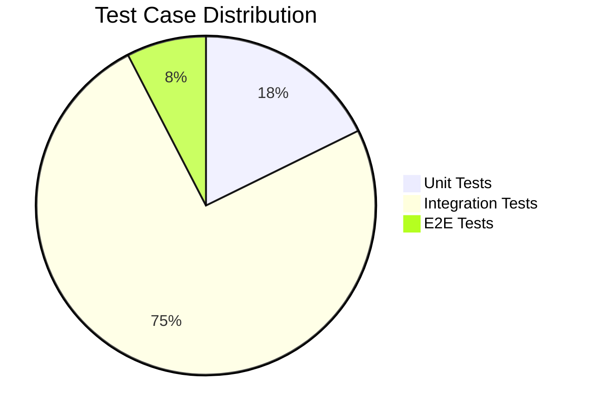
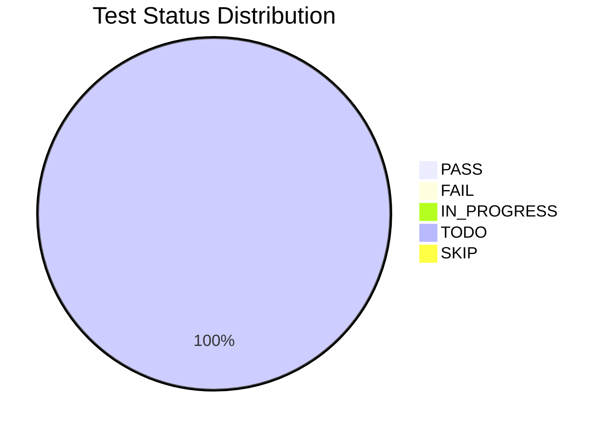

# RTM — Requirements Traceability Matrix（需求追溯矩陣）
<!-- SDLC Quality Engineering — Layer 8：Traceability & Coverage Audit -->
<!-- 對應學術標準：IEEE 29148 (Requirements Engineering)；業界：NASA RTM / ISTQB Traceability Matrix -->
<!-- 回答：每條需求是否有對應的設計、實作、測試？測試覆蓋率是否完整？ -->

---

## Document Control

| 欄位 | 內容 |
|------|------|
| **DOC-ID** | RTM-YOCAT-OFFICE-BACKEND-20261030 |
| **專案名稱** | yoCat Office 後端信任層（yocat-office-backend） |
| **文件版本** | v1.0 |
| **狀態** | DRAFT |
| **作者（QA Lead）** | AI Generated（gendoc gen RTM）／ QA Architect 待指派 |
| **日期** | 2026-10-30 |
| **上游 PRD** | [PRD.md](PRD.md) §5 User Stories & AC |
| **上游 EDD** | [EDD.md](EDD.md) §3.4 BC / §6 Class Diagram |
| **上游 API** | [API.md](API.md) §3 Endpoints（18 端點） |
| **上游 SCHEMA** | [SCHEMA.md](SCHEMA.md) |
| **上游 Test Plan** | [test-plan.md](test-plan.md) §15 RTM |
| **上游 BDD-server** | [features/](../features/)（9 feature files，@TC-* / @US-* tags） |
| **上游 BDD-client** | N/A — client_type=api-only，無 Client E2E feature |
| **審閱者** | QA Architect、Engineering Lead、Product Manager |
| **核准者** | Executive Sponsor（Sayyo Games / 聖祐遊戲） |

---

## Change Log

| 版本 | 日期 | 作者 | 變更摘要 |
|------|------|------|---------|
| v1.0 | 2026-10-30 | gendoc gen RTM | 初稿：依 PRD §5（8 US / 26 P0 AC）+ API §3（18 端點）+ test-plan §15 + features/（9 BDD）建立雙向追溯矩陣，涵蓋 7 有界上下文與關鍵可信付費動作端到端鏈 |

---

## §0 什麼是 RTM？（給非技術讀者的說明）

> RTM（Requirements Traceability Matrix，需求追溯矩陣）是一份表格，用來確認：
>
> **「每一條需求，都有對應的程式碼在實作它，也有測試在驗證它。」**
>
> 你可以把它想成一份「檢核清單」：
> - 左側是業務需求（BRD / PRD 寫下的「要做什麼」，本專案 8 條 User Story）
> - 中間是程式設計（EDD 寫下的「哪個 BC、哪個 Class、哪個方法」；API 寫下的「哪個端點」）
> - 右側是測試（test-plan 與 BDD feature 寫下的「如何驗證」）
>
> 若某一行沒有對應的測試 → 代表有需求沒被測試覆蓋，這是風險。
> 若某一個測試沒有對應的需求 → 代表有多餘（孤立）的測試，需要評估。
>
> 閱讀方向：需求（US-ID / Req-ID）→ 設計（BC / Class / API 端點）→ 測試（TC-ID / BDD @tag）。
> 本專案為 **api-only 伺服器權威信任層**，E2E 以 API 流程（非瀏覽器 UI）呈現。

---

## §1 Summary Statistics（統計摘要）

> 本節提供整體覆蓋率快照。每次更新 RTM 內容後，請同步更新此區塊的數字。

| 指標 | 數量 | 備註 |
|------|------|------|
| **總需求數（Requirements）** | 8 | 來自 PRD §4.4 MoSCoW（5 Must P0 + 3 Should P1） |
| **總 User Story 數** | 8 | 來自 PRD §5（US-MEM/WAL/ENT/SAVE/PLAT/REC/LB/DEP-001） |
| **總 Class 數** | 26 | 來自 EDD §6 / class-inventory（Domain 10 / App 5 / Presentation 2 / Infra 3 等，共 26） |
| **總 Method 數** | 11 | 統計 §3.2 追溯表中不重複的 Method |
| **總 Test Case 數** | 79 | Unit + Integration + E2E 全加總 |
| **Unit Test 數** | 14 | §3.2，TC-UNIT- 開頭 |
| **Integration Test 數** | 59 | §4.2，TC-INT- / 平台 ModularityTests / 跨 BC 事件 |
| **E2E Test 數** | 6 | §5.2，TC-E2E- 開頭 |
| **需求覆蓋率** | 100% | 有測試覆蓋的需求（8）÷ 總需求數（8） |
| **Method 覆蓋率** | 100% | 相對 §3.2 權威列舉集計算：11 個核心 Method 各有 ≥ 1 對應 TC（共 14 TC）。完整 S/E/B 三案例藍圖見 test-plan §15.2 / RTM §15.4，屬 target/future |
| **PASS 率** | 0% | 狀態為 PASS 的 TC ÷ 總 TC 數（初次生成全為 TODO） |
| **FAIL 數** | 0 | 狀態為 FAIL（需立即處理） |
| **TODO 數** | 79 | 尚未撰寫的測試（需排期；初次生成 = 總 TC 數） |

### §1.1 覆蓋率視覺化

> P0 User Story 覆蓋率 = 5/5 = 100%；P0 AC 覆蓋率 = 26/26 = 100%（對齊 test-plan §15.3）；全部 8 US 皆有測試追溯。

```
需求覆蓋率     [██████████████████████████████] 100%  (8/8 Requirements)
P0 US 覆蓋率   [██████████████████████████████] 100%  (5/5 P0 User Stories)
P0 AC 覆蓋率   [██████████████████████████████] 100%  (26/26 P0 Acceptance Criteria)
Method 覆蓋率  [██████████████████████████████] 100%  (11/11 核心 Method)
```





---

## §2 Status 狀態碼說明

| 狀態 | 說明（中文）| Meaning（English）| 行動 |
|------|------------|-------------------|------|
| `TODO` | 測試尚未撰寫 | Test not yet written | 排入 Sprint backlog |
| `IN_PROGRESS` | 測試撰寫中 | Test being developed | 確認完成日期 |
| `PASS` | 測試通過 | Test passing in CI | 無需行動 |
| `FAIL` | 測試失敗 | Test failing in CI | 立即建立 bug ticket |
| `SKIP` | 測試暫緩（有原因）| Test deliberately skipped | 記錄跳過原因，定期 review |

---

## §3 Unit Test RTM — 需求 → 程式碼 → 單元測試

> **什麼是 Unit Test？** 測試程式碼裡最小的單位（一個 Method / Function）。每個核心 Method 至少有 3 種情境：成功（Success）、錯誤（Error）、邊界（Boundary）。

### §3.1 欄位說明

| 欄位 | 說明 |
|------|------|
| **Req-ID** | 需求編號（RQ-001 ~ RQ-008），對應一條 PRD User Story |
| **User Story** | 使用者故事編號（US-xxx-001） |
| **Class** | 實作此需求的 Class 名稱 |
| **Method** | 具體方法名稱（含參數簡述） |
| **TC-ID** | 測試案例編號（對齊 BDD @tag / test-plan class-inventory） |
| **情境描述** | 這個測試在測什麼 |
| **情境類型** | Success / Error / Boundary |
| **Test Type** | Unit |
| **Status** | TODO / IN_PROGRESS / PASS / FAIL / SKIP |

### §3.2 Unit Test 追溯表

| Req-ID | User Story | Class | Method | TC-ID | 情境描述 | 情境類型 | Test Type | Status |
|--------|-----------|-------|--------|-------|---------|---------|-----------|--------|
| RQ-001 | US-MEM-001 | `Email` / `DisplayName` | `validate(input)` | TC-UNIT-MEM-003-B01 | 格式或長度不合法的註冊欄位被拒絕（回 400） | Boundary | Unit | `TODO` |
| RQ-001 | US-MEM-001 | `ScryptPasswordEncoder` | `matches(raw, hash)` | TC-UNIT-SCRYPTENC-E01 | 錯誤密碼比對失敗且以 timingSafeEqual 防時序攻擊 | Error | Unit | `TODO` |
| RQ-001 | US-MEM-001 | `RegisterMemberUseCase` | `register(cmd)` | TC-UNIT-REGMEMBER-S01 | 合法資料建帳成功並發布 MemberRegistered 事件 | Success | Unit | `TODO` |
| RQ-001 | US-MEM-001 | `Session` | `isExpired(now)` | TC-UNIT-SESSION-B01 | session TTL 到期邊界（expires_at <= now）判定為過期 | Boundary | Unit | `TODO` |
| RQ-002 | US-WAL-001 | `Wallet` | `debit(amount)` | TC-UNIT-WALLET-S01 | 餘額足夠時扣款成功並產生負 delta 異動 | Success | Unit | `TODO` |
| RQ-002 | US-WAL-001 | `Wallet` | `debit(amount)` | TC-UNIT-WALLET-E01 | 餘額不足時拒絕扣款（不產生異動） | Error | Unit | `TODO` |
| RQ-002 | US-WAL-001 | `Wallet` | `debit(amount)` | TC-UNIT-WAL-004-B01 | 超出合法範圍（<=0）的金額被拒絕（回 400） | Boundary | Unit | `TODO` |
| RQ-002 | US-WAL-001 | `TopUpWalletUseCase` | `topup(amount)` | TC-UNIT-WAL-004-B02 | 合法邊界金額（1 與 10,000,000）的儲值被接受 | Boundary | Unit | `TODO` |
| RQ-002 | US-WAL-001 | `Money` | `subtract(n)` | TC-UNIT-MONEY-B01 | 金額 0 與上限邊界運算正確且不產生負值 | Boundary | Unit | `TODO` |
| RQ-003 | US-ENT-001 | `BuyEntitlementUseCase` | `buy(cmd)` | TC-UNIT-BUYENT-S01 | 未擁有且餘額足時原子扣款並授予權益 | Success | Unit | `TODO` |
| RQ-003 | US-ENT-001 | `BuyEntitlementUseCase` | `buy(cmd)` | TC-UNIT-ENT-004-B01 | 類別非法或缺項目 ID 的購買被拒絕（回 400） | Boundary | Unit | `TODO` |
| RQ-004 | US-SAVE-001 | `SaveService` | `put(slot, data)` | TC-UNIT-SAVE-004-B01 | 上傳存檔缺少 data 欄位時被拒絕（回 400） | Boundary | Unit | `TODO` |
| RQ-005 | US-PLAT-001 | `ModularityTests` | `verifyModularity()` | TC-UNIT-ARCH-005-S01 | 模組依賴關係構成有向無環圖（0 循環依賴） | Success | Unit | `TODO` |
| RQ-005 | US-PLAT-001 | `BearerTokenFilter` | `doFilter(req, res)` | TC-UNIT-BEARERFILTER-E01 | 過期或無效 token 被攔截拒絕 | Error | Unit | `TODO` |

---

## §4 Integration Test RTM — API 端點追溯

> **什麼是 Integration Test？** 透過 HTTP 呼叫 API 或觸發跨 BC 事件，確認從入口到資料庫 / Outbox 的整條路是通的。涵蓋全部 18 個 API 端點（含 Happy Path + Error Path）與 Spring Modulith 模組邊界 / 跨 BC 事件合約。
>
> **命名規則**：Integration / 契約測試 ID 以 `TC-INT-` 為前綴；平台模組測試 `TC-INT-ARCH-`、跨 BC 事件 `TC-INT-EVT-`、健康檢查冒煙 `TC-SMOKE-PLAT-`。api-only 專案中部分端點 Happy Path 以 `TC-E2E-*-S01`（API 契約流程）追溯。

### §4.1 欄位說明

| 欄位 | 說明 |
|------|------|
| **API-ID** | API 端點編號（API-001 ~ API-018）；PLAT = 模組邊界、XBC = 跨 BC 事件 |
| **HTTP Method + Path** | 完整端點（例：`POST /wallet/spend`）；平台 / 事件測試以 TEST / EVENT 標示 |
| **IT-ID** | Integration / 契約 Test 編號 |
| **情境描述** | 這個測試在測什麼 |
| **預期 Status** | 預期 HTTP 回應碼或模組檢查結果 |
| **情境類型** | Success / Error / Boundary |
| **Status** | TODO / IN_PROGRESS / PASS / FAIL / SKIP |

### §4.2 Integration Test 追溯表

| API-ID | HTTP Method + Path | IT-ID | 情境描述 | 預期 Status | 情境類型 | Status |
|--------|-------------------|-------|---------|------------|---------|--------|
| API-001 | `GET /health/live` | TC-SMOKE-PLAT-LIVE-S01 | 存活探針回應程序存活 | 200 OK | Success | `TODO` |
| API-002 | `GET /health/ready` | TC-SMOKE-PLAT-READY-S01 | 就緒探針檢查 DB / Redis 依賴可用 | 200 OK | Success | `TODO` |
| API-003 | `POST /auth/register` | TC-E2E-MEM-001-S01 | 以合法資料註冊新帳號並同時開立錢包 | 200 OK | Success | `TODO` |
| API-003 | `POST /auth/register` | TC-INT-MEM-002-E01 | 以已註冊的 email 再次註冊時回應衝突 | 409 Conflict | Error | `TODO` |
| API-003 | `POST /auth/register` | TC-INT-MEM-009-E01 | 同一來源短時間大量註冊時觸發速率限制 | 429 Too Many Requests | Error | `TODO` |
| API-004 | `POST /auth/login` | TC-E2E-MEM-004-S01 | 以正確帳密登入並簽發新 session（TTL 30 天） | 200 OK | Success | `TODO` |
| API-004 | `POST /auth/login` | TC-INT-MEM-005-E01 | 以錯誤密碼登入時回應認證失敗且不洩露帳號是否存在 | 401 Unauthorized | Error | `TODO` |
| API-004 | `POST /auth/login` | TC-INT-MEM-005-E02 | 以未註冊 email 登入時回應與帳密錯誤相同的訊息 | 401 Unauthorized | Error | `TODO` |
| API-005 | `POST /auth/logout` | TC-INT-MEM-008-S01 | 登出刪除當前 session 且為冪等操作 | 200 OK | Success | `TODO` |
| API-005 | `POST /auth/logout` | TC-INT-MEM-008-E01 | 以無效或已失效 token 登出仍回應成功（冪等） | 200 OK | Boundary | `TODO` |
| API-006 | `GET /auth/me` | TC-E2E-MEM-007-S01 | 已登入者查詢我的資料彙整帳號 / 錢包 / 權益 | 200 OK | Success | `TODO` |
| API-006 | `GET /auth/me` | TC-INT-MEM-006-E01 | 無有效 token 查詢我的資料時拒絕存取 | 401 Unauthorized | Error | `TODO` |
| API-007 | `POST /wallet/topup` | TC-E2E-WAL-001-S01 | 以預定義儲值包儲值並寫入 topup 帳本 | 200 OK | Success | `TODO` |
| API-007 | `POST /wallet/topup` | TC-E2E-WAL-001-S02 | 以自訂現金金額儲值使餘額增加 | 200 OK | Success | `TODO` |
| API-008 | `POST /wallet/spend` | TC-E2E-WAL-002-S01 | 餘額足夠時以行鎖序列化扣款並寫入負異動帳本 | 200 OK | Success | `TODO` |
| API-008 | `POST /wallet/spend` | TC-INT-WAL-003-E01 | 餘額不足時拒絕扣款並回傳現有錢包 | 402 Payment Required | Error | `TODO` |
| API-008 | `POST /wallet/spend` | TC-INT-WAL-006-E01 | 無有效 token 嘗試花費時拒絕存取 | 401 Unauthorized | Error | `TODO` |
| API-008 | `POST /wallet/spend` | TC-INT-WAL-005-S01 | 同帳號併發多筆花費時行鎖序列化且帳本與餘額零不一致 | 200 OK | Success | `TODO` |
| API-008 | `POST /wallet/spend` | TC-INT-WAL-007-E01 | 同一帳號短時間大量花費時觸發速率限制 | 429 Too Many Requests | Error | `TODO` |
| API-009 | `GET /deposit/packs` | TC-E2E-DEP-001-S01 | 未登入也能查詢儲值包目錄 | 200 OK | Success | `TODO` |
| API-010 | `POST /deposit/checkout` | TC-E2E-DEP-002-S01 | 以有效儲值包與冪等鍵建立已確認的儲值訂單 | 200 OK | Success | `TODO` |
| API-010 | `POST /deposit/checkout` | TC-INT-DEP-003-S01 | 以相同冪等鍵重放時回放原訂單且只入帳一次 | 200 OK | Success | `TODO` |
| API-010 | `POST /deposit/checkout` | TC-INT-DEP-004-E01 | 相同冪等鍵但請求內容不同時回應衝突 | 409 Conflict | Error | `TODO` |
| API-010 | `POST /deposit/checkout` | TC-INT-DEP-005-E01 | 以不存在的儲值包建立訂單時被拒絕 | 400 Bad Request | Error | `TODO` |
| API-010 | `POST /deposit/checkout` | TC-INT-DEP-006-E01 | 未提供冪等鍵時拒絕建立儲值訂單 | 400 Bad Request | Error | `TODO` |
| API-010 | `POST /deposit/checkout` | TC-INT-DEP-007-E01 | 無有效 token 建立儲值訂單時拒絕存取 | 401 Unauthorized | Error | `TODO` |
| API-011 | `GET /entitlements` | TC-INT-ENT-008-E01 | 無有效 token 查詢權益時拒絕存取 | 401 Unauthorized | Error | `TODO` |
| API-012 | `POST /entitlements/buy` | TC-E2E-ENT-001-S01 | 餘額足夠且未擁有時原子扣款並授予權益 | 200 OK | Success | `TODO` |
| API-012 | `POST /entitlements/buy` | TC-INT-ENT-006-S01 | 以零金額免費授予活動權益時僅插入權益不寫帳本 | 200 OK | Boundary | `TODO` |
| API-012 | `POST /entitlements/buy` | TC-INT-ENT-002-E01 | 重複購買已擁有的項目時回應衝突且不重複扣款 | 409 Conflict | Error | `TODO` |
| API-012 | `POST /entitlements/buy` | TC-INT-ENT-003-E01 | 餘額不足時交易回滾不扣款也不授予 | 402 Payment Required | Error | `TODO` |
| API-012 | `POST /entitlements/buy` | TC-INT-ENT-007-E01 | 無有效 token 購買權益時拒絕存取 | 401 Unauthorized | Error | `TODO` |
| API-013 | `POST /records` | TC-INT-REC-001-S01 | 以合法類型新增一筆破產經營史 | 200 OK | Success | `TODO` |
| API-013 | `POST /records` | TC-INT-REC-002-B01 | 類型非法的經營史記錄被拒絕 | 400 Bad Request | Boundary | `TODO` |
| API-013 | `POST /records` | TC-INT-REC-003-E01 | 無有效 token 寫入經營史時拒絕存取 | 401 Unauthorized | Error | `TODO` |
| API-014 | `GET /records` | TC-INT-REC-004-S01 | 查詢經營史時依建立時間由新到舊回傳 | 200 OK | Success | `TODO` |
| API-014 | `GET /records` | TC-INT-REC-005-S01 | 依類型篩選經營史時只回傳符合的記錄 | 200 OK | Success | `TODO` |
| API-015 | `GET /leaderboard` | TC-INT-LB-001-S01 | 未登入也能依分數由高到低查詢排行榜 | 200 OK | Success | `TODO` |
| API-015 | `GET /leaderboard` | TC-INT-LB-002-B01 | 查詢筆數被夾擠於合法範圍內 | 200 OK | Boundary | `TODO` |
| API-016 | `POST /leaderboard` | TC-INT-LB-003-S01 | 已登入者上榜時以帳號顯示名稱歸戶寫入 | 200 OK | Success | `TODO` |
| API-016 | `POST /leaderboard` | TC-INT-LB-004-S01 | 以相同場次 ID 再次提交時只更新同一筆排行記錄 | 200 OK | Success | `TODO` |
| API-016 | `POST /leaderboard` | TC-INT-LB-005-E01 | 未提供場次 ID 上榜時被拒絕 | 400 Bad Request | Error | `TODO` |
| API-016 | `POST /leaderboard` | TC-INT-LB-006-E01 | 無有效 token 提交分數時拒絕存取 | 401 Unauthorized | Error | `TODO` |
| API-017 | `GET /save` | TC-E2E-SAVE-002-S01 | 查詢已存在的存檔時回傳最新內容 | 200 OK | Success | `TODO` |
| API-017 | `GET /save` | TC-INT-SAVE-003-E01 | 查詢尚無存檔的存檔槽時回傳空存檔而非找不到 | 200 OK | Boundary | `TODO` |
| API-018 | `PUT /save` | TC-E2E-SAVE-001-S01 | 上傳存檔時以帳號與存檔槽 upsert 寫入 | 200 OK | Success | `TODO` |
| API-018 | `PUT /save` | TC-INT-SAVE-006-B01 | 上傳空物件存檔時仍視為合法寫入 | 200 OK | Boundary | `TODO` |
| API-018 | `PUT /save` | TC-INT-SAVE-007-E01 | 無有效 token 上傳存檔時拒絕存取 | 401 Unauthorized | Error | `TODO` |
| PLAT | TEST ModularityTests | TC-INT-ARCH-001-S01 | 每個有界上下文只存取自己擁有的資料庫 schema | PASS | Success | `TODO` |
| PLAT | TEST ModularityTests | TC-INT-ARCH-002-S01 | 有界上下文之間僅透過公開介面或領域事件互動 | PASS | Success | `TODO` |
| PLAT | TEST ModularityTests | TC-INT-ARCH-003-S01 | 跨模組通訊透過具版本相容性的領域事件 | PASS | Success | `TODO` |
| PLAT | TEST ModularityTests | TC-INT-ARCH-004-S01 | 各有界上下文使用隔離的 Redis 命名空間 | PASS | Success | `TODO` |
| PLAT | TEST ModularityTests | TC-INT-ARCH-006-S01 | 單一有界上下文可在其他模組不可用時獨立冷啟動 | PASS | Boundary | `TODO` |
| XBC | EVENT Outbox | TC-INT-EVT-001-S01 | 註冊完成時 member 發布合規的會員註冊事件 | PASS | Success | `TODO` |
| XBC | EVENT Outbox | TC-INT-EVT-002-S01 | wallet 消費會員註冊事件後建立初始錢包與開帳帳本 | PASS | Success | `TODO` |
| XBC | EVENT Outbox | TC-INT-EVT-003-S01 | 儲值確認後 deposit 發布合規的儲值確認事件 | PASS | Success | `TODO` |
| XBC | EVENT Outbox | TC-INT-EVT-004-S01 | wallet 消費儲值確認事件後入帳且重複投遞只入帳一次 | PASS | Success | `TODO` |
| XBC | EVENT Outbox | TC-INT-EVT-005-S01 | 授予權益後 entitlement 發布合規的權益授予事件 | PASS | Success | `TODO` |
| XBC | EVENT Outbox | TC-INT-EVT-006-S01 | 上榜後 leaderboard 發布合規的分數提交事件 | PASS | Success | `TODO` |

---

## §5 E2E Test RTM — 端到端旅程追溯

> **什麼是 E2E Test？** 模擬真實使用流程、串起多個端點或驗證基礎設施行為的測試。本專案為 api-only，E2E 以多步驟 API 旅程（登入→儲值→購買→存檔）、跨裝置還原、破產歸戶，以及 HA / 混沌 / local-first 基礎設施場景呈現；單一端點的 Happy / Error 追溯見 §4。
>
> **命名規則**：E2E Test ID 以 `TC-E2E-` 為前綴。

### §5.1 欄位說明

| 欄位 | 說明 |
|------|------|
| **SC-ID** | 旅程 / 場景編號（api-only 無畫面，以業務流程命名） |
| **Screen Name** | 旅程 / 場景名稱 |
| **E2E-ID** | E2E Test 編號（TC-E2E-XXX） |
| **情境描述** | 這個測試在走什麼端到端流程 |
| **情境類型** | Happy Path / Error Path / Edge Case |
| **Tool** | 使用的自動化工具 |
| **Feature File** | 對應 BDD feature 檔路徑（基礎設施場景標示來源） |
| **Status** | TODO / IN_PROGRESS / PASS / FAIL / SKIP |

### §5.2 E2E Test 追溯表

| SC-ID | Screen Name | E2E-ID | 情境描述 | 情境類型 | Tool | Feature File | Status |
|-------|------------|-------|---------|---------|------|-------------|--------|
| SC-JRNY-01 | `核心付費旅程（登入→儲值→購買→存檔）` | TC-E2E-JOURNEY-001-S01 | 登入後 topup 假付費、entitlements/buy 原子扣款授予、PUT /save，端到端驗證伺服器權威狀態 | Happy Path | RestAssured + Testcontainers | 複合旅程（跨 member/wallet/entitlement/game-save feature） | `TODO` |
| SC-SAVE-05 | `game-save 跨裝置還原` | TC-E2E-SAVE-005-S01 | 在一台裝置上傳存檔後於另一台裝置登入可還原同一存檔（成功率 >= 99%） | Edge Case | RestAssured + Testcontainers | features/game-save/game_save_sync.feature | `TODO` |
| SC-ENT-05 | `entitlement 破產歸戶` | TC-E2E-ENT-005-S01 | 帳號破產 recycle 後已購權益與夢想員工仍完整不消失 | Edge Case | RestAssured + Testcontainers | features/entitlement/entitlement_purchase.feature | `TODO` |
| SC-PLAT-01 | `平台底座 HA 混沌` | TC-E2E-PLAT-001-S01 | 殺 1 個 pod 服務持續可用錯誤率 < 0.1% | Edge Case | k6 + Chaos Mesh | test-plan §15.1（基礎設施場景，無 BDD feature） | `TODO` |
| SC-PLAT-02 | `平台底座 滾動更新` | TC-E2E-PLAT-002-S01 | 滾動更新無停機 HTTP 5xx 比率 < 0.1%（PodDisruptionBudget 保證最小可用數） | Edge Case | k6 + K8s | test-plan §15.1（基礎設施場景，無 BDD feature） | `TODO` |
| SC-PLAT-05 | `平台底座 local-first` | TC-E2E-PLAT-005-S01 | 於 Rancher Desktop k8s 一鍵部署 + 測試全流程本機跑完且全綠 | Happy Path | K8s + CI | test-plan §15.1（基礎設施場景，無 BDD feature） | `TODO` |

---

## §6 Req-ID ↔ Test-ID 快查索引

> 此表提供雙向查找：從需求找測試，或從測試找需求。總測試數 / PASS / FAIL / TODO 由正文計算。

| Req-ID | User Story | 需求摘要 | 優先度 | 對應所有 TC/IT/E2E | 總測試數 | PASS | FAIL | TODO |
|--------|-----------|---------|:------:|-------------------|:-------:|:----:|:----:|:----:|
| RQ-001 | US-MEM-001 | member — 會員身分權威（註冊 / 登入 / 登出 / 我的資料） | P0 | TC-UNIT-MEM-003-B01, TC-UNIT-SCRYPTENC-E01, TC-UNIT-REGMEMBER-S01, TC-UNIT-SESSION-B01, TC-E2E-MEM-001-S01, TC-INT-MEM-002-E01, TC-INT-MEM-009-E01, TC-E2E-MEM-004-S01, TC-INT-MEM-005-E01, TC-INT-MEM-005-E02, TC-INT-MEM-008-S01, TC-INT-MEM-008-E01, TC-E2E-MEM-007-S01, TC-INT-MEM-006-E01, TC-INT-EVT-001-S01 | 15 | 0 | 0 | 15 |
| RQ-002 | US-WAL-001 | wallet — 伺服器權威錢包（topup / spend + append-only ledger） | P0 | TC-UNIT-WALLET-S01, TC-UNIT-WALLET-E01, TC-UNIT-WAL-004-B01, TC-UNIT-WAL-004-B02, TC-UNIT-MONEY-B01, TC-E2E-WAL-001-S01, TC-E2E-WAL-001-S02, TC-E2E-WAL-002-S01, TC-INT-WAL-003-E01, TC-INT-WAL-006-E01, TC-INT-WAL-005-S01, TC-INT-WAL-007-E01, TC-INT-EVT-002-S01, TC-INT-EVT-004-S01, TC-E2E-JOURNEY-001-S01 | 15 | 0 | 0 | 15 |
| RQ-003 | US-ENT-001 | entitlement — 已購權益（原子扣款 + 授予、破產不消失） | P0 | TC-UNIT-BUYENT-S01, TC-UNIT-ENT-004-B01, TC-E2E-ENT-005-S01, TC-INT-ENT-008-E01, TC-E2E-ENT-001-S01, TC-INT-ENT-006-S01, TC-INT-ENT-002-E01, TC-INT-ENT-003-E01, TC-INT-ENT-007-E01, TC-INT-EVT-005-S01 | 10 | 0 | 0 | 10 |
| RQ-004 | US-SAVE-001 | game-save — 跨裝置存檔 | P0 | TC-UNIT-SAVE-004-B01, TC-E2E-SAVE-002-S01, TC-INT-SAVE-003-E01, TC-E2E-SAVE-001-S01, TC-INT-SAVE-006-B01, TC-INT-SAVE-007-E01, TC-E2E-SAVE-005-S01 | 7 | 0 | 0 | 7 |
| RQ-005 | US-PLAT-001 | 平台底座 — 7 BC Spring Modulith + Day1 HA | P0 | TC-UNIT-ARCH-005-S01, TC-UNIT-BEARERFILTER-E01, TC-SMOKE-PLAT-LIVE-S01, TC-SMOKE-PLAT-READY-S01, TC-INT-ARCH-001-S01, TC-INT-ARCH-002-S01, TC-INT-ARCH-003-S01, TC-INT-ARCH-004-S01, TC-INT-ARCH-006-S01, TC-E2E-PLAT-001-S01, TC-E2E-PLAT-002-S01, TC-E2E-PLAT-005-S01 | 12 | 0 | 0 | 12 |
| RQ-006 | US-REC-001 | record — 經營史記錄（破產 / 成就 / 傳承） | P1 | TC-INT-REC-001-S01, TC-INT-REC-002-B01, TC-INT-REC-003-E01, TC-INT-REC-004-S01, TC-INT-REC-005-S01 | 5 | 0 | 0 | 5 |
| RQ-007 | US-LB-001 | leaderboard — 全域排行（歸戶寫入 + 公開 Top N） | P1 | TC-INT-LB-001-S01, TC-INT-LB-002-B01, TC-INT-LB-003-S01, TC-INT-LB-004-S01, TC-INT-LB-005-E01, TC-INT-LB-006-E01, TC-INT-EVT-006-S01 | 7 | 0 | 0 | 7 |
| RQ-008 | US-DEP-001 | deposit — 儲值接口（假付費 / 冪等） | P1 | TC-E2E-DEP-001-S01, TC-E2E-DEP-002-S01, TC-INT-DEP-003-S01, TC-INT-DEP-004-E01, TC-INT-DEP-005-E01, TC-INT-DEP-006-E01, TC-INT-DEP-007-E01, TC-INT-EVT-003-S01 | 8 | 0 | 0 | 8 |
| **合計** | **8 US** | **全部 8 需求皆有測試覆蓋** | — | — | **79** | **0** | **0** | **79** |

> 合計測試數 79 = 總 Test Case 數 79（Unit 14 + Integration 59 + E2E 6），與 §1 一致。TC-E2E-ENT-005-S01 歸類為 E2E（§5.2），不再於 §4.2 Integration 重複計列。需求覆蓋率 100%（8/8）。

---

## §7 FAIL 缺陷追蹤快查

> 所有狀態為 `FAIL` 的測試必須在此登記並建立對應 Bug Ticket。

| TC/IT/E2E ID | 失敗摘要 | 嚴重度 | Bug Ticket | 負責人 | 預計修復日期 |
|-------------|---------|--------|-----------|--------|------------|
| （目前無 FAIL 項目）| 初次生成，全部 79 筆測試狀態為 TODO，尚無 FAIL | — | — | — | — |

> 初次生成所有 TC 皆為 TODO，FAIL 缺陷表為空。測試進入 CI 後，FAIL 項目由 §3 / §4 / §5 自動回填此表。

---

## §8 CSV Export（機器可讀格式）

> 本節提供與上方表格相同的資料，CSV 格式方便匯入 Jira / Notion / TestRail / Zephyr。
> 複製內容存為 `rtm-yocat-office-backend-20261030.csv` 後即可匯入。

### §8.1 Unit Test CSV

```csv
RTM_Type,Req_ID,User_Story,Class,Method,TC_ID,Description,Scenario_Type,Test_Type,Status
Unit,RQ-001,US-MEM-001,Email / DisplayName,validate(input),TC-UNIT-MEM-003-B01,格式或長度不合法的註冊欄位被拒絕（回 400）,Boundary,Unit,TODO
Unit,RQ-001,US-MEM-001,ScryptPasswordEncoder,matches(raw， hash),TC-UNIT-SCRYPTENC-E01,錯誤密碼比對失敗且以 timingSafeEqual 防時序攻擊,Error,Unit,TODO
Unit,RQ-001,US-MEM-001,RegisterMemberUseCase,register(cmd),TC-UNIT-REGMEMBER-S01,合法資料建帳成功並發布 MemberRegistered 事件,Success,Unit,TODO
Unit,RQ-001,US-MEM-001,Session,isExpired(now),TC-UNIT-SESSION-B01,session TTL 到期邊界（expires_at <= now）判定為過期,Boundary,Unit,TODO
Unit,RQ-002,US-WAL-001,Wallet,debit(amount),TC-UNIT-WALLET-S01,餘額足夠時扣款成功並產生負 delta 異動,Success,Unit,TODO
Unit,RQ-002,US-WAL-001,Wallet,debit(amount),TC-UNIT-WALLET-E01,餘額不足時拒絕扣款（不產生異動）,Error,Unit,TODO
Unit,RQ-002,US-WAL-001,Wallet,debit(amount),TC-UNIT-WAL-004-B01,超出合法範圍（<=0）的金額被拒絕（回 400）,Boundary,Unit,TODO
Unit,RQ-002,US-WAL-001,TopUpWalletUseCase,topup(amount),TC-UNIT-WAL-004-B02,合法邊界金額（1 與 10，000，000）的儲值被接受,Boundary,Unit,TODO
Unit,RQ-002,US-WAL-001,Money,subtract(n),TC-UNIT-MONEY-B01,金額 0 與上限邊界運算正確且不產生負值,Boundary,Unit,TODO
Unit,RQ-003,US-ENT-001,BuyEntitlementUseCase,buy(cmd),TC-UNIT-BUYENT-S01,未擁有且餘額足時原子扣款並授予權益,Success,Unit,TODO
Unit,RQ-003,US-ENT-001,BuyEntitlementUseCase,buy(cmd),TC-UNIT-ENT-004-B01,類別非法或缺項目 ID 的購買被拒絕（回 400）,Boundary,Unit,TODO
Unit,RQ-004,US-SAVE-001,SaveService,put(slot， data),TC-UNIT-SAVE-004-B01,上傳存檔缺少 data 欄位時被拒絕（回 400）,Boundary,Unit,TODO
Unit,RQ-005,US-PLAT-001,ModularityTests,verifyModularity(),TC-UNIT-ARCH-005-S01,模組依賴關係構成有向無環圖（0 循環依賴）,Success,Unit,TODO
Unit,RQ-005,US-PLAT-001,BearerTokenFilter,doFilter(req， res),TC-UNIT-BEARERFILTER-E01,過期或無效 token 被攔截拒絕,Error,Unit,TODO
```

### §8.2 Integration Test CSV

```csv
RTM_Type,API_ID,HTTP_Method,Path,IT_ID,Description,Expected_Status,Scenario_Type,Status
Integration,API-001,GET,/health/live,TC-SMOKE-PLAT-LIVE-S01,存活探針回應程序存活,200 OK,Success,TODO
Integration,API-002,GET,/health/ready,TC-SMOKE-PLAT-READY-S01,就緒探針檢查 DB / Redis 依賴可用,200 OK,Success,TODO
Integration,API-003,POST,/auth/register,TC-E2E-MEM-001-S01,以合法資料註冊新帳號並同時開立錢包,200 OK,Success,TODO
Integration,API-003,POST,/auth/register,TC-INT-MEM-002-E01,以已註冊的 email 再次註冊時回應衝突,409 Conflict,Error,TODO
Integration,API-003,POST,/auth/register,TC-INT-MEM-009-E01,同一來源短時間大量註冊時觸發速率限制,429 Too Many Requests,Error,TODO
Integration,API-004,POST,/auth/login,TC-E2E-MEM-004-S01,以正確帳密登入並簽發新 session（TTL 30 天）,200 OK,Success,TODO
Integration,API-004,POST,/auth/login,TC-INT-MEM-005-E01,以錯誤密碼登入時回應認證失敗且不洩露帳號是否存在,401 Unauthorized,Error,TODO
Integration,API-004,POST,/auth/login,TC-INT-MEM-005-E02,以未註冊 email 登入時回應與帳密錯誤相同的訊息,401 Unauthorized,Error,TODO
Integration,API-005,POST,/auth/logout,TC-INT-MEM-008-S01,登出刪除當前 session 且為冪等操作,200 OK,Success,TODO
Integration,API-005,POST,/auth/logout,TC-INT-MEM-008-E01,以無效或已失效 token 登出仍回應成功（冪等）,200 OK,Boundary,TODO
Integration,API-006,GET,/auth/me,TC-E2E-MEM-007-S01,已登入者查詢我的資料彙整帳號 / 錢包 / 權益,200 OK,Success,TODO
Integration,API-006,GET,/auth/me,TC-INT-MEM-006-E01,無有效 token 查詢我的資料時拒絕存取,401 Unauthorized,Error,TODO
Integration,API-007,POST,/wallet/topup,TC-E2E-WAL-001-S01,以預定義儲值包儲值並寫入 topup 帳本,200 OK,Success,TODO
Integration,API-007,POST,/wallet/topup,TC-E2E-WAL-001-S02,以自訂現金金額儲值使餘額增加,200 OK,Success,TODO
Integration,API-008,POST,/wallet/spend,TC-E2E-WAL-002-S01,餘額足夠時以行鎖序列化扣款並寫入負異動帳本,200 OK,Success,TODO
Integration,API-008,POST,/wallet/spend,TC-INT-WAL-003-E01,餘額不足時拒絕扣款並回傳現有錢包,402 Payment Required,Error,TODO
Integration,API-008,POST,/wallet/spend,TC-INT-WAL-006-E01,無有效 token 嘗試花費時拒絕存取,401 Unauthorized,Error,TODO
Integration,API-008,POST,/wallet/spend,TC-INT-WAL-005-S01,同帳號併發多筆花費時行鎖序列化且帳本與餘額零不一致,200 OK,Success,TODO
Integration,API-008,POST,/wallet/spend,TC-INT-WAL-007-E01,同一帳號短時間大量花費時觸發速率限制,429 Too Many Requests,Error,TODO
Integration,API-009,GET,/deposit/packs,TC-E2E-DEP-001-S01,未登入也能查詢儲值包目錄,200 OK,Success,TODO
Integration,API-010,POST,/deposit/checkout,TC-E2E-DEP-002-S01,以有效儲值包與冪等鍵建立已確認的儲值訂單,200 OK,Success,TODO
Integration,API-010,POST,/deposit/checkout,TC-INT-DEP-003-S01,以相同冪等鍵重放時回放原訂單且只入帳一次,200 OK,Success,TODO
Integration,API-010,POST,/deposit/checkout,TC-INT-DEP-004-E01,相同冪等鍵但請求內容不同時回應衝突,409 Conflict,Error,TODO
Integration,API-010,POST,/deposit/checkout,TC-INT-DEP-005-E01,以不存在的儲值包建立訂單時被拒絕,400 Bad Request,Error,TODO
Integration,API-010,POST,/deposit/checkout,TC-INT-DEP-006-E01,未提供冪等鍵時拒絕建立儲值訂單,400 Bad Request,Error,TODO
Integration,API-010,POST,/deposit/checkout,TC-INT-DEP-007-E01,無有效 token 建立儲值訂單時拒絕存取,401 Unauthorized,Error,TODO
Integration,API-011,GET,/entitlements,TC-INT-ENT-008-E01,無有效 token 查詢權益時拒絕存取,401 Unauthorized,Error,TODO
Integration,API-012,POST,/entitlements/buy,TC-E2E-ENT-001-S01,餘額足夠且未擁有時原子扣款並授予權益,200 OK,Success,TODO
Integration,API-012,POST,/entitlements/buy,TC-INT-ENT-006-S01,以零金額免費授予活動權益時僅插入權益不寫帳本,200 OK,Boundary,TODO
Integration,API-012,POST,/entitlements/buy,TC-INT-ENT-002-E01,重複購買已擁有的項目時回應衝突且不重複扣款,409 Conflict,Error,TODO
Integration,API-012,POST,/entitlements/buy,TC-INT-ENT-003-E01,餘額不足時交易回滾不扣款也不授予,402 Payment Required,Error,TODO
Integration,API-012,POST,/entitlements/buy,TC-INT-ENT-007-E01,無有效 token 購買權益時拒絕存取,401 Unauthorized,Error,TODO
Integration,API-013,POST,/records,TC-INT-REC-001-S01,以合法類型新增一筆破產經營史,200 OK,Success,TODO
Integration,API-013,POST,/records,TC-INT-REC-002-B01,類型非法的經營史記錄被拒絕,400 Bad Request,Boundary,TODO
Integration,API-013,POST,/records,TC-INT-REC-003-E01,無有效 token 寫入經營史時拒絕存取,401 Unauthorized,Error,TODO
Integration,API-014,GET,/records,TC-INT-REC-004-S01,查詢經營史時依建立時間由新到舊回傳,200 OK,Success,TODO
Integration,API-014,GET,/records,TC-INT-REC-005-S01,依類型篩選經營史時只回傳符合的記錄,200 OK,Success,TODO
Integration,API-015,GET,/leaderboard,TC-INT-LB-001-S01,未登入也能依分數由高到低查詢排行榜,200 OK,Success,TODO
Integration,API-015,GET,/leaderboard,TC-INT-LB-002-B01,查詢筆數被夾擠於合法範圍內,200 OK,Boundary,TODO
Integration,API-016,POST,/leaderboard,TC-INT-LB-003-S01,已登入者上榜時以帳號顯示名稱歸戶寫入,200 OK,Success,TODO
Integration,API-016,POST,/leaderboard,TC-INT-LB-004-S01,以相同場次 ID 再次提交時只更新同一筆排行記錄,200 OK,Success,TODO
Integration,API-016,POST,/leaderboard,TC-INT-LB-005-E01,未提供場次 ID 上榜時被拒絕,400 Bad Request,Error,TODO
Integration,API-016,POST,/leaderboard,TC-INT-LB-006-E01,無有效 token 提交分數時拒絕存取,401 Unauthorized,Error,TODO
Integration,API-017,GET,/save,TC-E2E-SAVE-002-S01,查詢已存在的存檔時回傳最新內容,200 OK,Success,TODO
Integration,API-017,GET,/save,TC-INT-SAVE-003-E01,查詢尚無存檔的存檔槽時回傳空存檔而非找不到,200 OK,Boundary,TODO
Integration,API-018,PUT,/save,TC-E2E-SAVE-001-S01,上傳存檔時以帳號與存檔槽 upsert 寫入,200 OK,Success,TODO
Integration,API-018,PUT,/save,TC-INT-SAVE-006-B01,上傳空物件存檔時仍視為合法寫入,200 OK,Boundary,TODO
Integration,API-018,PUT,/save,TC-INT-SAVE-007-E01,無有效 token 上傳存檔時拒絕存取,401 Unauthorized,Error,TODO
Integration,PLAT,TEST,ModularityTests,TC-INT-ARCH-001-S01,每個有界上下文只存取自己擁有的資料庫 schema,PASS,Success,TODO
Integration,PLAT,TEST,ModularityTests,TC-INT-ARCH-002-S01,有界上下文之間僅透過公開介面或領域事件互動,PASS,Success,TODO
Integration,PLAT,TEST,ModularityTests,TC-INT-ARCH-003-S01,跨模組通訊透過具版本相容性的領域事件,PASS,Success,TODO
Integration,PLAT,TEST,ModularityTests,TC-INT-ARCH-004-S01,各有界上下文使用隔離的 Redis 命名空間,PASS,Success,TODO
Integration,PLAT,TEST,ModularityTests,TC-INT-ARCH-006-S01,單一有界上下文可在其他模組不可用時獨立冷啟動,PASS,Boundary,TODO
Integration,XBC,EVENT,Outbox,TC-INT-EVT-001-S01,註冊完成時 member 發布合規的會員註冊事件,PASS,Success,TODO
Integration,XBC,EVENT,Outbox,TC-INT-EVT-002-S01,wallet 消費會員註冊事件後建立初始錢包與開帳帳本,PASS,Success,TODO
Integration,XBC,EVENT,Outbox,TC-INT-EVT-003-S01,儲值確認後 deposit 發布合規的儲值確認事件,PASS,Success,TODO
Integration,XBC,EVENT,Outbox,TC-INT-EVT-004-S01,wallet 消費儲值確認事件後入帳且重複投遞只入帳一次,PASS,Success,TODO
Integration,XBC,EVENT,Outbox,TC-INT-EVT-005-S01,授予權益後 entitlement 發布合規的權益授予事件,PASS,Success,TODO
Integration,XBC,EVENT,Outbox,TC-INT-EVT-006-S01,上榜後 leaderboard 發布合規的分數提交事件,PASS,Success,TODO
```

### §8.3 E2E Test CSV

```csv
RTM_Type,SC_ID,Screen_Name,E2E_ID,Description,Scenario_Type,Tool,Feature_File,Status
E2E,SC-JRNY-01,核心付費旅程（登入→儲值→購買→存檔）,TC-E2E-JOURNEY-001-S01,登入後 topup 假付費、entitlements/buy 原子扣款授予、PUT /save，端到端驗證伺服器權威狀態,Happy Path,RestAssured + Testcontainers,複合旅程（跨 member/wallet/entitlement/game-save feature）,TODO
E2E,SC-SAVE-05,game-save 跨裝置還原,TC-E2E-SAVE-005-S01,在一台裝置上傳存檔後於另一台裝置登入可還原同一存檔（成功率 >= 99%）,Edge Case,RestAssured + Testcontainers,features/game-save/game_save_sync.feature,TODO
E2E,SC-ENT-05,entitlement 破產歸戶,TC-E2E-ENT-005-S01,帳號破產 recycle 後已購權益與夢想員工仍完整不消失,Edge Case,RestAssured + Testcontainers,features/entitlement/entitlement_purchase.feature,TODO
E2E,SC-PLAT-01,平台底座 HA 混沌,TC-E2E-PLAT-001-S01,殺 1 個 pod 服務持續可用錯誤率 < 0.1%,Edge Case,k6 + Chaos Mesh,test-plan §15.1（基礎設施場景，無 BDD feature）,TODO
E2E,SC-PLAT-02,平台底座 滾動更新,TC-E2E-PLAT-002-S01,滾動更新無停機 HTTP 5xx 比率 < 0.1%（PodDisruptionBudget 保證最小可用數）,Edge Case,k6 + K8s,test-plan §15.1（基礎設施場景，無 BDD feature）,TODO
E2E,SC-PLAT-05,平台底座 local-first,TC-E2E-PLAT-005-S01,於 Rancher Desktop k8s 一鍵部署 + 測試全流程本機跑完且全綠,Happy Path,K8s + CI,test-plan §15.1（基礎設施場景，無 BDD feature）,TODO
```

### §8.4 Summary Statistics CSV

```csv
Metric,Value,Note
Total_Requirements,8,PRD MoSCoW 5 P0 + 3 P1
Total_User_Stories,8,From PRD section 5
Total_Classes,26,From EDD class-inventory
Total_Methods,11,Distinct methods in section 3.2
Total_Test_Cases,79,Unit + Integration + E2E
Total_Unit_Tests,14,TC-UNIT prefix
Total_Integration_Tests,59,TC-INT / ARCH / EVT / SMOKE
Total_E2E_Tests,6,TC-E2E prefix
Requirement_Coverage_Pct,100,Requirements with test coverage / total
Method_Coverage_Pct,100,Methods with test coverage / total
Pass_Rate_Pct,0,PASS count / total test cases
Fail_Count,0,Immediate action required
Todo_Count,79,Need scheduling
```

---

### §15.3 UML 圖追蹤矩陣（Diagram-Test Traceability）

> 確認每個重要業務流程既有 UML 圖（Activity / Sequence / State）描述，也有對應測試案例。PRD §5 每個 P0 US 均附活動圖連結（待 /gendoc-gen-diagrams 生成實體檔案）。

| US-ID | 業務流程 | Activity / Sequence Diagram | State Machine | 對應 TC-ID | 覆蓋狀態 |
|-------|---------|----------------------------|--------------|-----------|---------|
| US-MEM-001 | 註冊 / 登入 | [activity-member-login.md](../docs/diagrams/activity-member-login.md) | PRD §6.3 存檔生命週期 | TC-E2E-MEM-001-S01 / TC-E2E-MEM-004-S01 | ⚠️ 缺 Diagram 檔（待 /gendoc-gen-diagrams） |
| US-WAL-001 | 行鎖扣款 | [activity-wallet-spend.md](../docs/diagrams/activity-wallet-spend.md)（API §1.3.2 序列圖） | — | TC-E2E-WAL-002-S01 / TC-INT-WAL-003-E01 / TC-INT-WAL-005-S01 | ✅ 已覆蓋（序列圖於 API §1.3.2） |
| US-ENT-001 | 原子扣款 + 授予 | [activity-entitlement-buy.md](../docs/diagrams/activity-entitlement-buy.md)（API §1.3.3 序列圖） | — | TC-E2E-ENT-001-S01 / TC-INT-ENT-002-E01 / TC-INT-ENT-003-E01 | ✅ 已覆蓋（序列圖於 API §1.3.3） |
| US-SAVE-001 | 跨裝置存檔 | [activity-game-save-sync.md](../docs/diagrams/activity-game-save-sync.md) | PRD §6.3 存檔生命週期 | TC-E2E-SAVE-001-S01 / TC-E2E-SAVE-005-S01 | ⚠️ 缺 Diagram 檔（待 /gendoc-gen-diagrams） |
| US-PLAT-001 | 滾動更新 / 模組邊界 | [activity-platform-rolling-update.md](../docs/diagrams/activity-platform-rolling-update.md) | — | TC-E2E-PLAT-002-S01 / TC-INT-ARCH-001-S01 | ⚠️ 缺 Diagram 檔（待 /gendoc-gen-diagrams） |
| US-DEP-001 | 冪等儲值 | API §1.3.4 序列圖 | — | TC-E2E-DEP-002-S01 / TC-INT-DEP-003-S01 | ✅ 已覆蓋（序列圖於 API §1.3.4） |

**覆蓋狀態說明：** ✅ 已覆蓋＝有圖且有 TC；⚠️ 缺 Diagram＝需執行 /gendoc-gen-diagrams 生成實體檔；❌ 缺 TC-ID＝有圖但無測試。

### §15.4 Class→Test 覆蓋追蹤（Class-Test Traceability）

> 本表交叉對照 test-plan §15.2（class-inventory 26 class 目標藍圖）與 **§3.2 權威列舉集（SSOT）**。**§3.2 目前已列舉 14 個 TC、涵蓋 11 個核心 Method**；本表「§3.2 已列舉 TC-ID」欄的每個 ID 都可在 §3.2 追溯表與 §6 索引中找到，「規劃中」欄的 S/E/B 則為 test-plan §15.2 目標藍圖中**尚未列入 §3.2 的 target/future 案例**，不計入 14 TC 統計。test-plan §15.2 使用的 `TC-UNIT-WALLET-B01`、`TC-UNIT-MONEY-S01/E01`、`TC-UNIT-ACCOUNT-*`、`TC-UNIT-SESSION-S01/E01`、`TC-UNIT-SPENDWALLET-*`、`TC-UNIT-BUYENT-E01`、`TC-UNIT-SCRYPTENC-S01/B01`、`TC-UNIT-BEARERFILTER-S01/B01` 等命名均屬規劃中，故列於「規劃中」欄而非誤植為已列舉。

| Class | Layer | 代表 Method | §3.2 已列舉 TC-ID（SSOT） | 規劃中 target/future（未列入 §3.2） | Test File | 狀態 |
|-------|-------|------------|---------------------------|--------------------------------------|----------|------|
| `Wallet` | Domain | `debit()` / `credit()` | TC-UNIT-WALLET-S01（S）、TC-UNIT-WALLET-E01（E）、TC-UNIT-WAL-004-B01（B） | —（S/E/B 皆已列舉） | `wallet/domain/WalletTest.java` | TODO |
| `Money` | Domain | `add()` / `subtract()` | TC-UNIT-MONEY-B01（B） | TC-UNIT-MONEY-S01/E01 | `shared/MoneyTest.java` | TODO |
| `Account` | Domain | `create()` | —（建帳主流程改由 §3.2 的 TC-UNIT-REGMEMBER-S01 於 UseCase 層覆蓋） | TC-UNIT-ACCOUNT-S01/E01/B01 | `member/domain/AccountTest.java` | TODO |
| `Session` | Domain | `isExpired()` | TC-UNIT-SESSION-B01（B） | TC-UNIT-SESSION-S01/E01 | `member/domain/SessionTest.java` | TODO |
| `SpendWalletUseCase` | Application | `spend()` | —（spend 單元邏輯由 §3.2 的 TC-UNIT-WALLET-S01/E01 於 Domain 層覆蓋） | TC-UNIT-SPENDWALLET-S01/E01/B01 | `wallet/application/SpendWalletUseCaseTest.java` | TODO |
| `BuyEntitlementUseCase` | Application | `buy()` | TC-UNIT-BUYENT-S01（S）、TC-UNIT-ENT-004-B01（B） | TC-UNIT-BUYENT-E01 | `entitlement/application/BuyEntitlementUseCaseTest.java` | TODO |
| `ScryptPasswordEncoder` | Infrastructure | `matches()` | TC-UNIT-SCRYPTENC-E01（E） | TC-UNIT-SCRYPTENC-S01/B01 | `member/infra/ScryptPasswordEncoderTest.java` | TODO |
| `BearerTokenFilter` | Infrastructure | `doFilter()` | TC-UNIT-BEARERFILTER-E01（E） | TC-UNIT-BEARERFILTER-S01/B01 | `platform/BearerTokenFilterTest.java` | TODO |

**Method 覆蓋率統計（相對 §3.2 權威列舉集：11 Method / 14 TC）：**

> 覆蓋率以「§3.2 已列舉的 11 個核心 Method 中，有 ≥ 1 個對應 TC 的比例」計算，非以 26 class 全量 S/E/B 計算。

| 類別 | §3.2 列舉 Method 數 | §3.2 列舉 TC 數 | Method 覆蓋率（相對列舉集）|
|------|:-----:|:-----:|:-----:|
| Domain Layer（`validate` / `isExpired` / `debit` / `subtract`）| 4 | 6 | 100% |
| Application Layer（`register` / `topup` / `buy` / `put`）| 4 | 5 | 100% |
| Infrastructure Layer（`matches` / `doFilter`）| 2 | 2 | 100% |
| Platform / Architecture Test（`verifyModularity`）| 1 | 1 | 100% |
| **合計（§3.2 列舉核心 Method）** | **11** | **14** | **100%** |

> 完整 26 class / 20 test file 的**目標藍圖**見 test-plan §15.2；§3.2 選取 PRD P0 AC 直接對應的核心 Method 為當前列舉的追溯錨點（11 Method / 14 TC）。本表「規劃中」欄的 S/E/B 待補齊後才併入 §3.2 與 §1 統計。Presentation 層 Controller（WalletController / AuthController）的驗證目前以 §4.2 Integration（MockMvc）覆蓋，未列入 §3.2 Unit 列舉集。

### §15.5 七有界上下文（7 BC）雙向追溯矩陣

> gendoc 原則：7 個 Spring Modulith 有界上下文都要在矩陣中可追溯（需求 ↔ 端點 ↔ 測試）。

| BC | Req / US | 主要端點 | 擁有資料表（SCHEMA） | 代表 TC-ID | 覆蓋 |
|----|---------|---------|---------------------|-----------|:----:|
| member | RQ-001 / US-MEM-001 | `/auth/register,login,logout,me` | `accounts`, `sessions` | TC-E2E-MEM-001-S01 / TC-INT-MEM-005-E01 | ✅ |
| wallet | RQ-002 / US-WAL-001 | `/wallet/topup,spend` | `wallets`, `wallet_ledger` | TC-E2E-WAL-002-S01 / TC-INT-WAL-005-S01 | ✅ |
| deposit | RQ-008 / US-DEP-001 | `/deposit/packs,checkout` | `deposit_pack`, `deposit_order` | TC-E2E-DEP-002-S01 / TC-INT-DEP-003-S01 | ✅ |
| entitlement | RQ-003 / US-ENT-001 | `/entitlements,/entitlements/buy` | `entitlements` | TC-E2E-ENT-001-S01 / TC-INT-ENT-002-E01 | ✅ |
| record | RQ-006 / US-REC-001 | `/records`（POST / GET） | `records` | TC-INT-REC-001-S01 / TC-INT-REC-004-S01 | ✅ |
| leaderboard | RQ-007 / US-LB-001 | `/leaderboard`（GET / POST） | `leaderboard` | TC-INT-LB-003-S01 / TC-INT-LB-001-S01 | ✅ |
| game-save | RQ-004 / US-SAVE-001 | `/save`（GET / PUT） | `saves` | TC-E2E-SAVE-001-S01 / TC-INT-SAVE-003-E01 | ✅ |
| 平台底座（橫切） | RQ-005 / US-PLAT-001 | `/health/live,ready` + 跨 BC 事件 | —（Outbox event_publication） | TC-INT-ARCH-001-S01 / TC-INT-EVT-001-S01 | ✅ |

> 7 BC + 平台底座全部有雙向追溯，0 孤立 BC。

### §15.6 關鍵可信付費動作端到端追溯鏈

> gendoc 原則：關鍵可信付費動作（扣款 / 冪等 / 餘額不足 / 權益授予 / 破產歸戶）要有端到端追溯鏈（需求 → 設計 → 測試 → BC）。

| 可信動作 | 需求（AC） | 設計（API / EDD / SCHEMA） | 單元 | 整合 | E2E / 旅程 |
|---------|-----------|---------------------------|------|------|-----------|
| 扣款（行鎖序列化） | US-WAL-001/AC-2 | `POST /wallet/spend`（API §1.3.2 SELECT FOR UPDATE）/ `wallet_ledger` | TC-UNIT-WALLET-S01 | TC-INT-WAL-005-S01 | TC-E2E-WAL-002-S01 → TC-E2E-JOURNEY-001-S01 |
| 冪等（儲值防重複入帳） | US-DEP-001/AC-2 | `POST /deposit/checkout`（API §1.3.4 Idempotency-Key）/ `deposit_order` | — | TC-INT-DEP-003-S01 / TC-INT-EVT-004-S01 | TC-E2E-DEP-002-S01 |
| 餘額不足（402 回滾） | US-WAL-001/AC-3、US-ENT-001/AC-3 | `POST /wallet/spend`、`/entitlements/buy`（402 交易回滾） | TC-UNIT-WALLET-E01 | TC-INT-WAL-003-E01 / TC-INT-ENT-003-E01 | TC-E2E-JOURNEY-001-S01 |
| 權益授予（原子扣款+授予） | US-ENT-001/AC-1 | `POST /entitlements/buy`（API §1.3.3 同交易）/ `entitlements` UNIQUE | TC-UNIT-BUYENT-S01 | TC-INT-ENT-002-E01 / TC-INT-EVT-005-S01 | TC-E2E-ENT-001-S01 |
| 破產歸戶（權益不消失） | US-ENT-001/AC-5 | `GET /entitlements`（recycle 隔離於 entitlement BC） | — | TC-INT-ENT-008-E01 | TC-E2E-ENT-005-S01 |

> 五條關鍵鏈皆達成 需求→設計→測試→BC 端到端閉環；扣款 / 權益授予 / 餘額不足三鏈具 Unit + Integration + E2E 三層覆蓋。

---

*RTM 文件應在每次 Sprint 結束後同步更新，並在 Release 前確認所有 P0（Must-have）需求的 PASS 率達 100%。*
