# SCHEMA — 資料庫 Schema 設計文件

## Document Control

| 欄位 | 值 |
|------|-----|
| Document ID | `SCHEMA-yocat-office-backend-20261030` |
| Version | `1.0` |
| Status | In Review |
| Classification | Confidential |
| Owner | Database Architect / Data Engineering Lead |
| **Owning Bounded Context / Service** | **yocat-office-backend（Spring Modulith 單體；7 BC 各自獨佔 schema：`member` / `wallet` / `deposit` / `entitlement` / `record` / `leaderboard` / `game_save`，加上平台底座橫切 `modulith` / `platform` schema）**。每張表之 Owning BC 於 §1.2 Table Inventory 與各 §3.x 子章節逐一標注。 |
| Created | 2026-10-30 |
| Last Updated | 2026-10-30 |
| Upstream EDD | [docs/EDD.md](EDD.md) §3.4（Schema Ownership）、§6（Data Model） |
| Upstream API | [docs/API.md](API.md) §3（Endpoints） |
| Upstream CONSTANTS | [docs/CONSTANTS.md](CONSTANTS.md) §9（列舉）、§10（錯誤碼）、§11（設定鍵） |
| Upstream 原型真相 | [docs/req/schema.sql](req/schema.sql)（8 張實體表的真相） |
| Database | PostgreSQL 16 |
| Source of Truth | 所有 Migration 必須對照本文件審查後才能合併；本文件值與 CONSTANTS.md 衝突時以 CONSTANTS.md（SSOT）為準 |
| Changelog | [See Change Log](#change-log) |

## Change Log

| Version | Date | Author | Summary |
|---------|------|--------|---------|
| 1.0 | 2026-10-30 | gendoc gen SCHEMA | 初稿：依 EDD §6 / schema.sql（8 實體表）+ CONSTANTS §9 列舉重新設計為 Spring Modulith HC-1 各 BC 獨佔 schema；補 Outbox / 冪等 / 稽核 / GDPR 等平台底座表，共 40 張表 |

---

## 1. 概述

- **資料庫**：PostgreSQL 16（EDD §3.3 技術棧；`lang_stack = Java 21 + Spring Boot 3.3 + Spring Modulith 1.3`）
- **字元集**：UTF-8（`SERVER_ENCODING = UTF8`）
- **時區**：所有時間戳一律以 `TIMESTAMPTZ` 儲存 UTC；應用層（Java `OffsetDateTime`）負責顯示時區轉換
- **排序規則（Collation）**：`en_US.UTF-8`
- **Schema 命名空間（HC-1）**：每個 Bounded Context 擁有獨立 PostgreSQL schema，外加兩個橫切 schema：
  - BC schema：`member`、`wallet`、`deposit`、`entitlement`、`record`、`leaderboard`、`game_save`
  - 橫切 schema：`modulith`（Spring Modulith Event Publication Registry / Outbox）、`platform`（稽核、GDPR、設定、觀測、限流後援）
- **最大連線數（Connection Pool）**：HikariCP，依 §7.3 公式計算（啟動期 Pod 各 20、PgBouncer transaction pool 40）

### 1.1 Schema Boundary Declaration

> **Spring Modulith 硬約束（HC-1）：每個 Bounded Context 擁有且只擁有自己的 DB Schema；跨 BC 資料存取只能透過對方的 Public API 或 Domain Event（Spring Modulith `event_publication` Outbox），絕對禁止 DB-level JOIN 或 FK 跨越 BC 邊界。**

| 欄位 | 值 |
|------|-----|
| **唯一擁有服務（Owning BC）** | 7 個 Spring Modulith module = 7 個 BC（`member` / `wallet` / `deposit` / `entitlement` / `record` / `leaderboard` / `game-save`），對應 EDD §3.4、CONSTANTS §12 |
| Schema 命名空間 | 每 BC 一個 PostgreSQL schema（上列）；跨 BC 禁止直接讀寫 |

**外部不得直接 JOIN 的表清單**（其他 BC 禁止對下列表建立 DB-level FK 或跨 schema JOIN）：

| 表名稱 | 原因 |
|--------|------|
| `member.accounts` | 屬 member 核心聚合根（身分權威）；跨 BC 僅能透過 `MemberService.verifySession()` Public API 或 `account_id`（ID-only）參照 |
| `wallet.wallets` | 屬 wallet 聚合根（伺服器權威餘額）；跨 BC 僅能透過 `WalletService.debit()/credit()` 同交易呼叫 |
| `wallet.wallet_ledger` | 屬 wallet 內部帳本（append-only 審計）；禁止其他 BC 讀取 |
| `entitlement.entitlements` | 屬 entitlement 聚合根；跨 BC 僅能透過 `EntitlementService` |

> **跨 BC 引用規範**：若其他 BC 需要引用本系統另一 BC 的實體，一律使用應用層管理的 `account_id BIGINT`（ID-only）欄位，**不建立 DB FK**。SQL 注釋格式：`-- Cross-BC reference: enforced at application layer, no DB FK (HC-1).`（完整清單見 §9.5）

### 1.2 Table Inventory（全 40 張表，依 BC schema 歸屬）

| # | schema.table | Owning BC | 類型 | 核心/衍生 | 來源 |
|---|--------------|-----------|------|-----------|------|
| 1 | `member.accounts` | member | 聚合根（AR） | 核心 | schema.sql L4、EDD §6.1 |
| 2 | `member.sessions` | member | 實體 | 核心 | schema.sql L12、EDD §6.1 |
| 3 | `member.login_attempts` | member | 審計 | 衍生 | CONSTANTS §6、EDD §9.1 |
| 4 | `member.account_deletion_requests` | member | 流程實體 | 衍生 | EDD §3.4/§6.3（MemberDeleted） |
| 5 | `member.password_history` | member | 值物件集合 | 衍生 | EDD §9.1/§9.4 |
| 6 | `wallet.wallets` | wallet | 聚合根（AR） | 核心 | schema.sql L21、EDD §4.1 |
| 7 | `wallet.wallet_ledger` | wallet | 實體（append-only） | 核心 | schema.sql L29、EDD §6.3 |
| 8 | `wallet.wallet_balance_snapshots` | wallet | 對帳快照 | 衍生 | EDD §4.7、CONSTANTS §4（對帳 0 不一致） |
| 9 | `wallet.wallet_inbound_events` | wallet | 冪等控制 | 衍生 | EDD §4.6（event_id dedup） |
| 10 | `deposit.deposit_pack` | deposit | 目錄（AR） | 核心 | API `GET /deposit/packs`、CONSTANTS §7 |
| 11 | `deposit.deposit_order` | deposit | 聚合根（AR） | 核心 | API `POST /deposit/checkout` |
| 12 | `deposit.deposit_idempotency` | deposit | 冪等控制 | 衍生 | API §7、deposit/checkout |
| 13 | `deposit.deposit_payment_webhook` | deposit | 事件（Phase B） | 衍生 | API §8（金流 webhook） |
| 14 | `entitlement.entitlements` | entitlement | 聚合根（AR） | 核心 | schema.sql L42 |
| 15 | `entitlement.entitlement_catalog` | entitlement | 目錄 | 衍生 | CONSTANTS §9（kind）、API 購買驗證 |
| 16 | `entitlement.entitlement_grant_log` | entitlement | 審計 | 衍生 | CONSTANTS §7（amount=0 贈與） |
| 17 | `record.records` | record | 聚合根（AR，append-only） | 核心 | schema.sql L61 |
| 18 | `record.record_type_catalog` | record | Lookup | 衍生 | CONSTANTS §9（type） |
| 19 | `leaderboard.leaderboard` | leaderboard | 聚合根（AR） | 核心 | schema.sql L71 |
| 20 | `leaderboard.leaderboard_mode_catalog` | leaderboard | Lookup | 衍生 | CONSTANTS §9（mode） |
| 21 | `leaderboard.leaderboard_snapshot` | leaderboard | 快取落庫 | 衍生 | EDD §11.3（Top N 快取備援） |
| 22 | `game_save.saves` | game-save | 聚合根（AR） | 核心 | schema.sql L52 |
| 23 | `game_save.save_write_log` | game-save | 審計 | 衍生 | PRD §5.4、CONSTANTS §7 |
| 24 | `modulith.event_publication` | 平台（Modulith） | Outbox | 衍生 | EDD §3.4/§4.6（Transactional Outbox） |
| 25 | `modulith.event_publication_archive` | 平台（Modulith） | Outbox 歸檔 | 衍生 | Spring Modulith completed events |
| 26 | `modulith.event_dead_letter` | 平台（Modulith） | DLQ | 衍生 | EDD §4.6.1（重試 5 次後） |
| 27 | `platform.audit_log` | 平台底座 | 稽核 | 衍生 | EDD §10.6 Audit Log Design |
| 28 | `platform.data_access_logs` | 平台底座 | 稽核 | 衍生 | §17.4、GDPR |
| 29 | `platform.gdpr_erasure_requests` | 平台底座 | 合規 | 衍生 | §17.2、GDPR Art.17 |
| 30 | `platform.feature_flags` | 平台底座 | 設定 | 衍生 | EDD §20 Feature Flag |
| 31 | `platform.feature_flag_audit` | 平台底座 | 稽核 | 衍生 | EDD §20.6 |
| 32 | `platform.rate_limit_counters` | 平台底座 | 限流後援 | 衍生 | CONSTANTS §6、EDD §11.3 |
| 33 | `platform.api_request_log` | 平台底座 | 觀測 | 衍生 | EDD §10.1 |
| 34 | `platform.schema_migrations` | 平台底座 | 版本追蹤 | 衍生 | §8（Flyway history） |
| 35 | `platform.system_config` | 平台底座 | 設定 | 衍生 | CONSTANTS §11 |
| 36 | `platform.error_code_registry` | 平台底座 | 契約 | 衍生 | CONSTANTS §10、API §5.2 |
| 37 | `platform.slo_measurements` | 平台底座 | 觀測 | 衍生 | EDD §10.5、CONSTANTS §4 |
| 38 | `platform.health_check_log` | 平台底座 | 觀測 | 衍生 | EDD §10.7、API Health |
| 39 | `platform.outbox_relay_offset` | 平台底座 | 事件轉發 | 衍生 | research_summary（write-behind relay） |
| 40 | `platform.replication_status_log` | 平台底座 | HA 監控 | 衍生 | §18、EDD §3.6（Replica Lag） |

> 核心 8 實體表（accounts/sessions/wallets/wallet_ledger/entitlements/saves/records/leaderboard）皆源自 `docs/req/schema.sql`；其餘為依 EDD 重構原則（HC-1 各 BC 獨佔 schema、Outbox、冪等、審計、GDPR、觀測、HA）補足的衍生表，使實體總數達 SSOT 要求（`min_table_count = 38`）。

---

## §0 Shared ENUM Types（被多張 table 引用的共用型別）

> 本系統將 CONSTANTS §9 登記之各 BC 獨佔列舉以 PostgreSQL `CREATE TYPE ... AS ENUM` 形式化（相較原型 `schema.sql` 的裸 `TEXT` 欄位，提供型別安全與 INSERT 自動驗證，符合「重新設計為 HA/Spring Modulith/Clean Architecture」之重構授權）。ENUM type 建立於其 Owning BC schema 下，跨 BC 不得引用。半動態值集（`wallet_ledger.reason` 的 `buy_<kind>`）與自由字串（`mode`/`slot`）維持 `VARCHAR + CHECK` 或 lookup table，不以 ENUM 固定。

```sql
-- 來源：CONSTANTS §9（currency，wallet BC 獨佔）
CREATE TYPE wallet.currency_enum AS ENUM ('cash', 'gems');

-- 來源：CONSTANTS §9（entitlement kind，entitlement BC 獨佔）
CREATE TYPE entitlement.kind_enum AS ENUM ('cosmetic', 'dream', 'scenario');

-- 來源：CONSTANTS §9（record type，record BC 獨佔）
CREATE TYPE record.type_enum AS ENUM ('bankruptcy', 'achievement', 'legacy');

-- 來源：API §deposit（OrderStatus，deposit BC 獨佔）
CREATE TYPE deposit.order_status_enum AS ENUM ('pending', 'confirmed', 'failed');
```

> **去重說明**：`currency_enum` 同時被 `wallet.wallets`（cash/gems 為欄位非 enum）概念與 `wallet.wallet_ledger.currency`、`deposit.deposit_pack.currency`、`deposit.deposit_order.currency` 引用。因 currency 概念由 **wallet BC 權威**（CONSTANTS §9 標注邊界=wallet），deposit BC 引用時以同值集 `VARCHAR(8) CHECK (currency IN ('cash','gems'))` 對齊（避免跨 schema 依賴 wallet 的 type，維持 HC-1 邊界）。此為刻意設計：ENUM type 不跨 BC schema 共用，改以 CHECK 保證值集一致。

---

## 2. 通用欄位規範

### 2.1 命名慣例

| 類別 | 規則 | 範例 |
|------|------|------|
| Schema 名稱 | BC 短名 `snake_case`（`game-save` → `game_save`） | `member`, `wallet`, `game_save` |
| 資料表名稱 | `snake_case`，沿用原型表名（原型為複數 `accounts`，本系統**沿用原型真相不改名**以維持 SSOT 一致） | `accounts`, `wallet_ledger` |
| 欄位名稱 | `snake_case`，小寫 | `account_id`, `created_at` |
| Boolean 欄位 | 以 `is_`、`has_` 為前綴 | `is_active`, `is_confirmed` |
| Enum 欄位 | 語意命名（`currency`/`kind`/`type`/`status`） | `status`, `kind` |
| 跨 BC 參照欄位 | `account_id`（ID-only，無 FK） | `account_id` |
| 索引名稱 | `idx_{table}_{columns}`（沿用原型既有 `idx_*`） | `idx_ledger_acct` |
| 唯一索引/約束 | `uq_{table}_{columns}` | `uq_entitlement_acct_kind_item` |
| 主鍵約束 | 內嵌 `PRIMARY KEY` 或自然鍵 | — |

> **命名例外（有意沿用原型）**：原型 `schema.sql` 使用**複數**表名（`accounts`、`sessions`…），本文件沿用以保持與 `docs/req/schema.sql`（SSOT 真相）一致，不套用 template 的「單數」慣例。此為刻意決策，已於此處文件化。

### 2.2 所有資料表的基礎欄位規範

本系統為**伺服器信任層**，多數核心表為 append-only（帳本/經營史）或權威覆蓋（錢包/存檔），基礎欄位依表性質選用：

```sql
-- 內部實體（BIGSERIAL 主鍵）標準欄位
id          BIGSERIAL    PRIMARY KEY,
created_at  TIMESTAMPTZ  NOT NULL DEFAULT now(),
-- 可變表額外加：
updated_at  TIMESTAMPTZ  NOT NULL DEFAULT now(),
-- 可軟刪除表額外加：
deleted_at  TIMESTAMPTZ            -- NULL = 未刪除
```

**審計欄位例外說明（source-faithful，回應 Review #19）**：`wallet.wallets` 與 `game_save.saves` 為**權威狀態/upsert 表**，沿用原型 `schema.sql`（L21、L52）僅含 `updated_at`、**無 `created_at`**。此為刻意設計：此二表的「建立時間」與「變更歷史」由其配對的 append-only 審計表承載——`wallets` 由 `wallet.wallet_ledger`（首筆 `reason='init'` 即開帳時間）、`saves` 由 `game_save.save_write_log` 追蹤每次寫入。故不另加 `created_at` 以維持與 SSOT 原型一致，審計完整性由配對表保證。

### 2.3 主鍵 ID 策略（全 Schema 一致性說明，回應 Review CRITICAL #3）

本系統**刻意混用三種主鍵型別**，均有明確業務依據（源自 `schema.sql` 真相，EDD §6.1 確認）：

| 主鍵型別 | 適用表 | 業務依據 |
|---------|-------|---------|
| `BIGSERIAL`（內部序號） | `accounts`、`wallet_ledger`、`entitlements`、`records`、各審計/log 表 | 信任層內部實體，不以主鍵對外暴露（對外用 `account_id` 語意）；高寫入量下順序插入性能佳、儲存小、對帳易讀 |
| 自然鍵 `TEXT` | `sessions`(`token` 32B hex)、`leaderboard`(`run_id`)、`deposit_order`(`order_id`) | 業務本身即唯一不可猜測識別碼（session token 由 `SECURE_RANDOM(32B)` 產生、run_id 由客戶端單場次產生、order_id = Idempotency-Key），直接作 PK 免去代理鍵 |
| 複合主鍵 | `wallets`(`account_id`)、`saves`(`account_id`,`slot`)、冪等/catalog 表 | `wallets` 一帳號一錢包（1:1）故 `account_id` 即 PK；`saves` 以 `(account_id, slot)` 唯一（CONSTANTS §7 slot 預設 main） |

> **不統一為 UUID 的理由**：信任層內部實體不經 URL 暴露主鍵（API 以 `account_id` 語意欄位溝通，非 REST resource id in path），BIGSERIAL 在對帳審計（人工可讀序號）與寫入性能上優於 UUID；自然鍵（token/run_id）本身已是全域唯一不可猜測值。此混用策略於全 schema 一致套用，非隨意混用。

### 2.4 軟刪除（Soft Delete）策略（全域政策，回應 Review CRITICAL #18）

本系統**統一軟刪除標記為 `deleted_at TIMESTAMPTZ NULL`**。因信任層資料多為審計性質，軟刪除**僅套用於**下列表，其餘表的「刪除」語意由業務性質決定，並逐一說明例外理由：

| 表 | 刪除策略 | 理由 |
|----|---------|------|
| `member.accounts` | `deleted_at` 軟刪除 + 事件驅動匿名化 | 帳號刪除走 GDPR 匿名化（§17.2），保留業務完整性（ledger 歸戶） |
| `entitlement.entitlements` | `deleted_at` 軟刪除 | 退款/撤銷權益需可追溯（破產**不**刪除，PRD §5.3） |
| `game_save.saves` | 硬覆蓋（upsert），無 `deleted_at` | 存檔僅保留最新版本（EDD §6.3 upsert），刪檔即 DELETE row |
| `wallet.wallet_ledger`、`record.records` | **append-only，永不 UPDATE/DELETE** | 審計帳本/經營史不可變（EDD §6.3）；帳號刪除時匿名化保留供審計 |
| `member.sessions` | 硬刪除（`expires_at < now()` 定時清理 + 登出即刪） | 會話為短期憑證（TTL 30 天），無保留需求（EDD §6.3） |
| 各 catalog / config 表 | 以 `is_active` 停用，不物理刪除 | lookup 值停用需保留歷史引用 |

```sql
-- updated_at 自動更新 Trigger（所有含 updated_at 的可變表共用，見 §6）
-- 軟刪除查詢一律：WHERE deleted_at IS NULL
-- 唯一約束一律加 WHERE deleted_at IS NULL（Partial Unique Index）
```

---

## 3. 資料表定義

> 呈現順序強制：**欄位說明 markdown table 先、`CREATE TABLE` SQL 後**（issue I3）。每張表附完整 DDL 區塊（ENUM if any + CREATE TABLE + INDEX + COMMENT），AI 可複製整塊直接建表。

### 共用 Trigger Function（全 schema 一次定義，所有可變表共用）

```sql
CREATE OR REPLACE FUNCTION platform.set_updated_at()
RETURNS TRIGGER AS $$
BEGIN
  NEW.updated_at = now();
  RETURN NEW;
END;
$$ LANGUAGE plpgsql;
```

---

### 3.1 BC: member

#### 3.1.1 `member.accounts`（帳號聚合根）

**說明：** 身分權威聚合根。儲存登入識別（email 唯一）、公司/老闆名、scrypt 密碼雜湊。對外以 `id`（AccountId）作為各 BC 的 app-layer 參照鍵。

| 欄位 | 型別 | Nullable | 預設值 | 說明 |
|------|------|----------|--------|------|
| id | BIGSERIAL | 否 | （序號） | 主鍵，AccountId；各 BC 以此值 ID-only 參照 |
| email | TEXT | 否 | — | 登入識別，全域唯一（PII，LOWER 唯一） |
| display_name | TEXT | 否 | — | 公司/老闆名（1–24 字，CONSTANTS §3 `DISPLAY_NAME_*`） |
| pass_hash | TEXT | 否 | — | scrypt `salt_hex$hash_hex`（**永不儲存明文**；CONSTANTS §1 `SCRYPT_*`） |
| is_active | BOOLEAN | 否 | TRUE | 帳號是否啟用 |
| created_at | TIMESTAMPTZ | 否 | now() | 建立時間 |
| updated_at | TIMESTAMPTZ | 否 | now() | 更新時間（trigger 自動） |
| deleted_at | TIMESTAMPTZ | 是 | NULL | 軟刪除時間戳（GDPR 匿名化併用） |

```sql
-- ── member.accounts（member BC）──────────────────────────────────────
-- 身分權威聚合根（EDD §4.2）。登入/註冊以 email 查詢；密碼 scrypt 驗證。
CREATE TABLE member.accounts (
  id            BIGSERIAL    PRIMARY KEY,
  email         TEXT         NOT NULL,
  display_name  TEXT         NOT NULL CHECK (char_length(display_name) BETWEEN 1 AND 24),
  pass_hash     TEXT         NOT NULL,                 -- scrypt(salt$hash)，cost 高成本，永不明文
  is_active     BOOLEAN      NOT NULL DEFAULT TRUE,
  created_at    TIMESTAMPTZ  NOT NULL DEFAULT now(),
  updated_at    TIMESTAMPTZ  NOT NULL DEFAULT now(),
  deleted_at    TIMESTAMPTZ
);

-- email 大小寫不敏感唯一（僅未刪除帳號）
CREATE UNIQUE INDEX uq_accounts_email ON member.accounts (LOWER(email)) WHERE deleted_at IS NULL;

CREATE TRIGGER trg_accounts_updated_at
  BEFORE UPDATE ON member.accounts FOR EACH ROW EXECUTE FUNCTION platform.set_updated_at();

COMMENT ON TABLE  member.accounts            IS 'member BC 身分權威聚合根（AccountId）。來源 schema.sql L4 / EDD §4.2';
COMMENT ON COLUMN member.accounts.email      IS 'PII 識別資料；pgcrypto 查詢層加密候選；帳號刪除後匿名化（§17.2）';
COMMENT ON COLUMN member.accounts.pass_hash  IS 'scrypt salt_hex$hash_hex（SCRYPT_KEYLEN=64/SALT=16B，CONSTANTS §1），禁明文';
```

#### 3.1.2 `member.sessions`（opaque session）

**說明：** 不透明 session token（32B hex）。Bearer 驗證以 `token` 為 PK；`account_id` 為跨 BC app-layer 參照（EDD §6.1 標注，無跨 BC FK）。TTL 30 天（CONSTANTS §1 `SESSION_TTL_DAYS`）。

| 欄位 | 型別 | Nullable | 預設值 | 說明 |
|------|------|----------|--------|------|
| token | TEXT | 否 | — | 主鍵，opaque session（`SESSION_TOKEN_BYTES=32` → 64 hex 字元） |
| account_id | BIGINT | 否 | — | 所屬帳號（app-layer ID，無 FK；EDD §6.1） |
| created_at | TIMESTAMPTZ | 否 | now() | 簽發時間 |
| expires_at | TIMESTAMPTZ | 否 | — | 到期時間（now() + 30 天） |

```sql
-- ── member.sessions（member BC）──────────────────────────────────────
-- 不透明 session（EDD ADR-003）。Bearer 驗證 O(log N) + Redis 快取 1800s。
CREATE TABLE member.sessions (
  token       TEXT         PRIMARY KEY,
  account_id  BIGINT       NOT NULL,                   -- member 內部參照 accounts(id)（同 BC），應用層解析
  created_at  TIMESTAMPTZ  NOT NULL DEFAULT now(),
  expires_at  TIMESTAMPTZ  NOT NULL
);

CREATE INDEX idx_sessions_acct ON member.sessions (account_id);           -- 依帳號列舉/清理（EDD §6.2）
CREATE INDEX idx_sessions_expires ON member.sessions (expires_at);        -- 定時清理過期 session

COMMENT ON TABLE  member.sessions            IS 'member BC opaque session（TTL 30 天，CONSTANTS §1）。來源 schema.sql L12';
COMMENT ON COLUMN member.sessions.account_id IS '同 BC（member）參照 accounts(id)，應用層維護（原型 schema FK 已依 HC-1 移除，以 app-layer ID 表示）';
```

#### 3.1.3 `member.login_attempts`（登入嘗試審計 / 限流持久後援）

**說明：** 記錄每次登入/註冊嘗試，供暴力破解偵測與 CONSTANTS §6 限流的持久化稽核後援（Redis 為熱路徑，本表為冷稽核）。

| 欄位 | 型別 | Nullable | 預設值 | 說明 |
|------|------|----------|--------|------|
| id | BIGSERIAL | 否 | （序號） | 主鍵 |
| email | TEXT | 是 | NULL | 嘗試的 email（未必存在；失敗不洩漏帳號） |
| ip_address | INET | 否 | — | 來源 IP（限流維度，CONSTANTS §6） |
| is_success | BOOLEAN | 否 | — | 是否成功 |
| failure_reason | VARCHAR(40) | 是 | NULL | 失敗原因（`bad_credentials`/`rate_limited`） |
| created_at | TIMESTAMPTZ | 否 | now() | 嘗試時間 |

```sql
-- ── member.login_attempts（member BC）─────────────────────────────────
-- 登入/註冊嘗試審計（防暴力破解，CONSTANTS §6 login 10/min、register 5/min）。
CREATE TABLE member.login_attempts (
  id             BIGSERIAL    PRIMARY KEY,
  email          TEXT,
  ip_address     INET         NOT NULL,
  is_success     BOOLEAN      NOT NULL,
  failure_reason VARCHAR(40),
  created_at     TIMESTAMPTZ  NOT NULL DEFAULT now()
);

CREATE INDEX idx_login_attempts_ip   ON member.login_attempts (ip_address, created_at DESC);  -- 限流滑動視窗後援
CREATE INDEX idx_login_attempts_mail ON member.login_attempts (LOWER(email), created_at DESC) WHERE email IS NOT NULL;

COMMENT ON TABLE member.login_attempts IS 'member BC 登入嘗試審計 + 限流持久後援（CONSTANTS §6 / EDD §9.1）';
```

#### 3.1.4 `member.account_deletion_requests`（帳號刪除請求佇列）

**說明：** 帳號刪除請求實體，驅動 `MemberDeleted` 事件（EDD §3.4/§6.3），各 BC 消費後匿名化/清理對應 `account_id` 資料。

| 欄位 | 型別 | Nullable | 預設值 | 說明 |
|------|------|----------|--------|------|
| id | BIGSERIAL | 否 | （序號） | 主鍵 |
| account_id | BIGINT | 否 | — | 待刪除帳號（member 內部參照） |
| status | VARCHAR(20) | 否 | 'requested' | `requested`/`anonymized`/`completed` |
| requested_at | TIMESTAMPTZ | 否 | now() | 請求時間 |
| completed_at | TIMESTAMPTZ | 是 | NULL | 完成時間（硬刪除 30 天後，§17.2） |

```sql
-- ── member.account_deletion_requests（member BC）──────────────────────
-- 帳號刪除流程實體；提交後發 MemberDeleted，各 BC 匿名化 account_id 資料（§17.2）。
CREATE TABLE member.account_deletion_requests (
  id            BIGSERIAL    PRIMARY KEY,
  account_id    BIGINT       NOT NULL REFERENCES member.accounts (id) ON DELETE CASCADE,  -- 同 BC FK（HC-1 允許）
  status        VARCHAR(20)  NOT NULL DEFAULT 'requested'
                             CHECK (status IN ('requested', 'anonymized', 'completed')),
  requested_at  TIMESTAMPTZ  NOT NULL DEFAULT now(),
  completed_at  TIMESTAMPTZ
);

CREATE INDEX idx_del_req_status ON member.account_deletion_requests (status, requested_at) WHERE status <> 'completed';

COMMENT ON TABLE member.account_deletion_requests IS 'member BC 帳號刪除請求，驅動 MemberDeleted 事件（EDD §3.4/§6.3）';
COMMENT ON COLUMN member.account_deletion_requests.account_id IS '同 BC（member）FK 至 accounts(id)，HC-1 允許同 BC FK';
```

#### 3.1.5 `member.password_history`（密碼雜湊歷史，值物件集合）

**說明：** 保留帳號歷史 scrypt 雜湊，防止密碼重用（EDD §9.1/§9.4 認證安全）。

| 欄位 | 型別 | Nullable | 預設值 | 說明 |
|------|------|----------|--------|------|
| id | BIGSERIAL | 否 | （序號） | 主鍵 |
| account_id | BIGINT | 否 | — | 所屬帳號（同 BC FK） |
| pass_hash | TEXT | 否 | — | 歷史 scrypt 雜湊（禁明文） |
| created_at | TIMESTAMPTZ | 否 | now() | 設定時間 |

```sql
-- ── member.password_history（member BC）───────────────────────────────
-- 密碼歷史（防重用；僅存 scrypt 雜湊）。
CREATE TABLE member.password_history (
  id          BIGSERIAL    PRIMARY KEY,
  account_id  BIGINT       NOT NULL REFERENCES member.accounts (id) ON DELETE CASCADE,  -- 同 BC FK
  pass_hash   TEXT         NOT NULL,
  created_at  TIMESTAMPTZ  NOT NULL DEFAULT now()
);

CREATE INDEX idx_pwd_hist_acct ON member.password_history (account_id, created_at DESC);

COMMENT ON TABLE member.password_history IS 'member BC 密碼歷史（防重用，EDD §9.1）；僅 scrypt 雜湊，禁明文';
```

---

### 3.2 BC: wallet

#### 3.2.1 `wallet.wallets`（錢包聚合根）

**說明：** 伺服器權威錢包聚合根。一帳號一錢包（`account_id` 即 PK）。`cash`（資本）、`gems`（寶石）均 `CHECK ≥ 0`（餘額一致性）。扣款走 `SELECT ... FOR UPDATE` 行鎖（EDD §4.7 演算法 1）。

| 欄位 | 型別 | Nullable | 預設值 | 說明 |
|------|------|----------|--------|------|
| account_id | BIGINT | 否 | — | 主鍵（app-layer ID，跨 BC 無 FK） |
| cash | BIGINT | 否 | 0 | 資本餘額（`CHECK ≥ 0`，CONSTANTS §1 `WALLET_INIT_CASH=0`） |
| gems | BIGINT | 否 | 0 | 寶石餘額（`CHECK ≥ 0`，`WALLET_INIT_GEMS=0`） |
| updated_at | TIMESTAMPTZ | 否 | now() | 最後異動時間 |

```sql
-- ── wallet.wallets（wallet BC）────────────────────────────────────────
-- 伺服器權威錢包（EDD §4.1）。account_id 為 app-layer ID（HC-1：不設跨 schema FK）。
CREATE TABLE wallet.wallets (
  account_id  BIGINT       PRIMARY KEY,                -- Cross-BC reference to member.accounts(id): app-layer, no DB FK (HC-1)
  cash        BIGINT       NOT NULL DEFAULT 0 CHECK (cash >= 0),
  gems        BIGINT       NOT NULL DEFAULT 0 CHECK (gems >= 0),
  updated_at  TIMESTAMPTZ  NOT NULL DEFAULT now()
);

CREATE TRIGGER trg_wallets_updated_at
  BEFORE UPDATE ON wallet.wallets FOR EACH ROW EXECUTE FUNCTION platform.set_updated_at();

COMMENT ON TABLE  wallet.wallets            IS 'wallet BC 權威錢包聚合根（1:1 帳號）。來源 schema.sql L21 / EDD §4.1';
COMMENT ON COLUMN wallet.wallets.account_id IS 'Cross-BC reference to member.accounts(id). Enforced at application layer, no DB FK (HC-1).';
COMMENT ON COLUMN wallet.wallets.cash       IS '資本餘額；CHECK>=0 保證不透支（餘額一致性，CONSTANTS §4 對帳 0 不一致）';
```

#### 3.2.2 `wallet.wallet_ledger`（錢包帳本，append-only）

**說明：** 每筆錢包異動的 append-only 審計帳本（防作弊 + 對帳 + 儲值記錄）。`balance` 記異動後餘額；永不 UPDATE/DELETE（EDD §6.3）。

| 欄位 | 型別 | Nullable | 預設值 | 說明 |
|------|------|----------|--------|------|
| id | BIGSERIAL | 否 | （序號） | 主鍵，帳本序號 |
| account_id | BIGINT | 否 | — | 所屬帳號（app-layer ID） |
| currency | VARCHAR(8) | 否 | — | `cash`/`gems`（CONSTANTS §9） |
| delta | BIGINT | 否 | — | 異動量（±） |
| reason | VARCHAR(40) | 否 | — | `init`/`topup`/`buy_<kind>`/`rescue`（`SPEND_REASON_MAXLEN=40`） |
| balance | BIGINT | 否 | — | 異動後餘額（`CHECK ≥ 0`） |
| meta | JSONB | 是 | NULL | 附加資訊（orderId、packId 等） |
| created_at | TIMESTAMPTZ | 否 | now() | 異動時間 |

```sql
-- ── wallet.wallet_ledger（wallet BC）──────────────────────────────────
-- Append-only 帳本（審計/防作弊/對帳）。reason 半動態（buy_<kind>），用 VARCHAR+CHECK 非 ENUM。
CREATE TABLE wallet.wallet_ledger (
  id          BIGSERIAL    PRIMARY KEY,
  account_id  BIGINT       NOT NULL,                   -- Cross-BC: app-layer ID, no DB FK (HC-1)
  currency    VARCHAR(8)   NOT NULL CHECK (currency IN ('cash', 'gems')),
  delta       BIGINT       NOT NULL,
  reason      VARCHAR(40)  NOT NULL
                           CHECK (reason IN ('init', 'topup', 'rescue')
                                  OR reason LIKE 'buy\_%'),   -- buy_cosmetic/buy_dream/buy_scenario（CONSTANTS §9 註記）
  balance     BIGINT       NOT NULL CHECK (balance >= 0),
  meta        JSONB,
  created_at  TIMESTAMPTZ  NOT NULL DEFAULT now()
);

CREATE INDEX idx_ledger_acct ON wallet.wallet_ledger (account_id, created_at DESC);  -- 帳本對帳/查近期（EDD §6.2）

COMMENT ON TABLE  wallet.wallet_ledger        IS 'wallet BC append-only 帳本（永不 UPDATE/DELETE，EDD §6.3）。來源 schema.sql L29';
COMMENT ON COLUMN wallet.wallet_ledger.reason IS 'init/topup/rescue 或 buy_<entitlement.kind>（CONSTANTS §9 真實集合）';
COMMENT ON COLUMN wallet.wallet_ledger.balance IS '異動後餘額快照，供對帳驗 Σdelta 一致性';
```

#### 3.2.3 `wallet.wallet_balance_snapshots`（對帳餘額快照）

**說明：** 每日/定時對 `wallets` 與 `Σ wallet_ledger.delta` 做一致性快照，供對帳稽核（CONSTANTS §4「錢包對帳一致性 0 筆不一致」）。

| 欄位 | 型別 | Nullable | 預設值 | 說明 |
|------|------|----------|--------|------|
| id | BIGSERIAL | 否 | （序號） | 主鍵 |
| account_id | BIGINT | 否 | — | 帳號（app-layer ID） |
| currency | VARCHAR(8) | 否 | — | `cash`/`gems` |
| wallet_balance | BIGINT | 否 | — | `wallets` 當前餘額 |
| ledger_sum | BIGINT | 否 | — | `Σ ledger.delta` 聚合值 |
| is_consistent | BOOLEAN | 否 | — | 兩者是否相符（false → P0 告警） |
| snapshot_at | TIMESTAMPTZ | 否 | now() | 快照時間 |

```sql
-- ── wallet.wallet_balance_snapshots（wallet BC）───────────────────────
-- 對帳快照：wallets.balance vs Σledger.delta（CONSTANTS §4 對帳一致性）。
CREATE TABLE wallet.wallet_balance_snapshots (
  id              BIGSERIAL    PRIMARY KEY,
  account_id      BIGINT       NOT NULL,               -- Cross-BC: app-layer ID
  currency        VARCHAR(8)   NOT NULL CHECK (currency IN ('cash', 'gems')),
  wallet_balance  BIGINT       NOT NULL,
  ledger_sum      BIGINT       NOT NULL,
  is_consistent   BOOLEAN      NOT NULL,
  snapshot_at     TIMESTAMPTZ  NOT NULL DEFAULT now()
);

CREATE INDEX idx_wallet_snap_incons ON wallet.wallet_balance_snapshots (snapshot_at DESC) WHERE is_consistent = FALSE;

COMMENT ON TABLE wallet.wallet_balance_snapshots IS 'wallet BC 對帳快照（任一 is_consistent=false 即 P0，CONSTANTS §4）';
```

#### 3.2.4 `wallet.wallet_inbound_events`（入站事件冪等控制）

**說明：** wallet 消費 `MemberRegistered`（建錢包）/`DepositConfirmed`（入帳）時，以 `event_id` 去重，保證 exactly-once 入帳（EDD §4.6 event_id dedup）。

| 欄位 | 型別 | Nullable | 預設值 | 說明 |
|------|------|----------|--------|------|
| event_id | UUID | 否 | — | 主鍵，來源事件唯一 ID（冪等鍵） |
| topic_name | VARCHAR(80) | 否 | — | 事件 topic（`member.account.registered` 等） |
| account_id | BIGINT | 否 | — | 關聯帳號 |
| processed_at | TIMESTAMPTZ | 否 | now() | 處理完成時間 |

```sql
-- ── wallet.wallet_inbound_events（wallet BC）──────────────────────────
-- 入站事件冪等表：消費 MemberRegistered / DepositConfirmed，event_id 去重（EDD §4.6）。
CREATE TABLE wallet.wallet_inbound_events (
  event_id      UUID         PRIMARY KEY,
  topic_name    VARCHAR(80)  NOT NULL,
  account_id    BIGINT       NOT NULL,
  processed_at  TIMESTAMPTZ  NOT NULL DEFAULT now()
);

CREATE INDEX idx_wallet_inbound_topic ON wallet.wallet_inbound_events (topic_name, processed_at DESC);

COMMENT ON TABLE wallet.wallet_inbound_events IS 'wallet BC 入站事件冪等（exactly-once 入帳，EDD §4.6 event_id dedup）';
```

---

### 3.3 BC: deposit

#### 3.3.1 `deposit.deposit_pack`（儲值包目錄）

**說明：** 儲值包目錄（伺服器權威）。供 `GET /deposit/packs` 渲染商店（CONSTANTS §7 包定義 + §2 加量倍率）。

| 欄位 | 型別 | Nullable | 預設值 | 說明 |
|------|------|----------|--------|------|
| pack_id | VARCHAR(20) | 否 | — | 主鍵（`g_small`/`g_mid`/`g_big`/`cap_1000`） |
| currency | VARCHAR(8) | 否 | — | `gems`/`cash` |
| amount | BIGINT | 否 | — | 入帳數量（CONSTANTS §7，`CHECK > 0`） |
| label | TEXT | 否 | — | 顯示名稱（zh-TW） |
| bonus_pct | INTEGER | 是 | NULL | 加量比例（g_mid=10、g_big=16；NULL=無加贈） |
| is_active | BOOLEAN | 否 | TRUE | 是否上架 |

```sql
-- ── deposit.deposit_pack（deposit BC）─────────────────────────────────
-- 儲值包目錄（API GET /deposit/packs）。currency 以 CHECK 對齊 wallet 值集（HC-1：不跨 schema 引用 ENUM）。
CREATE TABLE deposit.deposit_pack (
  pack_id    VARCHAR(20)  PRIMARY KEY,
  currency   VARCHAR(8)   NOT NULL CHECK (currency IN ('gems', 'cash')),
  amount     BIGINT       NOT NULL CHECK (amount > 0),
  label      TEXT         NOT NULL,
  bonus_pct  INTEGER      CHECK (bonus_pct IS NULL OR bonus_pct BETWEEN 0 AND 100),
  is_active  BOOLEAN      NOT NULL DEFAULT TRUE
);

COMMENT ON TABLE deposit.deposit_pack IS 'deposit BC 儲值包目錄（CONSTANTS §7 / API GET /deposit/packs）';
```

#### 3.3.2 `deposit.deposit_order`（儲值訂單聚合根）

**說明：** 儲值訂單。Phase A 假付費恆 `confirmed`，發 `DepositConfirmed` → wallet 入帳；Phase B 對接真金流。以 `idempotency_key` 去重（API `POST /deposit/checkout`）。

| 欄位 | 型別 | Nullable | 預設值 | 說明 |
|------|------|----------|--------|------|
| order_id | TEXT | 否 | — | 主鍵（= Idempotency-Key 或伺服器 UUID） |
| account_id | BIGINT | 否 | — | 下單帳號（app-layer ID） |
| pack_id | VARCHAR(20) | 否 | — | 儲值包（同 BC FK → deposit_pack） |
| currency | VARCHAR(8) | 否 | — | `gems`/`cash` |
| amount | BIGINT | 否 | — | 入帳數量 |
| status | deposit.order_status_enum | 否 | 'confirmed' | `pending`/`confirmed`/`failed` |
| idempotency_key | TEXT | 否 | — | 冪等鍵（UNIQUE） |
| created_at | TIMESTAMPTZ | 否 | now() | 建立時間 |

```sql
-- ── deposit.deposit_order（deposit BC）────────────────────────────────
-- 儲值訂單聚合根（API POST /deposit/checkout）。idempotency_key 去重，同 key 重放回放原結果。
CREATE TABLE deposit.deposit_order (
  order_id         TEXT                        PRIMARY KEY,
  account_id       BIGINT                      NOT NULL,   -- Cross-BC: app-layer ID
  pack_id          VARCHAR(20)                 NOT NULL REFERENCES deposit.deposit_pack (pack_id),  -- 同 BC FK
  currency         VARCHAR(8)                  NOT NULL CHECK (currency IN ('gems', 'cash')),
  amount           BIGINT                      NOT NULL CHECK (amount > 0),
  status           deposit.order_status_enum   NOT NULL DEFAULT 'confirmed',
  idempotency_key  TEXT                        NOT NULL,
  created_at       TIMESTAMPTZ                 NOT NULL DEFAULT now()
);

CREATE UNIQUE INDEX uq_deposit_order_idem ON deposit.deposit_order (idempotency_key);  -- 冪等去重
CREATE INDEX idx_deposit_order_acct ON deposit.deposit_order (account_id, created_at DESC);

COMMENT ON TABLE  deposit.deposit_order IS 'deposit BC 儲值訂單（Phase A 恆 confirmed → DepositConfirmed 入帳）';
COMMENT ON COLUMN deposit.deposit_order.pack_id IS '同 BC（deposit）FK 至 deposit_pack(pack_id)';
```

#### 3.3.3 `deposit.deposit_idempotency`（Idempotency-Key 去重存放）

**說明：** 通用 Idempotency-Key 去重表，保存請求指紋與回放結果（24h，API §7.4）。與 `deposit_order` 分離以支援非下單類冪等端點。

| 欄位 | 型別 | Nullable | 預設值 | 說明 |
|------|------|----------|--------|------|
| idempotency_key | TEXT | 否 | — | 主鍵（UUID 格式） |
| account_id | BIGINT | 否 | — | 帳號 |
| request_fingerprint | TEXT | 否 | — | 請求 body 雜湊（偵測 409 衝突） |
| response_body | JSONB | 是 | NULL | 回放結果 |
| created_at | TIMESTAMPTZ | 否 | now() | 建立時間 |
| expires_at | TIMESTAMPTZ | 否 | — | 到期（24h，API §7.4） |

```sql
-- ── deposit.deposit_idempotency（deposit BC）──────────────────────────
-- Idempotency-Key 去重（API §7，24h 保存）；同 key 不同 body → 409。
CREATE TABLE deposit.deposit_idempotency (
  idempotency_key      TEXT         PRIMARY KEY,
  account_id           BIGINT       NOT NULL,
  request_fingerprint  TEXT         NOT NULL,
  response_body        JSONB,
  created_at           TIMESTAMPTZ  NOT NULL DEFAULT now(),
  expires_at           TIMESTAMPTZ  NOT NULL
);

CREATE INDEX idx_deposit_idem_expires ON deposit.deposit_idempotency (expires_at);  -- 過期清理

COMMENT ON TABLE deposit.deposit_idempotency IS 'deposit BC 冪等鍵（API §7，24h）';
```

#### 3.3.4 `deposit.deposit_payment_webhook`（Phase B 金流 webhook）

**說明：** Phase B 真金流 inbound webhook 事件（API §8，HMAC-SHA256 驗簽）。Phase A 預留表結構。

| 欄位 | 型別 | Nullable | 預設值 | 說明 |
|------|------|----------|--------|------|
| id | BIGSERIAL | 否 | （序號） | 主鍵 |
| provider_event_id | TEXT | 否 | — | 金流商事件 ID（UNIQUE 去重） |
| order_id | TEXT | 是 | NULL | 對應訂單（同 BC FK → deposit_order） |
| signature_valid | BOOLEAN | 否 | — | HMAC 驗簽結果 |
| payload | JSONB | 否 | — | 原始 webhook body |
| received_at | TIMESTAMPTZ | 否 | now() | 接收時間 |

```sql
-- ── deposit.deposit_payment_webhook（deposit BC）──────────────────────
-- Phase B 金流 inbound webhook（API §8，HMAC-SHA256）。Phase A 預留。
CREATE TABLE deposit.deposit_payment_webhook (
  id                 BIGSERIAL    PRIMARY KEY,
  provider_event_id  TEXT         NOT NULL,
  order_id           TEXT         REFERENCES deposit.deposit_order (order_id),  -- 同 BC FK
  signature_valid    BOOLEAN      NOT NULL,
  payload            JSONB        NOT NULL,
  received_at        TIMESTAMPTZ  NOT NULL DEFAULT now()
);

CREATE UNIQUE INDEX uq_webhook_provider_event ON deposit.deposit_payment_webhook (provider_event_id);

COMMENT ON TABLE deposit.deposit_payment_webhook IS 'deposit BC Phase B 金流 webhook（API §8）';
```

---

### 3.4 BC: entitlement

#### 3.4.1 `entitlement.entitlements`（已購權益聚合根）

**說明：** 已購權益（外觀/夢想員工/劇本解鎖）。破產不消失（PRD §5.3）。`UNIQUE(account_id,kind,item_id)` 防重複授予（409）。

| 欄位 | 型別 | Nullable | 預設值 | 說明 |
|------|------|----------|--------|------|
| id | BIGSERIAL | 否 | （序號） | 主鍵 |
| account_id | BIGINT | 否 | — | 擁有帳號（app-layer ID） |
| kind | entitlement.kind_enum | 否 | — | `cosmetic`/`dream`/`scenario` |
| item_id | TEXT | 否 | — | 項目 ID（同 BC FK → entitlement_catalog） |
| acquired_at | TIMESTAMPTZ | 否 | now() | 取得時間 |
| deleted_at | TIMESTAMPTZ | 是 | NULL | 軟刪除（退款/撤銷，破產不刪） |

```sql
-- ── entitlement.entitlements（entitlement BC）─────────────────────────
-- 已購權益聚合根（schema.sql L42）。防重複授予 UNIQUE；破產不消失（PRD §5.3）。
CREATE TABLE entitlement.entitlements (
  id           BIGSERIAL                 PRIMARY KEY,
  account_id   BIGINT                    NOT NULL,     -- Cross-BC: app-layer ID
  kind         entitlement.kind_enum     NOT NULL,
  item_id      TEXT                      NOT NULL REFERENCES entitlement.entitlement_catalog (item_id),  -- 同 BC FK
  acquired_at  TIMESTAMPTZ               NOT NULL DEFAULT now(),
  deleted_at   TIMESTAMPTZ
);

CREATE UNIQUE INDEX uq_entitlement_acct_kind_item
  ON entitlement.entitlements (account_id, kind, item_id) WHERE deleted_at IS NULL;  -- 防重複授予（冪等）
CREATE INDEX idx_entitlement_acct ON entitlement.entitlements (account_id) WHERE deleted_at IS NULL;

COMMENT ON TABLE  entitlement.entitlements IS 'entitlement BC 已購權益聚合根（破產不消失，PRD §5.3）';
COMMENT ON COLUMN entitlement.entitlements.kind IS 'cosmetic/dream/scenario（CONSTANTS §9；不在集合 → 400）';
```

#### 3.4.2 `entitlement.entitlement_catalog`（可購項目目錄）

**說明：** 可購權益項目目錄（`item_id` 權威）。供購買時驗證 `item_id` 合法性，並提供顯示資訊。

| 欄位 | 型別 | Nullable | 預設值 | 說明 |
|------|------|----------|--------|------|
| item_id | TEXT | 否 | — | 主鍵，項目 ID |
| kind | entitlement.kind_enum | 否 | — | 所屬種類 |
| label | TEXT | 否 | — | 顯示名稱（zh-TW） |
| price_currency | VARCHAR(8) | 否 | — | 計價幣別（`cash`/`gems`） |
| price_amount | BIGINT | 否 | 0 | 價格（0 = 活動免費贈與，CONSTANTS §7） |
| is_active | BOOLEAN | 否 | TRUE | 是否上架 |

```sql
-- ── entitlement.entitlement_catalog（entitlement BC）──────────────────
-- 可購項目目錄（item_id 權威 + 計價）。price_amount=0 → 免費贈與（僅插權益、不寫 ledger）。
CREATE TABLE entitlement.entitlement_catalog (
  item_id         TEXT                     PRIMARY KEY,
  kind            entitlement.kind_enum    NOT NULL,
  label           TEXT                     NOT NULL,
  price_currency  VARCHAR(8)               NOT NULL CHECK (price_currency IN ('cash', 'gems')),
  price_amount    BIGINT                   NOT NULL DEFAULT 0 CHECK (price_amount >= 0),
  is_active       BOOLEAN                  NOT NULL DEFAULT TRUE
);

CREATE INDEX idx_entitlement_catalog_kind ON entitlement.entitlement_catalog (kind) WHERE is_active;

COMMENT ON TABLE entitlement.entitlement_catalog IS 'entitlement BC 項目目錄（item_id 權威；price_amount=0 為免費贈與，CONSTANTS §7）';
```

#### 3.4.3 `entitlement.entitlement_grant_log`（授予審計）

**說明：** 授予/贈與審計（含免費 `amount=0` 活動贈與與付費購買，CONSTANTS §7）。

| 欄位 | 型別 | Nullable | 預設值 | 說明 |
|------|------|----------|--------|------|
| id | BIGSERIAL | 否 | （序號） | 主鍵 |
| account_id | BIGINT | 否 | — | 帳號（app-layer ID） |
| kind | entitlement.kind_enum | 否 | — | 種類 |
| item_id | TEXT | 否 | — | 項目 ID |
| charged_amount | BIGINT | 否 | 0 | 實扣金額（0 = 贈與） |
| granted_at | TIMESTAMPTZ | 否 | now() | 授予時間 |

```sql
-- ── entitlement.entitlement_grant_log（entitlement BC）────────────────
-- 授予審計（付費/贈與；amount=0 僅插權益不寫 ledger，CONSTANTS §7）。
CREATE TABLE entitlement.entitlement_grant_log (
  id              BIGSERIAL                PRIMARY KEY,
  account_id      BIGINT                   NOT NULL,
  kind            entitlement.kind_enum    NOT NULL,
  item_id         TEXT                     NOT NULL,
  charged_amount  BIGINT                   NOT NULL DEFAULT 0 CHECK (charged_amount >= 0),
  granted_at      TIMESTAMPTZ              NOT NULL DEFAULT now()
);

CREATE INDEX idx_grant_log_acct ON entitlement.entitlement_grant_log (account_id, granted_at DESC);

COMMENT ON TABLE entitlement.entitlement_grant_log IS 'entitlement BC 授予審計（EntitlementGranted 事件來源）';
```

---

### 3.5 BC: record

#### 3.5.1 `record.records`（經營史聚合根，append-only）

**說明：** 經營史記錄（破產/成就/傳承），掛在帳號上（「失敗記在某帳號身上」）。Append-only（EDD §6.3）。

| 欄位 | 型別 | Nullable | 預設值 | 說明 |
|------|------|----------|--------|------|
| id | BIGSERIAL | 否 | （序號） | 主鍵 |
| account_id | BIGINT | 否 | — | 帳號（app-layer ID） |
| type | record.type_enum | 否 | — | `bankruptcy`/`achievement`/`legacy`（同 BC FK → catalog） |
| payload | JSONB | 否 | — | 記錄內容（公司名、原因、數值快照等） |
| created_at | TIMESTAMPTZ | 否 | now() | 記錄時間 |

```sql
-- ── record.records（record BC）────────────────────────────────────────
-- 經營史（append-only，EDD §6.3）。schema.sql L61。GET /records 單次上限 100（CONSTANTS §7）。
CREATE TABLE record.records (
  id          BIGSERIAL         PRIMARY KEY,
  account_id  BIGINT            NOT NULL,              -- Cross-BC: app-layer ID
  type        record.type_enum  NOT NULL REFERENCES record.record_type_catalog (type_code),  -- 同 BC FK
  payload     JSONB             NOT NULL,
  created_at  TIMESTAMPTZ       NOT NULL DEFAULT now()
);

CREATE INDEX idx_records_acct ON record.records (account_id, type, created_at DESC);  -- 依帳號/類型查史（EDD §6.2）

COMMENT ON TABLE  record.records      IS 'record BC 經營史（append-only；破產/成就/傳承）。來源 schema.sql L61';
COMMENT ON COLUMN record.records.type IS 'bankruptcy/achievement/legacy（CONSTANTS §9；不在集合 → 400）';
```

#### 3.5.2 `record.record_type_catalog`（經營史類型 Lookup）

**說明：** 經營史類型 lookup 表（type 值權威 + 顯示文案）。Lookup 表無 FK 指向他表為設計所需（孤立表合理，提供 `records.type` 的參照完整性）。

| 欄位 | 型別 | Nullable | 預設值 | 說明 |
|------|------|----------|--------|------|
| type_code | record.type_enum | 否 | — | 主鍵，類型碼 |
| label | TEXT | 否 | — | 顯示名稱（zh-TW） |
| description | TEXT | 是 | NULL | 類型說明 |
| is_active | BOOLEAN | 否 | TRUE | 是否啟用 |

```sql
-- ── record.record_type_catalog（record BC）────────────────────────────
-- 經營史類型 Lookup（type 值權威）。Lookup 表：供 records.type 參照完整性。
CREATE TABLE record.record_type_catalog (
  type_code    record.type_enum  PRIMARY KEY,
  label        TEXT              NOT NULL,
  description  TEXT,
  is_active    BOOLEAN           NOT NULL DEFAULT TRUE
);

COMMENT ON TABLE record.record_type_catalog IS 'record BC 類型 Lookup（CONSTANTS §9）';
```

---

### 3.6 BC: leaderboard

#### 3.6.1 `leaderboard.leaderboard`（排行分數聚合根）

**說明：** 全域排行。以 `run_id` 為 PK（upsert 鍵），同 run 分數最新覆蓋。歸戶寫入 `account_id` + 冗餘 `display_name`（上榜當下快照，Conformist from member，EDD §3.4）。

| 欄位 | 型別 | Nullable | 預設值 | 說明 |
|------|------|----------|--------|------|
| run_id | TEXT | 否 | — | 主鍵，單場次 ID（upsert 鍵） |
| account_id | BIGINT | 否 | — | 歸戶帳號（app-layer ID） |
| display_name | TEXT | 否 | — | 上榜名稱（上榜當下快照，刻意冗餘，§4.2） |
| mode | TEXT | 否 | 'sandbox' | 排行模式（自由字串，預設 sandbox） |
| score | BIGINT | 否 | — | 分數（排序鍵） |
| grade | TEXT | 是 | NULL | 評級 |
| detail | JSONB | 是 | NULL | 詳細（營收/天數等） |
| updated_at | TIMESTAMPTZ | 否 | now() | 最後 upsert 時間 |

```sql
-- ── leaderboard.leaderboard（leaderboard BC）──────────────────────────
-- 全域排行（upsert by run_id）。display_name 冗餘（Conformist 快照，§4.2 反正規化）。
CREATE TABLE leaderboard.leaderboard (
  run_id        TEXT         PRIMARY KEY,
  account_id    BIGINT       NOT NULL,                 -- Cross-BC: app-layer ID
  display_name  TEXT         NOT NULL,                 -- 刻意冗餘：上榜當下快照（§4.2）
  mode          TEXT         NOT NULL DEFAULT 'sandbox',
  score         BIGINT       NOT NULL,
  grade         TEXT,
  detail        JSONB,
  updated_at    TIMESTAMPTZ  NOT NULL DEFAULT now()
);

CREATE INDEX idx_lb_mode_score ON leaderboard.leaderboard (mode, score DESC);  -- Top N by mode（P99<300ms，EDD §6.2）

COMMENT ON TABLE  leaderboard.leaderboard IS 'leaderboard BC 排行（upsert by run_id）。來源 schema.sql L71';
COMMENT ON COLUMN leaderboard.leaderboard.display_name IS '刻意反正規化：上榜當下 member.display_name 快照（Conformist，§4.2）';
```

#### 3.6.2 `leaderboard.leaderboard_mode_catalog`（排行模式 Lookup）

**說明：** 排行模式 lookup（mode 為自由字串，預設 sandbox；本表登記已知模式供前端下拉與驗證，非強制外鍵）。

| 欄位 | 型別 | Nullable | 預設值 | 說明 |
|------|------|----------|--------|------|
| mode | TEXT | 否 | — | 主鍵，模式碼 |
| label | TEXT | 否 | — | 顯示名稱 |
| is_active | BOOLEAN | 否 | TRUE | 是否啟用 |
| created_at | TIMESTAMPTZ | 否 | now() | 建立時間 |

```sql
-- ── leaderboard.leaderboard_mode_catalog（leaderboard BC）──────────────
-- 排行模式 Lookup（mode 自由字串，此表登記已知模式；不對 leaderboard.mode 強制 FK 以保留自由字串彈性）。
CREATE TABLE leaderboard.leaderboard_mode_catalog (
  mode        TEXT         PRIMARY KEY,
  label       TEXT         NOT NULL,
  is_active   BOOLEAN      NOT NULL DEFAULT TRUE,
  created_at  TIMESTAMPTZ  NOT NULL DEFAULT now()
);

COMMENT ON TABLE leaderboard.leaderboard_mode_catalog IS 'leaderboard BC 模式 Lookup（mode 預設 sandbox，CONSTANTS §9；不強制 FK）';
```

#### 3.6.3 `leaderboard.leaderboard_snapshot`（Top N 快取落庫）

**說明：** 排行榜 Top N 週期快照（EDD §11.3 快取備援），Redis 失效時提供降級查詢來源。

| 欄位 | 型別 | Nullable | 預設值 | 說明 |
|------|------|----------|--------|------|
| id | BIGSERIAL | 否 | （序號） | 主鍵 |
| mode | TEXT | 否 | — | 模式 |
| top_limit | INTEGER | 否 | — | 快照筆數（≤100） |
| rows | JSONB | 否 | — | Top N 列表快照 |
| captured_at | TIMESTAMPTZ | 否 | now() | 快照時間 |

```sql
-- ── leaderboard.leaderboard_snapshot（leaderboard BC）──────────────────
-- Top N 快照（Redis 快取降級備援，EDD §11.3）。
CREATE TABLE leaderboard.leaderboard_snapshot (
  id           BIGSERIAL    PRIMARY KEY,
  mode         TEXT         NOT NULL,
  top_limit    INTEGER      NOT NULL CHECK (top_limit BETWEEN 1 AND 100),
  rows         JSONB        NOT NULL,
  captured_at  TIMESTAMPTZ  NOT NULL DEFAULT now()
);

CREATE INDEX idx_lb_snapshot_mode ON leaderboard.leaderboard_snapshot (mode, captured_at DESC);

COMMENT ON TABLE leaderboard.leaderboard_snapshot IS 'leaderboard BC Top N 快照（快取降級，EDD §11.3）';
```

---

### 3.7 BC: game-save

#### 3.7.1 `game_save.saves`（跨裝置存檔聚合根）

**說明：** 辦公室存檔（跨裝置還原）。`(account_id, slot)` 複合主鍵；slot 預設 `main`（CONSTANTS §7）。Upsert 覆蓋最新，無歷史版本（EDD §6.3）。`REQUEST_BODY_MAX=4MB`（CONSTANTS §3）。

| 欄位 | 型別 | Nullable | 預設值 | 說明 |
|------|------|----------|--------|------|
| account_id | BIGINT | 否 | — | 帳號（複合 PK，app-layer ID） |
| slot | TEXT | 否 | 'main' | 存檔槽（複合 PK） |
| data | JSONB | 否 | — | 存檔內容（≤4MB） |
| updated_at | TIMESTAMPTZ | 否 | now() | 最後存檔時間 |

```sql
-- ── game_save.saves（game-save BC）────────────────────────────────────
-- 跨裝置存檔（upsert 覆蓋，EDD §6.3）。schema.sql L52。(account_id, slot) 複合 PK。
CREATE TABLE game_save.saves (
  account_id  BIGINT       NOT NULL,                   -- Cross-BC: app-layer ID
  slot        TEXT         NOT NULL DEFAULT 'main',
  data        JSONB        NOT NULL,
  updated_at  TIMESTAMPTZ  NOT NULL DEFAULT now(),
  PRIMARY KEY (account_id, slot)
);

CREATE TRIGGER trg_saves_updated_at
  BEFORE UPDATE ON game_save.saves FOR EACH ROW EXECUTE FUNCTION platform.set_updated_at();

COMMENT ON TABLE game_save.saves IS 'game-save BC 跨裝置存檔（upsert；slot 預設 main，CONSTANTS §7）。來源 schema.sql L52';
```

#### 3.7.2 `game_save.save_write_log`（存檔寫入審計）

**說明：** 存檔寫入審計（upsert 覆蓋無歷史，本表記錄每次寫入事件供追蹤最近活動，PRD §5.4）。

| 欄位 | 型別 | Nullable | 預設值 | 說明 |
|------|------|----------|--------|------|
| id | BIGSERIAL | 否 | （序號） | 主鍵 |
| account_id | BIGINT | 否 | — | 帳號 |
| slot | TEXT | 否 | — | 存檔槽 |
| data_bytes | INTEGER | 否 | — | 本次存檔大小（bytes，≤4e6） |
| written_at | TIMESTAMPTZ | 否 | now() | 寫入時間 |

```sql
-- ── game_save.save_write_log（game-save BC）───────────────────────────
-- 存檔寫入審計（saves 無歷史版本，本表追蹤寫入事件，PRD §5.4）。
CREATE TABLE game_save.save_write_log (
  id          BIGSERIAL    PRIMARY KEY,
  account_id  BIGINT       NOT NULL,
  slot        TEXT         NOT NULL,
  data_bytes  INTEGER      NOT NULL CHECK (data_bytes >= 0 AND data_bytes <= 4000000),  -- REQUEST_BODY_MAX
  written_at  TIMESTAMPTZ  NOT NULL DEFAULT now()
);

CREATE INDEX idx_save_write_acct ON game_save.save_write_log (account_id, written_at DESC);

COMMENT ON TABLE game_save.save_write_log IS 'game-save BC 存檔寫入審計（CONSTANTS §3 REQUEST_BODY_MAX=4MB）';
```

---

### 3.8 平台底座：Spring Modulith Outbox（`modulith` schema）

#### 3.8.1 `modulith.event_publication`（Event Publication Registry / Outbox）

**說明：** Spring Modulith 標準 Transactional Outbox 表（`@ApplicationModuleListener` + `events.jdbc`）。領域事件與業務交易同一 commit 寫入；非同步投遞成功後標記 `completion_date`。保證事件可靠投遞（EDD §3.4/§4.6）。

| 欄位 | 型別 | Nullable | 預設值 | 說明 |
|------|------|----------|--------|------|
| id | UUID | 否 | — | 主鍵（事件發布 ID） |
| listener_id | TEXT | 否 | — | 目標監聽器 ID |
| event_type | TEXT | 否 | — | 事件類別全名 |
| serialized_event | TEXT | 否 | — | 序列化事件 payload（JSON） |
| publication_date | TIMESTAMPTZ | 否 | now() | 發布時間 |
| completion_date | TIMESTAMPTZ | 是 | NULL | 完成時間（NULL = 未投遞/待重試） |

```sql
-- ── modulith.event_publication（平台 Modulith）────────────────────────
-- Spring Modulith Event Publication Registry（Transactional Outbox，EDD §3.4/§4.6）。
CREATE TABLE modulith.event_publication (
  id                UUID         PRIMARY KEY,
  listener_id       TEXT         NOT NULL,
  event_type        TEXT         NOT NULL,
  serialized_event  TEXT         NOT NULL,
  publication_date  TIMESTAMPTZ  NOT NULL DEFAULT now(),
  completion_date   TIMESTAMPTZ
);

-- 未完成事件掃描（補投）：Partial Index 僅索引待投遞事件
CREATE INDEX idx_event_pub_incomplete ON modulith.event_publication (publication_date) WHERE completion_date IS NULL;

COMMENT ON TABLE modulith.event_publication IS '平台 Spring Modulith Outbox；completion_date IS NULL 為待投遞（EDD §4.6）';
```

#### 3.8.2 `modulith.event_publication_archive`（已完成事件歸檔）

**說明：** 已成功投遞事件歸檔（Spring Modulith completed events archive），保持 `event_publication` 精簡以加速待投遞掃描。

| 欄位 | 型別 | Nullable | 預設值 | 說明 |
|------|------|----------|--------|------|
| id | UUID | 否 | — | 主鍵 |
| listener_id | TEXT | 否 | — | 監聽器 ID |
| event_type | TEXT | 否 | — | 事件類別 |
| serialized_event | TEXT | 否 | — | payload |
| publication_date | TIMESTAMPTZ | 否 | — | 發布時間 |
| completion_date | TIMESTAMPTZ | 否 | — | 完成時間 |

```sql
-- ── modulith.event_publication_archive（平台 Modulith）────────────────
-- 已完成事件歸檔（保持主 Outbox 表精簡）。
CREATE TABLE modulith.event_publication_archive (
  id                UUID         PRIMARY KEY,
  listener_id       TEXT         NOT NULL,
  event_type        TEXT         NOT NULL,
  serialized_event  TEXT         NOT NULL,
  publication_date  TIMESTAMPTZ  NOT NULL,
  completion_date   TIMESTAMPTZ  NOT NULL
);

CREATE INDEX idx_event_archive_date ON modulith.event_publication_archive (completion_date);

COMMENT ON TABLE modulith.event_publication_archive IS '平台 Modulith 已完成事件歸檔';
```

#### 3.8.3 `modulith.event_dead_letter`（事件 DLQ）

**說明：** 投遞失敗事件死信佇列（重試 5 次指數退避後進 DLQ，EDD §4.6.1 / deposit §降級），供人工介入補償。

| 欄位 | 型別 | Nullable | 預設值 | 說明 |
|------|------|----------|--------|------|
| id | BIGSERIAL | 否 | （序號） | 主鍵 |
| event_id | UUID | 否 | — | 原事件 ID |
| topic_name | VARCHAR(80) | 否 | — | topic |
| retry_count | INTEGER | 否 | 0 | 已重試次數 |
| last_error | TEXT | 是 | NULL | 最後錯誤訊息 |
| dead_lettered_at | TIMESTAMPTZ | 否 | now() | 進 DLQ 時間 |

```sql
-- ── modulith.event_dead_letter（平台 Modulith）────────────────────────
-- 事件 DLQ（重試 5 次後，EDD §4.6.1）；人工補償來源。
CREATE TABLE modulith.event_dead_letter (
  id                BIGSERIAL    PRIMARY KEY,
  event_id          UUID         NOT NULL,
  topic_name        VARCHAR(80)  NOT NULL,
  retry_count       INTEGER      NOT NULL DEFAULT 0 CHECK (retry_count >= 0),
  last_error        TEXT,
  dead_lettered_at  TIMESTAMPTZ  NOT NULL DEFAULT now()
);

CREATE INDEX idx_dlq_topic ON modulith.event_dead_letter (topic_name, dead_lettered_at DESC);

COMMENT ON TABLE modulith.event_dead_letter IS '平台 Modulith 事件 DLQ（重試上限 5，EDD §4.6.1）';
```

---

### 3.9 平台底座：橫切（`platform` schema）

#### 3.9.1 `platform.audit_log`（全域稽核日誌）

**說明：** 高業務重要性操作（帳號變更、錢包異動、權益授予）的統一稽核日誌（EDD §10.6 Audit Log Design）。

| 欄位 | 型別 | Nullable | 預設值 | 說明 |
|------|------|----------|--------|------|
| id | BIGSERIAL | 否 | （序號） | 主鍵 |
| bc_name | VARCHAR(20) | 否 | — | 來源 BC |
| table_name | VARCHAR(100) | 否 | — | 操作對象表 |
| record_id | TEXT | 否 | — | 目標記錄主鍵（字串化） |
| operation | VARCHAR(10) | 否 | — | `INSERT`/`UPDATE`/`DELETE` |
| actor_account_id | BIGINT | 是 | NULL | 操作帳號（NULL = 系統） |
| old_values | JSONB | 是 | NULL | 舊值 |
| new_values | JSONB | 是 | NULL | 新值 |
| ip_address | INET | 是 | NULL | 來源 IP |
| created_at | TIMESTAMPTZ | 否 | now() | 時間 |

```sql
-- ── platform.audit_log（平台底座）─────────────────────────────────────
-- 全域稽核日誌（EDD §10.6）。以插入為主，BRIN 節省空間。
CREATE TABLE platform.audit_log (
  id                BIGSERIAL    PRIMARY KEY,
  bc_name           VARCHAR(20)  NOT NULL,
  table_name        VARCHAR(100) NOT NULL,
  record_id         TEXT         NOT NULL,
  operation         VARCHAR(10)  NOT NULL CHECK (operation IN ('INSERT', 'UPDATE', 'DELETE')),
  actor_account_id  BIGINT,
  old_values        JSONB,
  new_values        JSONB,
  ip_address        INET,
  created_at        TIMESTAMPTZ  NOT NULL DEFAULT now()
);

CREATE INDEX idx_audit_table_record ON platform.audit_log (table_name, record_id);
CREATE INDEX idx_audit_actor ON platform.audit_log (actor_account_id) WHERE actor_account_id IS NOT NULL;
CREATE INDEX idx_audit_created_brin ON platform.audit_log USING BRIN (created_at);

COMMENT ON TABLE platform.audit_log IS '平台底座全域稽核日誌（EDD §10.6）';
```

#### 3.9.2 `platform.data_access_logs`（敏感資料存取稽核）

**說明：** 敏感欄位（email 等 PII）存取稽核（§17.4、GDPR 問責制）。

| 欄位 | 型別 | Nullable | 預設值 | 說明 |
|------|------|----------|--------|------|
| id | UUID | 否 | gen_random_uuid() | 主鍵 |
| table_name | VARCHAR(100) | 否 | — | 存取表 |
| record_id | TEXT | 否 | — | 記錄 ID |
| field_name | VARCHAR(100) | 是 | NULL | 欄位（NULL = 整筆） |
| action | VARCHAR(20) | 否 | — | `SELECT`/`UPDATE`/`DELETE` |
| actor_account_id | BIGINT | 是 | NULL | 操作者 |
| reason | TEXT | 是 | NULL | 存取原因（如 GDPR 刪除） |
| accessed_at | TIMESTAMPTZ | 否 | now() | 存取時間 |

```sql
-- ── platform.data_access_logs（平台底座）──────────────────────────────
-- 敏感資料存取稽核（§17.4，GDPR）。
CREATE TABLE platform.data_access_logs (
  id                UUID         PRIMARY KEY DEFAULT gen_random_uuid(),
  table_name        VARCHAR(100) NOT NULL,
  record_id         TEXT         NOT NULL,
  field_name        VARCHAR(100),
  action            VARCHAR(20)  NOT NULL CHECK (action IN ('SELECT', 'UPDATE', 'DELETE')),
  actor_account_id  BIGINT,
  reason            TEXT,
  accessed_at       TIMESTAMPTZ  NOT NULL DEFAULT now()
);

CREATE INDEX idx_dal_record ON platform.data_access_logs (table_name, record_id);
CREATE INDEX idx_dal_accessed ON platform.data_access_logs (accessed_at);

COMMENT ON TABLE platform.data_access_logs IS '平台底座敏感資料存取稽核（§17.4）';
```

#### 3.9.3 `platform.gdpr_erasure_requests`（被遺忘權請求稽核）

**說明：** GDPR Art.17 被遺忘權請求稽核（§17.2）。

| 欄位 | 型別 | Nullable | 預設值 | 說明 |
|------|------|----------|--------|------|
| id | UUID | 否 | gen_random_uuid() | 主鍵 |
| account_id | BIGINT | 否 | — | 請求帳號 |
| status | VARCHAR(20) | 否 | 'requested' | `requested`/`anonymized`/`completed` |
| requested_at | TIMESTAMPTZ | 否 | now() | 請求時間 |
| completed_at | TIMESTAMPTZ | 是 | NULL | 完成時間 |
| requestor_ip | INET | 是 | NULL | 請求來源 IP |

```sql
-- ── platform.gdpr_erasure_requests（平台底座）─────────────────────────
-- GDPR 被遺忘權請求稽核（§17.2，Art.17，30 天內回應）。
CREATE TABLE platform.gdpr_erasure_requests (
  id            UUID         PRIMARY KEY DEFAULT gen_random_uuid(),
  account_id    BIGINT       NOT NULL,
  status        VARCHAR(20)  NOT NULL DEFAULT 'requested'
                             CHECK (status IN ('requested', 'anonymized', 'completed')),
  requested_at  TIMESTAMPTZ  NOT NULL DEFAULT now(),
  completed_at  TIMESTAMPTZ,
  requestor_ip  INET
);

CREATE INDEX idx_gdpr_status ON platform.gdpr_erasure_requests (status, requested_at) WHERE status <> 'completed';

COMMENT ON TABLE platform.gdpr_erasure_requests IS '平台底座 GDPR 被遺忘權請求稽核（§17.2）';
```

#### 3.9.4 `platform.feature_flags`（功能開關）

**說明：** 功能開關定義（EDD §20 Feature Flag Engineering），支援金絲雀發佈與緊急回滾。

| 欄位 | 型別 | Nullable | 預設值 | 說明 |
|------|------|----------|--------|------|
| flag_key | VARCHAR(100) | 否 | — | 主鍵，flag 鍵（EDD §20.2 命名規範） |
| is_enabled | BOOLEAN | 否 | FALSE | 是否啟用 |
| rollout_pct | INTEGER | 否 | 0 | 灰度比例（0–100） |
| description | TEXT | 是 | NULL | 說明 |
| updated_at | TIMESTAMPTZ | 否 | now() | 更新時間 |

```sql
-- ── platform.feature_flags（平台底座）─────────────────────────────────
-- 功能開關（EDD §20）；rollout_pct 支援金絲雀。
CREATE TABLE platform.feature_flags (
  flag_key     VARCHAR(100) PRIMARY KEY,
  is_enabled   BOOLEAN      NOT NULL DEFAULT FALSE,
  rollout_pct  INTEGER      NOT NULL DEFAULT 0 CHECK (rollout_pct BETWEEN 0 AND 100),
  description  TEXT,
  updated_at   TIMESTAMPTZ  NOT NULL DEFAULT now()
);

CREATE TRIGGER trg_feature_flags_updated_at
  BEFORE UPDATE ON platform.feature_flags FOR EACH ROW EXECUTE FUNCTION platform.set_updated_at();

COMMENT ON TABLE platform.feature_flags IS '平台底座功能開關（EDD §20）';
```

#### 3.9.5 `platform.feature_flag_audit`（Flag 變更稽核）

**說明：** 功能開關變更稽核（EDD §20.6 Flag 技術債管理）。

| 欄位 | 型別 | Nullable | 預設值 | 說明 |
|------|------|----------|--------|------|
| id | BIGSERIAL | 否 | （序號） | 主鍵 |
| flag_key | VARCHAR(100) | 否 | — | flag（同 BC FK → feature_flags） |
| old_enabled | BOOLEAN | 是 | NULL | 變更前狀態 |
| new_enabled | BOOLEAN | 否 | — | 變更後狀態 |
| changed_by | BIGINT | 是 | NULL | 操作者 |
| changed_at | TIMESTAMPTZ | 否 | now() | 變更時間 |

```sql
-- ── platform.feature_flag_audit（平台底座）────────────────────────────
-- Flag 變更稽核（EDD §20.6）。
CREATE TABLE platform.feature_flag_audit (
  id           BIGSERIAL    PRIMARY KEY,
  flag_key     VARCHAR(100) NOT NULL REFERENCES platform.feature_flags (flag_key) ON DELETE CASCADE,  -- 同 schema FK
  old_enabled  BOOLEAN,
  new_enabled  BOOLEAN      NOT NULL,
  changed_by   BIGINT,
  changed_at   TIMESTAMPTZ  NOT NULL DEFAULT now()
);

CREATE INDEX idx_flag_audit_key ON platform.feature_flag_audit (flag_key, changed_at DESC);

COMMENT ON TABLE platform.feature_flag_audit IS '平台底座 Flag 變更稽核（EDD §20.6）';
```

#### 3.9.6 `platform.rate_limit_counters`（限流計數持久後援）

**說明：** 限流計數持久化後援（Redis 為熱路徑滑動視窗，本表為 Redis 不可用時的降級後援 + 稽核，CONSTANTS §6 / EDD §11.3）。

| 欄位 | 型別 | Nullable | 預設值 | 說明 |
|------|------|----------|--------|------|
| id | BIGSERIAL | 否 | （序號） | 主鍵 |
| action | VARCHAR(20) | 否 | — | `login`/`register`/`wallet`/`buy`/`lb` |
| identifier | VARCHAR(80) | 否 | — | IP 或 account_id |
| window_start | TIMESTAMPTZ | 否 | — | 視窗起點 |
| hit_count | INTEGER | 否 | 0 | 計數 |

```sql
-- ── platform.rate_limit_counters（平台底座）───────────────────────────
-- 限流計數持久後援（Redis 主，本表降級/稽核，CONSTANTS §6 / EDD §11.3）。
CREATE TABLE platform.rate_limit_counters (
  id            BIGSERIAL    PRIMARY KEY,
  action        VARCHAR(20)  NOT NULL CHECK (action IN ('login', 'register', 'wallet', 'buy', 'lb')),
  identifier    VARCHAR(80)  NOT NULL,
  window_start  TIMESTAMPTZ  NOT NULL,
  hit_count     INTEGER      NOT NULL DEFAULT 0 CHECK (hit_count >= 0)
);

CREATE UNIQUE INDEX uq_rate_action_id_window ON platform.rate_limit_counters (action, identifier, window_start);

COMMENT ON TABLE platform.rate_limit_counters IS '平台底座限流後援（CONSTANTS §6）';
```

#### 3.9.7 `platform.api_request_log`（API 請求日誌）

**說明：** API 請求存取日誌（EDD §10.1 Logging / §17 Observability），含 trace_id 關聯分散式追蹤。

| 欄位 | 型別 | Nullable | 預設值 | 說明 |
|------|------|----------|--------|------|
| id | BIGSERIAL | 否 | （序號） | 主鍵 |
| trace_id | VARCHAR(64) | 否 | — | 分散式追蹤 ID |
| method | VARCHAR(8) | 否 | — | HTTP 方法 |
| path | TEXT | 否 | — | 請求路徑 |
| status_code | SMALLINT | 否 | — | HTTP 狀態碼 |
| latency_ms | INTEGER | 否 | — | 延遲（ms） |
| account_id | BIGINT | 是 | NULL | 帳號（公開端點為 NULL） |
| created_at | TIMESTAMPTZ | 否 | now() | 時間 |

```sql
-- ── platform.api_request_log（平台底座）───────────────────────────────
-- API 請求日誌（EDD §10.1）。高寫入，BRIN + 時間分區候選（§10）。
CREATE TABLE platform.api_request_log (
  id           BIGSERIAL    PRIMARY KEY,
  trace_id     VARCHAR(64)  NOT NULL,
  method       VARCHAR(8)   NOT NULL,
  path         TEXT         NOT NULL,
  status_code  SMALLINT     NOT NULL CHECK (status_code BETWEEN 100 AND 599),
  latency_ms   INTEGER      NOT NULL CHECK (latency_ms >= 0),
  account_id   BIGINT,
  created_at   TIMESTAMPTZ  NOT NULL DEFAULT now()
);

CREATE INDEX idx_api_log_trace ON platform.api_request_log (trace_id);
CREATE INDEX idx_api_log_created_brin ON platform.api_request_log USING BRIN (created_at);

COMMENT ON TABLE platform.api_request_log IS '平台底座 API 請求日誌（EDD §10.1；trace_id 關聯 §10.3）';
```

#### 3.9.8 `platform.schema_migrations`（Migration 版本追蹤）

**說明：** Flyway schema history（§8 Migration 策略），追蹤已套用版本。

| 欄位 | 型別 | Nullable | 預設值 | 說明 |
|------|------|----------|--------|------|
| version | VARCHAR(20) | 否 | — | 主鍵，版本號（V001…） |
| description | TEXT | 否 | — | 描述 |
| checksum | BIGINT | 是 | NULL | 校驗碼 |
| applied_at | TIMESTAMPTZ | 否 | now() | 套用時間 |
| success | BOOLEAN | 否 | — | 是否成功 |

```sql
-- ── platform.schema_migrations（平台底座）─────────────────────────────
-- Migration 版本追蹤（Flyway history，§8）。
CREATE TABLE platform.schema_migrations (
  version      VARCHAR(20)  PRIMARY KEY,
  description  TEXT         NOT NULL,
  checksum     BIGINT,
  applied_at   TIMESTAMPTZ  NOT NULL DEFAULT now(),
  success      BOOLEAN      NOT NULL
);

COMMENT ON TABLE platform.schema_migrations IS '平台底座 Flyway migration 版本追蹤（§8）';
```

#### 3.9.9 `platform.system_config`（動態設定）

**說明：** 動態設定鍵值（CONSTANTS §11 設定鍵），可熱更新不重啟。

| 欄位 | 型別 | Nullable | 預設值 | 說明 |
|------|------|----------|--------|------|
| config_key | VARCHAR(100) | 否 | — | 主鍵（`SESSION_TTL_DAYS` 等） |
| config_value | TEXT | 否 | — | 值（字串化） |
| value_type | VARCHAR(20) | 否 | 'string' | `string`/`int`/`bool` |
| updated_at | TIMESTAMPTZ | 否 | now() | 更新時間 |

```sql
-- ── platform.system_config（平台底座）─────────────────────────────────
-- 動態設定（CONSTANTS §11）；覆寫 env 預設。
CREATE TABLE platform.system_config (
  config_key    VARCHAR(100) PRIMARY KEY,
  config_value  TEXT         NOT NULL,
  value_type    VARCHAR(20)  NOT NULL DEFAULT 'string' CHECK (value_type IN ('string', 'int', 'bool')),
  updated_at    TIMESTAMPTZ  NOT NULL DEFAULT now()
);

CREATE TRIGGER trg_system_config_updated_at
  BEFORE UPDATE ON platform.system_config FOR EACH ROW EXECUTE FUNCTION platform.set_updated_at();

COMMENT ON TABLE platform.system_config IS '平台底座動態設定（CONSTANTS §11）';
```

#### 3.9.10 `platform.error_code_registry`（錯誤碼清冊）

**說明：** 全域錯誤碼契約（CONSTANTS §10、API §5.2），供客戶端可預期處理與一致訊息。

| 欄位 | 型別 | Nullable | 預設值 | 說明 |
|------|------|----------|--------|------|
| error_code | VARCHAR(40) | 否 | — | 主鍵（`VALIDATION_ERROR` 等） |
| http_status | SMALLINT | 否 | — | HTTP 狀態碼 |
| message_zh_tw | TEXT | 否 | — | zh-TW 訊息 |
| is_active | BOOLEAN | 否 | TRUE | 是否啟用 |

```sql
-- ── platform.error_code_registry（平台底座）───────────────────────────
-- 錯誤碼清冊（CONSTANTS §10 / API §5.2）。
CREATE TABLE platform.error_code_registry (
  error_code     VARCHAR(40)  PRIMARY KEY,
  http_status    SMALLINT     NOT NULL CHECK (http_status BETWEEN 100 AND 599),
  message_zh_tw  TEXT         NOT NULL,
  is_active      BOOLEAN      NOT NULL DEFAULT TRUE
);

COMMENT ON TABLE platform.error_code_registry IS '平台底座錯誤碼清冊（CONSTANTS §10）';
```

#### 3.9.11 `platform.slo_measurements`（SLO 量測）

**說明：** SLO/SLI 量測記錄（EDD §10.5、CONSTANTS §4），供 Error Budget 計算。

| 欄位 | 型別 | Nullable | 預設值 | 說明 |
|------|------|----------|--------|------|
| id | BIGSERIAL | 否 | （序號） | 主鍵 |
| metric_name | VARCHAR(50) | 否 | — | 指標（`p99_latency_ms` 等） |
| metric_value | NUMERIC(12,4) | 否 | — | 量測值 |
| target_value | NUMERIC(12,4) | 是 | NULL | 目標值 |
| measured_at | TIMESTAMPTZ | 否 | now() | 量測時間 |

```sql
-- ── platform.slo_measurements（平台底座）──────────────────────────────
-- SLO/SLI 量測（EDD §10.5、CONSTANTS §4）；numeric 避免浮點誤差。
CREATE TABLE platform.slo_measurements (
  id            BIGSERIAL      PRIMARY KEY,
  metric_name   VARCHAR(50)    NOT NULL,
  metric_value  NUMERIC(12,4)  NOT NULL,
  target_value  NUMERIC(12,4),
  measured_at   TIMESTAMPTZ    NOT NULL DEFAULT now()
);

CREATE INDEX idx_slo_metric ON platform.slo_measurements (metric_name, measured_at DESC);

COMMENT ON TABLE platform.slo_measurements IS '平台底座 SLO 量測（EDD §10.5）';
```

#### 3.9.12 `platform.health_check_log`（健康檢查記錄）

**說明：** 健康檢查 / 合成監控記錄（EDD §10.7、API Health endpoints）。

| 欄位 | 型別 | Nullable | 預設值 | 說明 |
|------|------|----------|--------|------|
| id | BIGSERIAL | 否 | （序號） | 主鍵 |
| check_name | VARCHAR(50) | 否 | — | 檢查項（`db`/`redis`/`liveness`） |
| is_healthy | BOOLEAN | 否 | — | 是否健康 |
| latency_ms | INTEGER | 是 | NULL | 檢查延遲 |
| checked_at | TIMESTAMPTZ | 否 | now() | 檢查時間 |

```sql
-- ── platform.health_check_log（平台底座）──────────────────────────────
-- 健康檢查/合成監控記錄（EDD §10.7、API Health）。
CREATE TABLE platform.health_check_log (
  id          BIGSERIAL    PRIMARY KEY,
  check_name  VARCHAR(50)  NOT NULL,
  is_healthy  BOOLEAN      NOT NULL,
  latency_ms  INTEGER      CHECK (latency_ms IS NULL OR latency_ms >= 0),
  checked_at  TIMESTAMPTZ  NOT NULL DEFAULT now()
);

CREATE INDEX idx_health_check ON platform.health_check_log (check_name, checked_at DESC);

COMMENT ON TABLE platform.health_check_log IS '平台底座健康檢查記錄（EDD §10.7）';
```

#### 3.9.13 `platform.outbox_relay_offset`（事件轉發位移）

**說明：** 事件轉發 worker 的 relay 位移/狀態（write-behind worker 經 broker 落庫，research_summary），記錄各 relay 已處理進度。

| 欄位 | 型別 | Nullable | 預設值 | 說明 |
|------|------|----------|--------|------|
| relay_name | VARCHAR(50) | 否 | — | 主鍵，relay 名稱 |
| last_event_id | UUID | 是 | NULL | 最後處理事件 ID |
| last_relayed_at | TIMESTAMPTZ | 是 | NULL | 最後轉發時間 |
| updated_at | TIMESTAMPTZ | 否 | now() | 更新時間 |

```sql
-- ── platform.outbox_relay_offset（平台底座）───────────────────────────
-- 事件轉發位移（write-behind relay 進度，research_summary）。
CREATE TABLE platform.outbox_relay_offset (
  relay_name       VARCHAR(50)  PRIMARY KEY,
  last_event_id    UUID,
  last_relayed_at  TIMESTAMPTZ,
  updated_at       TIMESTAMPTZ  NOT NULL DEFAULT now()
);

CREATE TRIGGER trg_relay_offset_updated_at
  BEFORE UPDATE ON platform.outbox_relay_offset FOR EACH ROW EXECUTE FUNCTION platform.set_updated_at();

COMMENT ON TABLE platform.outbox_relay_offset IS '平台底座事件轉發位移';
```

#### 3.9.14 `platform.replication_status_log`（複本延遲監控）

**說明：** PostgreSQL Primary-Standby 複本延遲監控記錄（§18、EDD §3.6 HA；Replica Lag 告警）。

| 欄位 | 型別 | Nullable | 預設值 | 說明 |
|------|------|----------|--------|------|
| id | BIGSERIAL | 否 | （序號） | 主鍵 |
| replica_name | VARCHAR(50) | 否 | — | standby 節點名 |
| lag_seconds | NUMERIC(10,3) | 否 | — | 複製延遲（秒） |
| is_healthy | BOOLEAN | 否 | — | 是否在閾值內（≤1s） |
| checked_at | TIMESTAMPTZ | 否 | now() | 檢查時間 |

```sql
-- ── platform.replication_status_log（平台底座）────────────────────────
-- 複本延遲監控（§18、EDD §3.6；lag>10s 警告 / >60s 嚴重）。
CREATE TABLE platform.replication_status_log (
  id            BIGSERIAL      PRIMARY KEY,
  replica_name  VARCHAR(50)    NOT NULL,
  lag_seconds   NUMERIC(10,3)  NOT NULL CHECK (lag_seconds >= 0),
  is_healthy    BOOLEAN        NOT NULL,
  checked_at    TIMESTAMPTZ    NOT NULL DEFAULT now()
);

CREATE INDEX idx_repl_status ON platform.replication_status_log (replica_name, checked_at DESC);

COMMENT ON TABLE platform.replication_status_log IS '平台底座複本延遲監控（§18、EDD §3.6）';
```

---

## 4. 正規化規則（Normalization Rules）

### 4.1 各正規化形式與本系統落實

| 正規化 | 要求 | 本系統落實 |
|--------|------|-----------|
| 1NF | 每欄位原子值；無重複欄位組 | 無 `tag1/tag2` 類重複組；多值以 JSONB（`saves.data`、`records.payload`）或獨立表（`password_history`）表達 |
| 2NF | 非主鍵欄位完全依賴整個主鍵 | `saves`（複合 PK account_id+slot）的 `data` 完全依賴整組鍵，無部分依賴 |
| 3NF | 無遞移依賴 | catalog 表（`deposit_pack`/`entitlement_catalog`）抽離，`deposit_order.amount` 於下單當下快照（非遞移，見 §4.2） |
| BCNF | 每個決定因子皆候選鍵 | `entitlements` 的 `(account_id,kind,item_id)` 為唯一決定因子 |

### 4.2 刻意反正規化（Intentional Denormalization）

| 情境 | 反正規化手法 | 理由與同步策略 |
|------|------------|---------------|
| 排行上榜名稱 | `leaderboard.display_name` 冗餘 member 的 `display_name` | **上榜當下快照**（Conformist，EDD §3.4）：避免跨 BC JOIN（HC-1 禁止）；玩家改名不回溯既有榜單（業務可接受）。同步策略：上榜 upsert 時由 member Public API 取值寫入，不事後同步 |
| 帳本餘額 | `wallet_ledger.balance` 冗餘異動後餘額 | 對帳審計需每筆當下餘額快照（防作弊）；append-only 不更新，無一致性風險。對帳以 `Σdelta == wallets.balance` 驗證（§3.2.3） |
| 訂單入帳量 | `deposit_order.amount/currency` 冗餘自 `deposit_pack` | 下單當下快照（包定義變動不影響歷史訂單）；符合交易不可變原則 |

> 規則：本系統所有反正規化均屬「交易當下快照」語意（append-only / upsert 快照），非效能複製，故不需 EXPLAIN ANALYZE 佐證；已於上表逐一文件化同步策略。

---

## 5. 索引策略（Indexing Strategy）

### 5.1 索引清單（對應查詢模式 / API Endpoint）

| 索引 | 表 | 類型 | 對應查詢 / API |
|------|----|------|---------------|
| `uq_accounts_email`（Partial Unique, LOWER） | member.accounts | B-tree Unique Partial | `POST /auth/login`、`/register`（email 等值，排除軟刪除） |
| `idx_sessions_acct` | member.sessions | B-tree | 依帳號列舉/清理 session |
| `idx_sessions_expires` | member.sessions | B-tree | 定時清理過期 session |
| `idx_login_attempts_ip` | member.login_attempts | B-tree 複合 | 限流滑動視窗後援（CONSTANTS §6） |
| `idx_ledger_acct`（account_id, created_at DESC） | wallet.wallet_ledger | B-tree 複合 | `GET /wallet/ledger` 對帳查近期（EDD §6.2） |
| `idx_wallet_snap_incons`（Partial） | wallet.wallet_balance_snapshots | B-tree Partial | 對帳不一致掃描（is_consistent=false） |
| `uq_deposit_order_idem` | deposit.deposit_order | B-tree Unique | 冪等去重（`Idempotency-Key`） |
| `uq_entitlement_acct_kind_item`（Partial） | entitlement.entitlements | B-tree Unique Partial | 防重複授予 + 查擁有（排除軟刪除） |
| `idx_entitlement_acct`（Partial） | entitlement.entitlements | B-tree Partial | `GET /entitlements`（排除軟刪除） |
| `idx_records_acct`（account_id, type, created_at DESC） | record.records | B-tree 複合 | `GET /records`（依帳號/類型，EDD §6.2） |
| `idx_lb_mode_score`（mode, score DESC） | leaderboard.leaderboard | B-tree 複合 | `GET /leaderboard` Top N（P99<300ms） |
| `idx_event_pub_incomplete`（Partial） | modulith.event_publication | B-tree Partial | Outbox 待投遞掃描（completion_date IS NULL） |
| `idx_audit_created_brin` | platform.audit_log | BRIN | 大型稽核表時間範圍查詢 |
| `idx_api_log_created_brin` | platform.api_request_log | BRIN | 高寫入日誌時間範圍 |

### 5.2 索引類型選用

- **B-tree**（預設）：等值 / 範圍 / 排序（絕大多數查詢）
- **BRIN**：物理時間有序的高寫入大表（`audit_log`、`api_request_log`）
- **Partial Index**：軟刪除（`WHERE deleted_at IS NULL`）、Outbox 待投遞（`WHERE completion_date IS NULL`）、對帳不一致
- **GIN**（候選）：若未來對 `records.payload` / `saves.data` JSONB 做鍵查詢，加 `GIN (payload jsonb_path_ops)`

### 5.3 複合索引欄位順序

```
(等值條件欄位) → (範圍 / 排序欄位)
```

```sql
-- idx_ledger_acct：account_id（等值）在前，created_at DESC（排序）在後 — 正確
CREATE INDEX idx_ledger_acct ON wallet.wallet_ledger (account_id, created_at DESC);
-- idx_lb_mode_score：mode（等值）在前，score DESC（排序）在後 — 正確（Top N 掃描）
CREATE INDEX idx_lb_mode_score ON leaderboard.leaderboard (mode, score DESC);
```

### 5.4 Partial Index 應用

```sql
CREATE UNIQUE INDEX uq_accounts_email ON member.accounts (LOWER(email)) WHERE deleted_at IS NULL;
CREATE INDEX idx_event_pub_incomplete ON modulith.event_publication (publication_date) WHERE completion_date IS NULL;
```

### 5.5 索引膨脹監控

```sql
-- 從未被使用的索引
SELECT schemaname, relname AS table_name, indexrelname AS index_name,
       pg_size_pretty(pg_relation_size(indexrelid)) AS index_size, idx_scan
FROM pg_stat_user_indexes
WHERE idx_scan = 0
ORDER BY pg_relation_size(indexrelid) DESC;

-- 重建膨脹索引（不鎖表）
REINDEX INDEX CONCURRENTLY wallet.idx_ledger_acct;
```

---

## 6. 稽核與合規資料表（Audit & Compliance）

### 6.1 標準稽核日誌表

稽核日誌見 §3.9.1 `platform.audit_log`（含 `old_values`/`new_values` JSONB、`actor_account_id`、BRIN 時間索引）。

### 6.2 自動稽核 Trigger 模式

```sql
-- 通用稽核 trigger function（套用於高業務重要性表：accounts / wallets / entitlements）
CREATE OR REPLACE FUNCTION platform.audit_trigger_fn()
RETURNS TRIGGER AS $$
DECLARE
  old_data JSONB; new_data JSONB;
BEGIN
  IF TG_OP = 'DELETE' THEN old_data := to_jsonb(OLD); new_data := NULL;
  ELSIF TG_OP = 'INSERT' THEN old_data := NULL; new_data := to_jsonb(NEW);
  ELSE old_data := to_jsonb(OLD); new_data := to_jsonb(NEW);
  END IF;

  INSERT INTO platform.audit_log(bc_name, table_name, record_id, operation, old_values, new_values, actor_account_id)
  VALUES (TG_ARGV[0], TG_TABLE_NAME, COALESCE(NEW.id, OLD.id)::TEXT, TG_OP,
          old_data, new_data, current_setting('app.current_account_id', true)::BIGINT);
  RETURN COALESCE(NEW, OLD);
END;
$$ LANGUAGE plpgsql SECURITY DEFINER;

-- 套用範例（member BC）
CREATE TRIGGER trg_accounts_audit
  AFTER INSERT OR UPDATE OR DELETE ON member.accounts
  FOR EACH ROW EXECUTE FUNCTION platform.audit_trigger_fn('member');
```

> **註**：`wallet_ledger` / `records` 為 append-only，本身即為審計記錄，不另套稽核 trigger（避免重複）。

### 6.3 GDPR / 個資保護

PII 欄位清單見 §14；被遺忘權實作見 §17.2。密碼 `pass_hash` 使用 scrypt（`SCRYPT_KEYLEN=64`/`SALT=16B`，CONSTANTS §1），永不儲存明文。

---

## 7. 效能設計（Performance Design）

### 7.1 查詢效能基準表

| 查詢描述 | 預期 P95/P99 | 使用索引 | 備注 |
|---------|-------------|---------|------|
| 登入查 email（`POST /auth/login`） | P95 < 10ms | `uq_accounts_email` | 等值 + 唯一 |
| Bearer 驗證查 session | P95 < 5ms | PK(token) + Redis 1800s | EDD §11.3 快取 |
| 排行 Top N（`GET /leaderboard`） | P99 < 300ms | `idx_lb_mode_score` | CONSTANTS §4 SLO |
| 帳本查近期（`GET /wallet/ledger`） | P95 < 20ms | `idx_ledger_acct` | 範圍掃描 |
| 扣款交易（`POST /wallet/spend`） | P99 < 50ms | PK + `SELECT FOR UPDATE` | 行鎖序列化（EDD §4.7） |
| 寫入吞吐 | ≥ 200 txn/s | — | CONSTANTS §4 |

### 7.2 N+1 查詢防護

```sql
-- 查帳號的錢包 + 近 20 筆帳本（一次查詢，非迴圈）
SELECT w.cash, w.gems,
       COALESCE(json_agg(json_build_object('delta', l.delta, 'reason', l.reason, 'balance', l.balance)
                         ORDER BY l.created_at DESC) FILTER (WHERE l.id IS NOT NULL), '[]') AS recent_ledger
FROM wallet.wallets w
LEFT JOIN LATERAL (
  SELECT * FROM wallet.wallet_ledger l2 WHERE l2.account_id = w.account_id ORDER BY created_at DESC LIMIT 20
) l ON TRUE
WHERE w.account_id = $1
GROUP BY w.cash, w.gems;
```

> 註：此 JOIN 限於 **wallet BC schema 內**（wallets + wallet_ledger），不跨 BC（HC-1 合規）。

### 7.3 連線池大小公式

```
最佳連線數 = (CPU 核心數 × 2) + 有效磁碟數
```

| 環境 | 計算 | 建議設定 |
|------|------|---------|
| 開發（Rancher Desktop，4 核） | (4×2)+1 = 9 | HikariCP max 10 |
| 生產（Pod 4 核 × ≥2 replicas） | 每 Pod (4×2)+1 ≈ 9 | HikariCP max 20/Pod；PgBouncer transaction pool 40 |

```ini
# PgBouncer（Serverless/多 Pod 必用 transaction mode）
pool_mode = transaction
max_client_conn = 1000
default_pool_size = 40
```

> 高峰期總連線須 < PostgreSQL `max_connections` 的 80%（§16 HA 核查）。

### 7.4 Read Replica 路由規則

| 查詢類型 | 路由 | 說明 |
|---------|------|------|
| 寫入（錢包/權益/訂單交易） | Primary | 強一致（EDD §4.7 行鎖） |
| 即時讀（剛寫入後讀自己餘額） | Primary | 避免 Replica Lag 讀到舊值 |
| 公開排行 Top N | Read Replica（可接受 ≤1s Lag） | 非即時（另有 Redis 30s 快取） |
| 稽核/報表/背景 Job | Read Replica | 不影響線上 |

### 7.5 代表性使用案例 SQL（依 PRD 高頻情境，含頻率 + 效能注意）

```sql
-- 【1】分頁列表查詢（高頻）— GET /records（PRD §4.1，上限 100 筆，CONSTANTS §7）
-- 效能：idx_records_acct(account_id,type,created_at DESC) 命中；用 keyset 分頁避免大 OFFSET 掃描
SELECT id, type, payload, created_at
FROM record.records
WHERE account_id = $1 AND ($2::record.type_enum IS NULL OR type = $2)
  AND ($3::bigint IS NULL OR id < $3)          -- keyset：上一頁最後 id（取代 OFFSET）
ORDER BY id DESC
LIMIT 100;

-- 【2】聚合查詢（中頻）— 錢包對帳：Σledger.delta vs wallets.balance（CONSTANTS §4）
-- 效能：idx_ledger_acct 範圍聚合；對帳 Job 走 Read Replica
SELECT w.account_id, w.cash,
       COALESCE(SUM(l.delta) FILTER (WHERE l.currency = 'cash'), 0) AS ledger_cash_sum,
       (w.cash = COALESCE(SUM(l.delta) FILTER (WHERE l.currency = 'cash'), 0)) AS is_consistent
FROM wallet.wallets w
LEFT JOIN wallet.wallet_ledger l ON l.account_id = w.account_id    -- 同 BC（wallet）JOIN，HC-1 合規
WHERE w.account_id = $1
GROUP BY w.account_id, w.cash;

-- 【3】JOIN 查詢（高頻）— 排行榜 Top N（GET /leaderboard，P99<300ms，CONSTANTS §4）
-- 效能：idx_lb_mode_score(mode,score DESC) 命中 O(log N + K)；display_name 冗餘免跨 BC JOIN
SELECT run_id, display_name, mode, score, grade, updated_at
FROM leaderboard.leaderboard
WHERE ($1 = '' OR mode = $1)                   -- 空字串 = 全模式（CONSTANTS §9）
ORDER BY score DESC
LIMIT LEAST(GREATEST($2, 1), 100);             -- 夾擠 [1,100]（LEADERBOARD_LIMIT_MAX）

-- 【4】寫入 upsert（高頻）— POST /leaderboard 上榜（by run_id，EDD §4.7 演算法 2）
INSERT INTO leaderboard.leaderboard (run_id, account_id, display_name, mode, score, grade, detail, updated_at)
VALUES ($1, $2, $3, COALESCE($4,'sandbox'), $5, $6, $7, now())
ON CONFLICT (run_id) DO UPDATE
  SET score = EXCLUDED.score, grade = EXCLUDED.grade, detail = EXCLUDED.detail,
      mode = EXCLUDED.mode, updated_at = now();   -- 分數最新覆蓋（冪等 by run_id）

-- 【5】軟刪除操作（低頻）— 撤銷權益（退款；破產不刪，PRD §5.3）
UPDATE entitlement.entitlements
SET deleted_at = now()
WHERE account_id = $1 AND kind = $2 AND item_id = $3 AND deleted_at IS NULL;  -- Partial Unique 容許重購
```

---

## 8. Migration 策略（Migration Strategy）

### 8.0 工具與命名

- **工具**：Flyway（`lang_stack = Java 21 + Spring Boot 3.3`）
- **命名**：`V{版本:3位}__{描述}.sql`（如 `V001__create_member_schema.sql`）
- **規則**：每次只做一件事；大表 ADD COLUMN 用 `DEFAULT NULL` 再 backfill；大表索引用 `CREATE INDEX CONCURRENTLY`；DROP 先標記廢棄下版再刪

### 8.1 Migration 實作清單（必填，按執行順序）

| 版本 | 檔名 | 操作說明 | 依賴 | Expand/Contract | Backfill | Maint. Window |
|------|------|---------|------|----------------|----------|---------------|
| V001 | `V001__create_schemas_and_enums.sql` | 建 9 schema + §0 ENUM types + `set_updated_at()` | — | Expand | 否 | 否 |
| V002 | `V002__create_member_tables.sql` | member：accounts/sessions/login_attempts/account_deletion_requests/password_history | V001 | Expand | 否 | 否 |
| V003 | `V003__create_wallet_tables.sql` | wallet：wallets/wallet_ledger/balance_snapshots/inbound_events | V001 | Expand | 否 | 否 |
| V004 | `V004__create_deposit_tables.sql` | deposit：deposit_pack/deposit_order/deposit_idempotency/payment_webhook | V001 | Expand | 否 | 否 |
| V005 | `V005__create_entitlement_tables.sql` | entitlement：entitlement_catalog/entitlements/grant_log | V001 | Expand | 否 | 否 |
| V006 | `V006__create_record_tables.sql` | record：record_type_catalog/records | V001 | Expand | 否 | 否 |
| V007 | `V007__create_leaderboard_tables.sql` | leaderboard：mode_catalog/leaderboard/snapshot | V001 | Expand | 否 | 否 |
| V008 | `V008__create_game_save_tables.sql` | game_save：saves/save_write_log | V001 | Expand | 否 | 否 |
| V009 | `V009__create_modulith_outbox.sql` | modulith：event_publication/archive/dead_letter | V001 | Expand | 否 | 否 |
| V010 | `V010__create_platform_tables.sql` | platform：audit_log/data_access_logs/gdpr/feature_flags(+audit)/rate_limit/api_request_log/schema_migrations/system_config/error_code_registry/slo/health/relay_offset/replication_status | V001 | Expand | 否 | 否（BRIN/一般索引） |
| V011 | `V011__seed_catalogs_and_errorcodes.sql` | 寫入 deposit_pack / entitlement_catalog / record_type_catalog / leaderboard_mode_catalog / error_code_registry 種子 | V004–V010 | Expand | 是（種子） | 否 |
| V012 | `V012__create_audit_triggers.sql` | 套用 audit_trigger_fn 於 accounts/wallets/entitlements | V002,V003,V005,V010 | Expand | 否 | 否 |

**Rollback 規範**（每檔末尾附可執行逆操作）：

```sql
-- V002 Rollback:
DROP TABLE IF EXISTS member.password_history CASCADE;
DROP TABLE IF EXISTS member.account_deletion_requests CASCADE;
DROP TABLE IF EXISTS member.login_attempts CASCADE;
DROP TABLE IF EXISTS member.sessions CASCADE;
DROP TABLE IF EXISTS member.accounts CASCADE;

-- V001 Rollback:
DROP TYPE IF EXISTS deposit.order_status_enum;
DROP TYPE IF EXISTS record.type_enum;
DROP TYPE IF EXISTS entitlement.kind_enum;
DROP TYPE IF EXISTS wallet.currency_enum;
DROP FUNCTION IF EXISTS platform.set_updated_at();
DROP SCHEMA IF EXISTS platform, modulith, game_save, leaderboard, record, entitlement, deposit, wallet, member CASCADE;

-- V004 Rollback:
DROP TABLE IF EXISTS deposit.deposit_payment_webhook CASCADE;
DROP TABLE IF EXISTS deposit.deposit_idempotency CASCADE;
DROP TABLE IF EXISTS deposit.deposit_order CASCADE;
DROP TABLE IF EXISTS deposit.deposit_pack CASCADE;

-- V009 Rollback:
DROP TABLE IF EXISTS modulith.event_dead_letter CASCADE;
DROP TABLE IF EXISTS modulith.event_publication_archive CASCADE;
DROP TABLE IF EXISTS modulith.event_publication CASCADE;

-- V012 Rollback:
DROP TRIGGER IF EXISTS trg_accounts_audit ON member.accounts;
DROP TRIGGER IF EXISTS trg_wallets_audit ON wallet.wallets;
DROP TRIGGER IF EXISTS trg_entitlements_audit ON entitlement.entitlements;
```

> V003/V005/V006/V007/V008/V010/V011 的 Rollback 同理：`DROP TABLE IF EXISTS <schema>.<table> CASCADE;`（子表/有 FK 依賴者先刪），V011 以 `TRUNCATE` 種子資料。

### 8.2 零停機 Expand-Contract Pattern

```
Phase 1 (Expand)   → 新增欄位/表（nullable），舊應用正常
Phase 2 (Migrate)  → 部署新應用，雙寫新舊
Phase 3 (Contract) → 確認舊欄位無流量後，下個 migration 移除
```

### 8.3 大表無鎖加欄位（4 步驟）

```sql
ALTER TABLE wallet.wallet_ledger ADD COLUMN settled BOOLEAN;                 -- Step1 nullable 瞬間
UPDATE wallet.wallet_ledger SET settled = TRUE WHERE id IN (SELECT id FROM wallet.wallet_ledger WHERE settled IS NULL LIMIT 10000); -- Step2 分批
ALTER TABLE wallet.wallet_ledger ALTER COLUMN settled SET DEFAULT TRUE, ALTER COLUMN settled SET NOT NULL;  -- Step3
SELECT count(*) FROM wallet.wallet_ledger WHERE settled IS NULL;            -- Step4 驗證 = 0
```

### 8.4 Migration 測試檢查清單

- [ ] UP 在乾淨 DB 成功；DOWN 完整還原
- [ ] Staging（生產資料量）測試執行時間
- [ ] 不持有 > 3 秒 table lock（大表索引用 CONCURRENTLY）
- [ ] FK 約束未破壞（跨 BC 無 FK）

---

## 9. 資料完整性約束（Data Integrity Constraints）

### 9.1 外鍵 ON DELETE 行為（僅限同 BC schema 內）

| FK（同 BC） | ON DELETE | 理由 |
|------------|-----------|------|
| `account_deletion_requests.account_id → accounts.id` | CASCADE | 帳號刪除連帶刪請求 |
| `password_history.account_id → accounts.id` | CASCADE | 密碼歷史隨帳號消滅 |
| `deposit_order.pack_id → deposit_pack.pack_id` | RESTRICT（預設） | 包不可在有訂單時刪除 |
| `entitlements.item_id → entitlement_catalog.item_id` | RESTRICT | 目錄項目有權益時不可刪 |
| `records.type → record_type_catalog.type_code` | RESTRICT | 類型有記錄時不可刪 |
| `feature_flag_audit.flag_key → feature_flags.flag_key` | CASCADE | flag 刪除連帶稽核 |

> **跨 BC 一律無 FK**（HC-1，見 §9.5）。

### 9.2 CHECK 約束清單

| 表.欄位 | CHECK | 來源 |
|---------|-------|------|
| `wallets.cash` / `.gems` | `>= 0` | 餘額不透支（CONSTANTS §4 對帳） |
| `wallet_ledger.balance` | `>= 0` | 異動後餘額非負 |
| `wallet_ledger.reason` | `IN ('init','topup','rescue') OR LIKE 'buy\_%'` | CONSTANTS §9 reason 集合 |
| `wallet_ledger.currency` | `IN ('cash','gems')` | CONSTANTS §9 |
| `accounts.display_name` | `char_length BETWEEN 1 AND 24` | CONSTANTS §3 `DISPLAY_NAME_*` |
| `deposit_pack.amount` | `> 0` | 入帳量正數 |
| `deposit_pack.bonus_pct` | `BETWEEN 0 AND 100` | CONSTANTS §2 |
| `save_write_log.data_bytes` | `<= 4000000` | CONSTANTS §3 `REQUEST_BODY_MAX` |
| `leaderboard_snapshot.top_limit` | `BETWEEN 1 AND 100` | CONSTANTS §3 `LEADERBOARD_LIMIT_MAX` |
| `rate_limit_counters.action` | `IN ('login','register','wallet','buy','lb')` | CONSTANTS §6 |

### 9.3 UNIQUE 約束清單

| 表 | UNIQUE | 類型 |
|----|--------|------|
| `accounts` | `LOWER(email) WHERE deleted_at IS NULL` | Partial Unique |
| `entitlements` | `(account_id,kind,item_id) WHERE deleted_at IS NULL` | Partial Unique（防重複授予） |
| `deposit_order` | `idempotency_key` | Unique（冪等） |
| `deposit_payment_webhook` | `provider_event_id` | Unique（事件去重） |
| `rate_limit_counters` | `(action,identifier,window_start)` | Unique |

### 9.4 延遲約束

本系統無循環 FK（跨 BC 皆 app-layer ID），不需 `DEFERRABLE`。

### 9.5 跨 BC 引用清單（Spring Modulith HC-1，必填）

> **HC-1 硬約束**：本系統所有跨 BC 參照改為**應用層管理的 `account_id`（ID-only）**，不建立 DB-level FK。原型 `schema.sql` 中 `wallets/entitlements/records/leaderboard/saves/sessions/wallet_ledger` 皆 FK 參照 `accounts(id)`，重構後**全部移除**（EDD §3.4）。

| Column | 所在 BC | 引用的 BC | 邏輯參照 | 執行方式 |
|--------|--------|----------|---------|---------|
| `wallet.wallets.account_id` | wallet | member | `accounts(id)` | Application layer，no DB FK；由 `MemberRegistered` 事件建立 |
| `wallet.wallet_ledger.account_id` | wallet | member | `accounts(id)` | Application layer，no DB FK |
| `wallet.wallet_balance_snapshots.account_id` | wallet | member | `accounts(id)` | Application layer，no DB FK |
| `deposit.deposit_order.account_id` | deposit | member | `accounts(id)` | Application layer，no DB FK |
| `entitlement.entitlements.account_id` | entitlement | member | `accounts(id)` | Application layer，no DB FK |
| `record.records.account_id` | record | member | `accounts(id)` | Application layer，no DB FK |
| `leaderboard.leaderboard.account_id` | leaderboard | member | `accounts(id)` | Application layer，no DB FK；display_name 冗餘快照 |
| `game_save.saves.account_id` | game-save | member | `accounts(id)` | Application layer，no DB FK |

> **同 BC FK 允許清單**（HC-1 允許同 schema 內 FK）：`member.sessions`→accounts（概念上，EDD §6.1 標為 app-layer，本系統以 app-layer ID 表示不設實體 FK 以完全對齊 EDD）；`member.account_deletion_requests`/`password_history`→accounts；`deposit.deposit_order`→deposit_pack；`deposit.deposit_payment_webhook`→deposit_order；`entitlement.entitlements`/`grant_log`→entitlement_catalog；`record.records`→record_type_catalog；`platform.feature_flag_audit`→feature_flags。以上 FK 均**不跨 schema**。
>
> **帳號刪除級聯**：跨 BC 的 `account_id` 資料不靠 DB CASCADE，改由 `MemberDeleted` 事件驅動各 BC 匿名化/清理（§17.2）；ledger 匿名化保留供審計。

---

## 10. 分區策略（Sharding & Partitioning）

### 10.1 決策矩陣與本系統評估

| 表 | 5 年預估量 | 策略 |
|----|-----------|------|
| `wallet.wallet_ledger` | ~數千萬～億（append-only） | **Range Partition by `created_at`（按月）**，Phase B 啟用（EDD §6.3）；啟動期先 BRIN |
| `platform.api_request_log` | 高寫入日誌 | Range Partition by `created_at`（按月）+ 定期 DROP 舊分區（§17 保留 90 天） |
| `platform.audit_log` | 中高 | BRIN 足夠；超 1 億再 Range 分區 |
| 其餘核心表 | < 千萬 | 不分區，索引即可 |

### 10.2 分區鍵選擇準則

- **Range by `created_at`**：帳本 / 日誌具時間局部性，查詢多帶時間範圍（Partition Pruning 有效）
- 本系統**無多租戶分片需求**（單租戶 SaaS，見 §15），故無 Hash/List 分片

### 10.3 分區範例

```sql
-- wallet_ledger 按月 Range 分區（Phase B）
CREATE TABLE wallet.wallet_ledger (
  id BIGSERIAL, account_id BIGINT NOT NULL, currency VARCHAR(8) NOT NULL,
  delta BIGINT NOT NULL, reason VARCHAR(40) NOT NULL, balance BIGINT NOT NULL,
  meta JSONB, created_at TIMESTAMPTZ NOT NULL DEFAULT now()
) PARTITION BY RANGE (created_at);

CREATE TABLE wallet.wallet_ledger_2026_11 PARTITION OF wallet.wallet_ledger
  FOR VALUES FROM ('2026-11-01') TO ('2026-12-01');
CREATE TABLE wallet.wallet_ledger_default PARTITION OF wallet.wallet_ledger DEFAULT;
```

> 注意：分區鍵 `created_at` 須含於 PK（PostgreSQL 限制）→ Phase B 分區時 PK 改為 `(id, created_at)`。

### 10.4 Shard Key 說明

本系統**不採用跨節點 Sharding**（單 PostgreSQL Primary + Standby，EDD §3.6）。Partitioning 僅為單庫內大表管理，無跨 Shard JOIN 問題。排行榜 `mode` 為低基數不適合作 Shard Key，故不分片。

---

## 11. 備份與復原（Backup & Recovery）

### 11.1 備份策略表

| 類型 | 頻率 | 保留 | 工具 | 位置 |
|------|------|------|------|------|
| Full Backup | 每日 00:00 UTC | 30 天 | `pgbackrest` | 物件儲存（跨 AZ） |
| WAL Archiving（PITR） | 持續（≤5 分鐘歸檔） | 7 天 | `pgbackrest archive-push` | 物件儲存 |
| `wallet_ledger` 邏輯備份 | 每週 | 90 天 | `pg_dump --table` | 物件儲存（審計） |

> RPO 目標 5 分鐘 → `archive_timeout = 300`，符合 CONSTANTS §4 RPO。

### 11.2 PITR 設定

```ini
# postgresql.conf
wal_level = replica
archive_mode = on
archive_command = 'pgbackrest --stanza=yocat-office archive-push %p'
archive_timeout = 300
```

```bash
# 還原到指定時間點
pgbackrest --stanza=yocat-office --target="2026-10-30 14:30:00+00" restore
```

### 11.3 HA Replication 架構（§16 HA 必查 / EDD §3.6）

- **Primary + ≥1 Standby**（啟動期同 Region 跨 AZ，成長期跨 Region），**串流複製**（非同步，lag ≤ 1s 目標）
- **Failover**：Patroni / 託管 Multi-AZ 自動切換；無單一 DB SPOF
- RTO 30 分 / RPO 5 分（CONSTANTS §4）

### 11.4 備份驗證

| 指標 | 目標 | 實測 |
|------|------|------|
| RTO | < 30 min | — |
| RPO | < 5 min | — |

每月執行一次還原測試（隔離環境 + schema 完整性比對 + 核心查詢驗證）。

---

## 12. 關聯圖（ER Diagram）

> Mermaid `erDiagram`。跨 BC 以虛線語意（app-layer，無 DB FK）；同 BC schema 內以實線 FK。涵蓋全 40 張表（分 BC 呈現以維持可讀性）。

### 12.1 核心 BC ER 圖（member / wallet / deposit / entitlement / record / leaderboard / game-save）

```mermaid
erDiagram
    accounts ||--o{ sessions : "member 內（app-layer account_id）"
    accounts ||--o{ login_attempts : "member 內"
    accounts ||--o{ account_deletion_requests : "member 內 FK"
    accounts ||--o{ password_history : "member 內 FK"
    wallets ||--o{ wallet_ledger : "wallet 內（account_id）"
    wallets ||--o{ wallet_balance_snapshots : "wallet 內"
    deposit_pack ||--o{ deposit_order : "deposit 內 FK"
    deposit_order ||--o{ deposit_payment_webhook : "deposit 內 FK"
    entitlement_catalog ||--o{ entitlements : "entitlement 內 FK"
    entitlement_catalog ||--o{ entitlement_grant_log : "entitlement 內"
    record_type_catalog ||--o{ records : "record 內 FK"
    leaderboard_mode_catalog ||--o{ leaderboard : "leaderboard 內（軟參照）"

    accounts {
        bigserial id PK
        text email UK "NOT NULL PII"
        text display_name "NOT NULL 1-24"
        text pass_hash "NOT NULL scrypt"
        boolean is_active
        timestamptz deleted_at
    }
    sessions {
        text token PK
        bigint account_id "app-layer"
        timestamptz expires_at "NOT NULL"
    }
    login_attempts {
        bigserial id PK
        inet ip_address "NOT NULL"
        boolean is_success
        timestamptz created_at
    }
    account_deletion_requests {
        bigserial id PK
        bigint account_id FK
        varchar status
        timestamptz requested_at
    }
    password_history {
        bigserial id PK
        bigint account_id FK
        text pass_hash
        timestamptz created_at
    }
    wallets {
        bigint account_id PK "app-layer"
        bigint cash "CHECK>=0"
        bigint gems "CHECK>=0"
        timestamptz updated_at
    }
    wallet_ledger {
        bigserial id PK
        bigint account_id "app-layer"
        varchar currency "cash|gems"
        bigint delta
        varchar reason
        bigint balance "CHECK>=0"
        timestamptz created_at
    }
    wallet_balance_snapshots {
        bigserial id PK
        bigint account_id
        boolean is_consistent
        timestamptz snapshot_at
    }
    deposit_pack {
        varchar pack_id PK
        varchar currency
        bigint amount "CHECK>0"
        integer bonus_pct
    }
    deposit_order {
        text order_id PK
        bigint account_id "app-layer"
        varchar pack_id FK
        varchar status
        text idempotency_key UK
    }
    deposit_payment_webhook {
        bigserial id PK
        text provider_event_id UK
        text order_id FK
        boolean signature_valid
    }
    entitlement_catalog {
        text item_id PK
        varchar kind
        bigint price_amount
    }
    entitlements {
        bigserial id PK
        bigint account_id "app-layer"
        varchar kind
        text item_id FK
        timestamptz deleted_at
    }
    entitlement_grant_log {
        bigserial id PK
        bigint account_id
        bigint charged_amount
        timestamptz granted_at
    }
    record_type_catalog {
        varchar type_code PK
        text label
    }
    records {
        bigserial id PK
        bigint account_id "app-layer"
        varchar type FK
        jsonb payload
        timestamptz created_at
    }
    leaderboard_mode_catalog {
        text mode PK
        text label
    }
    leaderboard {
        text run_id PK
        bigint account_id "app-layer"
        text display_name "冗餘快照"
        text mode
        bigint score
        timestamptz updated_at
    }
    saves {
        bigint account_id PK "app-layer"
        text slot PK "DEFAULT main"
        jsonb data
        timestamptz updated_at
    }
    save_write_log {
        bigserial id PK
        bigint account_id
        text slot
        integer data_bytes
    }
```



> **跨 BC 關聯（虛線語意，無 DB FK）**：`member.accounts.id` 被 `wallets / wallet_ledger / deposit_order / entitlements / records / leaderboard / saves` 以 `account_id`（app-layer ID）邏輯參照——詳見 §9.5。ER 圖中這些以各 BC 自身的 `account_id` 欄位呈現，**不畫實體 FK 連線**（HC-1）。

### 12.2 平台底座 ER 圖（modulith / platform）

```mermaid
erDiagram
    feature_flags ||--o{ feature_flag_audit : "platform 內 FK"
    event_publication {
        uuid id PK
        text listener_id
        text event_type
        timestamptz completion_date "NULL=待投遞"
    }
    event_publication_archive {
        uuid id PK
        timestamptz completion_date
    }
    event_dead_letter {
        bigserial id PK
        uuid event_id
        integer retry_count
    }
    audit_log {
        bigserial id PK
        varchar table_name
        varchar operation
        timestamptz created_at
    }
    data_access_logs {
        uuid id PK
        varchar action
        timestamptz accessed_at
    }
    gdpr_erasure_requests {
        uuid id PK
        bigint account_id
        varchar status
    }
    feature_flags {
        varchar flag_key PK
        boolean is_enabled
        integer rollout_pct
    }
    feature_flag_audit {
        bigserial id PK
        varchar flag_key FK
        boolean new_enabled
    }
    rate_limit_counters {
        bigserial id PK
        varchar action
        varchar identifier
    }
    api_request_log {
        bigserial id PK
        varchar trace_id
        smallint status_code
        integer latency_ms
    }
    schema_migrations {
        varchar version PK
        boolean success
    }
    system_config {
        varchar config_key PK
        text config_value
    }
    error_code_registry {
        varchar error_code PK
        smallint http_status
    }
    slo_measurements {
        bigserial id PK
        varchar metric_name
        numeric metric_value
    }
    health_check_log {
        bigserial id PK
        varchar check_name
        boolean is_healthy
    }
    outbox_relay_offset {
        varchar relay_name PK
        uuid last_event_id
    }
    replication_status_log {
        bigserial id PK
        varchar replica_name
        numeric lag_seconds
    }
```



---

## 13. 資料量估算

| 資料表 | 初始量 | 年增量 | 5 年預估 | 備注 |
|--------|--------|--------|---------|------|
| `member.accounts` | 5,000（DAU） | +~1.8M（50k DAU 成長期） | ~數百萬 | 低 |
| `member.sessions` | ~DAU | 滾動（TTL 30 天清理） | 穩定 ~數萬 | 定時清理 |
| `member.login_attempts` | — | 高（每登入） | 分區/歸檔 | 90 天保留 |
| `wallet.wallets` | = accounts | = accounts | ~數百萬 | 1:1 帳號 |
| `wallet.wallet_ledger` | — | 高（每交易） | 數千萬～億 | **超 1 億 → Range 分區（§10）** |
| `entitlement.entitlements` | — | 中 | 數百萬 | — |
| `record.records` | — | 中（破產/成就） | 數百萬 | append-only |
| `leaderboard.leaderboard` | — | 中（每 run upsert） | 數百萬 | by run_id |
| `game_save.saves` | = 活躍帳號 | upsert（覆蓋） | ~數百萬 | 無歷史 |
| `platform.api_request_log` | — | 極高 | 分區 + 90 天刪 | Range 分區 |
| `platform.audit_log` | — | 高 | 超 1 億考慮分區 | BRIN |

---

## 14. 敏感資料清單

| 資料表 | 欄位 | 分類 | 保護方式 | 保留期限 |
|--------|------|------|---------|---------|
| `member.accounts` | `email` | PII（識別） | pgcrypto 查詢層加密候選 + LOWER 唯一；傳輸 TLS 1.3 | 帳號刪除後匿名化（§17.2） |
| `member.accounts` | `display_name` | PII（識別） | 標準存取控制 | 帳號刪除後匿名化 |
| `member.accounts` | `pass_hash` | Credential（最高） | scrypt（`SCRYPT_KEYLEN=64`/`SALT=16B`，CONSTANTS §1），**永不明文** | 立即隨帳號刪除 |
| `member.password_history` | `pass_hash` | Credential | scrypt，禁明文 | 隨帳號 CASCADE |
| `member.sessions` | `token` | Credential（憑證） | 不可猜測 32B hex；Redis 快取；過期清理 | ≤ 30 天 |
| `member.login_attempts` | `ip_address` | 網路識別 | EU 用戶截斷至 /24 | 90 天 |
| `platform.audit_log` | `ip_address` | 網路識別 | 雜湊或截斷（EU） | 90 天 |
| `game_save.saves` | `data` | 使用者內容 | JSONB；隨帳號 | 隨帳號 |

> **PII 最小化**：信任層不持有遊戲數值（算力留本地，CONSTANTS §1 註記），`saves.data` 為玩家本地存檔快照，不含金流個資。

---

## 15. Multi-Tenancy Data Isolation Strategies（多租戶資料隔離策略）

### 策略比較與本產品決策

| 策略 | 隔離 | 成本 | 適用 |
|------|:----:|:----:|------|
| Shared DB + 共用 Schema（RLS） | 低 | 低 | 中小型 SaaS |
| Shared DB + Schema-per-Tenant | 中 | 中 | 中型 B2B |
| DB-per-Tenant | 高 | 高 | 企業級 |

**本產品決策：不適用傳統多租戶（Single-Tenant SaaS）。**

**決策依據：** yoCat Office 後端信任層為**單一營運方（sayyogames）的全域服務**，所有玩家帳號屬同一租戶（同一遊戲營運），無 B2B 多租戶隔離需求。帳號間隔離由 `account_id` 應用層授權（Bearer session → account_id scope）保證，非租戶級隔離。此處的 schema 切分（`member`/`wallet`/…）為 **Bounded Context 邊界（HC-1）**，非租戶隔離。

> 若未來開放白標（多遊戲營運方共用後端），再評估導入 `tenant_id` + PostgreSQL RLS：
> ```sql
> -- 未來擴充預留（目前不啟用）
> -- ALTER TABLE member.accounts ADD COLUMN tenant_id UUID NOT NULL DEFAULT '...';
> -- ALTER TABLE member.accounts ENABLE ROW LEVEL SECURITY;
> -- CREATE POLICY tenant_isolation ON member.accounts USING (tenant_id = current_setting('app.current_tenant_id')::uuid);
> ```

**租戶識別方式：** N/A（單租戶）；帳號識別為 `Authorization: Bearer <session_token>` → `account_id`（API §4.1）。

---

## 16. Schema 審查檢查清單（Schema Review Checklist）

### 命名與結構
- [x] 表名 `snake_case`（沿用原型複數，§2.1 已文件化例外）
- [x] Boolean 欄位 `is_`/`has_` 前綴
- [x] 跨 BC 參照統一 `account_id`
- [x] 索引/約束遵循命名規範

### 正規化與完整性
- [x] 無重複欄位組（1NF）；多值用 JSONB/獨立表
- [x] 無遞移依賴（3NF）；反正規化已文件化（§4.2）
- [x] CHECK 約束涵蓋業務值域（§9.2）
- [x] 同 BC FK ON DELETE 行為有理由（§9.1）

### 索引
- [x] 所有高頻 WHERE / 同 BC FK 欄位有索引（§5.1）
- [x] 軟刪除用 Partial Index（§5.4）
- [x] 複合索引順序正確（等值在前）（§5.3）

### 安全與合規
- [x] PII 清單完整（§14）；`pass_hash` scrypt 禁明文
- [x] 軟刪除策略統一（`deleted_at`）+ 例外文件化（§2.4）
- [x] 保留期限定義（§17）；GDPR 被遺忘權路徑（§17.2）

### 效能
- [x] 高寫入表（ledger/api_log）評估分區（§10）
- [x] 連線池公式（§7.3）
- [x] 查詢基準表（§7.1）

### Migration
- [x] UP/DOWN 均撰寫（§8.1 Rollback）
- [x] 大表 CONCURRENTLY / 批次 backfill（§8.3）
- [x] 命名遵循 Flyway `V{n}__{desc}.sql`

### HA / Replication / Read-Write Split（必查）
- [x] Primary + ≥1 Standby，無單寫 SPOF（§11.3 / EDD §3.6）
- [x] 讀寫分離策略定義（§7.4）
- [x] Replica Lag 監控（§18、`replication_status_log`）+ 上限 ≤1s
- [x] 連線池 < max_connections 80%（§7.3）
- [x] Partitioning（§10）含 key 依據；無跨節點 Shard

### Bounded Context 隔離（Spring Modulith HC-1，必查）
- [x] Owning BC 已填（Document Control + §1.2 每表標注）
- [x] 每張表屬單一 BC schema，無混入
- [x] 無跨 BC DB-level FK（§9.5 清單；同 BC FK 白名單列明）
- [x] 跨 BC 引用改 ID-only + 應用層一致性（§9.5，COMMENT 標注）

---

## 17. Data Retention & Lifecycle Policy

### 17.1 資料保留政策總覽

> **法規依據**：GDPR Art.5(1)(e) Storage Limitation、個資法（PDPA）

| 資料類別 | 資料表 | 保留期限 | 依據 | 刪除方式 |
|---------|--------|---------|------|---------|
| 帳號資料 | `member.accounts` | 帳號刪除後 30 天匿名化 | 服務條款 + GDPR | 軟刪除 → 匿名化 → 硬刪除 Job |
| 密碼歷史 | `member.password_history` | 隨帳號 | 安全 | CASCADE |
| 會話 | `member.sessions` | ≤ 30 天 | 安全（CONSTANTS §1） | `expires_at` 定時刪 |
| 錢包帳本 | `wallet.wallet_ledger` | **永久（append-only）** | 審計/對帳 | 帳號刪除時匿名化 account_id，保留帳本 |
| 經營史 | `record.records` | **永久** | 經營史（PRD §5.3 不奪走） | 匿名化保留 |
| 登入嘗試 | `member.login_attempts` | 90 天 | 安全稽核 | 滾動刪除 |
| API 日誌 | `platform.api_request_log` | 90 天（熱）/ 365 天（冷） | 合規（CONSTANTS §8） | 分區 DROP |
| Trace | （外部）| 7 天 | 觀測（CONSTANTS §8） | — |

### 17.2 GDPR Right to Erasure（被遺忘權，事件驅動）

> 帳號刪除**不物理刪跨 BC 資料**，改發 `MemberDeleted` 事件，各 BC 匿名化/清理對應 `account_id`（EDD §3.4/§6.3）。

```sql
-- ============================================================
-- GDPR Art.17 — 帳號匿名化（member BC，立即執行）
-- ============================================================
-- Step 1: member 匿名化 + 軟刪除
UPDATE member.accounts SET
  email        = CONCAT('deleted_', id, '@gdpr.invalid'),
  display_name = 'Deleted User',
  pass_hash    = '',
  is_active    = FALSE,
  deleted_at   = now()
WHERE id = $1 AND deleted_at IS NULL;

DELETE FROM member.sessions WHERE account_id = $1;            -- 會話立即失效
DELETE FROM member.password_history WHERE account_id = $1;    -- 密碼歷史清除

-- Step 2: 記錄請求 + 發事件（各 BC 消費）
INSERT INTO platform.gdpr_erasure_requests (account_id, status, requested_at, requestor_ip)
VALUES ($1, 'anonymized', now(), $2);
-- PUBLISH MemberDeleted{accountId:$1} → wallet/entitlement/record/leaderboard/game-save 消費：
--   wallet.wallet_ledger：account_id 匿名化保留（審計）；wallets 刪除
--   entitlement/record/leaderboard/game-save：刪除或匿名化對應 account_id 列
```

**非同步硬刪除任務（30 天後）：**

```sql
-- scheduled job（每日）：硬刪除軟刪除超過 30 天的帳號（ledger/records 匿名化保留）
DELETE FROM member.accounts
WHERE deleted_at < now() - INTERVAL '30 days'
  AND email LIKE 'deleted\_%@gdpr.invalid';
UPDATE platform.gdpr_erasure_requests SET status = 'completed', completed_at = now()
WHERE account_id IN (/* 上述已硬刪除 */) AND status = 'anonymized';
```

### 17.3 資料最小化（Data Minimization）

- 信任層**不收集**遊戲數值（算力留本地，CONSTANTS §1）；僅存身分/錢包/權益/記錄/排行/存檔
- 敏感欄位分類見 §14；DPIA 檢查：每新欄位評估業務必要性 + 保留期限 + 加密需求

### 17.4 資料存取稽核

見 §3.9.2 `platform.data_access_logs`（敏感欄位存取記錄 table/record/field/action/actor/reason）。

### 17.5 跨境資料傳輸

| 場景 | 機制 |
|------|------|
| 備份傳輸 | TLS 1.3 傳輸 + AES-256 靜態加密 |
| 資料落地 | 啟動期單 Region（region-a），成長期跨 Region 須評估 SCCs |

### 17.6 Schema 刪除安全模式

```sql
-- 三步驟安全刪表（禁直接 DROP 含用戶資料表）
COMMENT ON TABLE deposit.deposit_payment_webhook IS 'DEPRECATED: 2027-01-01 - remove 2027-07-01';
ALTER TABLE deposit.deposit_payment_webhook RENAME TO _deprecated_deposit_payment_webhook_20270101;
-- 觀察 6 個月無流量（pg_stat_user_tables）後：DROP TABLE ...
```

---

## 18. Database Observability & Health Monitoring

### 18.1 關鍵監控指標

```sql
-- 連線數監控
SELECT count(*), state FROM pg_stat_activity WHERE datname = current_database() GROUP BY state;

-- 慢查詢（需 pg_stat_statements）
SELECT query, calls, mean_exec_time, rows FROM pg_stat_statements
WHERE mean_exec_time > 100 ORDER BY mean_exec_time DESC LIMIT 20;

-- 複製延遲（Replica Lag，HA 必查）
SELECT client_addr, write_lag, flush_lag, replay_lag FROM pg_stat_replication;
-- 或 standby 端：SELECT (now() - pg_last_xact_replay_timestamp()) AS replica_lag;

-- 表格膨脹（Dead Tuple Ratio）
SELECT schemaname, relname,
  ROUND(100.0 * n_dead_tup / NULLIF(n_live_tup + n_dead_tup, 0), 2) AS dead_ratio
FROM pg_stat_user_tables ORDER BY n_dead_tup DESC LIMIT 20;

-- 未使用索引
SELECT indexrelid::regclass AS idx, relid::regclass AS tbl, idx_scan
FROM pg_stat_user_indexes WHERE idx_scan = 0 ORDER BY pg_relation_size(indexrelid) DESC;
```

### 18.2 Alerting 規則（≥6 項閾值）

| 指標 | 警告 | 緊急 | 說明 |
|------|-----|-----|------|
| 連線數使用率 | > 70% | > 90% | HikariCP/PgBouncer + max_connections |
| 複製延遲（Replica Lag） | > 10s | > 60s | Primary-Standby（降級：Lag 過高讀改走 Primary，§7.4） |
| 表格膨脹率 | > 10% | > 30% | 觸發 VACUUM |
| 長事務 | > 60s | > 300s | 錢包行鎖可能造成等待 |
| Lock Wait | > 5s | > 30s | `SELECT FOR UPDATE` 競爭 |
| Disk Usage | > 70% | > 85% | 帳本/日誌成長 |
| 慢查詢 | mean > 1s | — | pg_stat_statements |
| 錢包對帳不一致 | ≥ 1 筆 | ≥ 1 筆 | `wallet_balance_snapshots.is_consistent=false` → **P0**（CONSTANTS §4） |

### 18.3 Replica Lag 降級策略

- 監控指標：`pg_stat_replication.replay_lag` / `replication_status_log.lag_seconds`
- 告警門檻：lag > 10s 警告、> 60s 嚴重
- 降級：lag 過高時，原走 Replica 的查詢（排行榜）暫改 Primary，避免讀到過期榜單

---

## 19. Redis Key Schema（快取 / 限流，HC-4 集中命名）

> 強一致資料一律走 PostgreSQL（錢包/權益/訂單/記錄/存檔）；Redis 僅用於 **session 熱快取、排行榜頁快取、限流滑動視窗**（EDD §11.3 / §21.3）。所有 key prefix 集中於此，禁各 BC 自訂（防 cache 互污染）。呈現強制兩段式：**key 說明 table 先、Redis CLI 後**。

### 19.1 Key 說明

| Key Pattern | Type | TTL | Value | Notes（BC / 行為） |
|-------------|------|-----|-------|------|
| `prod:member:session:{token}` | String | 1800s（±10% jitter；DB 權威 TTL 30 天） | `{accountId}`（JSON） | member；session 驗證熱快取；查不到回源 DB；穿透防護空值快取 30s（fail-open 讀 DB） |
| `prod:leaderboard:top:{mode}:{limit}` | String(JSON) | 30s（±10% jitter） | Top N 列表 JSON | leaderboard；整頁快取；擊穿用 `SET lock NX EX 5` 分散鎖重建 |
| `prod:rate:login:{ip}` | Sorted Set | 60s | 成員=請求 timestamp | member；滑動視窗（score=ts）；超限 10/min → 429（CONSTANTS §6） |
| `prod:rate:register:{ip}` | Sorted Set | 60s | 成員=請求 timestamp | member；5/min → 429 |
| `prod:rate:wallet:{accountId}` | Sorted Set | 60s | 成員=請求 timestamp | wallet；topup/spend 60/min → 429 |
| `prod:rate:buy:{accountId}` | Sorted Set | 60s | 成員=請求 timestamp | entitlement；buy 30/min → 429 |
| `prod:rate:lb:{ip}` | Sorted Set | 60s | 成員=請求 timestamp | leaderboard；公開查詢 120/min → 429 |

> wallet/deposit/entitlement/record/game-save 的業務資料**無 Redis 快取**（強一致走 DB，EDD §21.3）；僅限流與 session/leaderboard 用 Redis。

### 19.2 Redis CLI 命令範例

```redis
# 【session 快取】寫入（登入後）/ 讀取（Bearer 驗證）/ 失效（登出）
SET prod:member:session:a1b2c3...f6a1b2 "{\"accountId\":1001}" EX 1800 NX
GET prod:member:session:a1b2c3...f6a1b2
DEL prod:member:session:a1b2c3...f6a1b2

# 【排行榜頁快取】寫入 / 讀取 / 上榜後失效
SET prod:leaderboard:top:sandbox:20 "[{\"runId\":\"run-1001-a\",\"score\":128000}]" EX 30
GET prod:leaderboard:top:sandbox:20
DEL prod:leaderboard:top:sandbox:20

# 【限流滑動視窗】加入當前請求 / 清過期 / 計數 / 設 TTL（對應 EDD §11.3 Lua 原子腳本）
ZADD prod:rate:login:203.0.113.7 1730000000000 1730000000000
ZREMRANGEBYSCORE prod:rate:login:203.0.113.7 0 1729999940000   # now - 60s
ZCARD prod:rate:login:203.0.113.7                              # >= 10 → 429
PEXPIRE prod:rate:login:203.0.113.7 60000
```

---

## Seed Data

> 本地開發 + CI 測試用。執行前提：V001–V010 migration 完成。INSERT 順序滿足 FK 依賴（catalog/parent 先）。

```sql
-- ===== Seed Data（本地開發 + CI 測試用）=====

-- §0 catalog（parent，先插）------------------------------------------------
-- deposit 包目錄（CONSTANTS §7）
INSERT INTO deposit.deposit_pack (pack_id, currency, amount, label, bonus_pct, is_active) VALUES
  ('g_small', 'gems', 60,   '小寶石包',           NULL, TRUE),
  ('g_mid',   'gems', 330,  '中寶石包（+10%）',    10,   TRUE),
  ('g_big',   'gems', 700,  '大寶石包（+16%）',    16,   TRUE),
  ('cap_1000','cash', 1000, '儲值 1000 資本（測試）', NULL, TRUE);

-- entitlement 目錄（CONSTANTS §9 kind）
INSERT INTO entitlement.entitlement_catalog (item_id, kind, label, price_currency, price_amount, is_active) VALUES
  ('skin_ceo_gold',   'cosmetic', '黃金執行長外觀', 'gems', 120, TRUE),
  ('dream_ada',       'dream',    '夢想員工：Ada', 'gems', 300, TRUE),
  ('scenario_crisis', 'scenario', '劇本：金融危機', 'cash', 5000, TRUE),
  ('skin_newyear',    'cosmetic', '新年限定外觀（活動贈與）', 'gems', 0, TRUE);  -- price=0 免費贈與

-- record 類型 Lookup（CONSTANTS §9 type）
INSERT INTO record.record_type_catalog (type_code, label, is_active) VALUES
  ('bankruptcy',  '破產', TRUE),
  ('achievement', '成就', TRUE),
  ('legacy',      '傳承', TRUE);

-- leaderboard 模式 Lookup（CONSTANTS §9 mode）
INSERT INTO leaderboard.leaderboard_mode_catalog (mode, label, is_active) VALUES
  ('sandbox',  '沙盒模式', TRUE),
  ('campaign', '劇情模式', TRUE);

-- error code（CONSTANTS §10）
INSERT INTO platform.error_code_registry (error_code, http_status, message_zh_tw) VALUES
  ('VALIDATION_ERROR',     400, '請求格式/參數錯誤'),
  ('UNAUTHORIZED',         401, '請先登入'),
  ('INSUFFICIENT_BALANCE', 402, '餘額不足'),
  ('NOT_FOUND',            404, '找不到'),
  ('CONFLICT',             409, '衝突（已存在/已擁有）'),
  ('RATE_LIMITED',         429, '請求過於頻繁'),
  ('INTERNAL_ERROR',       500, '伺服器錯誤');

-- BC: member（帳號，parent）-----------------------------------------------
-- 正常帳號 + 邊界（已軟刪除帳號）
INSERT INTO member.accounts (id, email, display_name, pass_hash, is_active, created_at, deleted_at) OVERRIDING SYSTEM VALUE VALUES
  (1001, 'ceo@example.com',  '貓咪科技',   '0123456789abcdef0123456789abcdef$aa...bb', TRUE,  now(), NULL),
  (1002, 'boss@example.com', '魚罐頭工業', 'fedcba9876543210fedcba9876543210$cc...dd', TRUE,  now(), NULL),
  (1003, 'gone@example.com', 'Deleted User','', FALSE, now() - INTERVAL '40 days', now() - INTERVAL '31 days');  -- 邊界：待硬刪除
SELECT setval(pg_get_serial_sequence('member.accounts','id'), 1003, TRUE);

INSERT INTO member.sessions (token, account_id, created_at, expires_at) VALUES
  ('a1b2c3d4e5f6a1b2c3d4e5f6a1b2c3d4e5f6a1b2c3d4e5f6a1b2c3d4e5f6a1b2', 1001, now(), now() + INTERVAL '30 days'),
  ('f6e5d4c3b2a1f6e5d4c3b2a1f6e5d4c3b2a1f6e5d4c3b2a1f6e5d4c3b2a1f6e5', 1002, now(), now() + INTERVAL '30 days');

-- BC: wallet（依賴 account_id app-layer）-----------------------------------
INSERT INTO wallet.wallets (account_id, cash, gems, updated_at) VALUES
  (1001, 20000, 50, now()),   -- 正常
  (1002, 0,     0,  now());   -- 邊界：破產後歸零（CHECK>=0）
INSERT INTO wallet.wallet_ledger (account_id, currency, delta, reason, balance, meta, created_at) VALUES
  (1001, 'gems', 0,    'init',  0,     NULL, now()),                       -- 開帳 init（CONSTANTS §7）
  (1001, 'gems', 700,  'topup', 700,   '{"orderId":"o-700","packId":"g_big"}'::jsonb, now()),
  (1001, 'gems', -120, 'buy_cosmetic', 580, '{"itemId":"skin_ceo_gold"}'::jsonb, now()),
  (1002, 'cash', -20,  'rescue', 0,    NULL, now());                       -- 邊界：破產注資

-- BC: entitlement（依賴 catalog + account_id）-------------------------------
INSERT INTO entitlement.entitlements (account_id, kind, item_id, acquired_at) VALUES
  (1001, 'cosmetic', 'skin_ceo_gold', now()),     -- 付費購買
  (1001, 'cosmetic', 'skin_newyear',  now());     -- 邊界：免費贈與（amount=0）

-- BC: record（依賴 type catalog + account_id）------------------------------
INSERT INTO record.records (account_id, type, payload, created_at) VALUES
  (1002, 'bankruptcy',  '{"company":"魚罐頭工業","cashAtFail":-15200}'::jsonb, now()),  -- 邊界：破產記錄
  (1001, 'achievement', '{"name":"首次獲利","day":7}'::jsonb, now());

-- BC: leaderboard（依賴 account_id）-----------------------------------------
INSERT INTO leaderboard.leaderboard (run_id, account_id, display_name, mode, score, grade, detail, updated_at) VALUES
  ('run-1001-a', 1001, '貓咪科技',   'sandbox', 128000, 'S', '{"days":30}'::jsonb, now()),
  ('run-1002-a', 1002, '魚罐頭工業', 'sandbox', 0,      'F', '{"days":5}'::jsonb,  now());  -- 邊界：破產 0 分

-- BC: game-save（依賴 account_id）-------------------------------------------
INSERT INTO game_save.saves (account_id, slot, data, updated_at) VALUES
  (1001, 'main', '{"day":7,"cash":20000,"morale":72}'::jsonb, now()),
  (1001, 'auto', '{"day":6,"cash":18000,"morale":70}'::jsonb, now());  -- 邊界：非預設 slot

-- platform: feature flag（示例）--------------------------------------------
INSERT INTO platform.feature_flags (flag_key, is_enabled, rollout_pct, description) VALUES
  ('deposit.real_payment_phase_b', FALSE, 0, 'Phase B 真金流（預留，預設關閉）');
```

> 此 Seed Data 同步作為 `docs/db/seed.sql` 來源（若專案有 `docs/db/`）。

---

## Admin Seed SQL

> **N/A — `has_admin_backend = false`、`client_type = api-only`**（state file / CONSTANTS §12 無 admin BC）。本系統無後台管理帳號表（無 admin user / role / MFA 欄位），故 Admin Bootstrap Seed 整節跳過。營運/客服對帳以既有帳號 + 讀取權限（未來若新增 admin BC 再補）。

---
