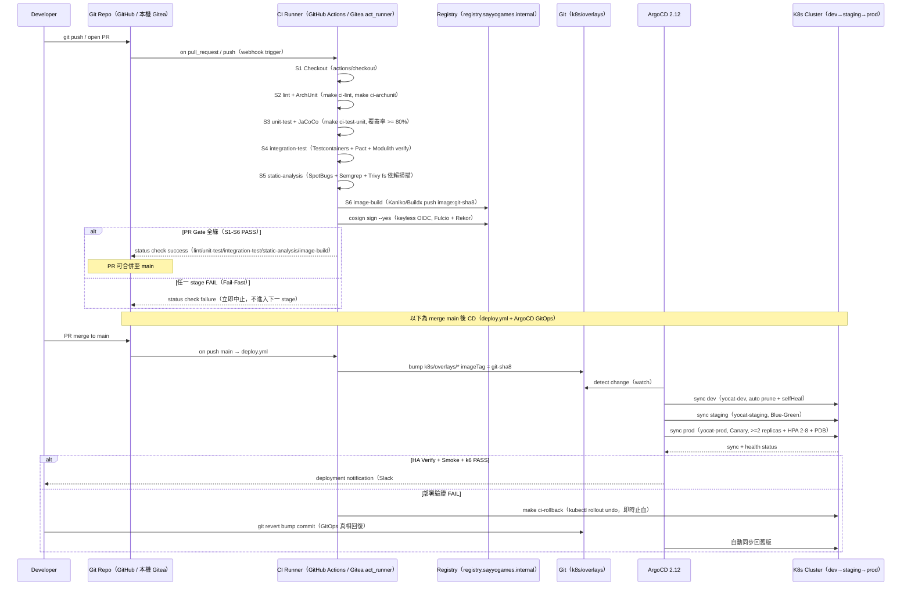

# CI Pipeline Sequence Diagram — yocat-office-backend

> 來源：docs/CICD.md §1.3 Pipeline Stage 總覽 + §2 GitHub Actions ci.yml + §7 ArgoCD GitOps
>
> 技術棧：GitHub Actions（雲端 PR Gate）/ Gitea Actions（本機 act_runner）跑同一份 `.github/workflows`；
> 影像以 Kaniko/Buildx 建置 + cosign 簽章；CD 由 ArgoCD GitOps（watch k8s/overlays）執行。

## 技術說明

此循序圖以服務內部視角描述從 `git push` 到生產環境部署的完整 Pipeline。CI 段（S1-S6）為 PR Gate，在 GitHub-hosted runner 或本機 Gitea `act_runner` 上執行**同一份** `ci.yml`（Local-First）。影像建置一律用 Kaniko（k3s 禁 privileged DinD），並以 cosign keyless 簽章。CD 段採 GitOps：`deploy.yml` 只 bump overlays imageTag，實際 sync 由 ArgoCD watch Git 後執行，三環境以 auto / Blue-Green / Canary 分級晉升。

## 白話說明

工程師送出程式後，機器自動幫忙檢查格式、跑測試、打包並簽章；全部通過才准合併。合併後系統自動把新版本依序推上開發、測試、正式環境，出問題會自動退回舊版。
