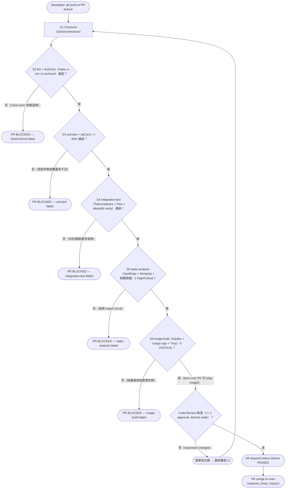

# PR Gate Activity Diagram — yocat-office-backend

> 來源：docs/CICD.md §5.1 PR Gate 清單 + §5.2 Branch Protection（required-status-checks）
>
> Branch Protection contexts（必須與 ci.yml job name 一致）：
> `lint` / `unit-test` / `integration-test` / `static-analysis` / `image-build`，Fail-Fast。

## 技術說明

此活動圖對應 GitHub Branch Protection 的 5 個 required status checks。任一 Gate 失敗即 Fail-Fast 中止（不進入下一 stage），決策點兩個分支皆標注具體失敗條件。`image-build` 允許 docs-only PR 以 `[skip-image]` commit prefix 跳過。合併需 Review 核准且採 linear history。

## 白話說明

PR 要合併前必須依序通過五道自動檢查（格式、單元測試、整合測試、安全掃描、映像建置），任何一道沒過就擋下；全過加上一位同事核准才能併入主幹。
