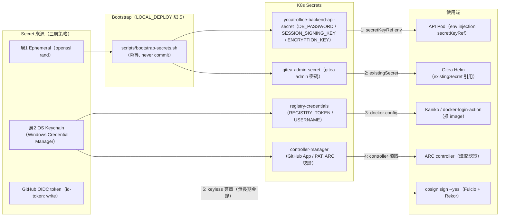

# CI/CD Secret Flow Diagram — yocat-office-backend

> 來源：docs/CICD.md §10.1 Secret Location 表格 + docs/LOCAL_DEPLOY.md §3.5 三層 Secret 策略
>
> 原則：任何 credential 不得明文出現在 workflow / Makefile / K8s manifest。workflow 以 `${{ secrets.NAME }}`、
> Makefile 以 `$(VAR)` 引用。cosign 採 keyless OIDC（無長期金鑰）。

## 技術說明

此流向圖對應 §10.1 Secret Location 表格與 LOCAL_DEPLOY §3.5 三層策略。層 1（Ephemeral）密碼由 `bootstrap-secrets.sh` 以 `openssl rand` 生成，輸出 never commit，寫入 K8s Secret 後以 `secretKeyRef` 注入 Pod env。層 2（固定憑證，如 registry token / GitHub PAT）存 OS Keychain，於 CI 以 `${{ secrets.* }}` 或 K8s Secret 引用。cosign 採 keyless OIDC，不落任何長期金鑰。Phase A 無金流 API key，層 3（Sealed Secrets / Vault）本機不使用。

## 白話說明

密碼分三級管理：可隨時重生的（資料庫密碼等）用腳本當場產生、不進版本庫；固定的（倉庫憑證）放在作業系統金鑰庫；簽章則用臨時憑證。全程沒有任何明文密碼寫進程式或設定檔。
