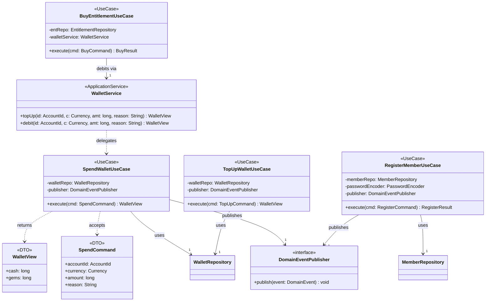

# Class Diagram — Application Layer

> 來源：EDD.md §4.5.2（2）class-application

## 技術說明

Application Layer 以 UseCase（每個對應一條 PRD AC）編排 Domain 物件與 Repository，透過 `<<Port>>`（`DomainEventPublisher`）與外部解耦。`WalletService` 為跨 UseCase 的 ApplicationService，提供 wallet BC 的 Public API 供 entitlement BC 同交易呼叫。所有輸入/輸出以 `<<DTO>>`（`SpendCommand`、`WalletView`）界定，不外洩 Domain 內部型別。

## 白話說明

這層是「做事的流程」：收到儲值、花費、購買、註冊的請求後，照順序呼叫錢包與會員的規則，把結果整理好回傳。
