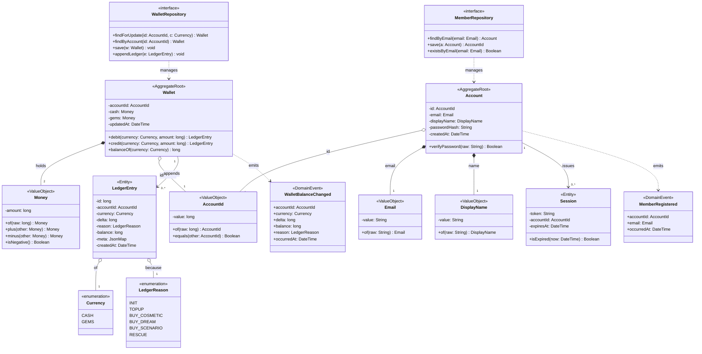

# Class Diagram — Domain Layer（wallet + member 核心）

> 來源：EDD.md §4.5.2（1）class-domain

## 技術說明

Domain Layer 封裝業務不變量與領域邏輯，不依賴任何 Infrastructure 具體類別（DIP）。`Wallet`、`Account` 為 AggregateRoot，負責維護餘額 `>= 0`、email 唯一等 invariant；`WalletRepository`、`MemberRepository` 為抽象介面（`<<Repository>>`），由 Infrastructure 層實作。Enum（`Currency`、`LedgerReason`）與 ValueObject（`Money`、`AccountId`、`Email`、`DisplayName`）皆不可變。`<<DomainEvent>>`（`WalletBalanceChanged`、`MemberRegistered`）對應 EDD §4.6 Domain Events 表。

## 白話說明

這層描述「錢包」與「會員」的核心規則：錢包餘額永遠不能是負的，買東西要先扣錢；每個帳號 email 不能重複。它只管規則，不管資料怎麼存進資料庫。
