# Class Diagram — Infrastructure + Presentation Layer

> 來源：EDD.md §4.5.2（3）class-infra-presentation

```mermaid
classDiagram
    class WalletController {
        <<Controller>>
        -topUp: TopUpWalletUseCase
        -spend: SpendWalletUseCase
        +postTopUp(req: TopUpRequest, me: Principal) TopUpResponse
        +postSpend(req: SpendRequest, me: Principal) WalletResponse
    }
    class AuthController {
        <<Controller>>
        -memberService: MemberService
        +postRegister(req: RegisterRequest) AuthResponse
        +postLogin(req: LoginRequest) AuthResponse
        +postLogout(auth: String) OkResponse
        +getMe(me: Principal) MeResponse
    }
    class JdbcWalletRepository {
        <<RepositoryImpl>>
        -jdbc: NamedParameterJdbcTemplate
        +findForUpdate(id: AccountId, c: Currency) Wallet
        +save(w: Wallet) void
        +appendLedger(e: LedgerEntry) void
    }
    class ModulithEventPublisher {
        <<Adapter>>
        -events: ApplicationEventPublisher
        +publish(event: DomainEvent) void
    }
    class ScryptPasswordEncoder {
        <<Adapter>>
        +encode(raw: String) String
        +matches(raw: String, stored: String) Boolean
    }
    class BearerTokenFilter {
        <<Adapter>>
        -memberService: MemberService
        +doFilter(req: HttpRequest) void
    }
    class TopUpRequest {
        <<RequestDTO>>
        +pack: String
        +currency: String
        +amount: long
    }
    class WalletResponse {
        <<ResponseDTO>>
        +ok: Boolean
        +currency: String
        +balance: long
        +wallet: WalletView
    }

    WalletController --> "1" TopUpWalletUseCase : delegates
    WalletController --> "1" SpendWalletUseCase : delegates
    AuthController --> "1" MemberService : delegates
    WalletRepository <|.. JdbcWalletRepository : implements
    DomainEventPublisher <|.. ModulithEventPublisher : implements
    WalletController ..> TopUpRequest : accepts
    WalletController ..> WalletResponse : returns
    BearerTokenFilter --> "1" MemberService : verifies
```

## 技術說明

Infrastructure 層以 `<<RepositoryImpl>>`（`JdbcWalletRepository`）與 `<<Adapter>>`（`ModulithEventPublisher`、`ScryptPasswordEncoder`、`BearerTokenFilter`）實作 Domain/Application 層聲明的介面，DIP 箭頭方向為 Infrastructure → Domain（`WalletRepository <|.. JdbcWalletRepository`、`DomainEventPublisher <|.. ModulithEventPublisher`，Realization）。Presentation 層以 `<<Controller>>` 暴露 HTTP handler，透過 `<<RequestDTO>>`/`<<ResponseDTO>>` 做 I/O 契約與驗證。

## 白話說明

這層是「對外窗口與真正存取資料的地方」：Controller 接收網路請求，Repository 把錢包資料讀寫進 PostgreSQL，Adapter 負責發事件、算密碼、驗 token。
