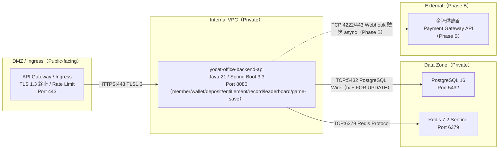

# Component Diagram — yoCat Office 後端元件架構

> 來源：EDD.md §4.5.8

**Inter-Service Communication Contract Table：**

| From | To | Protocol | Version | Port | Timeout | Retry Policy | Auth Method |
|------|-----|---------|---------|------|---------|-------------|------------|
| Ingress | API | HTTP/REST | 1.1 | 8080 | 5s | 0（冪等讀可 1x） | Bearer token（內部 mTLS 選配） |
| API | PostgreSQL | PostgreSQL Wire | 16 | 5432 | 3s（query）/1s（lock） | 0（交易不重試） | user/pass（Secret） |
| API | Redis | Redis | 7.2 | 6379 | 500ms | 1x | AUTH（Secret） |
| API | Payment（Phase B） | HTTPS Webhook | v1 | 443 | 10s | 3x exp backoff | HMAC 驗簽 |

**Resilience Pattern Table：**

| Source → Dest | Timeout | Circuit Breaker | Fallback | Bulkhead | P99 SLA |
|--------------|---------|-----------------|----------|----------|---------|
| API → PostgreSQL | 3s | 不熔斷（關鍵路徑；失敗即 503） | 無（寫入必須強一致） | HikariCP pool: 依 §11.2 | < 1000ms |
| API → Redis | 500ms | fail-after 50%/10s，reset 30s | session 回源 DB、rate-limit fail-open | pool: 16 | < 50ms |
| API → Payment（Phase B） | 10s | fail-after 5 errors / reset 30s | queue 待對帳 | pool: 8 | < 2s |

> 無外部 Message Queue（Outbox 於 DB）；模組間事件透過 Spring Modulith Event Publication Registry（JDBC Outbox，delivery=at-least-once）。
