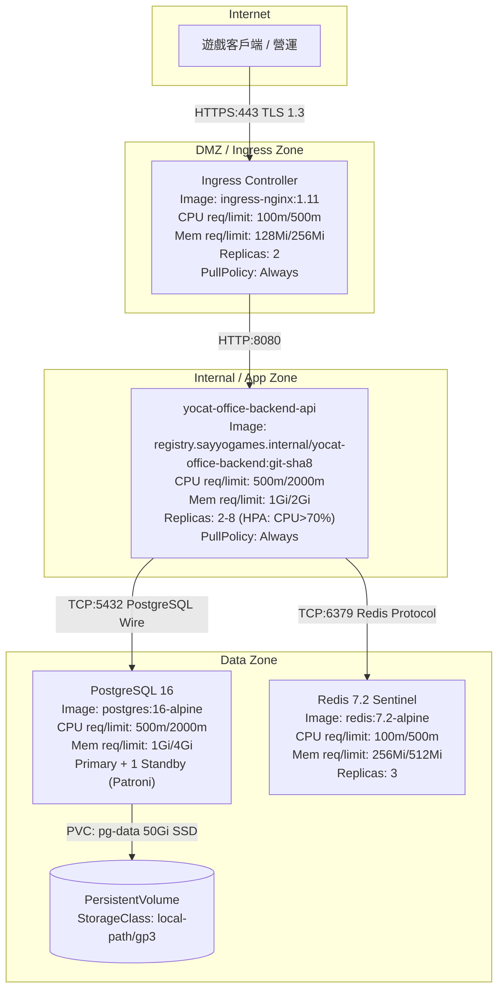

# Deployment Diagram — yoCat Office 後端部署架構

> 來源：EDD.md §4.5.9

**HPA Configuration Table：**

| Service | minReplicas | maxReplicas | Scale-Up Metric | Target | Scale-Down Cooldown |
|---------|------------|------------|----------------|--------|-------------------|
| yocat-office-backend-api | 2 | 8 | CPU Utilization | 70% | 300s |

**Storage Specification Table：**

| Service | PVC Name | Size | StorageClass | IOPS | Backup Frequency | Retention |
|---------|---------|------|------------|------|-----------------|----------|
| PostgreSQL | pg-data | 50Gi | gp3（prod）/ local-path（local，2Gi） | 3000 | hourly 增量 + daily 全量 | 30 days |

**Network Policy Table：**

| Source Zone | Dest Zone | Allowed Ports | Protocol | Notes |
|------------|---------|--------------|---------|-------|
| Internet | DMZ | 443 | HTTPS | 僅 Ingress |
| DMZ | App | 8080 | TCP | Ingress → API |
| App | Data | 5432, 6379 | TCP | API → PG/Redis |
| App | Internet | 443（Phase B 金流）| HTTPS | 預設 DENY，金流白名單例外 |
