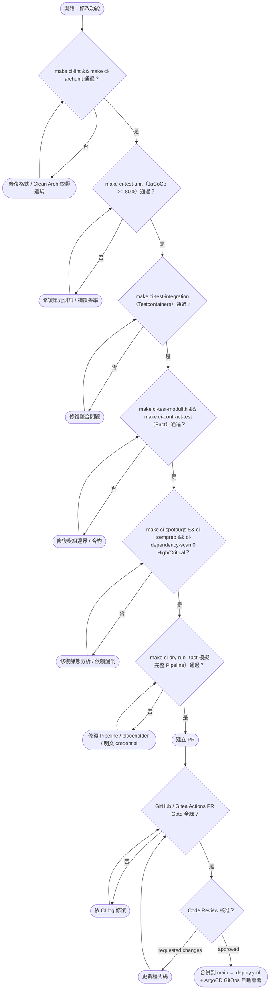

# Developer Daily Workflow Activity Diagram — yocat-office-backend

> 來源：docs/CICD.md §5.3 開發者 Pre-PR Checklist + §4 Shared Make Targets（CI ↔ Local 共用介面）
>
> 本機與 CI 共用同一組 `make ci-*` target，確保本機 dry-run 與雲端 PR Gate 行為一致。

## 技術說明

此活動圖描述開發者完成一個功能從修改到合併的完整內循環。核心是本機先以 `make ci-dry-run`（`act`）跑**與 CI 完全相同**的 workflow，將失敗盡量左移到本機，避免浪費雲端 PR Gate。每個檢查點都有修復回圈，Pre-PR Checklist 的第 7-8 步（無裸 placeholder、無明文 credential）併入 dry-run gate。

## 白話說明

工程師改完程式後，在自己電腦上照同一套檢查一關一關跑過（格式、測試、合約、安全掃描、整條流水線模擬），都通過才開 PR；線上再自動檢查一次加同事核准，合併後系統自動部署。
