# ER Diagram — 資料庫關聯圖

> 來源：SCHEMA.md §12。跨 BC 以 app-layer `account_id` 邏輯參照（無 DB FK，HC-1）；同 BC schema 內以實線 FK。

## 12.1 核心 BC ER 圖（member / wallet / deposit / entitlement / record / leaderboard / game-save）

```mermaid
erDiagram
    accounts ||--o{ sessions : "member 內（app-layer account_id）"
    accounts ||--o{ login_attempts : "member 內"
    accounts ||--o{ account_deletion_requests : "member 內 FK"
    accounts ||--o{ password_history : "member 內 FK"
    wallets ||--o{ wallet_ledger : "wallet 內（account_id）"
    wallets ||--o{ wallet_balance_snapshots : "wallet 內"
    deposit_pack ||--o{ deposit_order : "deposit 內 FK"
    deposit_order ||--o{ deposit_payment_webhook : "deposit 內 FK"
    entitlement_catalog ||--o{ entitlements : "entitlement 內 FK"
    entitlement_catalog ||--o{ entitlement_grant_log : "entitlement 內"
    record_type_catalog ||--o{ records : "record 內 FK"
    leaderboard_mode_catalog ||--o{ leaderboard : "leaderboard 內（軟參照）"

    accounts {
        bigserial id PK
        text email UK "NOT NULL PII"
        text display_name "NOT NULL 1-24"
        text pass_hash "NOT NULL scrypt"
        boolean is_active
        timestamptz deleted_at
    }
    sessions {
        text token PK
        bigint account_id "app-layer"
        timestamptz expires_at "NOT NULL"
    }
    login_attempts {
        bigserial id PK
        inet ip_address "NOT NULL"
        boolean is_success
        timestamptz created_at
    }
    account_deletion_requests {
        bigserial id PK
        bigint account_id FK
        varchar status
        timestamptz requested_at
    }
    password_history {
        bigserial id PK
        bigint account_id FK
        text pass_hash
        timestamptz created_at
    }
    wallets {
        bigint account_id PK "app-layer"
        bigint cash "CHECK>=0"
        bigint gems "CHECK>=0"
        timestamptz updated_at
    }
    wallet_ledger {
        bigserial id PK
        bigint account_id "app-layer"
        varchar currency "cash|gems"
        bigint delta
        varchar reason
        bigint balance "CHECK>=0"
        timestamptz created_at
    }
    wallet_balance_snapshots {
        bigserial id PK
        bigint account_id
        boolean is_consistent
        timestamptz snapshot_at
    }
    deposit_pack {
        varchar pack_id PK
        varchar currency
        bigint amount "CHECK>0"
        integer bonus_pct
    }
    deposit_order {
        text order_id PK
        bigint account_id "app-layer"
        varchar pack_id FK
        varchar status
        text idempotency_key UK
    }
    deposit_payment_webhook {
        bigserial id PK
        text provider_event_id UK
        text order_id FK
        boolean signature_valid
    }
    entitlement_catalog {
        text item_id PK
        varchar kind
        bigint price_amount
    }
    entitlements {
        bigserial id PK
        bigint account_id "app-layer"
        varchar kind
        text item_id FK
        timestamptz deleted_at
    }
    entitlement_grant_log {
        bigserial id PK
        bigint account_id
        bigint charged_amount
        timestamptz granted_at
    }
    record_type_catalog {
        varchar type_code PK
        text label
    }
    records {
        bigserial id PK
        bigint account_id "app-layer"
        varchar type FK
        jsonb payload
        timestamptz created_at
    }
    leaderboard_mode_catalog {
        text mode PK
        text label
    }
    leaderboard {
        text run_id PK
        bigint account_id "app-layer"
        text display_name "冗餘快照"
        text mode
        bigint score
        timestamptz updated_at
    }
    saves {
        bigint account_id PK "app-layer"
        text slot PK "DEFAULT main"
        jsonb data
        timestamptz updated_at
    }
    save_write_log {
        bigserial id PK
        bigint account_id
        text slot
        integer data_bytes
    }
```

> **跨 BC 關聯（虛線語意，無 DB FK）**：`member.accounts.id` 被 `wallets / wallet_ledger / deposit_order / entitlements / records / leaderboard / saves` 以 `account_id`（app-layer ID）邏輯參照——不畫實體 FK 連線（HC-1）。

## 12.2 平台底座 ER 圖（modulith / platform）

```mermaid
erDiagram
    feature_flags ||--o{ feature_flag_audit : "platform 內 FK"
    event_publication {
        uuid id PK
        text listener_id
        text event_type
        timestamptz completion_date "NULL=待投遞"
    }
    event_publication_archive {
        uuid id PK
        timestamptz completion_date
    }
    event_dead_letter {
        bigserial id PK
        uuid event_id
        integer retry_count
    }
    audit_log {
        bigserial id PK
        varchar table_name
        varchar operation
        timestamptz created_at
    }
    data_access_logs {
        uuid id PK
        varchar action
        timestamptz accessed_at
    }
    gdpr_erasure_requests {
        uuid id PK
        bigint account_id
        varchar status
    }
    feature_flags {
        varchar flag_key PK
        boolean is_enabled
        integer rollout_pct
    }
    feature_flag_audit {
        bigserial id PK
        varchar flag_key FK
        boolean new_enabled
    }
    rate_limit_counters {
        bigserial id PK
        varchar action
        varchar identifier
    }
    api_request_log {
        bigserial id PK
        varchar trace_id
        smallint status_code
        integer latency_ms
    }
    schema_migrations {
        varchar version PK
        boolean success
    }
    system_config {
        varchar config_key PK
        text config_value
    }
    error_code_registry {
        varchar error_code PK
        smallint http_status
    }
    slo_measurements {
        bigserial id PK
        varchar metric_name
        numeric metric_value
    }
    health_check_log {
        bigserial id PK
        varchar check_name
        boolean is_healthy
    }
    outbox_relay_offset {
        varchar relay_name PK
        uuid last_event_id
    }
```

