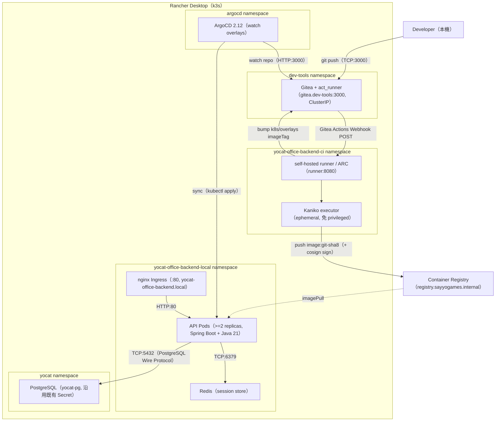

# Local Infrastructure Topology — yocat-office-backend（Rancher Desktop k3s）

> 來源：docs/CICD.md §8.1 Gitea 架構 + §6 ARC Runner + §7 ArgoCD + docs/LOCAL_DEPLOY.md §2 namespace
>
> 本機閉環（Local-First）：Gitea（dev-tools）→ Gitea Actions / ARC runner（ci）→ ArgoCD（argocd）→ App（local）。

## 技術說明

此拓撲圖呈現 Rancher Desktop k3s 上的完整本機 CI/CD 閉環。四個工具 namespace（dev-tools / ci / argocd / app）加資料 namespace（yocat，沿用既有 `yocat-pg`）。本機 Gitea 取代外部 GitHub，Gitea Actions 以 `act_runner` 跑同一份 workflow；影像建置用 Kaniko（k3s 禁 privileged DinD）。CD 由 ArgoCD watch Gitea overlays 後 sync。生產/Staging 環境的 repoURL 改指向 `github.com/sayyogames/yocat-office-backend`。

## 白話說明

整套開發與部署系統都跑在開發者自己電腦的 k3s 上：本機 Git 伺服器、打包機、自動部署器、應用程式各自分區，不需連外部雲端就能完整走一遍上線流程。
