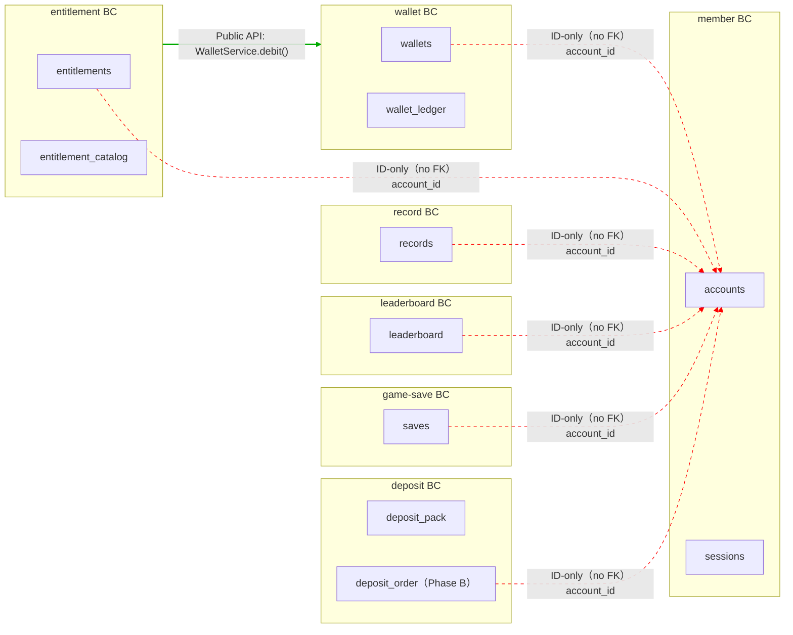

# Spring Modulith — BC 邊界隔離圖

> 來源：SCHEMA.md（各 BC 擁有的 schema/tables）+ ARCH.md §4 服務邊界。
> 每個 BC 獨佔自己的 DB schema（HC-1）；跨 BC 僅以 app-layer `account_id`（ID-only，無 DB FK）邏輯參照（紅色虛線），或透過 Public API（綠色實線）。

> **隔離原則**：禁止跨 BC 直接存取他 BC 的 DB table / JOIN；所有跨 BC 資料存取必須透過 Public `@NamedInterface` 或 Domain Event（HC-1/HC-2）。帳號刪除以 `MemberDeleted` 事件驅動各 BC 匿名化/級聯清理。
