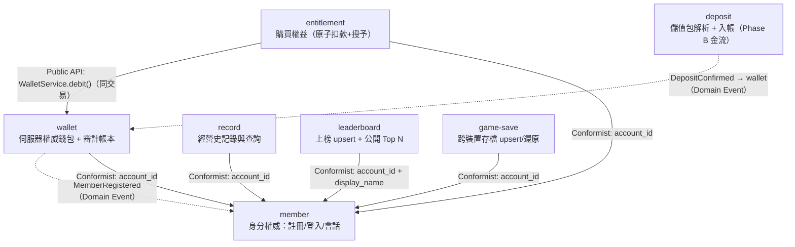

# Spring Modulith — 模組依賴關係圖（DAG）

> 來源：ARCH.md §4 服務邊界表 + 跨 BC 依賴圖 + EDD.md §4.6 Domain Events。
> 圖例：實線 = Public API 同步呼叫；虛線 = Domain Event 非同步投遞。member 為葉節點（被依賴），全圖無循環（HC-5 DAG 約束，CI `ApplicationModules.verify()` 阻斷循環）。

**DAG 驗證：**

| 驗證項目 | 結果 | 說明 |
|---------|------|------|
| 是否存在循環依賴 | NO | 無任何 A→…→A 路徑 |
| 依賴圖為 DAG | CONFIRMED | member 為葉節點，無反向邊 |
| 最長依賴鏈 | 3 層 | entitlement → wallet → member |
