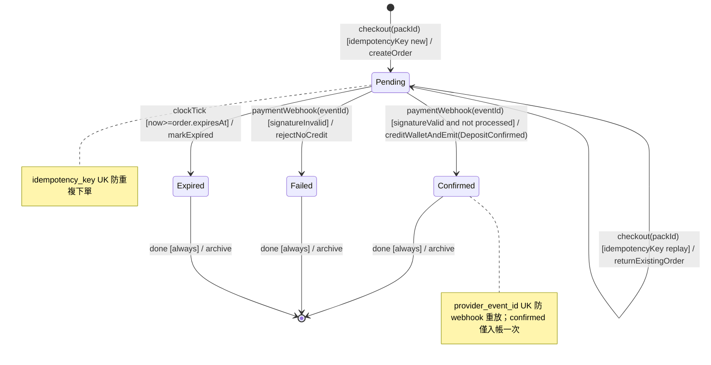

# State Machine Diagram — Deposit Order 生命週期（Phase B 金流）

> 推斷來源：SCHEMA.md `deposit_order.status` + EDD.md §4.6 `DepositConfirmed` 事件

**轉換說明：**

| From | To | Trigger [guard] / action | 備註 |
|------|----|--------------------------|------|
| (init) | Pending | checkout [idempotencyKey new] / createOrder | 建立訂單 |
| Pending | Confirmed | paymentWebhook [signatureValid, not processed] / creditWallet + emit DepositConfirmed | 入帳（orderId dedup） |
| Pending | Failed | paymentWebhook [signatureInvalid] / rejectNoCredit | 驗簽失敗 |
| Pending | Expired | clockTick [timeout] / markExpired | 未付款逾時 |
