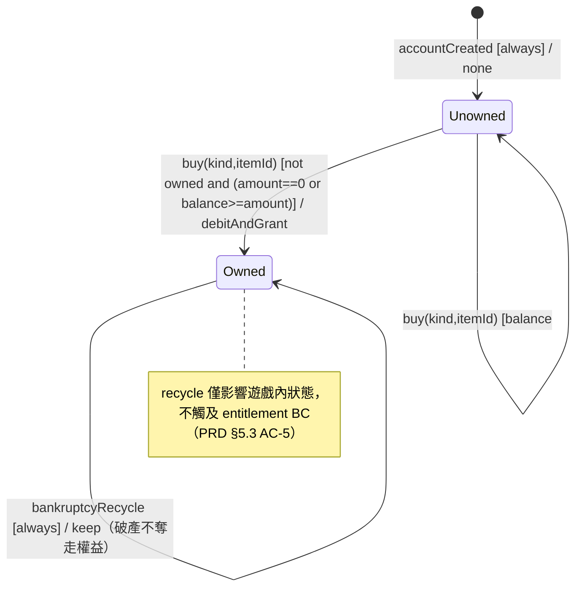

# State Machine Diagram — Entitlement 生命週期

> 來源：EDD.md §4.5.6（3）

**Idempotency Table（Entitlement）：**

| Trigger | From | Idempotent? | 重複觸發行為 |
|---------|------|------------|------------|
| buy(kind,itemId) | Owned | ✅ 是 | 回 409「已經擁有」，不重複扣款/授予 |
