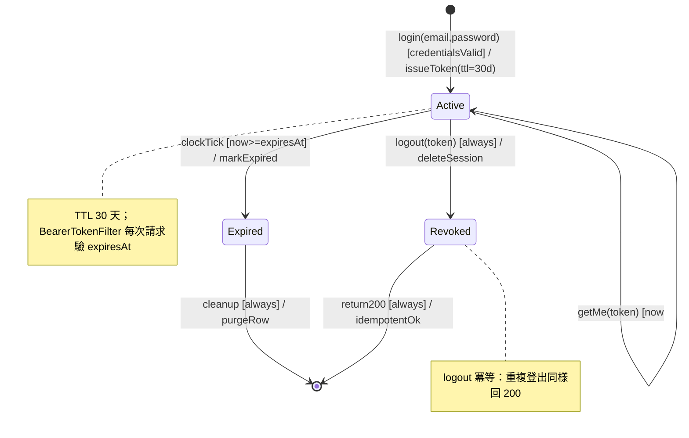

# State Machine Diagram — Member Session 生命週期

> 推斷來源：EDD.md §4.5.2（Session Entity，`isExpired(now)`）+ SCHEMA.md `sessions` + UC2/UC3

**轉換說明：**

| From | To | Trigger [guard] / action | 備註 |
|------|----|--------------------------|------|
| (init) | Active | login [credentialsValid] / issueToken | 簽發 session，TTL 30 天 |
| Active | Expired | clockTick [now>=expiresAt] / markExpired | 過期自動失效，下次請求回 401 |
| Active | Revoked | logout [always] / deleteSession | 主動登出，冪等 |
