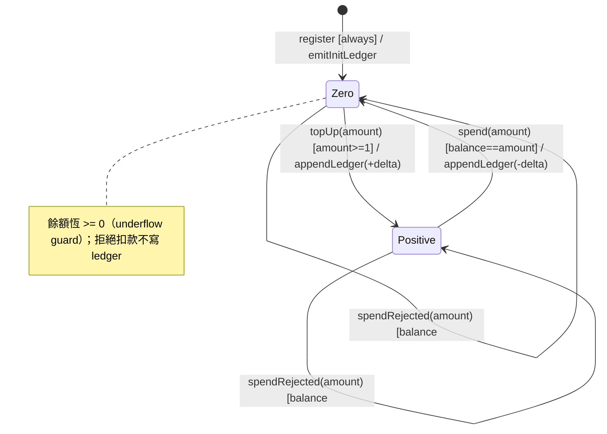

# State Machine Diagram — Wallet 餘額生命週期（每 currency）

> 來源：EDD.md §4.5.6（1）

**Invalid Transition Table（Wallet）：**

| From | To | Behavior | Log |
|------|----|----------|-----|
| Zero/Positive | Negative | 靜默拒絕（擲 InsufficientBalanceException → 402），交易回滾 | WARN |

**Idempotency Table（Wallet）：**

| Trigger | From | Idempotent? | 重複觸發行為 |
|---------|------|------------|------------|
| spend(amount) | Positive | ❌ 非冪等 | 每次都扣（業務預期）；併發以行鎖序列化 |
| topUp(pack) Phase B | any | ✅（冪等鍵 order_id） | 同 order_id 重放只入帳一次（Outbox dedup） |
