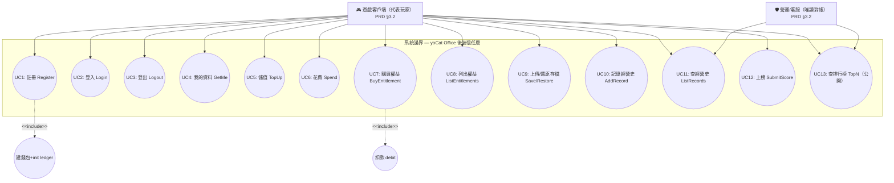

# Use Case Diagram — yoCat Office 後端

> 來源：EDD.md §4.5.1（Actor 來自 PRD §3.2）

## UC → PRD AC Traceability

| UC ID | UC 名稱 | PRD 章節 | PRD AC | Precondition | Postcondition |
|-------|---------|---------|--------|-------------|--------------|
| UC1 | Register | §5.1 | AC-1~3 | email 未註冊 | accounts+wallets+init ledger 建立，回 token |
| UC2 | Login | §5.1 | AC-4,5 | 帳號存在 | 簽發 session（TTL 30 天） |
| UC3 | Logout | §5.1 | — | 持有 token | session 刪除（冪等） |
| UC4 | GetMe | §5.1 | AC-6 | 已登入 | 回 account+wallet+entitlements |
| UC5 | TopUp | §5.2 | AC-1,4 | 已登入 | 餘額增加 + topup ledger |
| UC6 | Spend | §5.2 | AC-2,3,5 | 已登入、餘額足 | 行鎖扣款 + 負 delta ledger |
| UC7 | BuyEntitlement | §5.3 | AC-1~4 | 已登入、未擁有、餘額足 | 扣款 + 授予（原子） |
| UC8 | ListEntitlements | §5.3 | AC-5 | 已登入 | 回權益清單 |
| UC9 | Save/Restore | §5.4 | AC-1~5 | 已登入 | upsert / 回最新存檔 |
| UC10 | AddRecord | §5.3/§4.1 | — | 已登入 | 插入 records |
| UC11 | ListRecords | §4.1 | — | 已登入 | 回 ≤100 筆 |
| UC12 | SubmitScore | §4.1 | — | 已登入 | upsert leaderboard（by run_id） |
| UC13 | TopN | §4.1 | — | 無需登入 | 回 Top N（limit≤100） |

**<<include>> 語意**：UC1 註冊強制包含「建錢包+init ledger」；UC7 購買強制包含「扣款 debit」（amount>0 時）。
