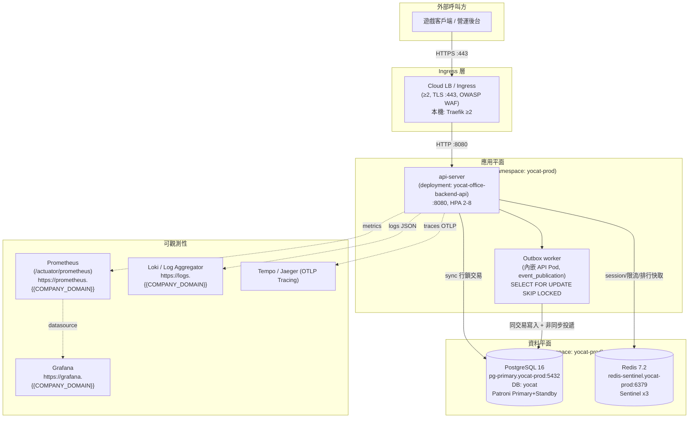
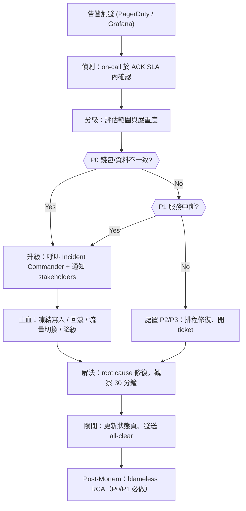
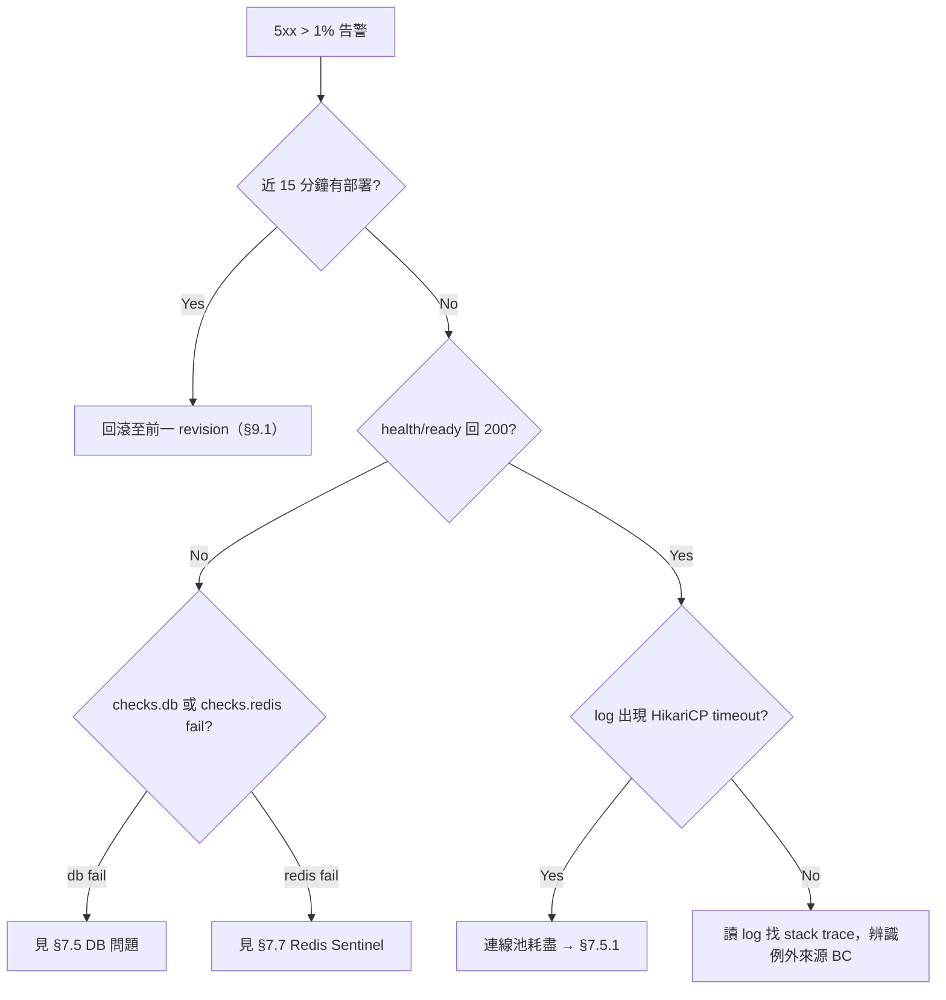
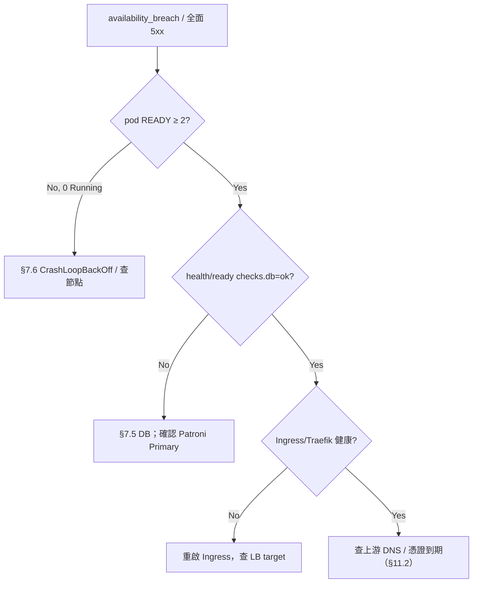
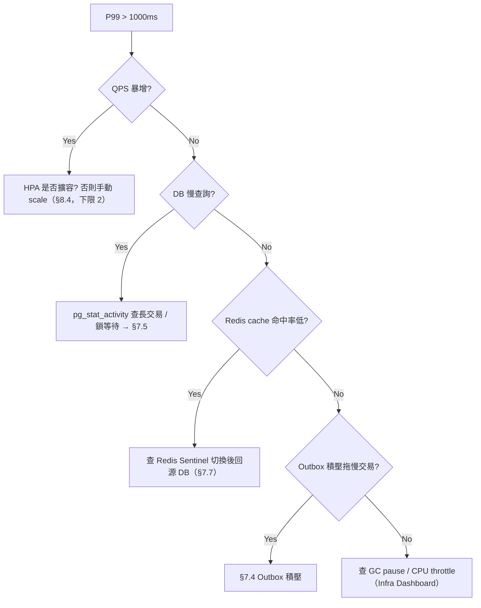
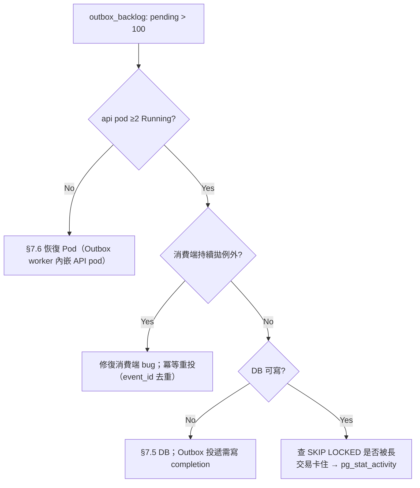
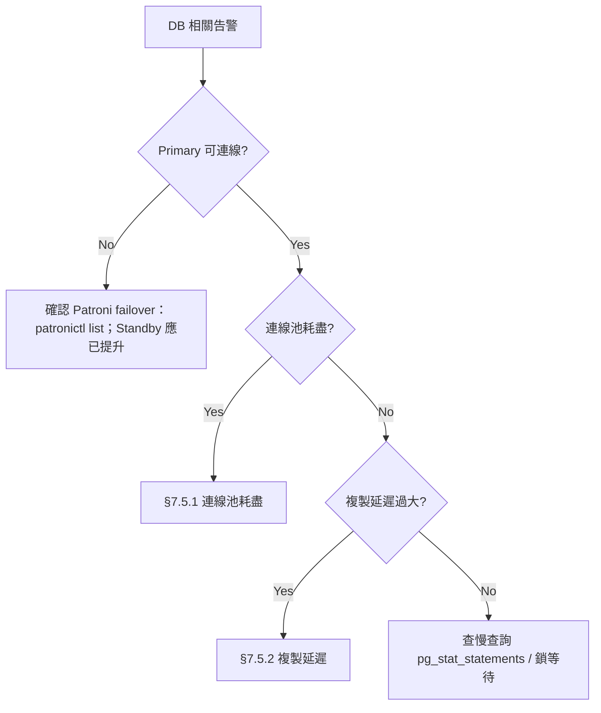
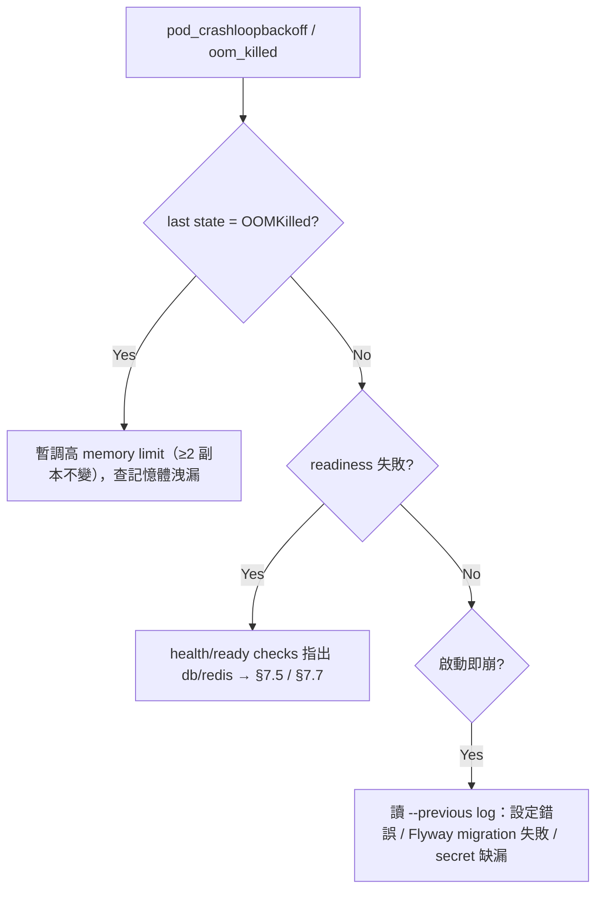
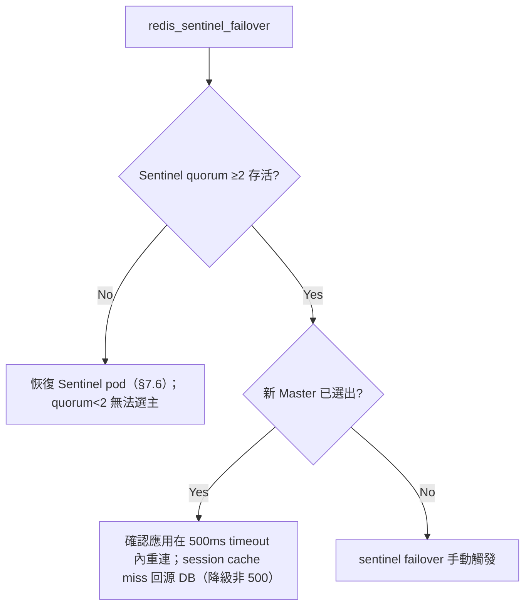
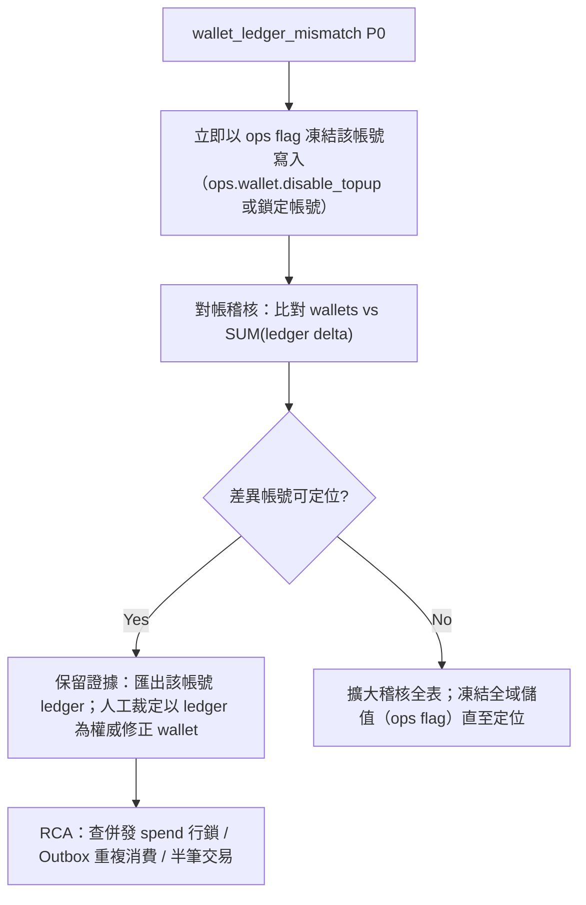

<!--
  DOC-ID:  RUNBOOK-YOCAT-OFFICE-BACKEND-20261030
  Version: v0.1
  Status:  DRAFT
  Owner:   {{RUNBOOK_OWNER}}: 填入主要 on-call 負責人姓名/Email（非團隊別名）
  Date:    2026-10-30
  Last Tested: {{LAST_TESTED_DATE}}: 填入整份 runbook 最近一次端到端演練日期
  Tested By:   {{TESTER_NAME}}: 填入演練執行者
  Review Cycle: Quarterly
  Upstream docs:
    - EDD:        docs/EDD.md（§10 可觀測性、§3.6 HA/BCP、§13 部署與 DR）
    - ARCH:       docs/ARCH.md（§7 高可用、§8 DR、§9 安全）
    - API:        docs/API.md（端點清單、健康檢查）
    - CONSTANTS:  docs/CONSTANTS.md（SSOT：SLO/容量/列舉/錯誤碼）
    - test-plan:  docs/test-plan.md（HA 驗證場景、對帳稽核）
    - postgres.yaml: docs/req/postgres.yaml（本機 PostgreSQL 部署基準）
  Change log:
    v0.1  2026-10-30  gendoc gen runbook  初稿生成
-->

# yoCat Office 後端信任層 — 營運 Runbook（Operations Runbook）

> **本 Runbook 是 yocat-office-backend（yoCat Office 後端信任層）的權威營運參考文件。**
> 任何 on-call 工程師、SRE 或自動化代理，在凌晨 3 點被叫醒、零前情提要的情況下，
> 必須能依本文件獨立診斷並處置所有涵蓋的故障情境，不需詢問任何人。
> 若發現缺口，請立即提交文件缺陷 ticket —— 該缺口即為一個正式的生產風險。

---

## Document Control（文件控制）

| 欄位 | 內容 |
|------|------|
| **DOC-ID** | RUNBOOK-YOCAT-OFFICE-BACKEND-20261030 |
| **專案** | yoCat Office 後端信任層（yocat-office-backend） |
| **版本** | v0.1 |
| **狀態** | DRAFT |
| **技術棧** | Java 21 + Spring Boot 3.3 + Spring Modulith 1.3 + PostgreSQL 16 + Kubernetes 1.30 |
| **架構** | Spring Modulith 單體（7 個有界上下文）+ Clean Architecture 4 層 + Day1 HA（≥2 replicas、HPA、PDB） |
| **Owner** | `{{RUNBOOK_OWNER}}`: 填入主要 on-call 負責人姓名/Email |
| **On-Call 輪值** | `{{ONCALL_ROTATION_LINK}}`（格式範例：`https://{{ORG}}.pagerduty.com/schedules/{{SCHEDULE_ID}}`） |
| **最近更新** | 2026-10-30 |
| **最近演練** | `{{LAST_TESTED_DATE}}`: 填入最近一次端到端演練日期 |
| **演練執行者** | `{{TESTER_NAME}}`: 填入演練執行者 |
| **上游真相來源** | CONSTANTS（SSOT）、EDD §10/§3.6/§13、ARCH §7/§8/§9、API、test-plan |

---

## Table of Contents（目錄）

1. [系統總覽 System Overview](#1-系統總覽-system-overview)
2. [架構 Architecture](#2-架構-architecture)
3. [SLI/SLO/SLA 定義](#3-slislosla-定義)
4. [部署程序 Deployment Procedures](#4-部署程序-deployment-procedures)
5. [監控與告警 Monitoring and Alerting](#5-監控與告警-monitoring-and-alerting)
6. [事故處理 Incident Response](#6-事故處理-incident-response)
7. [故障排除 Troubleshooting](#7-故障排除-troubleshooting)
8. [例行維護 Routine Maintenance](#8-例行維護-routine-maintenance)
9. [回滾程序 Rollback Procedures](#9-回滾程序-rollback-procedures)
10. [備份與還原 Backup and Restore](#10-備份與還原-backup-and-restore)
11. [安全程序 Security Procedures](#11-安全程序-security-procedures)
12. [聯絡與升級 Contacts and Escalation](#12-聯絡與升級-contacts-and-escalation)
13. [變更紀錄 Change Log](#13-變更紀錄-change-log)
14. [On-Call 交接 On-Call Handoff](#14-on-call-交接-on-call-handoff)
15. [Runbook 驗證程序 Runbook Validation Procedure](#15-runbook-驗證程序-runbook-validation-procedure)

---

## 1. 系統總覽 System Overview

yoCat Office 後端信任層（yocat-office-backend）是 yoCat Office 辦公室經營模擬遊戲的**伺服器權威信任層**：負責玩家身分（註冊/登入/session）、伺服器權威錢包（資本 cash / 寶石 gems，append-only 帳本）、儲值金流接口、已購權益、經營史記錄、全域排行榜，以及跨裝置辦公室存檔。遊戲模擬與 LLM 算力留在玩家本機（算力留本地），**僅信任層上雲端**，因此後端只持有與驗證「可被金錢或排名影響」的權威資料，不持有遊戲數值本身。

**誰依賴它（上下游）：**

| 系統 | 依賴類型 | 系統下線時的衝擊（Blast Radius） |
|------|---------|------------------------------|
| 遊戲前端客戶端（HTML5 Canvas 遊戲，代表玩家發請求） | 同步 HTTP（Bearer session token） | 無法登入/儲值/購買/存檔/上榜；玩家可離線遊玩但付費與跨裝置同步中斷 |
| 營運／客服後台（唯讀對帳與風控） | 同步 HTTP（唯讀查詢） | 無法對帳與查 PII；風控稽核暫停 |
| 遊戲客戶端本地算力 BC（玩家端模擬） | 單向：僅透過 `wallet_ledger.reason`（如 `rescue`）感知結果 | 不直接呼叫後端；後端下線不影響本機單機遊玩 |

**操作限制（Operational Constraints）：**

- 峰值流量窗口：啟動期 500 PCU（對應 5,000 DAU），成長期目標 3,000 PCU（50,000 DAU）；信任層請求頻率低（登入/儲值/存檔/上榜為主，非每幀），峰值 QPS ~35（CONSTANTS §8、EDD §11.1）。
- 維護窗口：採零停機滾動更新與 Canary（EDD §13.2），**無強制停機維護窗口**；破壞性 DB 變更採 expand-contract，禁止 drop-before-migrate。
- 資料分類：台灣用戶 PII（email、display_name）受個資法規範；`wallet_ledger` 為 append-only 審計帳本（永久保留，帳號刪除時 CASCADE 匿名化）；Audit Log 保留 7 年（WORM）。
- 絕對紅線：**錢包對帳一致性 = 0 筆不一致**（ledger 與 wallet 餘額 100% 相符）；任一筆不一致即 P0 事故（CONSTANTS §4、EDD §10.5）。

### 1.1 技術棧摘要（Tech Stack Summary）

| 層次 | 技術 | 版本 | 備註（來源 EDD §3.3 / §11） |
|------|------|------|------|
| 後端語言 | Java（Eclipse Temurin JVM） | 21 (LTS) | Virtual Threads 提升 I/O 併發 |
| Web/API 框架 | Spring Boot | 3.3.x | 與 Modulith 原生整合 |
| 模組化框架 | Spring Modulith | 1.3.x | `@ApplicationModule` 邊界、Event Publication Registry（Outbox） |
| 資料存取 | Spring Data JDBC | 3.3.x | 原生 `SELECT ... FOR UPDATE` 行鎖 |
| 主資料庫 | PostgreSQL | 16 | JSONB、行鎖、Patroni HA |
| 快取 | Redis | 7.2 | session/限流/排行榜快取；Sentinel HA |
| 容器編排 | Kubernetes | 1.30 | Day1 HA；Local=Rancher Desktop（context `rancher-desktop`） |
| CI/CD | ArgoCD GitOps + GitHub Actions | — | Canary（prod）、image tag `git-sha8` |

### 1.2 部署環境（Deployment Environment）

| 欄位 | Production | Local（Rancher Desktop） |
|------|-----------|--------------------------|
| **K8s Namespace** | `yocat-prod` | `yocat-office-backend-local` |
| **kubectl Context** | `prod-k8s` | `rancher-desktop` |
| **API Deployment** | `yocat-office-backend-api` | `yocat-office-backend-api` |
| **API 副本數** | 2–8（HPA min–max） | 2（HA 測試最低） |
| **DB Host** | `pg-primary.yocat-prod`（Patroni VIP） | `postgres.yocat-office-backend-local.svc.cluster.local`（本機 NodePort 30432，見 postgres.yaml） |
| **Redis Host** | `redis-sentinel.yocat-prod`（3 nodes） | `redis.yocat-office-backend-local.svc` |
| **Container Registry** | `registry.sayyogames.internal/yocat-office-backend` | 本機映像 |
| **Secret 路徑前綴** | `secret:yocat-office-backend/`（Sealed Secrets / Vault） | `k8s/overlays/local/secrets.env`（不提交） |
| **一鍵部署** | ArgoCD（Canary via GitOps） | `kubectl apply -k k8s/overlays/local/` |

> 切換到 Production context：`kubectl config use-context prod-k8s`；本機：`kubectl config use-context rancher-desktop`。

### 1.3 子系統邊界參考（7 Bounded Contexts）

| Bounded Context | K8s Deployment | 擁有 DB Schema（表） | Public API Prefix | Domain Event |
|----------------|---------------|---------------------|-------------------|--------------|
| `member` | `yocat-office-backend-api` | `member`: `accounts`, `sessions` | `/auth/` | `member.MemberRegistered` / `MemberDeleted` |
| `wallet` | `yocat-office-backend-api` | `wallet`: `wallets`, `wallet_ledger` | `/wallet/` | `wallet.*` |
| `deposit` | `yocat-office-backend-api` | `deposit`: `deposit_pack`, `deposit_order`(Phase B) | `/deposit/`、`POST /wallet/topup` | `deposit.*` |
| `entitlement` | `yocat-office-backend-api` | `entitlement`: `entitlements` | `/entitlements` | `entitlement.*` |
| `record` | `yocat-office-backend-api` | `record`: `records` | `/records` | `record.*` |
| `leaderboard` | `yocat-office-backend-api` | `leaderboard`: `leaderboard` | `/leaderboard` | `leaderboard.*` |
| `game-save` | `yocat-office-backend-api` | `game_save`: `saves` | `/save` | `game_save.*` |
| 平台底座（非 BC，橫切） | `yocat-office-backend-api` | —（承載 7 BC + Outbox `event_publication`） | `/health/`、`/actuator/*` | — |

> 7 個 BC 於 Day1 合部署為單一 Spring Modulith Deployment（`yocat-office-backend-api`），跨 BC 僅走 Public API 或 Domain Event（Transactional Outbox），無跨 BC DB FK。跨 BC 呼叫失敗時，先確認 `yocat-office-backend-api` Pod 健康（§7.1）。

---

## 2. 架構 Architecture

### 2.1 Runtime Topology（執行期拓撲）



### 2.2 Component Inventory（元件清單）

| 元件 | K8s Namespace | K8s Deployment | Port | 健康檢查 | 狀態查詢指令 |
|------|---------------|----------------|------|---------|-------------|
| api-server（含內嵌 Outbox worker） | `yocat-prod` | `yocat-office-backend-api` | `8080` | `GET /health/ready`（含 DB/Redis 檢查） | `kubectl get pods -n yocat-prod -l app=yocat-office-backend-api` |
| PostgreSQL（Patroni Primary+Standby） | `yocat-prod` | `yocat-pg`（StatefulSet） | `5432` | `pg_isready -h pg-primary.yocat-prod -p 5432 -U yocat` | `kubectl get pods -n yocat-prod -l app=yocat-pg` |
| Redis Sentinel（×3） | `yocat-prod` | `redis-sentinel` | `6379` | `redis-cli -h redis-sentinel.yocat-prod ping` | `kubectl get pods -n yocat-prod -l app=redis-sentinel` |
| Ingress / Traefik | `yocat-prod` | `traefik` | `443` | `curl -sf https://api.yocat.sayyogames.com/health/live` | `kubectl get pods -n yocat-prod -l app=traefik` |

> **本機（local-first）對照**：namespace 改為 `yocat-office-backend-local`，context `rancher-desktop`；本機 PostgreSQL 為單節點 StatefulSet（label `app=yocat-pg`，NodePort 30432，見 docs/req/postgres.yaml），Redis 單節點；API 仍維持 ≥2 replicas（HA 測試最低）。

### 2.3 Network and Port Reference（網路與連接埠）

| 服務 | 協議 | Port | 可存取來源 | 備註 |
|------|------|------|-----------|------|
| api-server（對外） | HTTPS | 443 | Internet via LB | TLS 於 LB 終止 |
| api-server（內部） | HTTP | 8080 | `yocat-prod` namespace | Pod-to-Pod；`/actuator/prometheus` 僅 monitoring namespace |
| PostgreSQL | TCP | 5432 | App namespace only（Data Subnet 10.0.3.0/24） | 不對外暴露 |
| Redis | TCP | 6379 | App namespace only | 不對外暴露 |
| Prometheus | HTTP | 9090 | Ops VPN only | `https://prometheus.{{COMPANY_DOMAIN}}` |
| Grafana | HTTPS | 443 | Ops VPN only | `https://grafana.{{COMPANY_DOMAIN}}` |

---

## 3. SLI/SLO/SLA 定義

> 所有 SLO 數字皆來自 **EDD §10.5 / CONSTANTS §4（SSOT）**，不得使用樣板預設值。

### 3.1 Service Level Indicators（SLI）

| SLI | 量測內容 | 量測方式（PromQL） | 窗口 |
|-----|---------|-------------------|------|
| **Availability** | 2xx/3xx 佔比（排除 /health 探針） | `sum(rate(http_server_requests_seconds_count{status=~"2..|3..",uri!~"/health.*"}[5m])) / sum(rate(http_server_requests_seconds_count{uri!~"/health.*"}[5m]))` | 5 分鐘滾動 |
| **Latency P99** | 99 百分位回應時間 | `histogram_quantile(0.99, sum(rate(http_server_requests_seconds_bucket{uri!~"/health.*"}[5m])) by (le))` | 5 分鐘滾動 |
| **Error Rate（5xx）** | 5xx 佔比 | `sum(rate(http_server_requests_seconds_count{status=~"5..",uri!~"/health.*"}[5m])) / sum(rate(http_server_requests_seconds_count{uri!~"/health.*"}[5m]))` | 5 分鐘滾動 |
| **排行榜 Top N P99** | `/leaderboard` 查詢 P99 | `histogram_quantile(0.99, sum(rate(http_server_requests_seconds_bucket{uri="/leaderboard"}[5m])) by (le))` | 5 分鐘滾動 |
| **錢包對帳不一致** | `wallet` 餘額與 ledger 累計差異 | `wallet_ledger_mismatch_total`（應恆為 0） | 持續 |
| **Outbox pending** | 未投遞事件數 | `outbox_pending_count` | 1 分鐘滾動 |

### 3.2 Service Level Objectives（SLO）

| SLI | SLO 目標 | 窗口 | Error Budget（30 天） | 告警閾值（消耗 50% budget） |
|-----|---------|------|----------------------|---------------------------|
| Availability | ≥ 99.9% | 30 天滾動 | **43.2 分鐘**/30 天 downtime（(1−0.999)×30×24×60 = 43.2） | < 99.95% |
| Latency P99 | ≤ 1000ms @500 PCU（成長期 3,000 PCU ≤ 1500ms） | 7 天 | 1% 請求允許超標 | > 800ms |
| Error Rate（5xx） | ≤ 1% | 1 小時 | 1% 請求預算 | > 0.5% |
| 排行榜 Top N P99 | ≤ 300ms（limit ≤ 100） | 7 天 | — | > 250ms |
| 寫入 TPS | ≥ 200 txn/s（wallet/entitlement） | 壓測 | — | < 200 |
| **錢包對帳一致** | **0 筆不一致** | 持續 | **0（零容忍）** | **> 0 即 P0** |

**Error Budget 政策（EDD §10.5）：**

- 消耗 0–50%：正常開發，允許新功能部署。
- 消耗 50–75%：限制高風險變更，SRE 審查後方可部署。
- 消耗 75–100%：僅允許 hotfix。
- 消耗 > 100%：凍結所有非 SLO 相關部署，宣告事故並 executive escalation。

**SLO Burn Rate 多窗口告警（Google SRE Workbook 標準；Availability error budget = 1 − 0.999 = 0.001）：**

```yaml
# Critical（P1）：以 14.4x 速率燃燒 error budget，約 2 天內耗盡；multi-window 1h + 5m
- alert: yocat-office-backend_slo_burn_rate_critical
  expr: |
    (
      sum(rate(http_server_requests_seconds_count{status=~"5..",uri!~"/health.*"}[5m]))
      / sum(rate(http_server_requests_seconds_count{uri!~"/health.*"}[5m]))
    ) > 0.0144
    and
    (
      sum(rate(http_server_requests_seconds_count{status=~"5..",uri!~"/health.*"}[1h]))
      / sum(rate(http_server_requests_seconds_count{uri!~"/health.*"}[1h]))
    ) > 0.0144
  for: 2m
  labels: { severity: critical }
  annotations:
    summary: "SLO critical burn rate — error budget 約 2 天內耗盡"

# Warning（P2）：以 6x 速率燃燒；multi-window 6h + 30m
- alert: yocat-office-backend_slo_burn_rate_warning
  expr: |
    (
      sum(rate(http_server_requests_seconds_count{status=~"5..",uri!~"/health.*"}[30m]))
      / sum(rate(http_server_requests_seconds_count{uri!~"/health.*"}[30m]))
    ) > 0.006
    and
    (
      sum(rate(http_server_requests_seconds_count{status=~"5..",uri!~"/health.*"}[6h]))
      / sum(rate(http_server_requests_seconds_count{uri!~"/health.*"}[6h]))
    ) > 0.006
  for: 15m
  labels: { severity: warning }
  annotations:
    summary: "SLO warning burn rate — error budget 約 5 天內耗盡"
```

### 3.3 Customer SLA（對客戶承諾）

| 承諾 | 目標 | 量測週期 | 違約後果 |
|------|------|---------|---------|
| 可用性 | 99.9%（Production） | 月曆月 | 服務信用（見客戶合約 `{{CONTRACT_URL}}`） |
| 首次回應（P0 錢包/資料不一致） | < 15 分鐘 | 每事故 | 依事故處理 SLA（§6.2、EDD §13.7） |
| 首次回應（P1 服務中斷） | < 30 分鐘 | 每事故 | 依事故處理 SLA（§6.2、EDD §13.7） |

> P0/P1 首次回應 SLA 來源：EDD §13.7 Runbook Framework（P0 15 分鐘 / P1 30 分鐘）；PRD §9.2。

---

## 4. 部署程序 Deployment Procedures

> **Iron Constraint — Replicas ≥ 2**：本章所有 `kubectl scale` / `replicas:` 數值不得低於 2（EDD §3.6 強制）。

### 4.1 部署前檢查清單（Pre-Deployment Checklist）

- [ ] Error budget 剩餘 ≥ 20%（檢查 `https://grafana.{{COMPANY_DOMAIN}}/d/{{SLO_DASHBOARD_ID}}/slo`）。
- [ ] 無進行中 P0/P1 事故（檢查 `{{INCIDENT_TRACKER_URL}}`）。
- [ ] Release 分支已通過全部 CI 檢查：`gh run list --branch main --limit 5`（Expected: 最新一筆 conclusion=success）。
- [ ] 待部署映像已在 staging 驗證：`curl -sf https://api-staging.yocat.sayyogames.com/health/ready`（Expected: `{"status":"ok"}`）。
- [ ] 回滾計畫已確認（見 §9）。
- [ ] 已於 `#deploy-yocat-office-backend` 公告：`[DEPLOY] yocat-office-backend vX.Y.Z — starting。Rollback owner: @{{ROLLBACK_CONTACT}}`。

### 4.2 標準部署（Rolling / Canary via ArgoCD）

**Step 0：確認 Kubernetes context**

```bash
kubectl config current-context
# Expected: prod-k8s
# If this fails（非 prod-k8s）：立即停止，執行 kubectl config use-context prod-k8s 後重新確認；絕不在錯誤 context 下操作。
```

**Step 1：打版本 tag 觸發 Pipeline**

```bash
git checkout main && git pull origin main
git tag v{{NEXT_VERSION}}        # 範例：v1.2.0
git push origin v{{NEXT_VERSION}}
# Expected: GitHub Actions deploy workflow 於 30 秒內觸發（gh run list --workflow=deploy.yml --limit 1 顯示 in_progress）
# If this fails：檢查 gh run list --workflow=deploy.yml --limit 5 的錯誤，CI 未綠不得繼續。
```

**Step 2：監控 Pipeline（lint → test → SAST → build → deploy → k6）**

```bash
gh run watch --repo {{GH_OWNER}}/{{GH_REPO}}
# Expected: 所有階段綠勾（涵蓋 ArchUnit/Modulith verify、coverage ≥80%、SAST 無 CRITICAL、k6 P99<1000ms err<0.1%）
# If this fails：記下失敗階段，開啟 pipeline URL 讀 log；部署階段失敗見 §7.6。
```

**Step 3：驗證滾動更新進度（狀態變更後驗證）**

```bash
kubectl rollout status deployment/yocat-office-backend-api -n yocat-prod --timeout=300s
# Expected: "deployment \"yocat-office-backend-api\" successfully rolled out"
# If this fails：執行 kubectl describe deployment yocat-office-backend-api -n yocat-prod，查 Warning events（ImagePullBackOff / OOMKilled / readiness 失敗）；見 §7.6。必要時回滾（§9）。
```

**Step 4：驗證應用健康（部署後必驗）**

```bash
curl -sf https://api.yocat.sayyogames.com/health/ready | jq .
# Expected: {"status":"ok","checks":{"db":"ok","redis":"ok"}}
# If this fails：readiness 探針失敗，執行 kubectl logs <pod> -n yocat-prod --previous 讀崩潰 log；若使用者受影響且降級，立即回滾（§9）。

kubectl get pods -n yocat-prod -l app=yocat-office-backend-api
# Expected: 全部 pod STATUS=Running、READY=1/1，數量 ≥ 2
# If this fails：見 §7.6 Pod CrashLoopBackOff。
```

**Step 5：Smoke test（關鍵路徑）**

```bash
./scripts/smoke-test.sh --env production
# 涵蓋：register → login → topup → spend → buy → save → leaderboard（EDD §10.7 合成腳本路徑）
# Expected: exit 0（全部斷言通過）
# If this fails（exit 2 關鍵流程失敗）：立即回滾（§9）。exit 1（非關鍵）：開事故並持續觀察。
```

**Step 6：部署後確認與對帳快檢**

```bash
curl -sf https://api.yocat.sayyogames.com/health/live | jq '.version'   # Expected: "{{NEXT_VERSION}}"
# 錢包對帳不一致必須恆為 0（部署不得引入半筆異動）
kubectl exec -n yocat-prod deploy/yocat-office-backend-api -- \
  curl -s localhost:8080/actuator/prometheus | grep '^wallet_ledger_mismatch_total'
# Expected: wallet_ledger_mismatch_total 0.0
# If this fails（> 0）：立即宣告 P0，見 §7.8 錢包餘額異常對帳，並評估回滾（§9）。
```

公告：`[DEPLOY] yocat-office-backend v{{NEXT_VERSION}} — deployed and verified ✓`。

### 4.3 緊急 Hotfix 部署

**前置**：P1 事故已開、Incident Commander 已授權、修復在 `hotfix/{{TICKET_ID}}-desc` 分支。

```bash
kubectl config current-context                 # Expected: prod-k8s（否則先切換）
git checkout main && git pull origin main
git merge --no-ff hotfix/{{TICKET_ID}}-desc
git tag v{{HOTFIX_VERSION}}                     # patch+1，如 v1.2.0 → v1.2.1
git push origin main v{{HOTFIX_VERSION}}
gh run watch --repo {{GH_OWNER}}/{{GH_REPO}}     # Expected: 全綠；If fails：讀失敗階段 log，CI 未綠不續
kubectl rollout status deployment/yocat-office-backend-api -n yocat-prod --timeout=300s
# Expected: "successfully rolled out"；If fails：kubectl describe ... 查 Warning，見 §7.6
curl -sf https://api.yocat.sayyogames.com/health/ready | jq .   # Expected: {"status":"ok",...}；If fails：回滾 §9
./scripts/smoke-test.sh --env production         # Expected: exit 0；exit 2：立即回滾 §9
```

### 4.4 本機一鍵部署（Local-First，Rancher Desktop）

```bash
kubectl config use-context rancher-desktop       # Expected: context 切至 rancher-desktop
kubectl apply -k k8s/overlays/local/             # Expected: deployment/service/secret 均 created/configured
kubectl rollout status deployment/yocat-office-backend-api -n yocat-office-backend-local --timeout=180s
# Expected: "successfully rolled out"
kubectl get pods -l app=yocat-office-backend-api -n yocat-office-backend-local | grep -c "Running"
# Expected: ≥ 2（HA 下限，EDD §3.7.2）
# If this fails：kubectl describe pod <name> -n yocat-office-backend-local 查事件；本機常見為映像未 build 或 secrets.env 缺漏。
curl -sf http://localhost:8080/health/ready | jq .   # Expected: {"status":"ok","checks":{"db":"ok","redis":"ok"}}
```

---

## 5. 監控與告警 Monitoring and Alerting

### 5.1 Dashboards

| Dashboard | URL | 何時開啟 |
|-----------|-----|---------|
| Service Health Overview | `https://grafana.{{COMPANY_DOMAIN}}/d/{{OVERVIEW_DASHBOARD_ID}}/overview` | 任何事故第一個開的畫面 |
| SLO / Error Budget | `https://grafana.{{COMPANY_DOMAIN}}/d/{{SLO_DASHBOARD_ID}}/slo` | 檢查 error budget 燃燒率 |
| Latency / Throughput | `https://grafana.{{COMPANY_DOMAIN}}/d/{{LATENCY_DASHBOARD_ID}}/latency` | 延遲/吞吐異常 |
| Database（HikariCP / 複製延遲） | `https://grafana.{{COMPANY_DOMAIN}}/d/{{DB_DASHBOARD_ID}}/db` | 慢查詢、連線池耗盡、Patroni failover |
| Wallet 對帳 / Outbox | `https://grafana.{{COMPANY_DOMAIN}}/d/{{WALLET_DASHBOARD_ID}}/wallet` | 對帳不一致、Outbox 積壓 |
| Infrastructure | `https://grafana.{{COMPANY_DOMAIN}}/d/{{INFRA_DASHBOARD_ID}}/infra` | CPU/記憶體/磁碟/節點壓力 |

### 5.2 Alert Reference（告警對照表）

| Alert 名稱（完整） | 嚴重度 | 白話意義 | Triage Dashboard | 首次處置 | Runbook 章節 |
|-------------------|--------|---------|------------------|---------|-------------|
| `yocat-office-backend_wallet_ledger_mismatch` | P0 | `wallet_ledger_mismatch_total > 0`，錢包餘額與帳本不一致 | Wallet Dashboard | 立即凍結該帳號寫入；啟動對帳稽核 | [§7.8](#78-錢包餘額異常對帳) |
| `yocat-office-backend_high_error_rate` | P1 | 5xx > 1% 持續 5 分鐘 | Latency Dashboard | 查 api-server log，辨識 5xx 類型 | [§7.1](#71-api-server-5xx-錯誤) |
| `yocat-office-backend_availability_breach` | P1 | Availability SLO 跌破 | SLO Dashboard | 確認範圍、查 pod 健康、呼叫 on-call lead | [§7.2](#72-服務完全不可用) |
| `yocat-office-backend_p99_latency_high` | P2 | P99 > 1000ms 持續 5 分鐘 | Latency Dashboard | 查 DB 慢查詢與 cache 命中率 | [§7.3](#73-high-latency-高延遲) |
| `yocat-office-backend_db_connection_pool_exhausted` | P1 | HikariCP 連線池 100% 持續 1 分鐘 | Database Dashboard | 查連線洩漏；滾動重啟 api-server | [§7.5](#75-database-issues-資料庫問題) |
| `yocat-office-backend_db_failover` | P1 | Patroni Primary failover 觸發 | Database Dashboard | 確認 Standby 已提升、應用重連 | [§7.5](#75-database-issues-資料庫問題) |
| `yocat-office-backend_redis_sentinel_failover` | P2 | Redis Sentinel 選新 Master | Infra Dashboard | 確認選主完成、cache miss 降級正常 | [§7.7](#77-redis-sentinel-故障切換) |
| `yocat-office-backend_pod_crashloopbackoff` | P1 | 一個以上 pod CrashLoopBackOff | Infra Dashboard | 讀崩潰 log，辨識 OOM/設定/啟動失敗 | [§7.6](#76-pod-crashloopbackoff) |
| `yocat-office-backend_oom_killed` | P2 | 容器 OOMKilled（`kube_pod_container_status_last_terminated_reason{reason="OOMKilled"} > 0`） | Infra Dashboard | 暫調高記憶體 limit；查記憶體洩漏 | [§7.6](#76-pod-crashloopbackoff) |
| `yocat-office-backend_outbox_backlog` | P2 | Outbox pending > 100 持續 5 分鐘 | Wallet Dashboard | 查 Outbox worker 投遞與消費端錯誤 | [§7.4](#74-outbox-事件積壓) |
| `yocat-office-backend_disk_pressure` | P2 | 節點磁碟使用 > 85% | Infra Dashboard | 辨識最大消耗者；清理或擴容 | [§7.9](#79-disk-pressure-磁碟壓力) |
| `yocat-office-backend_backup_not_completed` | P2 | 排程備份未於窗口內完成 | Infra Dashboard | 查備份 job log；手動重跑 | [§7.10](#710-備份batch-失敗) |
| `yocat-office-backend_slo_burn_rate_critical` | P1 | Error budget 以 > 14.4× 燃燒 | SLO Dashboard | 視為可用性事故；評估變更凍結 | [§3.2](#32-service-level-objectivesslo) |
| `yocat-office-backend_slo_burn_rate_warning` | P2 | Error budget 以 > 6× 燃燒 | SLO Dashboard | 檢視近期變更與錯誤趨勢 | [§3.2](#32-service-level-objectivesslo) |

### 5.3 Log 存取

```bash
# 串流所有 api-server pod log（最後 100 行後追蹤）
kubectl logs -n yocat-prod -l app=yocat-office-backend-api --tail=100 -f
# 查結構化 JSON log（Loki）：{service="yocat-office-backend", level="error"} | json
#   Dashboard: https://logs.{{COMPANY_DOMAIN}}
# 指定 pod、指定時間起點
kubectl logs <pod-name> -n yocat-prod --since-time="2026-10-30T03:00:00Z"
# Expected: 回傳結構化 JSON（含 trace_id/span_id）；PII（email）已遮罩，無 password/token。
# If this fails（No resources）：確認 pod 名稱 kubectl get pods -n yocat-prod；pod 已重建則用 --previous 讀前一次。
```

---

## 6. 事故處理 Incident Response

### 6.1 事故生命週期



### 6.2 嚴重度分級（Severity Classification）

| 嚴重度 | 判準 | 回應目標（來源 EDD §13.7 / PRD §9.2） | 範例 |
|--------|------|--------------------------------------|------|
| **P0 — 最高** | 錢包對帳不一致、資料遺失/毀損、資安外洩 | 首次回應 ≤ 15 分鐘；15 分鐘未解 → 通知 Engineering Manager | `wallet_ledger_mismatch_total > 0`、DB 毀損 |
| **P1 — 嚴重** | 使用者面服務完全不可用 | 首次回應 ≤ 30 分鐘 | 總中斷、5xx > 1%、Pod 全滅 |
| **P2 — 高** | 降級（延遲/錯誤升高）影響 > 10% 用戶 | 首次回應 ≤ 2 小時 | P99 > 2×SLO、Outbox 積壓、Redis failover |
| **P3 — 中** | 次要降級，無使用者可見影響 | 次一工作日 | 磁碟告警、憑證到期預警 |

### 6.3 Phase 1：偵測（Detection）

on-call 於首 5 分鐘：

```bash
kubectl get pods -n yocat-prod                                   # pod 是否 Running？
kubectl rollout history deployment/yocat-office-backend-api -n yocat-prod   # 近期是否有部署？
# Expected: 掌握 pod 狀態與最近變更；若剛部署，優先懷疑新版本 → 回滾（§9）。
```

於 `#incidents-yocat-office-backend` 發初始訊息：

```
[INCIDENT DETECTED] yocat-office-backend — <症狀簡述>
Severity: P? (assessing)
Impact: <受影響用戶數或 "unknown — investigating">
On-call: @<your-name>
Dashboard: https://grafana.{{COMPANY_DOMAIN}}/d/{{OVERVIEW_DASHBOARD_ID}}/overview
```

### 6.4 Phase 2：分級（Triage）

依 §6.2 判定嚴重度；確認範圍（全部用戶 / 單一 BC / 單一帳號）。錢包相關一律先懷疑 P0 並查 `wallet_ledger_mismatch_total`（§7.8）。

### 6.5 Phase 3：升級（Escalation）

P0/P1 呼叫 Incident Commander（見 §12）；15 分鐘未解通知 Engineering Manager（EDD §13.7）。開 war room、指定獨立 IC（與技術 lead 分離）。

### 6.6 Phase 4：止血與解決（Mitigation & Resolution）

止血 ≠ 解決：止血先停止使用者影響（回滾 §9 / 流量切換 / 降級 / 凍結寫入）；解決為修復 root cause。止血後觀察 30 分鐘確認穩定再降級事故等級。

### 6.7 客戶溝通

使用者面事故（P0/P1）更新狀態頁 `{{STATUS_PAGE_URL}}`；每 30 分鐘或狀態變更時更新一次，直到 all-clear。

### 6.8 Post-Mortem（P0/P1 必做，blameless）

- **草稿截止**：事故關閉後 **2 個工作日**內完成 RCA 草稿。
- **分發對象**：分發給所有事故參與者、Engineering Manager 與相關 BC owner。
- **30 天 check-in**：於 incident date + 30 天排程追蹤 action items 完成度。

---

## 7. 故障排除 Troubleshooting

> 每個情境附決策樹；每個診斷命令均有 `# Expected:` 與 `# If this fails:`。所有命令以真實 namespace `yocat-prod`、deployment `yocat-office-backend-api` 示範（本機替換為 `yocat-office-backend-local`）。

### 7.1 API Server 5xx 錯誤



```bash
kubectl get pods -n yocat-prod -l app=yocat-office-backend-api
# Expected: 全部 Running、READY=1/1；If this fails：見 §7.6。
kubectl logs -n yocat-prod -l app=yocat-office-backend-api --tail=200 | grep -E 'ERROR|Exception'
# Expected: 可見具體例外與 trace_id；If this fails（無 ERROR 卻仍 5xx）：查 Ingress/Traefik log 與 LB 5xx（kubectl logs -n yocat-prod -l app=traefik）。
kubectl rollout history deployment/yocat-office-backend-api -n yocat-prod
# Expected: 列出 revision；若最新 revision 時間與事故起點吻合 → 回滾（§9.1）。If this fails：確認 deployment 名稱無誤。
```

### 7.2 服務完全不可用



```bash
kubectl get pods -n yocat-prod -o wide
# Expected: api pod ≥2 Running 分佈於 ≥2 節點；If this fails（0 Running）：kubectl get nodes 查節點 NotReady，見 §7.6。
curl -sf https://api.yocat.sayyogames.com/health/ready | jq .
# Expected: {"status":"ok","checks":{"db":"ok","redis":"ok"}}；If this fails：依 checks 中 fail 項分流至 §7.5（db）或 §7.7（redis）。
kubectl get endpoints yocat-office-backend-api -n yocat-prod
# Expected: 列出 ≥2 個 Pod IP:8080；If this fails（<none>）：Service selector 與 Pod label 不符或全部 NotReady。
```

### 7.3 High Latency 高延遲



```bash
kubectl top pods -n yocat-prod -l app=yocat-office-backend-api
# Expected: CPU < 70%、記憶體 < 75%；If this fails（CPU 高）：確認 HPA kubectl get hpa -n yocat-prod 是否擴容，否則手動 scale（§8.4）。
kubectl exec -n yocat-prod deploy/yocat-office-backend-api -- \
  curl -s localhost:8080/actuator/prometheus | grep -E 'hikaricp_connections_active|http_server_requests_seconds'
# Expected: hikaricp_connections_active 遠低於 pool max(10/pod)；If this fails（逼近 max）：連線池耗盡，見 §7.5.1。
```

### 7.4 Outbox 事件積壓

> Spring Modulith Event Publication Registry（`event_publication` 表）= Transactional Outbox。積壓代表事件寫入成功但未投遞/消費。



```bash
kubectl exec -n yocat-prod deploy/yocat-office-backend-api -- \
  curl -s localhost:8080/actuator/prometheus | grep '^outbox_pending_count'
# Expected: outbox_pending_count < 100；If this fails（持續上升）：進入下一步查未完成事件。
kubectl exec -n yocat-prod -it <pg-primary-pod> -- psql -U yocat -d yocat -c \
  "SELECT completion_date IS NULL AS pending, count(*) FROM event_publication GROUP BY 1;"
# Expected: pending=true 的筆數穩定下降；If this fails（持續累積）：查消費端 log 的 Exception（§7.1），修復後 Outbox 以 event_id 冪等自動重投，不得手動刪 event_publication。
```

### 7.5 Database Issues 資料庫問題



**§7.5.1 連線池耗盡（HikariCP / PostgreSQL）**

```bash
kubectl exec -n yocat-prod -it <pg-primary-pod> -- psql -U yocat -d yocat -c \
  "SELECT count(*), state FROM pg_stat_activity GROUP BY state;"
# Expected: active + idle 總數遠低於 max_connections(200)；If this fails（逼近 200）：查 idle in transaction 長交易。
kubectl exec -n yocat-prod -it <pg-primary-pod> -- psql -U yocat -d yocat -c \
  "SELECT pid, now()-xact_start AS dur, query FROM pg_stat_activity WHERE state='idle in transaction' ORDER BY dur DESC LIMIT 10;"
# Expected: 無超過數分鐘的 idle in transaction；If this fails：記下 pid，必要時 SELECT pg_terminate_backend(<pid>)；接著滾動重啟 api-server 釋放連線洩漏。
kubectl rollout restart deployment/yocat-office-backend-api -n yocat-prod
kubectl rollout status deployment/yocat-office-backend-api -n yocat-prod --timeout=300s
# Expected: "successfully rolled out"；If this fails：見 §7.6。
```

**§7.5.2 Patroni Failover 與複製延遲**

```bash
kubectl exec -n yocat-prod -it <pg-primary-pod> -- patronictl list
# Expected: 一個 Leader(running) + 至少一個 Replica(running)，Lag in MB 接近 0；If this fails（無 Leader）：Patroni 正在選主，等待 ≤30s（RTO）；逾時執行 patronictl failover 手動切換。
kubectl exec -n yocat-prod -it <pg-primary-pod> -- psql -U yocat -d yocat -c \
  "SELECT client_addr, state, replay_lag FROM pg_stat_replication;"
# Expected: state=streaming、replay_lag < 1s（同步複本 RPO=0）；If this fails（replay_lag 大）：暫停對 Standby 的手動提升，先讓其追上，避免資料遺失。
```

### 7.6 Pod CrashLoopBackOff



```bash
kubectl get pods -n yocat-prod -l app=yocat-office-backend-api
# Expected: READY=1/1；If this fails（CrashLoopBackOff）：進入下一步。
kubectl describe pod <pod-name> -n yocat-prod | grep -A5 'Last State'
# Expected: 若 Reason=OOMKilled → 暫時調高 limit：kubectl set resources deploy/yocat-office-backend-api -n yocat-prod --limits=memory=1Gi，並查記憶體洩漏。
# If this fails（非 OOM）：讀崩潰 log。
kubectl logs <pod-name> -n yocat-prod --previous --tail=100
# Expected: 可見啟動失敗根因（Flyway migration / 缺 secret / DB 連線）；If this fails：secret 缺漏見 §11.3；Flyway 失敗見 §7.10。
```

### 7.7 Redis Sentinel 故障切換



```bash
kubectl get pods -n yocat-prod -l app=redis-sentinel
# Expected: 3 個 Sentinel pod Running（quorum ≥ 2）；If this fails（<2）：先恢復 Sentinel pod（§7.6）。
kubectl exec -n yocat-prod -it <sentinel-pod> -- redis-cli -p 26379 sentinel masters
# Expected: 回傳目前 master 的 ip/port（已選新主）；If this fails（no master）：redis-cli -p 26379 sentinel failover <master-name> 手動切換。
curl -sf https://api.yocat.sayyogames.com/health/ready | jq '.checks.redis'
# Expected: "ok"；If this fails：cache miss 期間 session 應回源 DB 而非 500，若出現 500 則查應用 Redis timeout 設定（500ms）。
```

### 7.8 錢包餘額異常對帳

> **零容忍 P0**：`wallet_ledger_mismatch_total > 0` 代表 `wallets` 餘額與 `wallet_ledger` append-only 累計不符。



```bash
kubectl exec -n yocat-prod deploy/yocat-office-backend-api -- \
  curl -s localhost:8080/actuator/prometheus | grep '^wallet_ledger_mismatch_total'
# Expected: wallet_ledger_mismatch_total 0.0；If this fails（> 0）：立即宣告 P0，執行下一步對帳。
kubectl exec -n yocat-prod -it <pg-primary-pod> -- psql -U yocat -d yocat -c \
  "SELECT w.account_id, w.cash, w.gems, l.cash_sum, l.gems_sum
   FROM wallet.wallets w JOIN (
     SELECT account_id,
            SUM(CASE WHEN currency='cash' THEN delta ELSE 0 END) cash_sum,
            SUM(CASE WHEN currency='gems' THEN delta ELSE 0 END) gems_sum
     FROM wallet.wallet_ledger GROUP BY account_id) l ON l.account_id=w.account_id
   WHERE w.cash <> l.cash_sum OR w.gems <> l.gems_sum;"
# Expected: 0 rows（完全相符）；If this fails（有 row）：記下 account_id，ledger 為權威真相來源，人工裁定修正 wallet 餘額；RCA 查併發 spend（行鎖）、Outbox 重複消費（event_id 冪等）、或 500 半筆交易（應已回滾）。絕不自動覆寫 ledger。
```

### 7.9 Disk Pressure 磁碟壓力

```bash
kubectl get nodes -o custom-columns='NODE:.metadata.name,DISK:.status.conditions[?(@.type=="DiskPressure")].status'
# Expected: 全部 False；If this fails（True）：下一步定位消耗者。
kubectl exec -n yocat-prod -it <pg-primary-pod> -- df -h /var/lib/postgresql/data
# Expected: 使用率 < 85%；If this fails：檢查 WAL 堆積（複製延遲導致 WAL 無法回收 → §7.5.2）、擴容 PVC，或清理舊備份。log 輸出至 stdout 由 containerd 管理，無需手動輪換（見 §8.3）。
```

### 7.10 備份/Batch 失敗

> 本系統無應用層 CronJob；排程任務為 PostgreSQL 備份（每日全量 + 每小時 WAL）與 Flyway migration Job（部署期）。

```bash
kubectl get jobs -n yocat-prod -l app=pg-backup --sort-by=.status.startTime | tail -5
# Expected: 最新 job COMPLETIONS=1/1；If this fails（Failed）：kubectl logs job/<name> -n yocat-prod 讀錯誤。
kubectl logs -n yocat-prod -l app=pg-backup --tail=50
# Expected: 可見 "backup completed" 與上傳異地物件儲存成功；If this fails：確認物件儲存憑證/容量，手動重跑 kubectl create job --from=cronjob/pg-backup pg-backup-manual -n yocat-prod。
# Flyway migration 失敗（部署期 initContainer/Job）：
kubectl logs -n yocat-prod -l job-name=flyway-migrate --tail=50
# Expected: "Successfully applied N migrations"；If this fails：migration 採 expand-contract 向後相容，回滾 code 版本（§9）但保留已套用 schema；禁止 drop 欄位。
```

---

## 8. 例行維護 Routine Maintenance

### 8.1 維護排程（Maintenance Schedule）

| 任務 | 頻率 | 需停機 | 負責 |
|------|------|-------|------|
| DB VACUUM / ANALYZE | 每週（autovacuum 常駐，手動補 `VACUUM ANALYZE`） | 否 | Platform |
| Secret 輪換（DB/Redis 密碼） | 每 90 天（自動，無停機） | 否 | Security team — 見 §11.1 |
| 備份還原演練 | 每季（Staging） | 否 | SRE |
| 容量審查（Capacity Review） | 每月 | 否 | SRE — 見 §8.4 |
| 依賴更新 / SAST | 每次 PR（CI OWASP Dependency-Check） | 否 | Backend |

> 所有維護任務皆有不停機替代方案（滾動更新、Patroni failover、Sentinel 切換）；無 "Requires Downtime: Yes" 任務。

### 8.2 資料庫維護（Database Maintenance）

```bash
kubectl exec -n yocat-prod -it <pg-primary-pod> -- psql -U yocat -d yocat -c "VACUUM ANALYZE;"
# Expected: VACUUM；If this fails：查磁碟空間（§7.9）與長交易（§7.5.1）。
# 確認關鍵索引健康（SCHEMA 複合索引，如排行榜 idx_lb_mode_score）
kubectl exec -n yocat-prod -it <pg-primary-pod> -- psql -U yocat -d yocat -c \
  "SELECT indexrelname, idx_scan FROM pg_stat_user_indexes WHERE schemaname='leaderboard';"
# Expected: idx_lb_mode_score idx_scan 持續增長（被使用中）；If this fails（idx_scan=0）：查詢未命中索引，檢視查詢計畫 EXPLAIN。
```

### 8.3 Log 輪換與清理

所有 pod log 輸出至 **stdout**（K8s 標準），由 containerd log driver 管理，**無需手動輪換**。集中式查詢於 Loki（`https://logs.{{COMPANY_DOMAIN}}`），保留：熱 90 天 / 冷 365 天（Prod）、Staging 14 天（CONSTANTS §8）。Audit Log 另串流 WORM 保留 7 年。

```bash
kubectl logs -n yocat-prod -l app=yocat-office-backend-api --tail=10
# Expected: 結構化 JSON log 正常輸出；If this fails（無輸出）：查 pod 是否 Running（§7.6）。
```

### 8.4 容量審查（Capacity Review，Iron Constraint — Replicas ≥ 2）

每月執行並留存紀錄於 `{{ISSUE_TRACKER}}/capacity-review`。

```bash
kubectl get hpa yocat-office-backend-api -n yocat-prod
# Expected: MINPODS=2 MAXPODS=8，當前 REPLICAS ≥ 2；If this fails（MINPODS<2）：立即修正 kubectl patch hpa yocat-office-backend-api -n yocat-prod -p '{"spec":{"minReplicas":2}}'。
kubectl top pods -n yocat-prod -l app=yocat-office-backend-api
# Expected: 平均 CPU < 70%、記憶體 < 75%；If this fails：評估調高 HPA maxReplicas 或 DB 讀寫分離（EDD §10.2）。
# 手動擴容（流量成長時；下限恆為 2，禁止縮到 1）
kubectl scale deployment/yocat-office-backend-api -n yocat-prod --replicas=4
# Expected: deployment scaled；故障演練後縮容目標下限亦為 2：--replicas=2。
```

| 元件 | 當前副本 | 建議 | 依據 |
|------|---------|------|------|
| yocat-office-backend-api | 2–8（HPA） | 維持（峰值 QPS ~35，單 pod 50 req/s） | EDD §11.2 |
| PostgreSQL | Primary + 1 Standby | 成長期加 Read Replica | EDD §10.2 |
| Redis Sentinel | 3 nodes | 成長期轉 Cluster | EDD §10.2 |

---

## 9. 回滾程序 Rollback Procedures

> **各子章節完整自包含**，不引用「見上方」。每個狀態變更步驟後均有驗證。

### 9.1 應用版本回滾（Deployment Rollback）

```bash
kubectl config current-context
# Expected: prod-k8s；If this fails：kubectl config use-context prod-k8s。
kubectl rollout history deployment/yocat-office-backend-api -n yocat-prod
# Expected: 列出 revisions；記下前一個 healthy revision 號碼。If this fails：確認 deployment 名稱。
kubectl rollout undo deployment/yocat-office-backend-api -n yocat-prod
# （或指定 revision：kubectl rollout undo deployment/yocat-office-backend-api -n yocat-prod --to-revision=<N>）
# Expected: "deployment.apps/yocat-office-backend-api rolled back"
kubectl rollout status deployment/yocat-office-backend-api -n yocat-prod --timeout=300s
# Expected: "successfully rolled out"；If this fails：kubectl describe 查 Warning（§7.6）。
kubectl get pods -n yocat-prod -l app=yocat-office-backend-api
# Expected: 全部 Running、READY=1/1、數量 ≥ 2；If this fails：見 §7.6。
curl -sf https://api.yocat.sayyogames.com/health/ready | jq .
# Expected: {"status":"ok","checks":{"db":"ok","redis":"ok"}}；If this fails：依 checks fail 項分流 §7.5 / §7.7。
```

### 9.2 DB Migration 回滾（expand-contract）

Flyway migration 採 expand-contract，**不做破壞性 drop**，故 code 回滾時 schema 向後相容，無需 schema 回滾。

```bash
kubectl exec -n yocat-prod -it <pg-primary-pod> -- psql -U yocat -d yocat -c \
  "SELECT version, description, success FROM flyway_schema_history ORDER BY installed_rank DESC LIMIT 5;"
# Expected: 最新 migration success=t 且與回滾後 code 相容（additive）；If this fails（有 success=f）：該 migration 未完成，依 §7.10 處理；禁止手動 drop 欄位。
```

### 9.3 Regional Failover（跨 Region 回滾 / DR 切換）

> **Replication Lag 量化警告**：跨 Region 為非同步複本（RPO ≤ 5 分鐘）。lag 過大時切換會遺失資料，切換前**必須**檢查 lag。

```bash
# 切換前檢查 DR Region 複製延遲（必做）
kubectl exec -n yocat-prod -it <pg-primary-pod> -- psql -U yocat -d yocat -c \
  "SELECT client_addr, state, write_lag, flush_lag, replay_lag FROM pg_stat_replication;"
# Expected: DR replica state=streaming、replay_lag ≤ 5 分鐘（RPO 上限）；
# If this fails（replay_lag > 5 分鐘）：切換將遺失 > RPO 的資料，暫停自動 failover，先讓 DR 追上或接受並記錄資料遺失範圍後由 IC 裁定。
# 確認後手動觸發 DR（Region 級 RTO ≤ 30 分鐘）
kubectl config use-context dr-k8s
# Expected: context 切至 DR region；提升 DR DB 為 Primary、切換 GeoDNS。
kubectl get pods -n yocat-prod -l app=yocat-office-backend-api
# Expected: DR region pod ≥2 Running；If this fails：於 DR 執行 §4.2 標準部署。
```

### 9.4 回滾後全套驗證（Rollback 完成標準）

Pod Running 不等於功能正常。回滾後必須執行全套測試閉環，全部通過才視為完成並觸發 On-Call Handoff（§14）：

```bash
# Unit test
./mvnw -q test
# Expected: BUILD SUCCESS，0 failures；If this fails：回滾版本本身有問題，升級處置。
# Integration test（Testcontainers：真實 PostgreSQL + Redis）
./mvnw -q verify -Pintegration
# Expected: BUILD SUCCESS（含 @ApplicationModuleTest 模組邊界驗證）；If this fails：查 DB schema 與回滾 code 相容性（§9.2）。
# E2E smoke test（關鍵路徑）
./scripts/smoke-test.sh --env production
# Expected: exit 0（register→login→topup→spend→buy→save→leaderboard 全通過）；If this fails（exit 2）：關鍵流程仍故障，重新評估事故處置。
# 錢包對帳確認
kubectl exec -n yocat-prod deploy/yocat-office-backend-api -- \
  curl -s localhost:8080/actuator/prometheus | grep '^wallet_ledger_mismatch_total'
# Expected: 0.0；If this fails：見 §7.8。
```

---

## 10. 備份與還原 Backup and Restore

### 10.1 RTO / RPO 目標（來源 EDD §13.5 / ARCH §8）

| 指標 | 目標值 | 說明 |
|------|--------|------|
| RTO（API Pod） | ≤ 30s | Pod 重啟到接流量 |
| RTO（DB Failover，Patroni） | ≤ 30s | Standby 提升 |
| RTO（Region 級 DR） | ≤ 30 分鐘 | DR Region 提升（手動觸發，§9.3） |
| **RPO（同 Region）** | **0**（同步複本 WAL） | 已確認寫入不遺失（錢包交易 0 丟失，PRD §9.1） |
| RPO（Region 級） | ≤ 5 分鐘 | 跨 Region 非同步複本 |
| MTTR | ≤ 2 小時 | Incident 分析 |

**備份策略：**

| 資料類型 | 頻率 | 保留 | 位置 | 驗證 |
|---------|------|------|------|------|
| PostgreSQL 全量 | 每日 | 30 天 | 異地物件儲存 | 每季 DR 演練還原 |
| PostgreSQL 增量 / WAL | 每小時（持續串流） | 30 天 | 異地物件儲存 | — |
| Audit Log | 持續串流 | 7 年 | WORM / S3 Object Lock | — |
| 設定 / Secrets | 每次變更 | Git 全歷史 | Git + Sealed Secrets | — |

### 10.2 DB 還原程序（DB Restore）

> **Credentials 不得以明文出現在命令中**：密碼由 K8s Secret 經 `PGPASSWORD` env 或 `.pgpass` 注入，命令行只帶 `-U <user>`。

```bash
# Step 1：建立隔離的還原目標（避免覆寫現役 Primary）
kubectl exec -n yocat-prod -it <restore-target-pod> -- bash
# 於 pod 內，密碼已由 Secret 注入環境變數 PGPASSWORD（不出現在命令行）
# Step 2：還原最近全量 + WAL replay 至指定時間點（PITR）
pg_restore -U yocat -d yocat --clean --if-exists /backup/yocat-daily-latest.dump
# Expected: 無 error，所有 schema（member/wallet/.../game_save）還原完成；If this fails：確認 dump 完整性與版本相容。
# Step 3：驗證還原後對帳一致
psql -U yocat -d yocat -c "SELECT count(*) FROM wallet.wallet_ledger;"
# Expected: 筆數與備份點一致；If this fails：改用前一個全量備份點重試。
```

### 10.3 還原後驗證

```bash
pg_isready -h <restore-target> -p 5432 -U yocat     # Expected: accepting connections
curl -sf https://api.yocat.sayyogames.com/health/ready | jq '.checks.db'   # Expected: "ok"
# 錢包對帳（§7.8 查詢）必須 0 rows 不一致後，方可將還原目標提升為 Primary。
```

---

## 11. 安全程序 Security Procedures

### 11.1 Secret 輪換（正確順序，順序錯誤會中斷服務）

> DB/Redis 密碼每 90 天輪換（EDD §9.3）。**必須**依下列順序，先改 DB 再改 K8s Secret，最後重啟 Pod：

```bash
# Step 1（先）：於 PostgreSQL 更新密碼
kubectl exec -n yocat-prod -it <pg-primary-pod> -- psql -U yocat -d yocat -c \
  "ALTER USER yocat WITH PASSWORD '<new-password>';"
# Expected: ALTER ROLE；If this fails：確認具 SUPERUSER/rolpassword 權限。
# Step 2（再）：更新 K8s Secret（Sealed Secret / Vault）
kubectl create secret generic yocat-office-backend-db --from-literal=password='<new-password>' \
  -n yocat-prod --dry-run=client -o yaml | kubectl apply -f -
# Expected: secret configured；If this fails：確認 secret 名稱與 deployment envFrom 一致。
# Step 3（最後）：滾動重啟 Pod 載入新 Secret
kubectl rollout restart deployment/yocat-office-backend-api -n yocat-prod
kubectl rollout status deployment/yocat-office-backend-api -n yocat-prod --timeout=300s
# Expected: "successfully rolled out" 且 health/ready checks.db=ok；
# If this fails：若順序顛倒（先改 Secret 後改 DB），新 Pod 將因密碼不符無法連 DB → 立即回滾 Secret 並確認 DB 密碼一致。
```

### 11.2 TLS 憑證續期

```bash
kubectl get certificate -n yocat-prod
# Expected: READY=True，到期前 14 天 cert-manager 自動續期；If this fails（到期近且未續）：檢查 cert-manager pod 與 ACME challenge（kubectl describe certificate <name> -n yocat-prod）。
```

### 11.3 Credentials 洩漏處置（Compromised Credentials）

> **撤銷 SLA：15 分鐘內完成**（EDD §9.3 緊急輪換）。

```bash
# Step 1：撤銷（delete）疑似外洩 Secret
kubectl delete secret yocat-office-backend-db -n yocat-prod
# Expected: secret deleted
# Step 2：以新密碼重建（先已於 DB ALTER USER，見 §11.1 順序）
kubectl create secret generic yocat-office-backend-db --from-literal=password='<rotated>' -n yocat-prod
# Expected: secret created
# Step 3：滾動重啟使所有 Pod 載入新憑證
kubectl rollout restart deployment/yocat-office-backend-api -n yocat-prod
kubectl rollout status deployment/yocat-office-backend-api -n yocat-prod --timeout=300s
# Expected: "successfully rolled out"；If this fails：見 §7.6。
# Step 4：撤銷既有 session（若 token 外洩）— 清 Redis session 快取並使 DB session 失效
kubectl exec -n yocat-prod -it <sentinel-pod> -- redis-cli -h redis-sentinel.yocat-prod --scan --pattern 'member:session:*' | xargs -r redis-cli -h redis-sentinel.yocat-prod del
# Expected: 清除快取（DB 為 session 權威 TTL）；接著查 Audit Log（§11.5）評估影響範圍。
```

### 11.4 WAF 緊急封鎖（Cloud Production；本機以 NetworkPolicy）

Cloud Production 遭惡意流量時，於 WAF 新增封鎖規則（命令含 `--scope`、`--id`、`--default-action`、`--visibility-config` 四個必要 flag）：

```bash
aws wafv2 update-web-acl \
  --name yocat-prod-waf \
  --scope REGIONAL \
  --id {{WAF_ACL_ID}} \
  --lock-token {{WAF_LOCK_TOKEN}} \
  --default-action Allow={} \
  --rules file://block-rule.json \
  --visibility-config SampledRequestsEnabled=true,CloudWatchMetricsEnabled=true,MetricName=yocatProdWAF
# Expected: 回傳新的 NextLockToken，規則生效；If this fails：以 aws wafv2 get-web-acl 取得最新 lock-token 後重試。
```

本機（local-first）無雲端 WAF，改用 NetworkPolicy 封鎖來源：

```bash
kubectl apply -f k8s/overlays/local/netpol-block.yaml -n yocat-office-backend-local
# Expected: networkpolicy configured；If this fails：確認 CNI 支援 NetworkPolicy（Rancher Desktop 預設支援）。
```

### 11.5 Audit Log 查詢（事後追查）

```bash
# 查特定時間窗內的錢包寫入與 OPS 查 PII（Audit Log 為 append-only WORM）
# Loki 查詢：{service="yocat-office-backend", audit="true", event_type=~"wallet..*|ops.pii.*"}
#   | json | actor_account_id="1001" | __error__=""
# 時間窗：於 Loki UI 設定 start/end（如 2026-10-30T00:00:00Z ~ 2026-10-30T06:00:00Z）
# Dashboard: https://logs.{{COMPANY_DOMAIN}}
kubectl exec -n yocat-prod -it <pg-primary-pod> -- psql -U yocat -d yocat -c \
  "SELECT event_id, timestamp, event_type, actor FROM audit_log
   WHERE timestamp BETWEEN '2026-10-30T00:00:00Z' AND '2026-10-30T06:00:00Z'
     AND event_type LIKE 'wallet.%' ORDER BY timestamp;"
# Expected: 回傳該窗口錢包操作稽核列（含 before/after）；If this fails：改查 WORM 串流儲存（S3 Object Lock）匯出。
```

---

## 12. 聯絡與升級 Contacts and Escalation

> 所有聯絡欄位為格式範例佔位符，不填入虛構姓名或電話。

| 角色 | 聯絡方式（格式範例） | 升級時機 |
|------|---------------------|---------|
| Primary On-Call | `{{ONCALL_PRIMARY}}`: PagerDuty `https://{{ORG}}.pagerduty.com/schedules/{{SCHEDULE_ID}}` | 所有告警第一響應 |
| Secondary On-Call | `{{ONCALL_SECONDARY}}`: 填入次要值班 Email | Primary 15 分鐘未 ACK |
| Incident Commander | `{{IC_CONTACT}}`: 填入 IC 聯絡 | P0/P1 事故 |
| Engineering Manager | `{{EM_CONTACT}}`: 填入 EM 聯絡 | 15 分鐘未解（EDD §13.7） |
| Security Team | `{{SECURITY_CONTACT}}`: 填入資安聯絡 | Credentials 洩漏、資安事件（§11） |
| DBA / Platform | `{{DBA_CONTACT}}`: 填入 DBA 聯絡 | DB failover、對帳不一致（§7.5 / §7.8） |

**Escalation 路徑**：On-Call Primary → (15 分鐘未 ACK) Secondary → (P0/P1) Incident Commander → (15 分鐘未解) Engineering Manager。事件頻道：`#incidents-yocat-office-backend`。狀態頁：`{{STATUS_PAGE_URL}}`。

---

## 13. 變更紀錄 Change Log

| 版本 | 日期 | 作者 | 變更摘要 |
|------|------|------|---------|
| v0.1 | 2026-10-30 | gendoc gen runbook | 初稿生成：涵蓋 7 BC 單體 HA 架構、部署/回滾、健康檢查、SLO/告警、DB/Redis/Pod/OOM/Outbox/對帳故障排除、BCP/DR、Secret 輪換、on-call escalation、local-first Rancher Desktop 操作 |

---

## 14. On-Call 交接 On-Call Handoff

每次換班於 `#incidents-yocat-office-backend` 貼出下列 Slack 訊息範本（可直接複製貼上）：

```
[ON-CALL HANDOFF] yocat-office-backend
日期：<DATE>
值班接手：@<INCOMING_ENGINEER>
值班交出：@<OUTGOING_ENGINEER>

目前狀態：<GREEN / DEGRADED / INCIDENT>
進行中事項：<DESCRIPTION or "無">
需注意：<DESCRIPTION or "無">（如：Outbox 積壓觀察中、某帳號對帳人工追蹤）
待處理 ticket：<URL or "無">
Error Budget 剩餘：<% from SLO Dashboard>
錢包對帳：wallet_ledger_mismatch_total = <0 or 值>
Grafana Overview：https://grafana.{{COMPANY_DOMAIN}}/d/{{OVERVIEW_DASHBOARD_ID}}/overview
SLO Dashboard：https://grafana.{{COMPANY_DOMAIN}}/d/{{SLO_DASHBOARD_ID}}/slo
```

交接前接手者確認：`kubectl config current-context` 為 `prod-k8s`、`kubectl get pods -n yocat-prod` 全 Running、health/ready 回 ok。

---

## 15. Runbook 驗證程序 Runbook Validation Procedure

> 至少 3 個具體測試場景，每個含通過標準（命令 exit 0、執行時間 ≤ SLA）。非「定期測試」泛化。

**場景 1 — Monthly：DB 連線池耗盡演練**

- 動作：於 Staging 將 HikariCP pool 設為 1 注入故障，依 §7.5.1 診斷。
- 通過標準：§7.5.1 每個 `kubectl exec ... psql` 命令 exit 0；能於 10 分鐘內定位 `idle in transaction` 並恢復；恢復後 health/ready `checks.db=ok`。

**場景 2 — Quarterly：DR Drill（Patroni Failover + Regional）**

- 動作：於 Staging 執行 `patronictl failover`（§7.5.2）與 §9.3 Regional Failover，計時實際 RTO/RPO。
- 通過標準：DB Failover RTO ≤ 30s（§10.1）、同 Region RPO=0；Regional 切換前已執行 `pg_stat_replication` lag 檢查且 replay_lag ≤ 5 分鐘；全程 `wallet_ledger_mismatch_total` 維持 0。

**場景 3 — New On-Call：獨立走過標準部署**

- 動作：新工程師不經協助，依 §4.2（或本機 §4.4）完成一次部署與 §9.1 回滾。
- 通過標準：§4 每個 `kubectl rollout status` 回 "successfully rolled out"、health/ready 回 ok；§9.1 回滾後 §9.4 全套測試（unit/integration/e2e）全部 exit 0；全程無需詢問他人。

**通過總標準**：每個場景在規定 SLA 內完成，每個 `kubectl` / 測試命令成功（exit 0），對帳不一致恆為 0。驗證結果記錄於文件控制表 "最近演練" 欄位。
