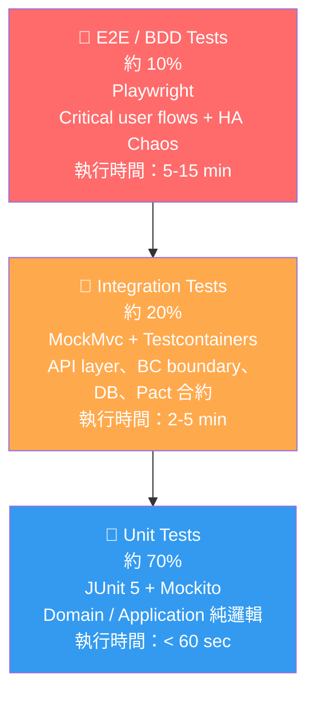
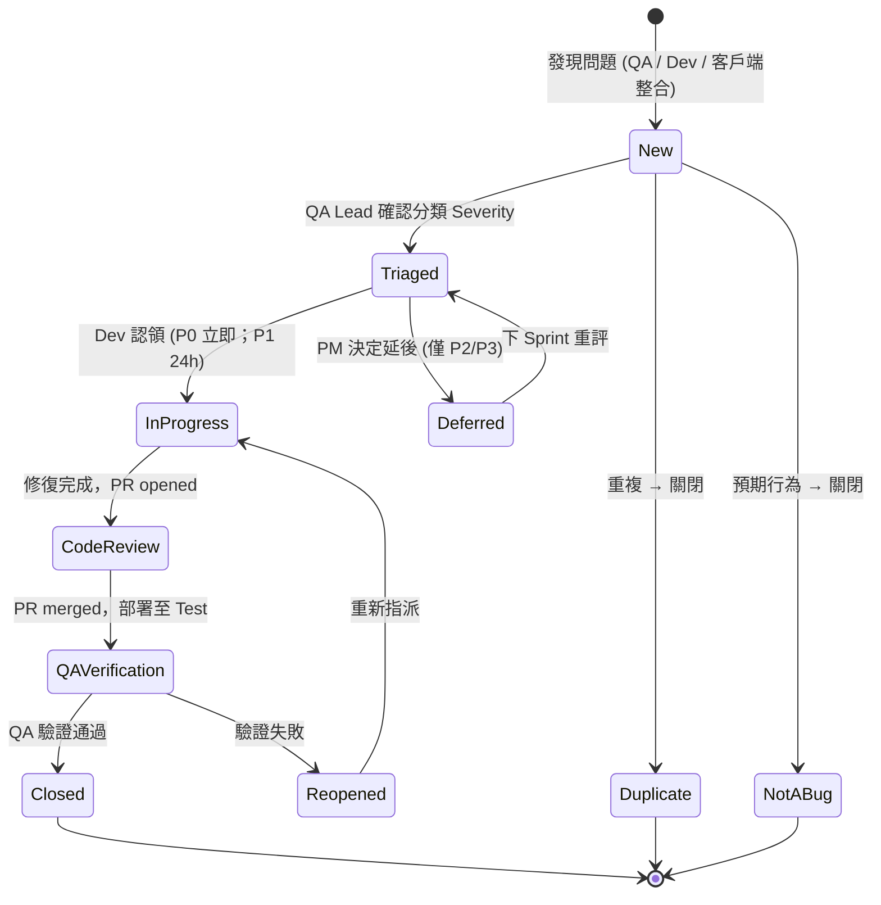
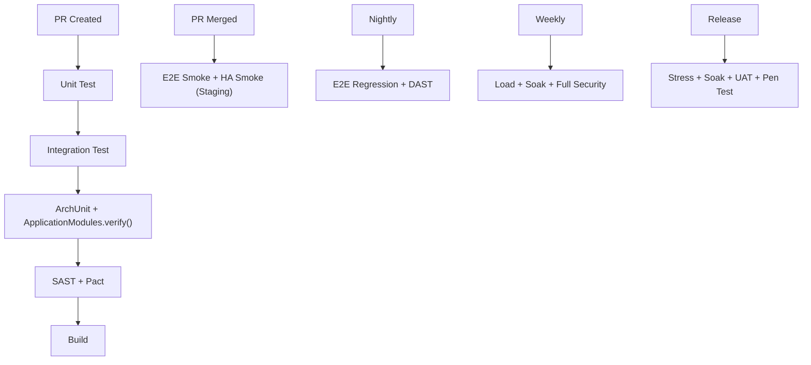

# Test Plan — 測試計畫
<!-- SDLC Quality Engineering — Layer 7：Test Strategy & Plan -->
<!-- 對應學術標準：IEEE 829 Test Plan；業界：Google Test Certified / ISTQB Test Plan -->
<!-- 回答：如何驗證產品符合 BRD/PRD/EDD 定義的需求？測試範圍、工具、責任、時程為何？ -->

---

## Document Control

| 欄位 | 內容 |
|------|------|
| **DOC-ID** | TP-YOCAT-OFFICE-20261030 |
| **專案名稱** | yocat-office-backend（yoCat Office 後端信任層） |
| **文件版本** | v1.0 |
| **狀態** | IN_REVIEW |
| **作者（QA Lead）** | QA Architect（gendoc 自動生成） |
| **日期** | 2026-10-30 |
| **上游 ARCH** | [ARCH.md](ARCH.md) |
| **上游 API** | [API.md](API.md) |
| **上游 SCHEMA** | [SCHEMA.md](SCHEMA.md) |
| **上游 PRD** | [PRD.md](PRD.md) |
| **上游 EDD** | [EDD.md](EDD.md) |
| **上游 CONSTANTS** | [CONSTANTS.md](CONSTANTS.md) |
| **下游 BDD** | [BDD.md](BDD.md)（features/*.feature） |
| **審閱者** | QA Architect, SRE Expert, DevOps Expert |
| **核准者** | Engineering Lead（Executive Sponsor） |

**技術棧（來自 EDD §3.3 / state.tech_stack_hints）：** Java 21 + Spring Boot 3.3 + Spring Modulith 1.3 + PostgreSQL 16 + Redis + Kubernetes（Rancher Desktop，local-first）。
**產品型態：** api-only 信任層（`client_type=api-only`，`has_admin_backend=false`），18 個 REST 端點，7 個 Spring Modulith 有界上下文（member/wallet/deposit/entitlement/record/leaderboard/game-save）。

---

## Change Log

| 版本 | 日期 | 作者 | 變更摘要 |
|------|------|------|---------|
| v1.0 | 2026-10-30 | QA Architect | 初稿：依 PRD/EDD/ARCH/API/SCHEMA/CONSTANTS/class-inventory 生成完整 IEEE 829 Test Plan |

---

## §1 Executive Summary（測試目標與原則）

> 本章節建立整體測試策略的方向，所有後續章節的決策均以此為依據。對應 PRD §1 Executive Summary 與 §9 Success Metrics。

### §1.1 測試目標（SMART 量化）

1. **功能驗證**：於 Alpha 內測結束前，確認所有 PRD Must-have（P0）AC（US-MEM-001 6 條 + US-WAL-001 5 條 + US-ENT-001 5 條 + US-SAVE-001 5 條 + US-PLAT-001 5 條，共 **26 條 P0 AC**）通過自動化測試，P0 通過率達 **100%**（P0 未覆蓋 = 未驗收，不得 merge）。
2. **覆蓋率保障**：所有 BC 的 Unit Test 行覆蓋率（Line Coverage）≥ **80%**，核心錢包/權益交易邏輯（`SpendWalletUseCase`、`TopUpWalletUseCase`、`BuyEntitlementUseCase`）≥ **100%**，Branch Coverage ≥ **70%**，於每次 PR merge 前由 CI JaCoCo gate 強制驗收。
3. **效能基準**：核心 API 端點在正常負載（500 PCU）下，P99 延遲 ≤ **1000ms**，P50 ≤ **200ms**，排行榜 Top N 查詢 P99 ≤ **300ms**，寫入吞吐量 ≥ **200 txn/sec**，Error Rate ≤ **1%**，於進入 Staging 的 Release Candidate 前完成基準測試（來源 EDD §10.5）。
4. **一致性保障**：併發扣款與 failover 壓測後，錢包餘額與 `wallet_ledger` 對帳 **0 筆不一致**（PRD §9.1 北極星護欄，任一不一致即 P0）。
5. **安全合規**：SAST（SpotBugs + Semgrep）、DAST（OWASP ZAP）掃描無 High/Critical 等級漏洞，OWASP Top 10 A01-A10 全數覆蓋，滲透測試確認 **0 條可竄改伺服器餘額路徑**，於進入 Staging 前完成。
6. **HA 驗證**：殺 1 個 pod / 滾動更新期間 5xx 錯誤率 < **0.1%**，ModularityTests 100% 綠、0 循環依賴，於 Go/No-Go 前完成（PRD §9.3）。

### §1.2 測試原則

| 原則 | 說明 | 實踐方式 |
|------|------|---------|
| **Risk-Based Testing** | 優先測試高風險、高業務價值功能 | 參照 §9 Risk Matrix；wallet/entitlement 交易列 High/P0 |
| **Shift-Left** | 測試活動前移至開發早期 | Pre-commit hook 執行變更檔 Unit Tests；PR 觸發 Integration + ModularityTests |
| **Fail-Fast** | 最快找出最嚴重問題 | CI 依序 Unit → Integration → ArchUnit/Modulith → E2E，任一層失敗即中止 |
| **Test Isolation** | 每個測試獨立，不依賴外部狀態 | 每個測試自帶 setup/teardown，使用 Testcontainers（PostgreSQL 16 / Redis）|
| **Automation First** | 可自動化的測試必須自動化 | 目標自動化率 ≥ **90%**（E2E Smoke 100%，Regression ≥ 80%）；UAT 手動 |
| **Living Documentation** | BDD scenarios 反映業務需求 | Gherkin feature files 與 PRD AC 雙向追蹤（§15 RTM） |

### §1.3 Test Pyramid（測試金字塔）



> **比例說明**：
> - **Unit (70%)**：覆蓋所有 Domain Entity 不變式、ValueObject 不可變性、UseCase 協調邏輯。秒級執行，開發者本機頻繁執行。
> - **Integration (20%)**：覆蓋 18 個 REST 端點 contract、PostgreSQL 交易/行鎖、Redis、BC 間 Pact 合約、Spring Modulith 邊界。以 Testcontainers 隔離。
> - **E2E (10%)**：覆蓋關鍵使用者流程（登入→儲值→購買→存檔 Happy Path）與 HA Chaos 場景。僅在 PR merge 後或排程觸發。
>
> **自動化率目標：整體 ≥ 90%；E2E Smoke 100%；Regression ≥ 80%；手動僅限 UAT 與探索性測試。**

### §1.4 品質目標（Quality Gates）

| 指標 | 目標值 | 測量工具 | 頻率 | 來源 |
|------|--------|---------|------|------|
| Unit Test Line Coverage | ≥ 80%（核心交易 100%） | JaCoCo | 每次 PR | PRD §7.6 |
| Unit Test Branch Coverage | ≥ 70% | JaCoCo | 每次 PR | 業界標準 |
| Integration Test Pass Rate | 100%（PR merge 前） | JUnit XML / Surefire | 每次 PR | — |
| E2E Smoke Pass Rate | 100% | Playwright HTML Report | 每次 PR merge | — |
| E2E Regression Pass Rate | ≥ 95% | Playwright HTML Report | 每日排程 | — |
| Defect Escape Rate（to Prod） | ≤ 2 P0+P1 defects / sprint | Jira / Linear | 每 Sprint | PRD §9.2 |
| P99 API Latency（500 PCU） | ≤ 1000ms | k6 | 每週 + Release | EDD §10.5 |
| 排行榜 Top N P99 | ≤ 300ms | k6 | 每週 | EDD §10.5 |
| 寫入交易吞吐量 | ≥ 200 txn/sec | k6 | 每週 | EDD §10.5 |
| Error Rate（5xx） | ≤ 1% | k6 / APM | 每週 | EDD §10.5 |
| Security High/Critical Issues | 0 | SpotBugs / Semgrep / ZAP | 每次 PR / 每週 | PRD §9.3 |
| **錢包對帳一致性** | **0 筆不一致（任一不一致即 P0）** | 併發壓測 + 對帳稽核 | 每次壓測 | PRD §9.1 |
| **ModularityTests 通過率** | **100% 綠、0 循環依賴** | `ApplicationModules.verify()` | 每次建置 | PRD §9.1 |
| **Pact Contract Test Pass Rate** | **100%（PR merge 前）** | Pact Broker / PactFlow | 每次 PR | EDD §4.6.1 |
| **跨 Schema SQL 違規** | **0（CROSS_BC_SQL_COUNT = 0）** | P6Spy SQL Analyzer | 每次 PR | EDD §3.4 HC-1 |
| Flaky Test Rate | ≤ 2% | CI Dashboard | 每週 | — |

---

## §2 Test Scope

### §2.1 In-Scope（測試範圍內）

**Must-have 功能（對應 PRD §5 Functional Requirements，全 P0）：**

| 功能模組（BC） | PRD REQ-ID | AC 數 | 測試類型 | 備註 |
|---------|-----------|:----:|---------|------|
| member — 會員身分 | US-MEM-001 | 6 | Unit + Integration + E2E + Security | 認證敏感，含時序攻擊防護 |
| wallet — 伺服器權威錢包 | US-WAL-001 | 5 | Unit + Integration + E2E + Performance | 行鎖併發一致性、append-only ledger |
| entitlement — 已購權益 | US-ENT-001 | 5 | Unit + Integration + E2E | 原子扣款+授予、UNIQUE 防重複 |
| game-save — 跨裝置存檔 | US-SAVE-001 | 5 | Unit + Integration + E2E | slot upsert、跨裝置還原 |
| 平台底座 — 7 BC Modulith + Day1 HA | US-PLAT-001 | 5 | Unit + Integration + E2E（Chaos） | ModularityTests + HA Failover |
| deposit — 儲值接口 | US-DEP-001 | 2 | Unit + Integration + E2E | 假付費走 DepositConfirmed 入帳，Idempotency-Key 冪等防重複 |
| record — 經營史記錄 | US-REC-001 | 1 | Unit + Integration | append-only，type 列舉驗證 |
| leaderboard — 全域排行 | US-LB-001 | 1 | Unit + Integration + Performance | 公開 Top N 查詢 + 上榜 upsert |

**非功能性測試（NFR）：**
- **Module 可拆解性驗證（必填 NFR）**：Spring Modulith HC-1～HC-5 的 SM-TEST-00～SM-TEST-04 均需通過（見 §3.8）。
- **效能測試**：全 18 個 public API endpoint，重點 wallet/spend、wallet/topup、entitlements/buy、leaderboard（讀）。
- **安全測試**：所有 authenticated endpoints、密碼/session 處理流程、OWASP A01-A10。
- **HA / Failover 測試**：殺 pod、DB Failover、Redis Sentinel 切換、Graceful Shutdown（依 EDD §12.2 HA-01~HA-04）。
- **一致性測試**：wallet 併發扣款 + failover 的錢包/ledger 對帳向量（§3.6 + §10）。

### §2.2 Out-of-Scope（排除項目）

| 排除項目 | 原因 | 替代方案 |
|---------|------|---------|
| Phase B 真金流支付 Gateway 內部邏輯（金流 SDK） | 第三方責任，MVP 為假付費 | 以 WireMock 驗證 `DepositConfirmed` 冪等合約；接口預留測試 |
| 客戶端遊戲模擬 / LLM 本地算力 | 算力留本地，非信任層範圍（IDEA 邊界） | 信任層僅測 API 契約 |
| 客戶端 UI（index.html） | 本專案為 api-only 信任層 | 由客戶端團隊獨立測試（見 §19/§20） |
| 行動端原生 App（iOS/Android） | 無原生 App，玩家經由客戶端呼叫 API | N/A（見 §19） |
| 成長期 3,000 PCU 以上壓力測試 | 啟動期規模 500 PCU，超出成本效益 | 列入 Phase B；Stress Test 以 150% × 500 PCU 為上限 |

### §2.3 Future Scope（後續版本規劃）

| 功能 | 目標版本 | 測試需求說明 |
|------|---------|------------|
| Phase B 真金流（DepositConfirmed 真實金流 + 對帳） | v2.0 | 需新增金流冪等鍵、HMAC 驗簽、對帳 E2E；預估 15 個 TC |
| wallet_ledger 歷史分區查詢 | v2.0 | 需分區表查詢效能測試 |
| 跨 Region Global LB 切換（成長期） | 成長期 | HA-04 替換為跨 Region failover（RTO ≤ 30 min） |
| 轉蛋/抽獎類付費玩法（若新增 BC） | TBD（待確認：產品決策） | 需新增獨立 BC 並登記各情境 RTP 測試 |

> **注意**：HA Failover 測試**不屬** Future Scope，已全數於 §3.6 定義並須在 MVP 上線前完成（符合 PRD §9.3 Go/No-Go）。

### §2.4 測試假設與限制

**假設（Assumptions）：**
1. 測試環境（Dev/Test/Staging）具獨立 PostgreSQL 16 與 Redis，不與 Production 共用。
2. 所有 18 個 API endpoints 在測試開始前已完成開發並部署至 Test 環境。
3. QA 工程師擁有 Test/Staging 環境完整存取權限（含 DB read、log、kubectl）。
4. Phase B 金流 Sandbox 未就緒時，以 WireMock 模擬 `DepositConfirmed` 事件。
5. CI/CD pipeline 已建置（GitHub Actions + Rancher Desktop k8s，local-first）。

**限制（Constraints）：**
1. **環境限制**：本機 PostgreSQL/Redis 於 Local Dev 為單節點（EDD §3.7.2 例外），HA Failover 測試需在 Staging（≥ 2 replicas、DB Primary+Standby、Redis Sentinel）執行。
2. **資料限制**：含 PII（email/display_name）的真實資料不可用於測試環境，需匿名化（§5.2）。
3. **時程限制**：UAT sign-off 倒推，效能測試須於 Release Candidate 前完成。
4. **人力限制**：優先確保 26 條 P0 AC 全覆蓋。

---

## §3 Test Types & Strategy

> 本章節為核心章節，定義每種測試類型的執行策略、工具選型與品質標準。技術棧 = Java 21 + Spring Boot 3.3，工具組合依此選定。

---

### §3.1 Unit Tests

**目標**：驗證單一函式、類別、模組邏輯正確性，不依賴外部資源。

#### 框架選型（Java 技術棧）

| 類型 | 框架 | Coverage 工具 | 設定檔 |
|------|------|-------------|-------|
| Unit | JUnit 5 (Jupiter) + Mockito | JaCoCo | `build.gradle` / `pom.xml` |
| 參數化測試 | JUnit 5 `@ParameterizedTest` | JaCoCo | 同上 |
| 斷言 | AssertJ | — | 同上 |

#### 覆蓋率目標

```
Line Coverage     ≥ 80%  (CI hard gate — JaCoCo fail if below)
核心交易邏輯        = 100% (SpendWalletUseCase / TopUpWalletUseCase / BuyEntitlementUseCase)
Branch Coverage   ≥ 70%  (CI warning)
Function Coverage ≥ 85%  (CI warning)
```

#### Clean Architecture 層次分類（依 EDD §3.1b + class-inventory.md）

**Domain 層（目標覆蓋率 ≥ 90%）**
- 對象：`<<AggregateRoot>>`（Wallet, Account, Entitlement...）/ `<<Entity>>`（LedgerEntry, Session）/ `<<ValueObject>>`（Money, AccountId, Email, DisplayName）/ `<<DomainEvent>>`。
- 特性：**完全隔離，不得 import `org.springframework.*` / `java.sql.*` / 任何 ORM/DB/HTTP**（EDD §3.1b Dependency Rule，由 ArchUnit 強制驗證）。
- 測試重點：Entity 不變式（Wallet 餘額 ≥ 0）、ValueObject 不可變性（Money 四則運算不改原值）、Email 格式驗證分支、DisplayName 長度邊界（0/24/25）。

**Application 層（目標覆蓋率 ≥ 80%，核心 UseCase 100%）**
- 對象：`<<UseCase>>`（SpendWalletUseCase...）/ `<<ApplicationService>>`（WalletService）。
- 特性：**mock 所有 Interface**（`WalletRepository`、`MemberRepository`、`DomainEventPublisher`），不啟動 DB。
- 測試重點：UseCase 主流程、錯誤分支（餘額不足 → 402 語意例外）、`WalletBalanceChanged` / `MemberRegistered` Domain Event 發布時機。

**Infrastructure 層（以 Integration Test 為主，Unit ≥ 60%）**
- 對象：`<<RepositoryImpl>>`（JdbcWalletRepository）/ `<<Adapter>>`（ScryptPasswordEncoder, BearerTokenFilter, ModulithEventPublisher）。
- 特性：`JdbcWalletRepositoryIT` 使用 Testcontainers 啟動真實 PostgreSQL 16，驗證 `SELECT ... FOR UPDATE` 行鎖；`ScryptPasswordEncoderTest` 為純轉換邏輯可 Unit。
- 歸類：RepositoryImpl 列入 §3.2 Integration，不計入 §3.1 Unit 覆蓋率。

- **執行策略**：Pre-commit hook（變更檔）+ PR CI（全量）強制通過。
- **排除項目**：`<<Controller>>`（WalletController, AuthController，由 §3.2 MockMvc 覆蓋）、`<<RequestDTO>>`/`<<ResponseDTO>>`。

> §15.2 Unit Test RTM 以 class-inventory.md 的 26 個 class 為**目標藍圖**，將「每個 public method ≥ 3 TC（S/E/B）」訂為覆蓋**政策/目標**。**目前已列舉（enumerated）的權威單元測試集為 [RTM §3.2](RTM.md) 的 14 個 TC、涵蓋 11 個核心 Method（此為當前 SSOT）**；§15.2 中尚未列入 RTM §3.2 的 S/E/B 案例屬 **target/future（規劃中）**，待排期補齊，不計入目前 14 TC 統計。

---

### §3.2 Integration Tests

**目標**：驗證 BC 之間、API layer、PostgreSQL/Redis 操作的整合行為，確認 contract 符合 API.md 規格。

#### 測試範圍

| 層次 | 測試內容 | 工具 |
|------|---------|------|
| API Layer | HTTP request/response、status codes（200/400/401/402/404/409/500）、response schema | Spring MockMvc / `@SpringBootTest` + TestRestTemplate |
| Database Layer | CRUD、交易、`SELECT FOR UPDATE` 行鎖、UNIQUE 約束、索引、append-only ledger | Testcontainers（PostgreSQL 16，實際 DB）|
| BC Boundary | BC 間 Public API（`WalletService.debit()`）contract | Pact Consumer-Driven Contract |
| Message / Event | Domain Event 發布/消費、Outbox 投遞、event_id 去重冪等 | Testcontainers + Spring Modulith `@ApplicationModuleTest` |
| Cache Layer | Redis session 快取、排行榜 Top N 快取、限流滑動視窗 | Testcontainers（Redis）|
| **HA 行為** | Pod 重啟後服務恢復、DB 重連、分散式鎖競爭 | chaoskube（K8s）/ toxiproxy（網路注入）|

#### API Endpoint 覆蓋（全 18 個，來自 EDD §5.2 / API.md §3）

每個業務端點至少覆蓋 200 成功、400 輸入錯誤、401 未授權（需 Auth 者）、402/409 業務衝突（適用者）、500 內部錯誤：

| Method | Path | BC | 認證 | 必測狀態碼 |
|--------|------|----|:----:|-----------|
| GET | `/health/live` | 平台 | 否 | 200 |
| GET | `/health/ready` | 平台 | 否 | 200 / 503（DB/Redis down） |
| POST | `/auth/register` | member | 否 | 200 / 400 / 409 |
| POST | `/auth/login` | member | 否 | 200 / 400 / 401 |
| POST | `/auth/logout` | member | 是 | 200（冪等）/ 401 |
| GET | `/auth/me` | member | 是 | 200 / 401 |
| POST | `/wallet/topup` | wallet/deposit | 是 | 200 / 400 / 401 |
| POST | `/wallet/spend` | wallet | 是 | 200 / 400 / 401 / 402 |
| GET | `/deposit/packs` | deposit | 否 | 200 |
| POST | `/deposit/checkout` | deposit | 是 | 200 / 400 / 401 / 409 |
| GET | `/entitlements` | entitlement | 是 | 200 / 401 |
| POST | `/entitlements/buy` | entitlement/wallet | 是 | 200 / 400 / 401 / 402 / 409 |
| GET | `/save` | game-save | 是 | 200（含 `{save:null}`）/ 401 |
| PUT | `/save` | game-save | 是 | 200 / 400 / 401 |
| POST | `/records` | record | 是 | 200 / 400 / 401 |
| GET | `/records` | record | 是 | 200 / 401 |
| GET | `/leaderboard` | leaderboard | 否 | 200 |
| POST | `/leaderboard` | leaderboard | 是 | 200 / 400 / 401 |

> **deposit 端點 RTM TC 追溯（對應 RTM §4.2 API-009/010）**：`GET /deposit/packs` → TC-E2E-DEP-001；`POST /deposit/checkout` → TC-E2E-DEP-002（確認訂單）、TC-INT-DEP-003（冪等重放）、TC-INT-DEP-004（冪等鍵衝突 409）、TC-INT-DEP-005（儲值包不存在 400）、TC-INT-DEP-006（缺冪等鍵 400）、TC-INT-DEP-007（未授權 401）。

#### 資料庫約束測試策略（對應 SCHEMA.md §9）

- **UNIQUE 約束**：`accounts.email` 併發註冊僅一筆成功（其餘 409）；`entitlements UNIQUE(account_id, kind, item_id)` 重複購買回 409；`saves PK(account_id, slot)` upsert。
- **行鎖一致性**：`wallet_ledger` append-only + `wallets` 行 `SELECT ... FOR UPDATE`，驗證併發扣款序列化、餘額永遠 ≥ 0。
- **Cross-BC FK 移除驗證（HC-1）**：確認各 BC 以 `account_id BIGINT`（application-layer ID）參照，**無跨 schema FK**；SQL 攔截器驗證無跨 BC JOIN。
- **Migration 回滾**：Flyway/Liquibase migration up/down 可回滾，不破壞既有資料。
- **NOT NULL 邊界**：缺 `data`（PUT /save）、缺 `runId`（POST /leaderboard）回 400。

#### HA Integration Test 標準場景（依 EDD §12.2）

| 場景 ID | 測試名稱 | 注入方式 | 通過條件 |
|---------|---------|---------|---------|
| HA-INT-01 | 分散式鎖競爭（≥ 2 API replica）| 同時發送 2 個相同帳號 spend 請求 | 行鎖序列化，最終餘額 = 初始 − Σ成功扣款，ledger 對帳 0 筆不一致 |
| HA-INT-02 | Session 外置驗證 | Kill API Pod 後用原 Bearer token 重新請求 | 新 Pod 從 Redis/DB 正確驗證原 session，無需重新登入 |
| HA-INT-03 | DB 連線重連 | toxiproxy 斷開 PostgreSQL 連線 5s 後恢復 | HikariCP 自動重連，請求不丟失 |
| HA-INT-04 | Circuit Breaker 觸發 | toxiproxy 注入 500ms 延遲到 Redis | Resilience4j CB 開啟，session 回源 DB（降級非 5xx）|

#### Spring Modulith Module Decomposability Tests（必填，見 §3.8 詳述）

Integration 層執行 `ApplicationModules.verify()`（SM-TEST-00）、`@ApplicationModuleTest` 單 BC 冷啟動（SM-TEST-04）、Pact 合約（SM-TEST-02）、Schema 隔離 P6Spy 攔截（SM-TEST-01）、Redis Namespace 隔離（SM-TEST-HC4）。

#### Admin RBAC Boundary Test

> **本系統 `has_admin_backend=false`（state 確認），無管理後台，§3.2 Admin RBAC 測試略過。** 營運對帳 Console 由客戶端團隊於另案規劃（見 PRD §19 標註為條件章節未啟用）。

#### Test Database 策略

```
Strategy: 每個 integration test suite 使用獨立 PostgreSQL schema（對應各 BC）
Setup:    @BeforeAll → Testcontainers 啟動 postgres:16，執行 migration，載入 seed
Teardown: @AfterEach → transaction rollback；@AfterAll → 停止 container

// Testcontainers（Java 範例）
@Container
static PostgreSQLContainer<?> pg = new PostgreSQLContainer<>("postgres:16")
    .withDatabaseName("test_db").withUsername("test_user").withPassword("test_pass");
```

#### 資料清理原則
1. 不使用 truncate 清理（破壞並行 suite）。
2. 使用 transaction rollback 或 schema isolation（每 BC 一 schema）。
3. Seed data 版本化（納入 version control，修改需 PR review）。
4. 禁止 test 間共享可變狀態；每個 test 自帶 factory 建資料。

---

### §3.3 E2E / BDD Tests

**目標**：從客戶端整合工程師視角驗證 Critical User Flows，確保跨 BC/跨層整合無誤。E2E 以 API 層黑箱方式進行（api-only 無 UI）。

#### 工具選型
- **E2E 框架**：Playwright（API testing mode，`request` fixture，跨語言統一）。
- **BDD**：Gherkin feature files（`features/*.feature`），與 PRD AC @tag 雙向追蹤。

#### Gherkin Feature 範例

```gherkin
# features/wallet/spend.feature
Feature: 伺服器權威錢包扣款
  As a 客戶端整合工程師 Kevin（代表玩家）
  I want to 呼叫 /wallet/spend 使伺服器權威扣款
  So that 餘額成為不可偽造的唯一真實來源

  Background:
    Given 服務運行於 "staging" 環境
    And 存在已登入帳號 token 且 wallet.cash = 20000

  @p0 @wallet @US-WAL-001-AC2
  Scenario: 餘額足夠扣款成功
    When 我 POST /wallet/spend body {currency:"cash", amount:1250, reason:"buy_cosmetic"}
    Then 回應狀態為 200
    And wallet.cash 為 18750
    And wallet_ledger 新增一筆 delta=-1250, balance=18750

  @p0 @wallet @US-WAL-001-AC3
  Scenario: 餘額不足回 402
    When 我 POST /wallet/spend body {currency:"cash", amount:99999, reason:"buy_cosmetic"}
    Then 回應狀態為 402 且 error = "餘額不足"
    And wallet.cash 不變且不寫 ledger
```

#### Critical User Flows 清單（從 PRD §6 User Flows + §5 AC 提取）

| Flow Name | 優先序 | Smoke? | 預期執行時間 | PRD AC 對應 |
|-----------|:----:|:-----:|:----:|------------|
| 註冊 → 建帳+錢包+init ledger → 取 token | P0 | Yes | < 10 sec | US-MEM-001/AC-1 |
| 登入 → 簽發 session → GET /auth/me | P0 | Yes | < 10 sec | US-MEM-001/AC-4 |
| 登入 → topup → spend → GET /auth/me 對帳 | P0 | Yes | < 20 sec | US-WAL-001/AC-1,AC-2 |
| 購買權益（原子扣款+授予）→ GET /entitlements | P0 | Yes | < 15 sec | US-ENT-001/AC-1 |
| 裝置 A PUT /save → 裝置 B GET /save 還原 | P0 | Yes | < 15 sec | US-SAVE-001/AC-5 |
| 破產 recycle 後權益仍完整 | P0 | No | < 15 sec | US-ENT-001/AC-5 |
| 錯誤帳密登入 → 401 | P1 | No | < 5 sec | US-MEM-001/AC-5 |
| 重複購買同項目 → 409 | P1 | No | < 10 sec | US-ENT-001/AC-2 |
| 上榜 upsert → 公開 Top N 查詢 | P1 | No | < 10 sec | POST/GET /leaderboard |
| **HA-E2E-001 Pod Kill 後服務恢復** | P0 | Yes | < 60 sec | US-PLAT-001/AC-1、EDD §12.2 HA-01 |
| **HA-E2E-002 DB Failover 後寫入一致** | P0 | Yes | < 60 sec | EDD §12.2 HA-02 |
| **HA-E2E-003 Redis 切換後 session 有效** | P1 | No | < 30 sec | EDD §12.2 HA-03 |
| **HA-E2E-004 滾動更新 in-flight 不中斷** | P0 | Yes | < 90 sec | US-PLAT-001/AC-2 |

> **HA E2E 執行要求**：
> - HA-E2E-001/002/004 列入 Smoke，每次 pre-release 必須通過。
> - HA E2E 須於 Staging（≥ 2 API replica、DB Primary+Standby、Redis Sentinel）執行，不可於 localhost 單進程執行。
> - HA-E2E-001：`kubectl delete pod -l app=yocat-office-backend-api --grace-period=0`，驗證流量路由至剩餘 Pod，≤ 30s 重建（EDD §3.6.3 RTO）。
> - HA-E2E-002：`pg_ctl stop -m fast` 觸發 Standby 提升，驗證 HikariCP 自動重連、RPO=0 無資料丟失。

#### 環境矩陣（api-only，以 HTTP Client 取代瀏覽器）

| 執行方式 | 版本 | Smoke? | Full Regression? |
|-------|------|:----:|:----:|
| Playwright `request`（Node runner） | Latest stable | Yes | Yes |
| curl / newman（契約煙霧） | Latest | Yes | No |

> 瀏覽器相容矩陣（Chrome/Firefox/Safari）適用於未來客戶端 UI，由客戶端團隊負責（見 §20）。

---

### §3.4 Performance Tests

**目標**：驗證系統在預期與極端負載下的行為，確認 SLO 達標（來源 EDD §10.5 / CONSTANTS §4）。

#### 四種效能測試場景

**Scenario 1 — Smoke Test（健康檢查）**
```
目的：確認腳本可執行、基本功能無誤
負載：1 VU，持續 1 分鐘
通過條件：Error Rate = 0%，所有 SLO P99 達標
工具：k6；執行時機：每次部署後
```

**Scenario 2 — Load Test（正常負載，PR CI + Nightly）**
```
目的：驗證 500 PCU 正常負載下 SLO 達標
負載：500 並發用戶（啟動期 PCU），持續 30 分鐘
Ramp-up：前 5 分鐘線性增至 500 VU；Steady：20 分鐘；Ramp-down：5 分鐘
通過條件：P99 < 1000ms、P50 < 200ms、Error Rate < 0.1%、寫入 TPS ≥ 200
```

**Scenario 3 — Stress Test（壓力測試，Release Gate）**
```
目的：找出承載上限與降級行為
負載：從 500 PCU 起每 5 分鐘 +25%，至 150% 峰值（750 PCU）× 10 分鐘，或 P99 > 2x SLO
恢復測試：壓力移除後系統 ≤ 5 分鐘恢復正常
關注：行鎖爭用下 wallet/spend 是否仍 0 筆不一致
```

**Scenario 4 — Soak Test（持久測試，每週 + 大版本前）**
```
目的：發現記憶體洩漏、HikariCP 連線池耗盡、Outbox 積壓
負載：350-400 PCU（正常 70-80%），持續 2 小時
監控：JVM Heap RSS trend、HikariCP utilization（< 80%）、Error Rate trend、GC frequency、trust_outbox_pending（< 100）
通過條件：2h 內 Error Rate 無上升、Memory 無線性增長、Outbox 無積壓
```

#### SLO Targets 表格（與 EDD §10.5 完全對齊）

| Endpoint 類型 | P50 | P95 | P99 | Error Rate | Throughput |
|-------------|-----|-----|-----|-----------|-----------|
| 讀取 API（GET /auth/me, /entitlements, /records） | ≤ 100ms | ≤ 300ms | ≤ 1000ms | ≤ 0.1% | — |
| 寫入 API（POST /wallet/spend, /topup, /entitlements/buy） | ≤ 200ms | ≤ 500ms | ≤ 1000ms | ≤ 0.1% | ≥ 200 txn/s |
| 排行榜 Top N（GET /leaderboard, limit ≤ 100） | ≤ 100ms | ≤ 200ms | ≤ 300ms | ≤ 0.1% | — |
| 健康檢查（GET /health/*） | ≤ 10ms | ≤ 20ms | ≤ 50ms | 0% | ≥ 500 |
| 整體系統 @ 500 PCU | ≤ 200ms | ≤ 500ms | ≤ 1000ms | ≤ 1% | — |

#### k6 腳本骨架

```javascript
// tests/performance/load-test.js
import http from 'k6/http';
import { check } from 'k6';
export const options = {
  stages: [
    { duration: '5m', target: 500 },   // ramp-up 至 500 PCU
    { duration: '20m', target: 500 },  // steady-state
    { duration: '5m', target: 0 },     // ramp-down
  ],
  thresholds: {
    http_req_duration: ['p(99)<1000', 'p(50)<200'],
    http_req_failed: ['rate<0.001'],
  },
};
export default function () {
  const res = http.post(`${__ENV.BASE_URL}/wallet/spend`,
    JSON.stringify({ currency: 'cash', amount: 100, reason: 'buy_cosmetic' }),
    { headers: { Authorization: `Bearer ${__ENV.TOKEN}`, 'Content-Type': 'application/json' } });
  check(res, { 'status 200 or 402': (r) => r.status === 200 || r.status === 402 });
}
```

> **執行命令**：`k6 run --env BASE_URL=https://perf.yocat.internal --env TOKEN=<token> tests/performance/load-test.js`。
> **工具版本**：k6 latest stable；環境規格見 §4（Perf 環境與 Production 同規格 DB）。

---

### §3.5 UAT（User Acceptance Tests）

**目標**：由業務 stakeholder 驗證產品符合 PRD/BRD，給出上線核准。

#### 驗收標準（逐項來自 PRD §9.5 Definition of Done）

**Product DoD：**
1. 所有 P0 AC 均有對應 BDD scenario 並通過（PM 驗收）。
2. §7.8 所有 Analytics Event 已確認觸發 ≥ 5 次（PM）。
3. 所有已知 edge case 與 error state（400/401/402/409/500）已測試（QA）。
4. §9/§17 Phase A 合規項通過法務初審（Legal）。
5. API 錯誤訊息已 key 化，無 hardcode（Engineering）。
6. Launch 前已記錄 Metrics 基準值（PM）。

**Engineering DoD：**
7. Coverage ≥ 80%（核心錢包/權益交易 100%）。
8. 所有 API endpoint 有 integration test。
9. 所有 P0 AC 自動化測試通過（E2E 覆蓋 Happy + Error Path）。
10. 無 CRITICAL/HIGH 開放缺陷。
11. ModularityTests 100% 綠、0 循環依賴、HC-1~HC-5 合規。
12. SAST 無 HIGH/CRITICAL、dependencies 無 CVE > 7.0。
13. P99 ≤ 1000ms @ 500 PCU、Error Rate ≤ 1%。
14. P0 功能在 Feature Flag Kill Switch 保護下上線。

#### Stakeholder 清單

| 角色 | 職責 | 參與場景 |
|------|------|---------|
| Product Manager | 功能驗收 | 所有 Must-have flows（register/login/topup/spend/buy/save）|
| Business Owner（營運/Finance） | 業務邏輯 + 對帳驗收 | 錢包對帳、ledger 稽核、付費轉化 |
| Engineering Lead | 架構/HA 驗收 | ModularityTests、HA Chaos、Go/No-Go |
| Security Officer | 安全合規驗收 | 滲透測試報告、OWASP |
| 客戶端整合工程師（代表性用戶 1-3 人） | API DX 驗收 | OpenAPI 契約一致性、錯誤碼處理 |

#### UAT 執行環境與通過條件
- **環境**：Staging（production-like，≥ 2 replica）。
- **資料**：匿名化 production-representative 或 UAT 專用 seed，測試帳號 `@test.invalid`。
- **時間**：Release Candidate 確認後 3-5 個工作天。
- **通過條件**：所有 P0 UAT 案例通過 + 無 CRITICAL/P0/P1 open defect → 核准上線。

---

### §3.6 HA / Failover / Chaos Tests

**目標**：驗證系統在元件故障、節點重啟、網路中斷時能自動恢復並維持 SLO（可用性 ≥ 99.9%）。
**HA 原則**：HA 是架構前提，非 Future Scope。所有服務在 MVP 上線前必須通過 §3.6 最小 HA 場景（PRD §9.3）。

#### §3.6.1 Integration Test — HA Failover（依 EDD §12.2 HA-01~HA-04）

| 測試場景 | 工具 | 通過條件（含具體數字）|
|---------|------|---------|
| **API Pod 強制終止**（`chaoskube --labels app=yocat-office-backend-api`）| chaoskube + curl | K8s ≤ 30s 重建新 pod（EDD §3.6.3 RTO）；其他 pod 承接，P99 ≤ 2000ms（SLO 2x）；5xx 錯誤率 < 0.1%；/health/ready 持續 200 |
| **Primary DB 故障切換**（`pg_ctl stop -m fast`）| pgbench + failover trigger | Standby ≤ 30s 提升為 Primary；HikariCP 自動重連；已確認（Commit）寫入 RPO=0 不遺失 |
| **Redis Master 斷線**（Sentinel 模式停 master）| redis-cli + health probe | Sentinel 選出新 Master；應用 ≤ 500ms（EDD §3.6.2 timeout）切換；session cache miss 回源 DB，降級非 500 |
| **單節點重啟**（啟動期單 Region，HA-04）| kubectl + 節點重啟 | 單節點 DB 重啟後應用自動恢復；成長期跨 Region 以 Global LB 切換（RTO ≤ 30 min）|
| **API Gateway 限流觸發** | k6 / vegeta | 超過 Rate Limit（如 login 10/min/IP）回 429 + `Retry-After`，不報 500 |

#### §3.6.2 E2E Test — HA Chaos Scenario（≥ 3 個 @ha 場景）

```gherkin
Feature: HA Failover — 端點對端點驗證

  @ha @failover @chaos
  Scenario: Pod 重啟期間使用者請求不中斷
    Given 系統已部署 2 個 API Server Pod（≥ 2 replicas）
    And 有持續每秒 10 req 的穩定流量（register/login/spend 混合）
    When 其中 1 個 API Pod 被強制終止
    Then 流量自動切換至剩餘 Pod
    And 期間 5XX 錯誤率 ≤ 0.1%（允許 ≤ 1 個請求失敗）
    And 新 Pod 在 30 秒內通過 Readiness Probe 並重新接收流量

  @ha @failover @chaos
  Scenario: DB Primary 切換後錢包寫入一致性
    Given 系統正在進行 wallet/spend 寫入（每秒 5 筆）
    When Primary DB 節點發生故障（pg_ctl stop -m fast）
    Then Standby DB 在 30 秒內自動提升為 Primary
    And 所有已 Commit 的扣款資料不遺失（RPO=0）
    And wallet 餘額與 wallet_ledger 對帳 0 筆不一致
    And API 在 60 秒內恢復正常寫入

  @ha @graceful-shutdown
  Scenario: Pod Rolling Update 期間 in-flight 請求完成
    Given API Pod 正在處理需要 5 秒的 entitlements/buy 交易
    When Kubernetes 發送 SIGTERM 信號至該 Pod
    Then Pod 停止接受新請求（Readiness Probe 失敗）
    And 現有 in-flight 請求正常完成（最多等待 30s，EDD §3.6.5）
    And PodDisruptionBudget 保證最小可用副本數
    And Pod 退出後不殘留未完成的交易（無半筆 ledger）
```

#### §3.6.3 本地 HA 驗證（Local Dev，遵循 EDD §3.7.2 圖 B）

```bash
# 1. 確認 Local 有 ≥ 2 API replicas
kubectl get pods -l app=yocat-office-backend-api | grep Running | wc -l
# 期望 ≥ 2

# 2. 終止其中一個 Pod，觀察服務不中斷
kubectl delete pod $(kubectl get pods -l app=yocat-office-backend-api -o jsonpath='{.items[0].metadata.name}')
curl http://localhost:8080/health/ready   # 應在 5s 內持續回應 200

# 3. 驗證 Outbox 事件冪等（送出同一 MemberRegistered event_id 兩次）
#    斷言 wallet 僅建立一次（event_id dedup，EDD §4.6.1）
```

> 本機 PostgreSQL/Redis 為單節點（EDD §3.7.2 例外），DB/Redis Failover 場景須於 Staging 執行。

---

### §3.7 Security Tests

**目標**：系統性識別並修復安全漏洞，確認符合 OWASP Top 10（來源 EDD §9.5 / PRD §7.4）。

#### SAST（Java 技術棧）

| 工具 | 語言 | 觸發時機 | Fail 條件 |
|------|------|---------|---------|
| SpotBugs + FindSecBugs | Java | PR opened | High/Critical bug pattern |
| Semgrep | 多語言 | PR opened | High/Critical rule matches |

#### DAST

| 工具 | 掃描目標 | 觸發時機 | 排除項目 |
|------|---------|---------|---------|
| OWASP ZAP（Baseline Scan） | Staging 18 個 API endpoint | 每週排程 | `/health/live`, `/health/ready` |
| OWASP ZAP（Full Scan） | Staging 全應用 | UAT 前 | — |

#### Dependency Scanning

| 工具 | 掃描對象 | 觸發時機 | Fail 條件 |
|------|---------|---------|---------|
| Trivy | Container image | PR merged to main | Critical CVE |
| OWASP Dependency-Check | Gradle/Maven 依賴 | PR opened | High/Critical CVE（CVE > 7.0）|
| GitHub Dependabot | 所有依賴 | 每日 | 自動開 PR，不 block |

#### OWASP Top 10 Coverage（A01-A10 每項均有測試方法，對應 EDD §9.5）

| OWASP 類別 | 適用性 | 測試方法 | 工具 | Pass Condition | 負責人 |
|-----------|:----:|---------|------|---------------|-------|
| A01 Broken Access Control | 高 | 以他人 token 存取本人錢包/存檔 → 401/403；session 歸戶驗證 | pytest/REST + ZAP | 所有越權請求回 401/403（非 200）| Security |
| A02 Cryptographic Failures | 中 | scrypt 密碼雜湊審查、TLS 1.3 設定、無硬編碼 secrets | Semgrep + testssl.sh | 密碼單向雜湊、TLS 1.3+、0 硬編碼 secret | Security |
| A03 Injection | 高 | 參數化查詢審查（JDBC PreparedStatement）、ZAP active scan | SpotBugs + ZAP | 無字串拼接 SQL、無注入成功 | QA Lead |
| A04 Insecure Design | 中 | STRIDE Threat Model Review（EDD §9.6）| 人工審查 | Threat model 完成且 High risk 已 mitigate | Architect |
| A05 Security Misconfiguration | 高 | 無 debug endpoint、CORS 收斂檢查、預設密碼掃描 | ZAP + Trivy | 無 debug endpoint、CORS 非 `*`（正式）| DevOps |
| A06 Vulnerable Components | 高 | 依賴 CVE 掃描 | Trivy + Dependency-Check | 無 Critical CVE，High 有 remediation | DevOps |
| A07 Auth & Session Failures | 高 | 登入暴力破解（login 10/min/IP 限流）、session 過期（TTL 30 天）、`timingSafeEqual` 防時序 | ZAP + 自撰測試 | 限流生效、過期 token 回 401、密碼比對恆定時間 | Security |
| A08 Software & Data Integrity | 低 | append-only ledger 不可改、event_id 冪等、CI action pin 版本 | 人工 + CI audit | ledger WORM、pinned action | DevOps |
| A09 Logging & Monitoring Failures | 中 | 認證事件有 log、PII（email）遮罩、無明文密碼/token | 人工 audit | 所有 auth event 有 log、0 PII 洩漏 | DevOps |
| A10 SSRF | 低（無外部 URL 輸入） | save data JSONB 無 URL fetch；Phase B webhook URL 驗證 | ZAP + 人工 | 無法觸發內部網路存取 | QA Lead |

#### 滲透測試（Release 前，PRD §9.3 Go 條件）
- 重點：**0 條可由客戶端竄改伺服器餘額路徑**（北極星護欄）。
- 範圍：錢包 topup/spend、entitlements/buy、session 偽造、JWT/token 竄改。委外或內部 Security Officer 執行，輸出滲透測試報告。

---

### §3.8 Spring Modulith 可拆解性驗證（Decomposability Test Suite）

> 本節以 Spring Modulith 1.3 驗證系統 HC-1～HC-5 邊界約束。**必填，不可省略。**

**目標**：確保系統從 Day 1 符合 Bounded Context 邊界，具備微服務拆解能力：
- **HC-1 Schema 隔離**：各 BC 獨佔 PostgreSQL schema，無跨 BC FK、無跨 BC JOIN。
- **HC-2 公開介面**：跨 BC 僅走 `@NamedInterface`（`*/api`）或 Domain Event，無直接 internal class 呼叫。
- **HC-3 事件驅動**：跨 BC 通訊走 Domain Event（Transactional Outbox），消費端 event_id 冪等。
- **HC-4 無共享可變狀態**：Redis Key 符合 `{BC}:{type}:{id}` namespace，無跨 BC Key 存取。
- **HC-5 DAG 依賴圖**：`ApplicationModules.verify()` 無循環依賴。

#### §3.8.1 ApplicationModules 全局驗證（對應 HC-5）

| 測試 ID | 測試類型 | 工具 | 驗證目標 | 合格標準 |
|---------|---------|------|---------|---------|
| SM-TEST-00 | Architecture Test | `ApplicationModules.verify()` | 全域模組邊界 + 循環依賴偵測 | `verify()` 無 AssertionError（CI 強制 gate）|

```java
// src/test/java/com/yocat/office/ModulithVerificationTest.java
@SpringBootTest
class ModulithVerificationTest {
    @Test
    void modules_comply_with_all_hc_constraints() {
        ApplicationModules modules = ApplicationModules.of(YocatOfficeBackendApplication.class);
        modules.verify();   // HC-5 DAG + HC-1/HC-2 邊界違規 → AssertionError
    }

    @Test
    void modules_have_no_circular_dependencies() {
        ApplicationModules modules = ApplicationModules.of(YocatOfficeBackendApplication.class);
        modules.forEach(m -> System.out.println(m.getName() + ": " + m.getDependencies()));
        modules.verify();
    }

    @Test   // 另產出模組文件（供 Review 確認邊界）
    void write_documentation() {
        new Documenter(ApplicationModules.of(YocatOfficeBackendApplication.class))
            .writeModulesAsPlantUml().writeIndividualModulesAsPlantUml();
    }
}
```

> **CI 阻斷 merge 條件**：`ApplicationModules.verify()` 必須在每個 PR CI pipeline 執行，任何 `AssertionError`（HC-1/HC-2/HC-5 違規）阻斷 merge（見 §8 自動化策略）。

#### §3.8.2 Per-BC 邊界隔離測試（對應 HC-1/HC-2，EDD §3.4 全 7 BC）

| 測試 ID | BC 名稱 | 測試方式 | 合格標準 |
|---------|--------|---------|---------|
| SM-TEST-01-member | member | `@ApplicationModuleTest` 單 BC context 啟動 | `/auth/*` endpoints 回 2XX，無跨 BC 依賴滲漏 |
| SM-TEST-01-wallet | wallet | `@ApplicationModuleTest` 單 BC context 啟動 | `/wallet/*` endpoints 回 2XX |
| SM-TEST-01-deposit | deposit | `@ApplicationModuleTest` 單 BC context 啟動 | topup pack 解析正常，Event 發布可驗 |
| SM-TEST-01-entitlement | entitlement | `@ApplicationModuleTest`（stub WalletService）| `/entitlements/*` 回 2XX |
| SM-TEST-01-record | record | `@ApplicationModuleTest` 單 BC context 啟動 | `/records/*` 回 2XX |
| SM-TEST-01-leaderboard | leaderboard | `@ApplicationModuleTest` 單 BC context 啟動 | `/leaderboard` 回 2XX |
| SM-TEST-01-game-save | game-save | `@ApplicationModuleTest` 單 BC context 啟動 | `/save` GET/PUT 回 2XX |

#### §3.8.3 Event Contract 測試（對應 HC-3，依 EDD §4.6.1 跨 BC pair）

跨 BC Domain Event pair（Owning BC → Consumer BC）各產生一組 Pact / Schema 合約測試：

| 測試 ID | Producer BC | Event Class | Consumer BC | Contract Type | 合格標準 |
|---------|-----------|------------|------------|--------------|---------|
| SM-TEST-02-EVT-01 | member | `MemberRegistered` | wallet | Pact Consumer-Driven + JSON Schema | wallet 端 pact verify 100% 通過，建錢包+init ledger |
| SM-TEST-02-EVT-02 | deposit | `DepositConfirmed` | wallet | Pact + orderId dedup | wallet 端 verify 通過，orderId 冪等入帳 |
| SM-TEST-02-EVT-03 | member | `MemberDeleted` | wallet | Pact + Schema | wallet 端消費匿名化/清理 |
| SM-TEST-02-EVT-04 | member | `MemberDeleted` | entitlement | Pact + Schema | entitlement 端消費清理 |
| SM-TEST-02-EVT-05 | member | `MemberDeleted` | record | Pact + Schema | record 端消費清理 |
| SM-TEST-02-EVT-06 | member | `MemberDeleted` | leaderboard | Pact + Schema | leaderboard 端消費清理 |
| SM-TEST-02-EVT-07 | member | `MemberDeleted` | game-save | Pact + Schema | game-save 端消費清理 |

> `WalletBalanceChanged`、`EntitlementGranted`、`BusinessRecordAdded`、`RunScoreSubmitted` 為 **BC-internal 消費**（EDD §4.6.1），不產生跨 BC Pact，但以 §3.8.3 Schema 版本相容性測試（SM-TEST-03）驗證 producer/consumer `event_schema_version=v1` 相容。另 entitlement → wallet 為 **同步 Public API**（`WalletService.debit()`，EDD §3.4），以 Pact SM-TEST-02-API-01 驗證。

#### §3.8.4 Schema 隔離驗證（對應 HC-1）

```
驗證方法：Integration Test 中以 P6Spy（Java）攔截所有 SQL，
          記錄每個 BC 程式碼執行的 SQL 目標 schema，
          驗證無任何 SQL 存取其他 BC 的 schema（如 wallet BC 讀 member schema）。
合格標準：CROSS_BC_SQL_COUNT = 0
測試 ID：SM-TEST-01-SCHEMA
工具：P6Spy + 自撰 SQL schema analyzer
```

#### §3.8.5 Redis Namespace 隔離驗證（對應 HC-4）

```
驗證方法：Redis MONITOR 在 Integration Test 記錄所有 Redis 操作，
          驗證每個 BC 的 Key 符合其 namespace（與 SCHEMA.md §19 一致）。
合格標準：所有 Redis Key 符合各 BC Key Pattern，無跨 BC Key 存取。
各 BC Redis Key Pattern（SCHEMA.md §19）：
  member      → session:{token}
  leaderboard → lb:{mode}:top（Top N 頁快取）
  平台底座     → ratelimit:{scope}:{id}（限流滑動視窗）
測試 ID：SM-TEST-HC4-NAMESPACE
```

#### §3.8.6 HC-3 Domain Event 消費冪等性測試

```
測試 ID：SM-TEST-HC3-IDEMPOTENCY
驗證方法：Testcontainers 跑 wallet Consumer，投遞同一 MemberRegistered event_id 兩次，
          斷言 wallets 僅建立一筆、init ledger 僅一筆（event_id dedup，EDD §4.6.1）。
合格標準：重複投遞後 DB 業務記錄只有一筆；processed_event_id 去重表 INSERT 可驗。
風險覆蓋：MQ/Outbox at-least-once 重複投遞 → 重複建錢包/重複入帳。
```

---

## §4 Test Environment Specification

> 每個環境用途不同，資料策略嚴格隔離，避免測試汙染 Production。全環境 local-first（Rancher Desktop k8s）。

| Environment | 用途 | URL Pattern | Database | 資料策略 | 部署方式 |
|------------|------|------------|---------|---------|---------|
| **Dev** | 開發者本機 Unit/快速 Integration | `localhost:8080` | 本機 Docker PostgreSQL 16 / Testcontainers | 開發者自管，每次重啟清空 | `docker compose up` / Rancher Desktop |
| **Test** | Integration + E2E CI pipeline | `http://test.yocat.internal` | 獨立 Test DB（CI 每次重建）| CI 前 migration + seed，執行後保留供 debug | GitHub Actions + Rancher Desktop k8s |
| **Staging** | UAT / Performance / DAST / HA Chaos | `https://staging.yocat.internal` | 獨立 Staging DB（匿名化快照，Primary+Standby）| 月更匿名化快照，QA Lead 手動 reset | 與 Production 相同 IaC（Helm/k8s，≥ 2 replica）|
| **Perf（Prod-like）** | Stress / Soak（隔離）| `https://perf.yocat.internal` | 與 Production 同規格 DB（Primary+Standby + Redis Sentinel）| 測試前 provision，測試後 destroy | 與 Production 相同 IaC，按需建立 |

**各測試類型執行環境對照：**
- Unit Test → Dev（本機，無 DB）/ CI。
- Integration Test → Dev/Test（Testcontainers PostgreSQL 16 + Redis）。
- E2E（功能）→ Test。
- E2E（HA Chaos）→ Staging（≥ 2 replica、DB Primary+Standby、Redis Sentinel，不可於 localhost 執行）。
- Performance（Load）→ Staging；Performance（Stress/Soak）→ Perf。
- Security DAST / 滲透 → Staging。

**環境存取控制：**
- Dev：開發者本人。
- Test：Dev + QA（GitHub Actions service account）。
- Staging：Dev + QA + PM + UAT stakeholders + SRE（VPN required）。
- Perf：QA Lead + SRE（限效能測試時段）。

---

## §5 Test Data Management

### §5.1 資料生成策略

| 策略 | 使用場景 | 工具 | 說明 |
|------|---------|------|------|
| **Faker** | 動態生成單筆測試資料 | datafaker（Java）| Unit/Integration，每次執行生成 email/displayName |
| **Factory** | 批量建立具業務邏輯物件 | 自撰 TestFactory + Instancio | 支援 trait（已登入帳號、餘額足/不足、已擁有權益）|
| **Fixture** | 靜態基準資料（seed）| SQL/JSON fixtures | E2E 固定測試帳號，納入 version control |
| **Production Anonymized** | UAT / Staging | 自建匿名化 pipeline | 僅 Staging，嚴禁用於 Test/Dev |

**Factory 範例（Java）：**
```java
// src/test/java/com/yocat/office/support/WalletFactory.java
public final class WalletFactory {
    public static Wallet withCash(long cash) {
        return Wallet.rehydrate(AccountId.of(1001L), Money.of(cash, Currency.CASH), Money.zero(Currency.GEMS));
    }
    public static Wallet insufficient() { return withCash(0); }  // 觸發 402
}
```

### §5.2 PII Masking 規則（對應 PRD §17 / SCHEMA.md §14）

| PII 類型 | Masking 方式 | 範例（原始 → 匿名化）| 環境適用 |
|---------|------------|-------------------|---------|
| display_name | 隨機替換（同語系） | 王小明 → 測試員A7 | Staging |
| email | 固定 domain 替換 | john@real.com → test_8f3a@test.invalid | Staging / Test |
| pass_hash | 已為 scrypt 單向雜湊，不還原 | （不可逆，保持雜湊）| 全環境 |
| IP 地址（audit log）| 保留前兩段，後兩段隨機 | 203.0.113.45 → 203.0.xxx.xxx | Staging |

**PII 禁令：**
- Test/Dev 環境**嚴禁**真實 PII；測試帳號用 `@test.invalid` / `@example.com`。
- 匿名化 pipeline 由 SRE 維護，QA Lead 每季審核。
- 違規使用立即通報 Security Officer。

### §5.3 Test Isolation 原則

```
每個 Test Case 黃金法則：
1. SETUP（Arrange）：Factory/Fixture 建最小資料集，不假設前一 test 狀態
2. EXECUTE（Act）：執行被測行為，一個 test 只測一件事
3. VERIFY（Assert）：僅 assert 本 test 關心的狀態
4. TEARDOWN（Cleanup）：transaction rollback 自動還原，不留副作用
```

### §5.4 Shared Test Data 規範

| 類型 | 說明 | 管理方式 | 注意事項 |
|------|------|---------|---------|
| Seed Data（靜態）| deposit_pack 包目錄、currency/kind/type 列舉基礎資料 | Flyway migration，版本化 | 只讀不寫 |
| Dynamic Test Data | 每個 test 動態建的 account/wallet/entitlement | Factory function | teardown 清理 |
| Shared Fixtures（E2E）| 跨裝置存檔測試的固定帳號 | `@BeforeAll` / Playwright fixtures | 唯讀共享 |

---

## §6 Entry / Exit Criteria

| Stage | Entry Criteria | Exit Criteria | Blocking Defects |
|-------|---------------|--------------|-----------------|
| **Unit Testing** | 功能開發完成，PR opened，CI 觸發 | Line Coverage ≥ 80%（核心交易 100%），所有 Unit Tests pass | 任何 Unit Test failure |
| **Integration Testing** | Unit 通過，Test 環境部署成功，Testcontainers 可啟動 | 18 endpoint 測試通過，API contract 符合 API.md，ModularityTests 綠 | P0/P1 defect、API schema mismatch、`verify()` AssertionError |
| **E2E Testing** | Integration 通過，E2E 環境穩定，測試資料備妥 | Smoke 100% pass，Regression ≥ 95%，HA Smoke 通過 | P0 defect、Critical Flow failure、HA Smoke 失敗 |
| **Performance Testing** | E2E 通過，Staging/Perf 部署，k6 腳本 review 完畢 | P99 ≤ 1000ms @ 500 PCU、Error Rate < 0.1%、寫入 TPS ≥ 200、對帳 0 筆不一致 | P99 超 SLO 50%、Error Rate > 1%、任一筆對帳不一致 |
| **Security Testing** | Staging 可存取，SAST 初掃完成 | OWASP A01-A10 全通過，無 High/Critical open issue，滲透 0 條竄改路徑 | 任何 Critical 漏洞、任一可竄改餘額路徑 |
| **UAT** | 上述全通過，Staging 穩定，stakeholders 已排程 | 所有 P0 UAT sign-off，無 P0/P1 open defect | P0 defect、Must-have AC 未通過 |

**Release Exit Criteria（Go/No-Go，PRD §9.3）：** 所有 P0 AC 通過 + 覆蓋率 ≥ 80%（核心 100%）+ 滲透 0 竄改路徑 + 併發/failover 0 筆不一致 + 殺 pod/滾動更新 < 0.1% + ModularityTests 0 循環依賴 + 安全掃描無 CRITICAL/HIGH + local-first 全綠 + Rollback 已驗證。

---

## §7 Defect Management

### §7.1 Severity 分類與 SLA

| Priority | 定義 | 修復 SLA | 驗證 SLA | 範例 |
|---------|------|---------|---------|------|
| **P0 Critical** | 系統崩潰/資料遺失/安全漏洞/錢包對帳不一致 | 4 小時 | 2 小時 | 可竄改餘額、負餘額、SQL injection、DB SPOF |
| **P1 High** | 核心功能無法使用（無 workaround）| 24 小時 | 4 小時 | spend/buy 失敗、session 驗證錯誤、ledger 漏記 |
| **P2 Medium** | 功能受損但有 workaround | 3 個工作天 | 1 個工作天 | 非核心端點異常、效能略低於 SLO |
| **P3 Low** | 次要問題/訊息文字 | Next Sprint | Next Sprint | 錯誤訊息錯字、log 格式瑕疵 |

**Defect Escape Rate 目標**：Production P0/P1 defect ≤ **2 per sprint**（P0 = 0、P1 ≤ 1）。

### §7.2 Defect Workflow



### §7.3 Defect Escape Rate 監控

| 指標 | 目標 | 測量方式 | 行動觸發 |
|------|------|---------|---------|
| Production P0 defects / sprint | = 0 | Jira sprint report | 立即 post-mortem |
| Production P1 defects / sprint | ≤ 1 | Jira sprint report | 根因分析，改善覆蓋 |
| 錢包對帳不一致 | = 0（任一即 P0）| 對帳稽核 | 立即凍結金流 + On-Call |
| Defect resolution within SLA | ≥ 95% | Jira time tracking | < 90% 升級 Engineering Lead |

---

## §8 Test Automation & CI/CD Integration

### §8.1 CI Pipeline 觸發時機

| 事件 | 執行測試類型 | 允許時間 | Fail 行為 |
|------|-----------|---------|---------|
| `git commit`（pre-commit hook）| 變更檔 Unit Tests | < 30 sec | Block commit |
| PR opened / push | 全量 Unit + Integration + ModularityTests + SAST + Pact | < 10 min | Block PR merge |
| PR merged to main | Unit + Integration + E2E Smoke（含 HA Smoke）| < 15 min | Alert on Slack |
| Daily（02:00 UTC）| Full E2E Regression + Security DAST | < 30 min | Alert + Jira ticket |
| Weekly（Mon 04:00 UTC）| Load Test + Soak Test + Full Security Scan | < 120 min | Alert + Jira ticket |
| Release | Stress + Soak + UAT Gate + 滲透測試 | Varies | QA Lead 通知，阻斷 Release |

### §8.2 CI Pipeline Gate（Mermaid）



### §8.3 測試執行時間目標（PR CI < 10 分鐘）
- Unit Test：< 2 分鐘；Integration Test：< 5 分鐘；ArchUnit + Modulith verify：< 1 分鐘；SAST：< 3 分鐘。
- **並行策略**：Unit + SAST 並行；Integration 在 Unit 通過後觸發；ModularityTests 與 Integration 並行。

### §8.4 自動化率目標
- 整體自動化率 ≥ **90%**；E2E Smoke **100%**；Regression ≥ **80%**。
- **不自動化**：UAT（業務 stakeholder 手動驗收）、探索性測試（exploratory）、滲透測試人工部分。理由：需人工業務判斷或創造性探索。

### §8.5 工具矩陣（含版本目標與設定檔）

| 類型 | 工具 | 版本目標 | 設定檔位置 |
|------|------|---------|-----------|
| Unit | JUnit 5 + Mockito + AssertJ | latest stable | `build.gradle` / `pom.xml` |
| Coverage | JaCoCo | latest stable | `build.gradle` |
| Integration | Spring MockMvc + Testcontainers | latest stable | `src/test/resources/` |
| Architecture | ArchUnit + Spring Modulith `ApplicationModules` | latest stable | `*/ModulithVerificationTest.java` |
| Contract | Pact JVM | latest stable | `src/test/pact/` |
| E2E | Playwright（API mode）| latest stable | `playwright.config.ts` |
| Performance | k6 | latest stable | `tests/performance/` |
| SAST | SpotBugs + FindSecBugs + Semgrep | latest stable | CI 設定 |
| DAST | OWASP ZAP | latest | `zap/` |
| Dependency | Trivy + OWASP Dependency-Check | latest | CI 設定 |

---

## §9 Risk-Based Testing Matrix

| 功能（BC）| 業務優先級 | 風險等級 | 測試深度 | 覆蓋率目標 |
|------|:--------:|:------:|---------|:--------:|
| wallet（topup/spend/ledger）| P0 | **High** | Unit + Integration + E2E + Performance + 併發壓測 | ≥ 90%（核心 100%）|
| entitlement（原子扣款+授予）| P0 | **High** | Unit + Integration + E2E | ≥ 90%（核心 100%）|
| member（註冊/登入/session）| P0 | **High** | Unit + Integration + E2E + Security | ≥ 90% |
| 平台底座（7 BC Modulith + HA）| P0 | **High** | Unit（Modulith）+ Integration + E2E Chaos | 100%（ModularityTests）|
| game-save（跨裝置存檔）| P0 | Medium | Unit + Integration + E2E | ≥ 80% |
| deposit（假付費/Phase B 預留）| P0 | Medium | Unit + Integration | ≥ 80% |
| leaderboard（公開 Top N + 上榜）| P1 | Medium | Unit + Integration + Performance | ≥ 80% |
| record（經營史 append-only）| P1 | Low | Unit + Integration | ≥ 70% |

**高風險功能詳細清單（P0 High，逐一對應 AC）：**
- **wallet**：US-WAL-001 AC-1~AC-5（topup 上限 10,000,000、spend 行鎖、402 餘額不足、併發 0 筆不一致）。
- **entitlement**：US-ENT-001 AC-1~AC-5（原子扣款、409 重複、402 餘額不足交易回滾、破產後權益不消失）。
- **member**：US-MEM-001 AC-1~AC-6（409 email 重複、401 帳密錯/未登入、timingSafeEqual、session TTL）。
- **平台底座**：US-PLAT-001 AC-1~AC-5（殺 pod < 0.1%、滾動更新、ModularityTests 0 循環、跨 BC 僅 Public API/Event、local-first）。

> **Admin 後台**：`has_admin_backend=false`，無 Admin RBAC 風險項，不列入本 Matrix。

---

## §10 Performance Testing Specification

### §10.1 Load Targets（從 CONSTANTS §8 / EDD §11）

| 場景 | 並發用戶數 | 持續時間 | 目標 | 工具 |
|------|:--------:|:------:|------|------|
| Smoke | 1 VU | 1 min | 0 error，SLO P99 達標 | k6 |
| Normal Load | 500 PCU | 30 min | P99 < 1000ms、寫入 TPS ≥ 200、Error < 0.1% | k6 |
| Stress（Peak）| 750 PCU（150%）| 10 min | 找降級點，壓力移除 ≤ 5min 恢復 | k6 |
| Soak | 350-400 PCU | 2 hours | Memory 穩定、Outbox < 100、Error 不上升 | k6 |

### §10.2 SLO / SLI 矩陣（P50/P95/P99，與 EDD §10.5 對齊）

| Endpoint 類型 | P50 | P95 | P99 | Max Error Rate |
|-------------|-----|-----|-----|----------------|
| 讀取 API（GET）| ≤ 100ms | ≤ 300ms | ≤ 1000ms | ≤ 0.1% |
| 寫入 API（POST/PUT）| ≤ 200ms | ≤ 500ms | ≤ 1000ms | ≤ 0.1% |
| 排行榜 Top N | ≤ 100ms | ≤ 200ms | ≤ 300ms | ≤ 0.1% |
| 健康檢查 | ≤ 10ms | ≤ 20ms | ≤ 50ms | 0% |

### §10.3 錢包一致性與冪等測試向量（核心，PRD §9.1）

| 向量 ID | 情境 | 輸入 | 預期結果 |
|---------|------|------|---------|
| CONS-01 | 單帳號併發 100 筆 spend（餘額足）| cash=100000，100 × amount=1000 | 行鎖序列化，最終 cash=0，ledger 100 筆，餘額 = 初始 − Σ扣款，0 筆不一致 |
| CONS-02 | 併發 spend 至餘額邊界 | cash=5000，10 × amount=1000 | 5 筆成功、5 筆回 402，最終 cash=0，永不負餘額 |
| CONS-03 | spend 交易中途 pod 被殺 | 扣款交易執行中 kill pod | 交易回滾，無半筆 ledger，餘額不變（ledger 與餘額恆一致）|
| CONS-04 | topup 冪等（Phase B 預留）| 同 orderId 重送 DepositConfirmed 2 次 | orderId dedup，僅入帳一次 |
| CONS-05 | entitlements/buy 併發同項目 | 同帳號併發買同 (kind,item_id) | 行鎖 + UNIQUE，僅一次授予，其餘 409，扣款僅一次 |
| CONS-06 | MemberRegistered 重複投遞 | 同 event_id 投遞 2 次 | wallet 僅建一次、init ledger 僅一筆 |

> 執行方式：k6 / Gatling 併發腳本 + 測試後對帳稽核 SQL（`SELECT balance FROM wallets` vs `SUM(delta) FROM wallet_ledger`）。合格標準：所有向量 0 筆不一致。

### §10.4 效能測試環境與工具
- **環境**：Perf（Prod-like，與 Production 同規格 DB + Redis Sentinel，隔離）。
- **工具版本**：k6 latest stable。
- **執行命令**：`k6 run --vus 500 --duration 30m --env BASE_URL=https://perf.yocat.internal tests/performance/load-test.js`。
- **資料量要求**：預載 ≥ 50,000 accounts（成長期 DAU 量級）、≥ 1,000,000 wallet_ledger 筆，驗證 `idx_ledger_acct` 查詢不退化。

---

## §11 Security Testing Scope

> 依 EDD §4（Security）/ §9.5 與 OWASP 標準。詳細測試方法見 §3.7。

### §11.1 SAST
- 工具：SpotBugs + FindSecBugs + Semgrep。
- 觸發：PR 提交自動執行。
- 必掃：JDBC 注入、密碼/token 洩漏、硬編碼 secret、不安全反序列化。

### §11.2 DAST
- 工具：OWASP ZAP。
- 觸發：Nightly（Baseline）+ Release 前（Full）。
- 掃描目標：Staging 全 18 個 API endpoint（排除 /health/*）。

### §11.3 OWASP Top 10（每項測試方法與工具，摘要見 §3.7 完整矩陣）

| OWASP 項目 | 測試類型 | 工具 | 觸發 |
|-----------|---------|------|------|
| A01 Broken Access Control | Integration + DAST | 自撰 REST + ZAP | PR + Nightly |
| A02 Cryptographic Failures | SAST + 審查 | Semgrep + testssl.sh | PR |
| A03 Injection | SAST + DAST | SpotBugs + ZAP | PR + Nightly |
| A05 Security Misconfiguration | DAST + Config Scan | ZAP + Trivy | Weekly |
| A07 Auth & Session Failures | Integration（暴力破解/限流/session 過期）| ZAP + 自撰 | PR |

### §11.4 滲透測試（Release 前）
- P0 金融相關（錢包/權益/session）：委外或 Security Officer 執行 Pen Test。
- 驗收：**0 條可竄改伺服器餘額路徑**（PRD §9.3 Go 條件），輸出滲透測試報告。

### §11.5 密碼與 PII 安全
- scrypt 密碼雜湊（salt$hash）、`crypto.timingSafeEqual` 恆定時間比對驗證。
- Log 遮罩 email/account_id、禁止記錄明文密碼/pass_hash/token（A09）。

---

## §12 UAT Plan

> 依 PRD P0 User Story 與業務利害關係人需求定義（詳見 §3.5）。

### §12.1 UAT 範圍與參與者
- **範圍**：所有 P0 功能（register/login/topup/spend/buy/save）+ 對帳驗收 + HA Go/No-Go。
- **參與者**：Product Manager、Business Owner（營運/Finance）、Engineering Lead、Security Officer、客戶端整合工程師（1-3 人）。

### §12.2 UAT 測試案例（每個 P0 功能 ≥ 1 場景）

| UAT-ID | 功能 | 前置條件 | 測試步驟 | 預期結果 | 驗收標準 |
|--------|------|---------|---------|---------|---------|
| UAT-001 | 註冊建帳 | email 未註冊 | POST /auth/register {email, displayName, password} | 回 token + account + wallet(cash:0,gems:0) + init ledger | US-MEM-001/AC-1 |
| UAT-002 | 權威扣款 | 已登入 cash=20000 | POST /wallet/spend {cash, 1250} | cash=18750，ledger 新增 -1250 筆 | US-WAL-001/AC-2 |
| UAT-003 | 原子購買 | 已登入餘額足未擁有 | POST /entitlements/buy {cosmetic, item1} | 扣款+授予同交易，回 wallet + entitlements | US-ENT-001/AC-1 |
| UAT-004 | 跨裝置還原 | 裝置 A 已 PUT /save | 裝置 B 登入 GET /save | 回裝置 A 最新存檔 | US-SAVE-001/AC-5 |
| UAT-005 | 對帳一致 | 併發壓測後 | 執行對帳稽核 SQL | wallet 餘額 = Σ ledger delta，0 筆不一致 | PRD §9.1 |
| UAT-006 | HA 殺 pod | ≥ 2 replica | kubectl delete 1 pod + 持續流量 | 5xx < 0.1%，服務不中斷 | US-PLAT-001/AC-1 |

### §12.3 UAT 環境與通過條件
- **環境**：Staging（production-like）；**資料**：匿名化 seed + `@test.invalid` 帳號；**時間**：RC 確認後 3-5 工作天。
- **通過條件**：所有 P0 UAT 通過 + 無 CRITICAL/P0/P1 open defect → 核准上線。

---

## §13 Test Schedule & Milestones

| 測試階段 | 開始條件 | 預計週期 | 執行方式 | 里程碑 |
|---------|---------|---------|---------|-------|
| Unit Test | 每次 commit | 持續 | CI 自動化 | 每個 PR |
| Integration + ModularityTests | PR created | 持續 | CI 自動化 | 每個 PR |
| E2E Smoke（含 HA Smoke）| PR merged | 持續 | CI 自動化 | Sprint Review |
| E2E Regression | Daily | Nightly | CI 自動化 | Sprint Review |
| Performance（Load）| Staging deploy | Weekly | 排程 CI | Release Candidate |
| Performance（Stress/Soak）| Perf 環境就緒 | Weekly + Release | 排程 | Release Candidate |
| Security（DAST + 滲透）| Staging 可存取 | Weekly + Release | 排程 + 人工 | Release Candidate |
| UAT | RC 確認 | 3-5 工作天 | 手動 | Sign-off 前 |
| Smoke（Production）| 每次部署後 | < 15 分鐘 | CI 自動化 | 每次 Release |

**Go/No-Go 里程碑條件：**
- Sprint Review 通過：所有 Unit/Integration 通過，覆蓋率 ≥ 80%，ModularityTests 綠。
- Release Candidate 通過：Performance SLO 達標、對帳 0 筆不一致、HA Smoke 通過、安全無 High/Critical。

**CI 報告（自動化）：**
- 每次 run 產出 JaCoCo Coverage Report（HTML + badge）。
- E2E 失敗自動存 Playwright trace + 截圖至 CI artifact（保留 30 天）。
- Performance 產出 k6 HTML report（P50/P95/P99 圖表）。
- 覆蓋率下降 > 5% 觸發 Slack 告警。

---

## §14 RACI Matrix（測試責任分工）

| 活動 | QA Lead | Dev | DevOps/SRE | PM | Engineering Lead |
|------|:------:|:---:|:--------:|:--:|:---------------:|
| Unit Test 撰寫 | Consulted | Responsible | - | - | Accountable |
| Integration Test 撰寫 | Responsible | Consulted | - | - | Accountable |
| ModularityTests 維護 | Consulted | Responsible | - | - | Accountable |
| E2E Test 撰寫 | Responsible | Consulted | - | - | - |
| Performance Test 設計 | Responsible | Consulted | Consulted | - | Informed |
| HA / Chaos Test 執行 | Consulted | - | Responsible | - | Accountable |
| CI Pipeline 設定 | Consulted | Consulted | Responsible | - | - |
| Security Test / 滲透 | Responsible | Informed | Consulted | - | Informed |
| UAT 協調 | Responsible | Informed | - | Consulted | Accountable |
| 缺陷 Triage | Responsible | Consulted | - | Informed | Accountable |
| Release 核准 | Consulted | - | Consulted | Responsible | Accountable |

---

## §15 Requirements Traceability Matrix（RTM）

### §15.1 Functional RTM（PRD AC → TC，涵蓋所有 P0 AC）

| TC-ID | PRD REQ-ID / AC | AC 描述 | BDD Scenario / @tag | 測試類型 | 狀態 |
|-------|-----------------|---------|-------------------|---------|------|
| TC-E2E-MEM-001-S01 | US-MEM-001/AC-1 | 註冊建帳+錢包+init ledger | `@US-MEM-001-AC1` | E2E | 待執行 |
| TC-INT-MEM-002-E01 | US-MEM-001/AC-2 | email 重複回 409 | `@US-MEM-001-AC2` | Integration | 待執行 |
| TC-UNIT-MEM-003-B01 | US-MEM-001/AC-3 | 格式/長度/密碼錯誤回 400 | — | Unit | 待執行 |
| TC-E2E-MEM-004-S01 | US-MEM-001/AC-4 | 登入簽發 session（TTL 30 天）| `@US-MEM-001-AC4` | E2E | 待執行 |
| TC-INT-MEM-005-E01 | US-MEM-001/AC-5 | 帳密錯 401 + timingSafeEqual | `@US-MEM-001-AC5` | Integration | 待執行 |
| TC-INT-MEM-006-E01 | US-MEM-001/AC-6 | 無/過期 token 回 401 | `@US-MEM-001-AC6` | Integration | 待執行 |
| TC-E2E-WAL-001-S01 | US-WAL-001/AC-1 | topup 入帳 + topup ledger | `@US-WAL-001-AC1` | E2E | 待執行 |
| TC-E2E-WAL-002-S01 | US-WAL-001/AC-2 | spend 行鎖扣款 + 負 delta ledger | `@US-WAL-001-AC2` | E2E | 待執行 |
| TC-INT-WAL-003-E01 | US-WAL-001/AC-3 | 餘額不足回 402 不寫 ledger | `@US-WAL-001-AC3` | Integration | 待執行 |
| TC-UNIT-WAL-004-B01 | US-WAL-001/AC-4 | amount ≤ 0/非數字回 400 | — | Unit | 待執行 |
| TC-INT-WAL-005-S01 | US-WAL-001/AC-5 | 併發 spend 0 筆不一致 | `@US-WAL-001-AC5` | Integration（併發壓測）| 待執行 |
| TC-E2E-ENT-001-S01 | US-ENT-001/AC-1 | 原子扣款+授予+buy ledger | `@US-ENT-001-AC1` | E2E | 待執行 |
| TC-INT-ENT-002-E01 | US-ENT-001/AC-2 | 已擁有回 409 不重複 | `@US-ENT-001-AC2` | Integration | 待執行 |
| TC-INT-ENT-003-E01 | US-ENT-001/AC-3 | 餘額不足回 402 交易回滾 | `@US-ENT-001-AC3` | Integration | 待執行 |
| TC-UNIT-ENT-004-B01 | US-ENT-001/AC-4 | kind 非法/缺 itemId 回 400 | — | Unit | 待執行 |
| TC-E2E-ENT-005-S01 | US-ENT-001/AC-5 | 破產後權益仍完整 | `@US-ENT-001-AC5` | E2E | 待執行 |
| TC-E2E-SAVE-001-S01 | US-SAVE-001/AC-1 | PUT /save upsert | `@US-SAVE-001-AC1` | E2E | 待執行 |
| TC-E2E-SAVE-002-S01 | US-SAVE-001/AC-2 | GET /save 回最新 | `@US-SAVE-001-AC2` | E2E | 待執行 |
| TC-INT-SAVE-003-E01 | US-SAVE-001/AC-3 | 無存檔回 `{save:null}`（非 404）| `@US-SAVE-001-AC3` | Integration | 待執行 |
| TC-UNIT-SAVE-004-B01 | US-SAVE-001/AC-4 | 缺 data 回 400 | — | Unit | 待執行 |
| TC-E2E-SAVE-005-S01 | US-SAVE-001/AC-5 | 跨裝置還原（≥ 99%）| `@US-SAVE-001-AC5` | E2E | 待執行 |
| TC-E2E-PLAT-001-S01 | US-PLAT-001/AC-1 | 殺 pod 錯誤率 < 0.1% | `@ha @US-PLAT-001-AC1` | E2E（Chaos）| 待執行 |
| TC-E2E-PLAT-002-S01 | US-PLAT-001/AC-2 | 滾動更新 5xx < 0.1% | `@ha @graceful-shutdown` | E2E | 待執行 |
| TC-UNIT-ARCH-005-S01 | US-PLAT-001/AC-3 | ModularityTests 0 循環依賴（DAG） | SM-TEST-00 | Unit（建置期）| 待執行 |
| TC-INT-ARCH-002-S01 | US-PLAT-001/AC-4 | 跨 BC 僅 Public API/Event | SM-TEST-01/02 | Integration | 待執行 |
| TC-E2E-PLAT-005-S01 | US-PLAT-001/AC-5 | local-first 全綠 | `@US-PLAT-001-AC5` | E2E | 待執行 |
| TC-INT-REC-001-S01 | US-REC-001/AC-1 | 經營史 append-only 寫入 + type 驗證 | `@US-REC-001-AC1` | Integration | 待執行 |
| TC-INT-LB-001-S01 | US-LB-001/AC-1 | 公開 Top N 查詢 + 上榜 upsert 歸戶 | `@US-LB-001-AC1` | Integration + Performance | 待執行 |
| TC-E2E-DEP-001-S01 | US-DEP-001/AC-1 | 公開查詢儲值包目錄 | `@US-DEP-001-AC1` | E2E | 待執行 |
| TC-E2E-DEP-002-S01 | US-DEP-001/AC-2 | 冪等鍵建立已確認訂單 + 入帳 | `@US-DEP-001-AC2` | E2E | 待執行 |

> **P0 AC 覆蓋率 = 26/26 = 100%**（詳見 §15.3 AC 覆蓋率完整性）。

### §15.2 Unit Test RTM（目標藍圖：class-inventory.md 26 個 class，每 public method S/E/B 為覆蓋政策目標）

> **列舉現況（SSOT = [RTM §3.2](RTM.md)）**：本表為**目標藍圖（target blueprint）**，依覆蓋政策「每 public method ≥ 3 TC（S/E/B）」對 26 class 展開，呈現「完整覆蓋後」的理想單元測試集。**目前權威已列舉（enumerated）的單元測試集為 14 個 TC、涵蓋 11 個核心 Method**，完整清單見 RTM §3.2 追溯表與 RTM §6 索引。下表中尚未出現在 RTM §3.2 的 S/E/B 案例為 **target/future（規劃中）**，待排期補齊，**不計入目前 14 TC 統計**（切勿將本表 S/E/B 三案例數加總當成實際 TC 數）。RTM §15.4 提供本表各 class 與 §3.2 列舉集的逐項對照。

| TC-ID（含 target/future） | Class | Layer | Test File | 案例（S/E/B）|
|-------|-------|-------|-----------|------------|
| TC-UNIT-WALLET-S01/E01/B01 | Wallet | Domain | `wallet/domain/WalletTest.java` | 扣款成功 / 餘額不足拒絕 / 餘額邊界=0 |
| TC-UNIT-LEDGERENTRY-S01/E01/B01 | LedgerEntry | Domain | `wallet/domain/LedgerEntryTest.java` | 建立成功 / 非法 reason / delta 邊界 |
| TC-UNIT-MONEY-S01/E01/B01 | Money | Domain | `shared/MoneyTest.java` | 加減成功 / 負值拒絕 / 0 與上限邊界 |
| TC-UNIT-ACCOUNTID-S01/E01/B01 | AccountId | Domain | `shared/AccountIdTest.java` | 建立 / 非法 ID / 邊界 |
| TC-UNIT-ACCOUNT-S01/E01/B01 | Account | Domain | `member/domain/AccountTest.java` | 建帳成功 / 重複 email / displayName 邊界 |
| TC-UNIT-SESSION-S01/E01/B01 | Session | Domain | `member/domain/SessionTest.java` | 簽發 / 過期判定 / TTL 邊界 |
| TC-UNIT-EMAIL-S01/E01/B01 | Email | Domain | `member/domain/EmailTest.java` | 合法 / 格式錯 / 邊界 |
| TC-UNIT-DISPLAYNAME-S01/E01/B01 | DisplayName | Domain | `member/domain/DisplayNameTest.java` | 1-24 字 / 0 字 / 25 字 |
| TC-UNIT-SPENDWALLET-S01/E01/B01 | SpendWalletUseCase | Application | `wallet/application/SpendWalletUseCaseTest.java` | 扣款+發事件 / 餘額不足 402 / 邊界（mock Repo）|
| TC-UNIT-TOPUPWALLET-S01/E01/B01 | TopUpWalletUseCase | Application | `wallet/application/TopUpWalletUseCaseTest.java` | 入帳+事件 / 上限超過 / amount 邊界 |
| TC-UNIT-BUYENT-S01/E01/B01 | BuyEntitlementUseCase | Application | `entitlement/application/BuyEntitlementUseCaseTest.java` | 原子扣款授予 / 409 已擁有 / amount=0 免費 |
| TC-UNIT-REGMEMBER-S01/E01/B01 | RegisterMemberUseCase | Application | `member/application/RegisterMemberUseCaseTest.java` | 建帳發事件 / 409 / 邊界 |
| TC-UNIT-WALLETSVC-S01/E01/B01 | WalletService | Application | `wallet/api/WalletServiceTest.java` | debit/credit / 餘額不足 / 邊界 |
| TC-UNIT-WALLETCTRL-S01/E01/B01 | WalletController | Presentation | `wallet/api/WalletControllerTest.java` | 200 / 400/402 / 邊界（MockMvc）|
| TC-UNIT-AUTHCTRL-S01/E01/B01 | AuthController | Presentation | `member/api/AuthControllerTest.java` | 200 / 401/409 / 邊界 |
| TC-UNIT-SCRYPTENC-S01/E01/B01 | ScryptPasswordEncoder | Infrastructure | `member/infra/ScryptPasswordEncoderTest.java` | 雜湊+驗證 / 錯誤密碼 / timingSafeEqual |
| TC-UNIT-BEARERFILTER-S01/E01/B01 | BearerTokenFilter | Infrastructure | `platform/BearerTokenFilterTest.java` | 有效 token / 過期無效 / 缺 header |
| TC-IT-JDBCWALLETREPO-S01/E01/B01 | JdbcWalletRepository | Infrastructure | `wallet/infra/JdbcWalletRepositoryIT.java` | FOR UPDATE 行鎖（§3.2 Integration）|

> 純 enum/DomainEvent/Repository interface（Currency, LedgerReason, WalletBalanceChanged, MemberRegistered, WalletRepository, MemberRepository, DomainEventPublisher, ModulithEventPublisher）：僅需建構子/常數測試或由消費端合約測試覆蓋（class-inventory 標 `—`）。合計 26 class → 20 test file（Domain 10 / Application 5 / Presentation 2 / Infra 3）。上表 S/E/B 為**目標覆蓋藍圖**；**目前實際已列舉的 14 個 TC（11 Method）見 RTM §3.2**，其餘 S/E/B 為 target/future（規劃中）。

### §15.3 AC 覆蓋率完整性（A3r — 未覆蓋 AC 清單）

**未覆蓋 Must-Have（P0）AC 清單：**

| AC-ID | PRD 需求 | 說明 | 風險 |
|-------|---------|------|------|
| （無）| — | 所有 26 條 P0 AC 均有對應 TC | — |

> **P0 AC 覆蓋率 = 100%（空清單 = PASS）。** Should-Have（P1）AC：record（US-REC-001/AC-1）、leaderboard（US-LB-001/AC-1）、deposit（US-DEP-001/AC-1~AC-2）均有 TC-E2E / TC-INT 覆蓋，P1 覆蓋率 ≥ 95%。

---

## §16 Test Summary Report Template

> 測試周期結束時填寫。

```markdown
# Test Summary Report — yocat-office-backend v{VERSION}
**測試期間**：{START_DATE} – {END_DATE}
**測試環境**：Staging（版本 {STAGING_VERSION}）
**測試負責人**：QA Architect

### 執行摘要
| 測試類型 | 計劃數 | 執行數 | 通過 | 失敗 | 跳過 | 通過率 |
|---------|-------|-------|------|------|------|-------|
| Unit Test | N | N | N | N | N | N% |
| Integration Test | N | N | N | N | N | N% |
| E2E Test | N | N | N | N | N | N% |
| Performance Test | N | N | N | N | N | N% |

### 覆蓋率
- 程式碼覆蓋率：N%（目標 80%+，核心交易 100%）
- PRD P0 AC 覆蓋率：N%（目標 100%）
- 錢包對帳一致性：N 筆不一致（目標 0）

### 缺陷摘要
| 嚴重度 | 發現 | 已修復 | 殘留 |
|-------|------|-------|------|
| P0 CRITICAL | N | N | N |
| P1 HIGH | N | N | N |

### Go / No-Go 建議
[ ] GO — 所有通過條件達成，建議上線
[ ] NO-GO — 原因：{REASON}
```

**術語表：**
| 術語 | 定義 |
|------|------|
| SLO | Service Level Objective：服務水準目標 |
| SLI | Service Level Indicator：服務水準指標 |
| P99 | 99 百分位延遲 |
| MTTR | Mean Time To Recovery：平均恢復時間 |
| TC-ID | Test Case ID |
| Soak Test | 長時間負載測試，發現記憶體洩漏 |
| SAST | Static Application Security Testing |
| DAST | Dynamic Application Security Testing |
| RTM | Requirements Traceability Matrix |
| VU / PCU | Virtual User / Peak Concurrent Users |
| DoD | Definition of Done |
| HC-1~HC-5 | Spring Modulith 邊界約束（Schema 隔離/公開介面/事件驅動/無共享可變狀態/DAG）|

---

## §17 Open Questions

| # | 問題 | 影響範圍 | 負責人 | 目標釐清時間 |
|---|------|---------|-------|-----------|
| 1 | Phase B 真金流 Sandbox 是否支援 Webhook（DepositConfirmed）測試？ | deposit 契約測試 | Engineering Lead | Phase B 啟動前 |
| 2 | Loki/ELK 與 OpenTelemetry/Jaeger 的 local-first 方案選型確認 | §3.7 A09 日誌測試 | SRE | Sprint 1 前 |
| 3 | 成長期跨 Region HA（HA-04 替換）測試環境何時就緒？ | HA Failover | SRE | 成長期規劃前 |
| 4 | HikariCP 連線池大小（依 Q4 容量）定稿值，供 Soak Test 設定 | 效能測試 | Engineering | Load Test 前 |

---

## §18 Approval Sign-off

| 角色 | 姓名 | 簽核日期 | 備注 |
|------|------|---------|------|
| QA Lead（QA Architect）| ________ | ________ | 測試策略與 RTM 驗收 |
| Engineering Lead | ________ | ________ | 架構/HA/Modulith 驗收 |
| Product Manager | ________ | ________ | 功能/業務驗收 |
| Product Owner（Executive Sponsor）| ________ | ________ | 最終 Release 核准人 |

---

## §19 Mobile Testing Strategy

> **本產品為 api-only 信任層，無原生 Mobile App，§19 原生裝置矩陣不適用。** 玩家透過客戶端（Web/未來 App）呼叫信任層 API；行動端測試責任歸客戶端團隊。本節定義信任層對行動客戶端的**支援驗證**：

**行動客戶端相容性驗證（信任層側）：**
- **弱網環境測試**：以 k6 / toxiproxy 模擬 3G（150ms 延遲 + 封包抖動），驗證 API 在高延遲下 timeout/retry 行為正確（EDD §8.2 Retry、§8.3 Circuit Breaker）。
- **離線→重連**：客戶端離線期間的存檔，重連後 PUT /save（last-write-wins upsert）正確合併，GET /save 還原。
- **大存檔邊界**：行動端上傳 data（JSONB）接近 4MB 上限時，驗證 request body max 行為（超過中斷連線，US-SAVE-001 邊界）。

**未來原生 App 版本（Future Scope）：**
- 裝置矩陣（iOS P0/P1/P2 + Android P0/P1/P2）、冷啟動 ≤ 2s / 熱啟動 ≤ 0.5s、包體積預算，將於客戶端 App 版本 Test Plan 另行規劃（待確認：客戶端團隊負責）。

---

## §20 Accessibility Testing Strategy（無障礙測試）

> **本產品為 api-only 信任層，無直接 C 端 UI，WCAG 2.1 AA 不直接適用於信任層。** 無障礙目標適用於未來營運對帳 Console 與客戶端 UI（PRD §7.5/§18，由各該團隊負責）。本節定義信任層對無障礙的**支援性要求**與未來 UI 的測試框架：

**信任層支援性要求：**
- API 錯誤訊息 zh-TW 可 i18n key 化（無 hardcode，PRD §9.5 DoD），供客戶端呈現無障礙友善訊息。
- 一致的錯誤碼契約（400/401/402/409/500）與 JSON 格式，供輔助技術（AT）友善客戶端解析。

**未來 UI（客戶端/Console）無障礙測試框架（供客戶端團隊採用）：**
- **自動化掃描（axe-core + Playwright）**：WCAG 2.1 AA tags `wcag2a/wcag2aa/wcag21aa`；CI Gate critical/serious violations 零容忍。
- **AT 手動測試矩陣（三組合）**：NVDA + Chrome / VoiceOver macOS + Safari / TalkBack + Chrome。
- **A11y CI Gate**：GitHub Actions workflow，失敗時阻斷 PR 合併。

```yaml
# 供客戶端 UI 採用的 A11y CI Gate 範例
name: a11y-gate
on: [pull_request]
jobs:
  axe:
    runs-on: ubuntu-latest
    steps:
      - uses: actions/checkout@v4
      - run: npx playwright test tests/a11y --config=playwright.a11y.config.ts
      # axe-core critical/serious violations → exit 1，阻斷合併
```

## 測試情境：使用 NVDA + Chrome 完成使用者登入（供客戶端 UI 參考樣板）

> 本情境為客戶端 UI 無障礙測試樣板（信任層無 UI，實際執行由客戶端團隊於其登入頁進行）：

```gherkin
Feature: 無障礙登入（客戶端 UI，AT = NVDA + Chrome）
  @a11y @wcag21aa
  Scenario: 螢幕閱讀器使用者完成登入
    Given 使用者以 NVDA + Chrome 開啟客戶端登入頁
    When 以 Tab 鍵聚焦 email 欄位（NVDA 朗讀 label「電子郵件」）
    And 輸入 email 與密碼並以 Enter 提交
    Then 登入成功，NVDA 朗讀成功狀態（aria-live region）
    And 錯誤情境（401）時 NVDA 朗讀 zh-TW 錯誤訊息「email 或密碼錯誤」
    And 無 axe-core critical/serious 違規
```

---

## §21 Test Debt Management（測試技術債管理）

### §21.1 Flaky Test 管理流程
- **標記**：不穩定測試加 `@flaky` 標記 + 隔離清單（quarantine），不阻斷主 pipeline 但每日報告。
- **SLA**：1 週內修復；超時自動刪除 + Slack 通知負責人。
- **根因**：優先排查 HA/併發測試的時序依賴、Testcontainers 啟動競態、Redis/DB 清理不完整。

### §21.2 測試健康儀表板（6 項週度指標）
1. 測試覆蓋率（行 / 分支）— 目標 ≥ 80% / ≥ 70%。
2. Mutation Score（PIT Mutation Testing）— 目標 ≥ 70%。
3. Flaky Test 數量 — 目標趨近 0。
4. CI 平均執行時間 — PR CI < 10 分鐘。
5. 測試失敗率 — 監測趨勢。
6. ModularityTests / Pact 合約通過率 — 100%。

### §21.3 測試債登記與償還
- 新增測試債（跳過的 TC、`@Disabled`、降低的斷言）必須登記於 `docs/test-debt.md` 並標 SLA。
- 每 Sprint Retro 審視測試債清單，P0/P1 相關測試債優先償還。
- `@Disabled` 測試須附原因與追蹤 ticket，禁止無說明停用核心交易/HA/安全測試。
